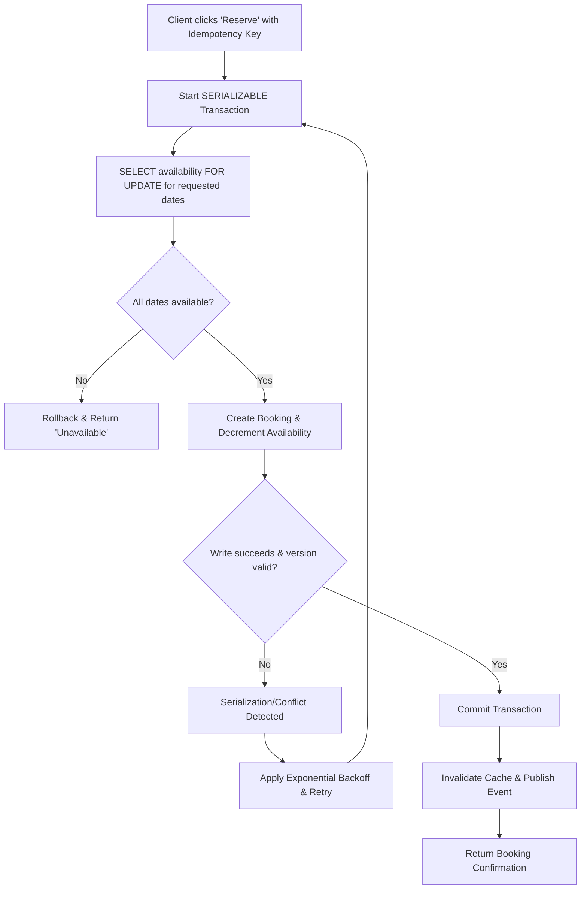

| Difficulty | Channel | Tags |
|---|---|---|
| intermediate | database | acid, isolation-levels, mvcc |

It was the click heard around the system. With millions of travelers attempting to snag their dream stays at any given moment, a single misstep in concurrency can spiral into chaos. For Airbnb, this nightmare materialized in their payments platform as a scaling wave collided with network timeouts and double-click happy users. The result? A race to process the same payment twice, risking double charges for guests and double payouts for hosts [1]. Much like double bookings, this was no fluke of bad luck, but a textbook case of concurrency gone rogue. So, what does it take to guarantee consistency at scale, all whilst keeping your product lightning fast?

---

> ### Real-World Case — Airbnb
>
> As Airbnb scaled its payments platform on a service-oriented architecture, concurrent booking flows created race conditions: double-clicks, aggressive client retries, and ambiguous network timeouts could process the same payment request multiple times, risking double charges to guests and double payouts to hosts. The same TOCTOU race that causes double bookings plagued the money-movement path that sits behind every reservation.
>
> | | |
> |---|---|
> | **Challenge** | Guarantee exactly-once payment processing across distributed services under concurrency, without sacrificing the ultra-low latency bookings require, and without every product team hand-rolling data-integrity logic. |
> | **Solution** | Airbnb built Orpheus, an idempotency framework that requires every API call to acquire a database row-level lock on a unique idempotency key, granting a time-limited lease so only one in-flight request can proceed. Requests are split into three atomic phases (pre-RPC, RPC, post-RPC) with no network calls inside transactions, retries use exponential backoff with jitter, and all idempotency state is read/written exclusively against the sharded master MySQL database—never replicas—because replica lag could make a correct retry look like a never-executed payment. The key tables were sharded by idempotency key to handle scale. |
> | **Outcome** | Achieved 99.999% (five nines) payment consistency while annual payment volume doubled; the pattern was later rebuilt into Airbnb's payment orchestration layer where every major workflow is a DAG of retryable idempotent steps. |
> | **Lesson** | Row-level locks plus idempotency keys turn ambiguous distributed failures into safe retries—but consistency-critical state must live on the master, not read replicas: a few seconds of replica lag converts a correct retry into a double charge. Availability checks and caches can be eventually consistent; the booking write boundary cannot. |

---

## Hook — The Clock Is Ticking

Picture this: you are milliseconds away from confirming a booking. Another user, across the globe, also just clicked "Reserve" on that exact same property for the exact same weekend. In a perfectly isolated world, only one of them would walk away with the keys. In the real world, without the correct safeguards, you could both end up with a receipt. This is the ticking time bomb that plagues any high demand, reservation based system. These race conditions are not a product of malice, but of physics. Networks are unreliable, clients retry aggressively and humans love to double click. The stakes? Trust. Once a user is charged for a property that was never secured, that trust is incredibly difficult to earn back.

## Problem — The Unforgiving Race Condition

So, why does this happen? The root of the issue lies within the gap between "checking" and "acting". This infamous window, more formally known as TOCTOU (Time-of-Check to Time-of-Use) [2], is what allows two transactions to both see availability, before either has committed a change. These operations violate the guarantees that developers rely on to reason about their data. Without enforcing ACID (Atomicity, Consistency, Isolation, Durability) properties [3], your database can no longer prevent these conflicts, especially when operating at the scale of thousands of concurrent bookings. Therefore, the problem isn't your code's speed, it's your code's inability to enforce mutual exclusion during the critical booking window. The question then becomes: how can you enforce this, without grinding your availability to a halt?

## Real-World Case — Airbnb

This battle was fought first hand at Airbnb. As their payments platform evolved into a service-oriented architecture, the same TOCTOU race that threatens double bookings began to plague their money-movement flows. Concurrent flows, double-clicks, aggressive client retries and ambiguous network timeouts all conspired to process the same payment request multiple times [1]. The consequences were dire, risking double charges for guests and double payouts for hosts. Rather than sacrificing availability, Airbnb's engineering teams rebuilt their payment orchestration layer to treat every major workflow as a DAG of retryable, idempotent steps. The results spoke for themselves, achieving 99.999% (five nines) payment consistency, all while annual payment volume doubled [1]. This was not a band-aid fix. It was a fundamental re-architecture that still powers their systems to this day.

## Deep Dive — The Tools to Prevent the Race

Building on Airbnb's success, preventing double bookings requires a two pronged approach: correct isolation at the database level, paired with the correct concurrency strategy in your application. For the critical booking transaction, the gold standard is SERIALIZABLE isolation [4]. In systems such as PostgreSQL, SERIALIZABLE transactions detect conflicts between concurrent transactions and will abort one of them, preventing anomalies without forcing a global lock. However, detection alone is not enough. To minimize contention, many teams opt to pair this with row-level locking. PostgreSQL's `SELECT ... FOR UPDATE` allows you to lock specific rows (such as an availability record for a property and date range) prior to modification [5]. These locks, when combined with Multi-Version Concurrency Control (MVCC) [6], allow for high throughput reads, whilst still guaranteeing exclusive access for writers. Optimistic concurrency control (OCC) is another powerful tool to utilize. By adding a version column to your rows and enforcing `version = expected_version` on updates, you can detect stale writes without holding locks for the entirety of a long running request. It's fast, it's scalable and it's perfect for hot paths where conflicts are rare, but catastrophic when they occur. Lastly, for any action that can be retried (such as the booking request itself), idempotency is non-negotiable. A unique key per client request prevents a retried network call from creating a second reservation [1].

## Workflow — Orchestrating A Safe Booking

With the theory under our belt, you can apply this to a production safe workflow. This process, visualized in the diagram below, is designed to be both safe and available: 

**Step 1: Request Identification** - Assign an idempotency key to the booking attempt (e.g. `request_id`) before any database operations. This prevents retries from spawning duplicates [1]. 

**Step 2: Load With Intent To Write** - Within a SERIALIZABLE transaction, fetch the availability records for the requested dates using `SELECT ... FOR UPDATE`. This locks those specific rows, preventing other transactions from modifying them [5]. 

**Step 3: Validate** - Check that all requested dates are still open for booking. This is your guard against TOCTOU, as the locked state now reflects reality [2]. 

**Step 4: Reserve Atomically** - Decrement availability, create the booking record and increment the row version (if using OCC). If the version mismatches due to a concurrent write, abort and retry [6]. 

**Step 5: Commit Or Retry** - If validation passes and the write succeeds, commit the transaction. If a serialization conflict or lock timeout is detected, catch the error, apply exponential backoff [7] and retry from step 2 with the same idempotency key. 

**Step 6: Notify & Invalidate** - On success, publish an event, invalidate any cached availability and return the confirmed booking. This ensures downstream services remain consistent without reintroducing a race.

## Code Example — Putting It Into Practice

Theory is great, but code is what prevents double bookings. Below is a production-inspired, Python based implementation that combines `SELECT ... FOR UPDATE`, SERIALIZABLE isolation, idempotency and retry logic with exponential backoff. These are the exact building blocks that power reservation systems at scale.

## Lessons Learned — The Battle Scars To Avoid

After surviving the race condition war, there are a few scars that every developer should carry with them to avoid reliving it. 

- **Contention is a feature tradeoff.** Not everything needs SERIALIZABLE. Reserve it for your critical paths (bookings, payments, inventory depletion). For availability reads, utilize read replicas and MVCC snapshots for massive scalability [6]. 
- **Locks are a last resort, not a default.** Overusing `SELECT ... FOR UPDATE` on hot rows will create convoying. Pair them with date-range locks, partitioning, or optimistic concurrency to spread the load [5]. 
- **Retries are required.** At scale, serialization failures and deadlocks are inevitable. Implement retry logic with exponential backoff and jitter to prevent thundering herds, all whilst preserving idempotency [7]. 
- **Cache with extreme caution.** Caching availability is a massive win for latency, however, a stale cache is the perfect accomplice to a double booking. Always invalidate on commit, utilize versioned keys and be wary of read-modify-write patterns. 
- **Measure everything.** Monitor for lock contention, serialization abort rates, P99 latency and idempotency hits. As Airbnb proved, you can double your volume whilst increasing consistency, but only if you measure it [1]. 

Most importantly, remember this: preventing races isn't about slowing down, it's about codifying the rules of "who gets it first" in a way that even a retrying, double clicking user cannot break. Sound familiar? Chances are, if you're scaling any finite resource, it's already happening to you.

---

## Safe Booking Transaction Flow

<strong>Original Interview Question</strong>

**Q:** You're building a booking system for Airbnb where multiple users can reserve the same property simultaneously. How would you design the transaction handling to prevent double bookings while maintaining high availability?

**A:** Use SERIALIZABLE isolation with optimistic concurrency control. Implement row-level locks on property availability tables, use MVCC snapshot reads for checking availability, and apply application-level validation to ensure atomic booking operations.

## Conclusion

The double booking isn't a product of incompetence, it's a product of concurrency. From the race to secure a weekend getaway, all the way down to the movement of money behind it, the same TOCTOU trap lurks in the shadows of any high-demand system. However, as Airbnb proved firsthand, you do not need to sacrifice availability to guarantee consistency [1]. By pairing SERIALIZABLE transactions with `SELECT ... FOR UPDATE`, utilizing optimistic concurrency control with versioning [6], and hardening your critical paths with idempotency and exponential backoff retries [7], you can eliminate these races without grinding your system to a halt. The lesson is simple: don't trust the check. Trust the lock, trust the version, and trust a retry-safe, idempotent write. The next time your "Reserve" button goes viral, you can sleep soundly knowing that only one person is getting that confirmation email.

---

## References

1. [Airbnb incident report](https://medium.com/airbnb-engineering/avoiding-double-payments-in-a-distributed-payments-system-2981f6b070bb) — article
2. [Time-of-check to time-of-use](https://en.wikipedia.org/wiki/Time-of-check_to_time-of-use) — documentation
3. [ACID](https://en.wikipedia.org/wiki/ACID) — documentation
4. [Transaction Isolation (PostgreSQL Documentation)](https://www.postgresql.org/docs/current/transaction-iso.html#XACT-SERIALIZABLE) — documentation
5. [SELECT ... FOR UPDATE/SHARE (PostgreSQL Documentation)](https://www.postgresql.org/docs/current/sql-select.html#SQL-FOR-UPDATE-SHARE) — documentation
6. [Multiversion concurrency control](https://en.wikipedia.org/wiki/Multiversion_concurrency_control) — documentation
7. [Exponential backoff](https://en.wikipedia.org/wiki/Exponential_backoff) — documentation
8. [Isolation (database systems)](https://en.wikipedia.org/wiki/Isolation_(database_systems)) — documentation

---

**Author:** Satishkumar Dhule — [GitHub](https://github.com/satishkumar-dhule) · [LinkedIn](https://linkedin.com/in/satishkumar-dhule) · [Website](https://satishkumar-dhule.github.io)
