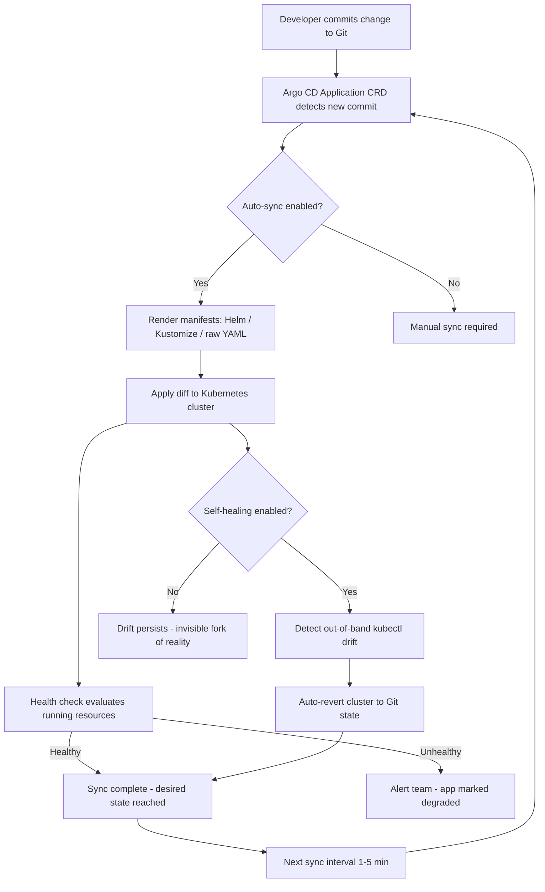

| Difficulty | Channel | Tags |
|---|---|---|
| beginner | devops | argocd, flux, declarative |

Adobe's internal deployment platform, Moonbeam, had become a monster. Hundreds of engineering teams depended on it, yet it was increasingly difficult to scale, secure, and operate. In the second half of 2024, Adobe launched a bold effort to replace it entirely with Flex — a GitOps-based delivery platform built on Kubernetes and the Argo ecosystem. The result: 10,400 pipelines migrated or decommissioned, over 6,000 services now managed across nearly 50,000 environments, and roughly 80% of stale or abandoned services retired [1]. That is not a refactor. That is a reinvention. And the engine behind it was Argo CD, silently reconciling Git with reality. If you are setting up GitOps for microservices today, the same tools Adobe used are available to you. The question is whether you will configure them to protect you — or leave yourself open to the same chaos Moonbeam became.

---

> ### Real-World Case — Adobe
>
> Adobe operated an internal deployment platform called Moonbeam (Containers as a Service) that had become increasingly difficult to scale, secure, and operate across hundreds of engineering teams. In 2H 2024, they launched a focused effort to replace it with Flex, a GitOps-based delivery platform built on Kubernetes and the Argo project ecosystem (Argo CD, Argo Workflows, Argo Events, Argo Rollouts).
>
> | | |
> |---|---|
> | **Challenge** | Legacy imperative, queue-based deployment workflows across 10,400 pipelines and hundreds of teams caused configuration drift, slow rollbacks, poor auditability, and mounting security and compliance debt. Mandating migration alone failed to drive adoption, and early migration tooling was inadequate, creating real friction for engineering teams. |
> | **Solution** | Adobe made Git the single source of truth with declarative infrastructure and application definitions, then used Argo CD's automated reconciliation to continuously align running environments with approved state in source control. They built a self-service migration interface backed by Argo Workflows orchestration with start/pause/resume lifecycle controls, integrated onboarding, service registration, secrets management, and deployment guardrails into one governed platform. |
> | **Outcome** | 10,400 pipelines migrated or decommissioned; Flex now manages over 6,000 services across nearly 50,000 environments including nearly 19,000 production environments supporting 3,300+ production services; 100+ teams and 3,000+ developers onboarded; substantial infrastructure cost savings from retiring roughly 80% of previously identified stale, duplicate, or abandoned services. |
> | **Lesson** | Two counterintuitive lessons: (1) mandates and end-of-life deadlines do not drive lasting adoption — concrete GitOps value (declarative delivery, automated reconciliation, auditability, faster rollbacks) does; (2) a large-scale platform migration is also an unexpected platform-hygiene forcing function, surfacing thousands of forgotten services whose retirement alone justified much of the effort. Adobe also regrets not investing in end-to-end self-service migration tooling from day one instead of relying on standalone scripts. |

---

## Hook — The 2 AM Page That Never Should Have Happened

Picture this: a developer on your team needs a quick config tweak before a launch. They run a single kubectl edit against the cluster. It works. Ship goes out. Everyone celebrates. Three weeks later, a junior engineer spins up a fresh environment from your "source of truth" in Git — and the service crashes. Why? Because that one manual kubectl command never made it back into Git. The cluster and the repository have silently diverged, and nobody notices until production does the noticing for you. This is configuration drift, and it is the quiet killer of microservices platforms. You might think a few manual edits are harmless. But multiply that by 50 developers, 100 services, and 1,000 environments, and you have the exact spiral that consumed Adobe's Moonbeam platform — a system so full of undocumented manual state that it became impossible to reason about [1]. The fix is not more discipline. The fix is a system that does not care whether humans are disciplined.

## Problem — Why kubectl Alone Cannot Scale Across Hundreds of Teams

The imperative approach to Kubernetes — running kubectl commands to push changes directly into a cluster — works beautifully in one environment with one engineer. Then your company grows. Here is the tension: every kubectl apply, kubectl edit, or helm upgrade that bypasses Git creates a tiny, invisible fork of reality. No audit trail. No review. No rollback path except tribal memory. Consequently, you end up with environments that claim to run the same manifests but behave completely differently. The stakes climb with every microservice added. When a security patch lands in Git, how do you prove it reached all 47 of your clusters? When an outage hits, how do you diff what is running against what should be running? Many developers discover this gap only after their first major incident, when the post-mortem reveals that production was running a config that existed nowhere in version control. Adobe faced this at platform scale: Moonbeam's sprawl made it nearly impossible to enforce consistency across hundreds of teams [1]. The core problem was never that engineers were careless. The problem was that the system allowed a second source of truth to exist — the live cluster itself. If Git is supposed to be the source of truth, then anything that lets reality drift away from Git without reconciliation is a liability.

## Real-World Case — Adobe Replaces Moonbeam with Flex

Adobe's Moonbeam platform — their Containers as a Service offering — had served the company well, but by 2024 it had accumulated the classic symptoms of imperative sprawl at scale: difficult to scale, difficult to secure, and difficult to operate across hundreds of engineering teams. In 2H 2024, Adobe began the deliberate replacement of Moonbeam with Flex, a GitOps-native delivery platform built on Kubernetes and the full Argo project stack: Argo CD for continuous delivery, Argo Workflows for CI pipelines, Argo Events for event-driven automation, and Argo Rollouts for progressive delivery [1]. The numbers are staggering. 10,400 pipelines were migrated or decommissioned. Flex now manages over 6,000 services across nearly 50,000 environments, including close to 19,000 production environments supporting 3,300+ production services. Over 100 teams and 3,000+ developers have onboarded. And perhaps most tellingly, retiring roughly 80% of previously identified stale, duplicate, or abandoned services delivered substantial infrastructure cost savings [1]. That 80% figure deserves a second look. It means the old platform had accumulated an enormous graveyard of zombie services — things nobody knew were still running. This is the operational tax of a system where the live cluster, not Git, becomes the de facto source of truth. Flex's GitOps model forced every service to declare itself in Git or cease to exist. The cleanup was not a one-off project; it was a natural byproduct of the architecture. When you make Git the only door into production, abandoned services have nowhere to hide.

## Deep Dive — Declarative vs Imperative: The Real Tradeoff

Building on Adobe's experience, the technical choice underneath all of this is simple to state and hard to internalize: declarative or imperative. The imperative approach commands the cluster to do something right now. kubectl scale deployment/api --replicas=5 works, and it works instantly. But it tells you nothing about how you got to five replicas, and Git knows nothing about it either. The declarative approach inverts the relationship. You describe the desired state — five replicas, this image tag, these resource limits — in YAML manifests, Helm charts, or Kustomize overlays committed to Git. Argo CD then continuously compares the live cluster state against that declared state and reconciles any differences [2]. Here is the nuance many developers miss: declarative does not mean infrequent. Argo CD's Application CRD supports auto-sync with configurable health check intervals, commonly set between 1 and 5 minutes [3]. Self-healing goes further, automatically reverting any manual kubectl change that drifts from the declared state. In other words, the platform fights back against imperative accidents. The tradeoffs become clear when you map them:

## Workflow — How Argo CD Actually Reconciles Git with Your Cluster

The reconciliation loop is where GitOps stops being a philosophy and becomes machinery. Here is the step-by-step flow: 1. A developer commits a change to the Kubernetes manifests, Helm chart, or Kustomize overlay in Git. 2. Argo CD's Application CRD — a custom resource pointing at the Git repository, target branch, and destination cluster — detects the new commit [3]. 3. Auto-sync kicks in on the configured interval (typically 1–5 minutes) and applies the diff to the cluster [3]. 4. Health checks assess whether the applied resources are actually functioning, not merely present. 5. If self-healing is enabled, any out-of-band manual change is detected as drift and automatically reverted to match Git [3]. 6. Rollback is trivial: revert the Git commit, and Argo CD reconciles again. The diagram below visualizes this loop end-to-end.

## Code Example — A Production-Grade Argo CD Application with Self-Healing

Below is a realistic Argo CD Application manifest paired with a small Kustomize overlay structure — the exact pattern used across many GitOps platforms, including the kind of GitOps-native stack Adobe built with Flex [1]. The comments walk through each decision.

## Lessons Learned — Battle Scars and What to Do Tomorrow

Adobe's migration proves that GitOps is not a toy pattern for small teams — it is the architecture that lets you manage 6,000 services across 50,000 environments without losing your mind [1]. Here are the battle scars worth learning from before they become yours. First, start with auto-sync disabled in a staging environment. Enabling auto-sync before your manifests are clean will cause Argo CD to aggressively fight you during the migration itself. Get the Git state correct first, then flip the switch. Second, never disable self-healing in production. It feels comforting during the first week — "we can still emergency-fix with kubectl" — but that safety hatch is exactly how Moonbeam-style drift accumulated [1]. Instead, use Argo CD's sync windows and ApplicationSets to control when and where changes land. Third, treat the 80% cleanup insight seriously. Audit your clusters for services that no Git commit claims. Adobe found enormous cost savings by simply making Git the arbiter of existence [1]. If a service is not in Git, it should not be in the cluster. Fourth, embrace Helm and Kustomize together rather than choosing a religion. Application CRDs can pull Helm charts, raw YAML, or Kustomize overlays — the key is that the rendered output is what Git stores and Argo CD reconciles [2]. Finally, here is the memorable insight to take to your team: the goal of GitOps is not to eliminate human judgment — it is to eliminate human *accidents*. Every kubectl edit is a judgment call wrapped in an irreversible side effect. Git wraps that same judgment in a pull request, an audit log, and a one-line rollback. Adobe did not just replace a platform; they replaced an operating model. You do not need 3,000 developers to deserve the same guarantee.

---

## Argo CD GitOps Reconciliation Loop

<strong>Original Interview Question</strong>

**Q:** You're setting up GitOps for a microservices deployment. How would you configure ArgoCD to automatically sync changes from your Git repository to Kubernetes, and what's the difference between declarative and imperative approaches in this context?

**A:** I'd configure ArgoCD by setting up a Git repository containing Kubernetes manifests or Helm charts, creating an Application CRD that points to the Git repository, enabling auto-sync with a health check interval of 3 minutes, and implementing self-healing to automatically revert any manual changes. The declarative approach involves defining the desired state in Git through YAML manifests, Helm charts, or Kustomize configurations, where ArgoCD continuously reconciles the actual state with the desired state. In contrast, the imperative approach uses kubectl commands to make direct changes to the cluster, bypassing the Git repository as the single source of truth.

## Conclusion

Adobe did not fix Moonbeam with better documentation or stricter policies. They replaced an imperative operating model with a declarative one, retiring 10,400 pipelines and 80% of zombie services in the process [1]. The same primitives — an Application CRD, auto-sync, self-healing, and Kustomize overlays — are available to any team running Argo CD today [3]. The actionable step is small: pick one non-critical service this week, codify its full desired state in Git, enable auto-sync with self-heal, and deliberately try to break it with a kubectl edit. Watch Argo CD revert it. That five-minute experiment is worth more than any architecture review. The insight worth sharing with your team is simple: GitOps does not make your engineers more disciplined — it makes discipline unnecessary. When Git is the only door into production, the system enforces the audit trail, the rollback path, and the single source of truth whether anyone remembers to or not.

---

## References

1. [Adobe incident report](https://www.cncf.io/case-studies/adobe/) — article
2. [Kubernetes Documentation](https://kubernetes.io/docs/concepts/) — documentation
3. [Argo CD Documentation](https://argo-cd.readthedocs.io/en/stable/) — documentation
4. [Argo Workflows](https://argoproj.github.io/argo-workflows/) — documentation
5. [Argo Rollouts Documentation](https://argoproj.github.io/argo-rollouts/) — documentation
6. [CNCF Argo Project](https://www.cncf.io/projects/argo/) — documentation
7. [Kustomize GitHub Repository](https://github.com/kubernetes-sigs/kustomize) — documentation
8. [Helm Documentation](https://helm.sh/docs/) — documentation

---

**Author:** Satishkumar Dhule — [GitHub](https://github.com/satishkumar-dhule) · [LinkedIn](https://linkedin.com/in/satishkumar-dhule) · [Website](https://satishkumar-dhule.github.io)
