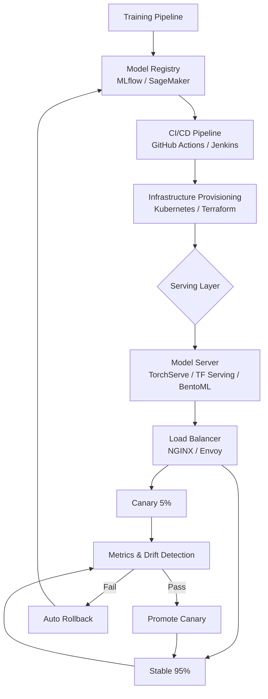

| Difficulty | Channel | Tags |
|---|---|---|
| beginner | devops | mlops, deployment |

By the mid-2010s, Uber was drowning in its own ML success. Hundreds of models powered everything from ETA predictions to surge pricing, yet every team rolled their own training, packaging, and inference stack. The result: inconsistent rollouts, glacial iteration, and unreliable predictions at planetary scale [1]. Their fix — the Michelangelo platform — eventually served millions of predictions per second across thousands of models with p99 latencies in the tens of milliseconds [1]. The secret wasn't a better model. It was understanding a distinction most engineers blur: model deployment is not model serving. Confuse the two, and your 2am pager will educate you — expensively.

---

> ### Real-World Case — Uber
>
> By the mid-2010s, Uber had hundreds of ML use cases (ETA, surge pricing, rider-driver matching, fraud detection) running across disparate systems. Each team was building ad-hoc training, packaging, and inference paths, leading to inconsistent rollouts, slow iteration, and unreliable production predictions at massive scale.
>
> | | |
> |---|---|
> | **Challenge** | Uber needed a unified ML platform that could safely deploy, version, and serve thousands of models in production while meeting strict real-time latency (sub-100ms) and ultra-high throughput demands across CPU and GPU-backed inference workloads. |
> | **Solution** | Uber built Michelangelo, which explicitly separates model deployment from model serving. The deployment layer (model lifecycle, CI/CD, validation, artifact registry, canary/shadow rollouts, rollback) promotes trained models into production via versioned artifacts and feature compatibility checks. The serving layer (a high-throughput prediction service, containerized model servers, request routing, batch prefetching, autoscaling, and traffic splitting) loads versioned artifacts and serves inference with strong isolation. It supports both real-time and batch, A/B experiments, and horizontal scaling on Kubernetes with GPU-aware bin-packing and batching to amortize cost. |
> | **Outcome** | Michelangelo scaled to serve at peak on the order of millions of predictions per second across thousands of production models with p99 latencies in the tens of milliseconds for latency-sensitive use cases. It enabled teams to ship models much faster with safer, governed rollouts (shadow/canary/A-B) and became the backbone for core Uber products at global scale. |
> | **Lesson** | Treating 'deployment' (infrastructure, artifact promotion, validation, rollout policy, rollback) and 'serving' (runtime inference, routing, version loading, autoscaling, latency/throughput optimization, cold-start mitigation) as separate layers is critical to achieving both engineering velocity and production SLOs at hyper-scale. |

---

## Lessons Learned — What to Do Differently Tomorrow

The Uber story is not an outlier. It is the inevitable outcome of letting deployment and serving blur together at scale [1]. Here is what to take to your team:

- **Draw the boundary explicitly.** Deployment owns the artifact lifecycle. Serving owns the runtime path. Different owners, different SLAs, different dashboards.
- **Pin model versions in the serving layer.** Never trust a "latest" tag in production. Ever. [2]
- **Invest in shadow and canary before you invest in more unit tests.** They catch distributional regressions that static tests never will [1].
- **Monitor both halves.** Pipeline health metrics and runtime inference metrics answer different questions during an incident [8].
- **Automate rollback.** If rollback requires a human at 3am, your system is not production-ready.

⚠️ **Watch Out:** The most common battle scar is a serving pod that silently caches an old model after a rolling update. Fix it by making the health endpoint report the actual loaded model version, and have the CI pipeline assert on it before declaring success.

🔥 **Hot Take:** Most "MLOps" vendor stacks sell you deployment tooling and call it done. Without a purpose-built serving layer — dynamic batching, canary routing, warm pools — you will hit a latency wall the moment traffic triples.

🎯 **Key Point:** You do not need Michelangelo's scale to benefit from Michelangelo's architecture. Even a two-model canary on a single Kubernetes node is an order of magnitude safer than a monolithic deploy-and-pray script.

If this feels overwhelming, you are not alone. Start with one boundary: put a model registry between training and serving this week. That single seam will change how your team thinks about shipping ML.

---

## ML Deployment vs. Serving Architecture

<strong>Original Interview Question</strong>

**Q:** Explain the key differences between model serving and model deployment in ML systems, including specific technologies, scaling considerations, and real-world implementation patterns?

**A:** Deployment encompasses CI/CD pipelines, infrastructure setup, and monitoring using tools like Kubernetes, MLflow, and SageMaker. Serving focuses on runtime inference APIs with frameworks like TensorFlow Serving, TorchServe, or BentoML, handling request routing, model versioning, and autoscaling. Key trade-offs include latency vs throughput, batch vs real-time inference, and cold start optimization.

## Conclusion

Deployment and serving are not two phases of the same process. They are two systems that happen to share a model artifact. Uber learned this the hard way across hundreds of use cases before Michelangelo made the separation explicit [1]. You do not need a platform team of fifty to apply the lesson. Start by drawing one seam: put a versioned model registry between your training pipeline and your inference runtime, then make your serving layer report exactly which version it has loaded. That single boundary turns a deploy-and-pray script into a system you can reason about at 3am — and that is the difference between shipping ML models and running an ML platform.

---

## References

1. [Uber — Michelangelo: Uber's Machine Learning Platform](https://www.uber.com/blog/michelangelo-machine-learning-platform/) — article
2. [Wikipedia — MLOps](https://en.wikipedia.org/wiki/MLOps) — documentation
3. [PyTorch Serve (TorchServe) GitHub Repository](https://github.com/pytorch/serve) — documentation
4. [TensorFlow Serving GitHub Repository](https://github.com/tensorflow/serving) — documentation
5. [BentoML GitHub Repository](https://github.com/bentoml/BentoML) — documentation
6. [Kubernetes Documentation — Workloads and Controllers](https://kubernetes.io/docs/concepts/workloads/) — documentation
7. [Envoy Proxy GitHub Repository](https://github.com/envoyproxy/envoy) — documentation
8. [AWS SageMaker Developer Guide — What Is Amazon SageMaker?](https://docs.aws.amazon.com/sagemaker/latest/dg/whatis.html) — documentation
9. [MLflow GitHub Repository](https://github.com/mlflow/mlflow) — documentation
10. [FastAPI Documentation](https://fastapi.tiangolo.com/) — documentation

---

**Author:** Satishkumar Dhule — [GitHub](https://github.com/satishkumar-dhule) · [LinkedIn](https://linkedin.com/in/satishkumar-dhule) · [Website](https://satishkumar-dhule.github.io)
