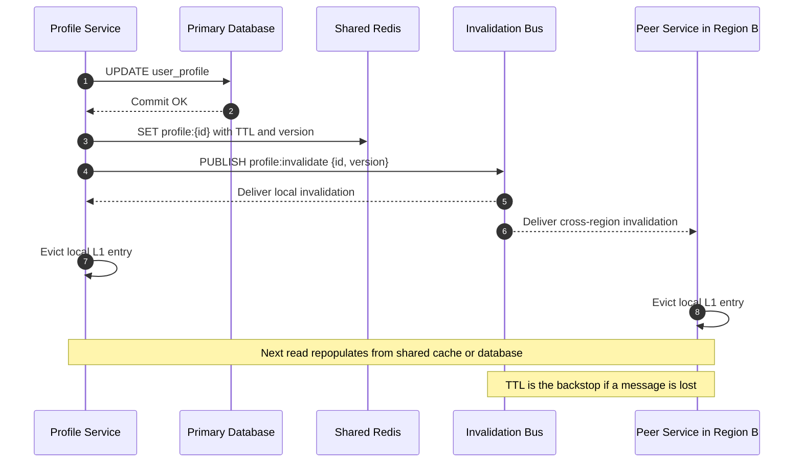

| Difficulty | Channel | Tags |
|---|---|---|
| beginner | backend | redis, memcached, cache-invalidation |

Netflix's EVCache system stores hundreds of billions of objects across tens of thousands of Memcached nodes in three AWS regions, yet a profile update in one region can ripple through the others in about one second [1]. That number is not the result of buying faster hardware; it is the result of treating cache invalidation as a first-class distributed systems problem. For anyone building a user profile service, the same question appears at a much smaller scale: when a user edits their name, avatar, or preferences, how do you stop every cache node from serving the old version? The answer is less about picking Redis or Memcached and more about designing an invalidation protocol you can actually trust.

---

> ### Real-World Case — Netflix
>
> Netflix needed to cache frequently accessed user profile and viewing data across a global microservice architecture spanning multiple AWS regions. Their EVCache system (built on Memcached) scaled to hundreds of billions of objects across tens of thousands of memcached instances, handling upwards of 30 million requests per second at peak. When a user updates their profile or viewing state, that stale key exists in cache clusters in every AWS region — and Memcached has no built-in pub/sub or cross-node coordination to propagate the invalidation.
>
> | | |
> |---|---|
> | **Challenge** | Cache invalidation across a globally distributed Memcached fleet. Memcached offers no native pub/sub, persistence, or multi-node coordination, so a profile write in one region would leave stale copies in every other region until TTL expiry — causing users to see outdated profiles or recommendations for potentially hours. They also needed to avoid the cost and latency of replicating full cache values across continents. |
> | **Solution** | Netflix built a Kafka-based cross-region replication pipeline into EVCache. On a cache write, the client publishes only the key metadata (not the value) to Kafka; a Replication Relay in the source region fetches the value from the local cache and forwards it to a Replication Proxy in target regions. Crucially, for invalidation-sensitive data they send only a DELETE for the key across regions rather than the new value — forcing a fresh read-through from the authoritative store (Cassandra/S3) on next access. This is combined with TTLs (Ephemeral by design) as a safety net, since Kafka delivery is not guaranteed and old messages can be dropped when queues fill. |
> | **Outcome** | EVCache sustained 30M+ requests/sec at peak with 99%+ hit rates, storing hundreds of billions of objects across tens of thousands of memcached nodes in 3 AWS regions. Cross-region cache propagation completes within ~1 second at p99. EVCache Moneta (SSD tier) reduced cluster sizes by over 60% for personalization workloads, cutting storage costs significantly while maintaining ~1ms SLA latency at 100K RPS per cluster. |
> | **Lesson** | Memcached's simplicity is a feature for pure caching but forces you to build your own distributed invalidation layer — and the cheapest invalidation is often a DELETE, not a value push. Replicating a delete across regions is cheaper, safer, and avoids the 'store keys for entire TTL duration' cost problem Netflix hit with their original Kafka approach. TTLs remain the essential safety net when your invalidation channel (Kafka) provides no delivery guarantees. |

---

## Hook — One Stale Field, Three Regions, Zero Warnings

At 8:47 p.m. on a Friday, a customer updates their profile photo. The request hits a service in the eastern region, writes to the primary database, and returns a cheerful 200 OK. Within seconds, the mobile app shows the new image. The web app, routed to a different data center, still shows the old one. Then a support ticket arrives: a user's old email address is visible on a public profile page long after they changed it.

Nothing crashed. No alarm fired. The database is correct. The cache is wrong. That gap between correct storage and incorrect presentation is where cache invalidation lives, and it is one of the most quietly dangerous problems in backend engineering.

The stakes are higher than a cosmetic mismatch. Stale profile data can expose old contact details, break personalization, corrupt downstream analytics, and erode user trust. Yet the fix is not as simple as calling delete after every update. You need to answer harder questions: Which cache nodes need to hear about the change? What happens if the message never arrives? How long is stale data acceptable? And what does the choice between Redis and Memcached actually cost you?

Many developers discover that cache invalidation is not a feature they add once. It is a protocol they operate forever. The rest of this story is about building that protocol without losing sleep.

## Problem — The Second Copy of the Truth

Every cache creates a second copy of the truth [2]. For a user profile service, the database is the source of record, and the cache is a fast approximation. The moment those two copies disagree, every read becomes a gamble.

The naive implementation writes to the database and then writes to the cache in the same function. It feels atomic because the code is sequential, but the network is not. The database commit can succeed while the cache write times out. A retry can write an older value after a newer one. Two concurrent updates can interleave so that the cache ends up holding the loser of the race. This is the dual-write problem, and it is the reason production systems rarely trust a simple set-and-hope strategy [5].

A safer default is to delete the cache key on update rather than overwrite it. The next read misses, fetches the current value from the database, and repopulates the cache. This is the cache-aside pattern, and it is popular because it keeps the cache from becoming a second source of truth [6]. The trade-off is a temporary miss and a burst of database traffic, which is exactly why teams add TTLs and request coalescing.

TTL is the safety net, not the strategy. A five-to-thirty-minute TTL bounds how long a stale profile can survive, but it does not tell you why the stale value appeared. If the invalidation path is broken, TTL quietly hides the bug until traffic grows and the window becomes unacceptable.

Then the problem multiplies. One cache becomes forty. Forty becomes three regions. A mobile client keeps its own in-memory copy. Now invalidation is a distributed messaging problem wearing a caching costume, and the hardest part is not the first node. It is the node you forgot existed.

## Real-World Case — Netflix and EVCache

Netflix did not avoid this problem by choosing a different cache. The company built EVCache on top of Memcached and scaled it to hundreds of billions of objects across tens of thousands of Memcached instances, handling upwards of 30 million requests per second at peak with 99%+ hit rates [1]. Those numbers are impressive on their own, but the interesting part is what happens on a write.

When a user updates their profile or viewing state, a stale key can exist in cache clusters in every AWS region. Memcached has no built-in pub/sub and no cross-node coordination to propagate the invalidation [3]. That is not a minor limitation at Netflix's scale; it is an architectural constraint that has to be solved outside the cache itself. EVCache wraps Memcached with routing, replication, and invalidation tooling so that cross-region cache propagation completes within roughly one second at p99 [1].

The engineering payoff is visible in the numbers. EVCache Moneta, an SSD-backed tier, reduced cluster sizes by more than 60% for personalization workloads, cutting storage costs significantly while maintaining a roughly 1 ms SLA at 100,000 requests per second per cluster [1]. In other words, Netflix kept Memcached's raw speed and low memory overhead, then paid complexity at the orchestration layer to get the invalidation behavior the application needed.

That is the uncomfortable lesson. The cache did not solve the distributed problem. The team did. EVCache is a reminder that at scale, the cache is only one component of a larger consistency system, and the invalidation protocol deserves the same design attention as the data model.

## Deep Dive — Redis vs Memcached Is the Wrong First Question

The first fork in the road is not Redis versus Memcached. It is write-through versus cache-aside. Write-through updates the database and the cache together, which keeps the cache warm but introduces dual-write failure modes [5]. Cache-aside reads from the database on a miss and populates the cache, which is simpler to reason about but can create a cold-start penalty after invalidation [6].

The second fork is delete versus update. Deleting a key is usually safer because it avoids writing a value that may already be outdated by the time it lands. Updating a key can be faster for read-heavy workloads, but only if every writer computes the value identically and every write is ordered. In practice, version numbers or updated-at timestamps are what make ordering visible.

The third fork is TTL. A short TTL reduces the blast radius of stale data but increases database load and miss rate. A long TTL improves hit rate but makes every invalidation bug more expensive. HTTP caching has wrestled with this same freshness trade-off for decades, which is why RFC 7234 separates freshness lifetime from validation [7].

Here is the comparison that actually matters:

| Concern | Redis | Memcached |
|---|---|---|
| Invalidation | Pub/sub and keyspace notifications | No native pub/sub; external bus required |
| Data model | Strings, hashes, sorted sets, streams | Flat key-value only |
| Persistence | Optional snapshots and append-only file | In-memory only |
| Memory overhead | Higher per-key metadata cost | Lower, simpler slab allocator |
| Scaling | Cluster mode, but resharding has sharp edges | Simple sharding, trivially horizontal |
| Best fit | Complex invalidation and mixed workloads | Pure, massive, volatile caching |

Redis wins when invalidation itself is the hard part. Its pub/sub model lets one service broadcast a change and lets every subscriber evict its local copy [4]. Memcached wins when the workload is simple, the dataset is enormous, and the team is prepared to build coordination around it. Netflix chose Memcached and built EVCache because raw cache efficiency mattered more than built-in messaging [1].

There is also the thundering herd. Invalidate a popular profile and a thousand requests may miss at once, hammering the database [9]. The fix is request coalescing, a short stale-while-revalidate window, or a per-key lock. None of these are Redis or Memcached features. They are application responsibilities.

⚠️ Watch Out: A cache that is 99% correct is still wrong for the 1% of users who see old data at the worst possible moment. Hit rate is not a consistency metric.

## Workflow — Designing an Invalidation Protocol

Building on the trade-offs above, a reliable profile cache follows a sequence rather than a single function call. The diagram below traces the write path from database commit to cross-region eviction.

1. Persist the change to the primary database. The database remains the source of truth, and the write must commit before any cache operation is treated as authoritative.
2. Attach a version or updated-at timestamp to the profile. This gives every cache entry and every invalidation message a monotonic ordering signal.
3. Write the new value to the shared cache with a bounded TTL, or delete the key if the read path can repopulate it cheaply. Choose one policy per entity type and document it.
4. Publish an invalidation event containing the entity key and version to a message channel. Redis pub/sub is one option [8]; a dedicated event bus is another when delivery guarantees matter.
5. Have every service instance subscribe and evict its local L1 entry when it sees a newer version. Ignore messages whose version is older than the locally known version to survive out-of-order delivery.
6. On the read path, use cache-aside with request coalescing so a miss does not become a database stampede. Instrument hit rate, invalidation lag, and stale-read rate separately.

Failure handling is part of the workflow, not an afterthought. Pub/sub is typically fire-and-forget, so a subscriber that is down during a publish will miss the message. The TTL is the backstop. For stronger guarantees, publish through a durable queue, reconcile periodically, or use a version check on read. Managed services such as Amazon ElastiCache can reduce operational burden, but they do not remove the need for an invalidation protocol [10].

🎯 Key Point: The invalidation message should describe what changed, not just that something changed. A key plus a version is enough to make eviction idempotent and order-safe.

## Code Example — Write-Through Plus Pub/Sub in Python

The following example combines write-through caching with a pub/sub invalidation channel and a small in-process L1 cache. It is intentionally compact, but it demonstrates the pieces that matter in production: a TTL, a publish on update, and a subscriber that evicts local copies.

The code assumes a shared Redis instance and two placeholder functions for database access. In a real service, those would be your repository methods. The important design decision is that the shared cache is updated with the new value, while peer processes are told to drop their local copy. That keeps the hot path fast without letting local caches drift indefinitely.

## Lessons Learned — What Survives Contact With Production

The journey from a single cache node to a multi-region invalidation protocol teaches a few lessons that apply whether you run three nodes or thirty thousand.

- Delete is usually safer than update. A delete forces the next read to fetch the current truth, while an update can write a value that is already stale [2].
- TTL is a bound on staleness, not a substitute for invalidation. Treat every TTL as a promise about the maximum acceptable delay, and alert when the invalidation path is slower than that promise.
- Version numbers turn races into decisions. Without them, an old invalidation message can arrive after a new one and resurrect stale data.
- Pub/sub is not durable by default. Pair it with a TTL, a durable queue, or a periodic reconciliation job if lost messages are unacceptable [8].
- Memcached is not the wrong choice. It is a different contract: less built-in coordination, lower memory overhead, and a requirement that you own the invalidation layer [3].
- Measure the right thing. Hit rate tells you about efficiency. Invalidation lag p99 and stale-read rate tell you about correctness.

Battle scar one: mass invalidation at deploy time. A cache flush or a key-prefix change can send every request to the database at once. Warm the cache gradually, use jittered TTLs, and coalesce misses [9].

Battle scar two: key version mismatches. One service writes profile:v2 while another reads profile:v1, and the invalidation message targets neither. Centralize key construction in a small library and test it like an API contract.

Battle scar three: treating the cache as a database. If losing the cache causes data loss, the cache is doing a job it was never designed to do. The database owns durability; the cache owns speed.

🔥 Hot Take: Most cache invalidation bugs are not cache bugs. They are ownership bugs. Teams disagree about who is allowed to write the key, and the stale data is just the symptom.

---

## Cache Invalidation Sequence

<strong>Original Interview Question</strong>

**Q:** You're building a user profile service that caches frequently accessed profiles. How would you implement cache invalidation when a user updates their profile, and what trade-offs would you consider between Redis and Memcached?

**A:** Implement write-through caching with TTL-based expiration. On profile update, invalidate the cache by deleting the key and writing new data to both the database and cache. Redis offers pub/sub for automatic distributed invalidation, while Memcached requires manual coordination across nodes.

## Conclusion

Netflix's scale is exceptional, but the lesson is not. Every profile service eventually faces the same moment: the database says one thing, the cache says another, and a user notices. The teams that handle it well do not simply choose Redis over Memcached or set a longer TTL. They design an invalidation protocol with ordering, eviction, retries, and observable lag.

Tomorrow, audit one cache key in your system. Ask who writes it, who invalidates it, what happens when the message is lost, and how long a stale value can survive. If the answer is a shrug and a TTL, there is work to do. Add a version, publish the invalidation, and measure the gap between the database commit and the last cache eviction.

The memorable insight worth sharing with your team: a cache is easy to add and hard to keep honest. Treat invalidation as a distributed system, not a line of code after the database call [1].

---

## References

1. [Netflix incident report](https://netflixtechblog.com/caching-for-a-global-netflix-7bcc457012f1) — article
2. [Cache (computing)](https://en.wikipedia.org/wiki/Cache_(computing)) — documentation
3. [Memcached](https://en.wikipedia.org/wiki/Memcached) — documentation
4. [Redis](https://en.wikipedia.org/wiki/Redis) — documentation
5. [Caching patterns](https://docs.aws.amazon.com/whitepapers/latest/database-caching-strategies-using-redis/caching-patterns.html) — documentation
6. [Cache-Aside Pattern](https://martinfowler.com/bliki/CacheAsidePattern.html) — blog
7. [RFC 7234: HTTP Caching](https://datatracker.ietf.org/doc/html/rfc7234) — documentation
8. [Publish-subscribe pattern](https://en.wikipedia.org/wiki/Publish%E2%80%93subscribe_pattern) — documentation
9. [Cache stampede](https://en.wikipedia.org/wiki/Cache_stampede) — documentation
10. [What is Amazon ElastiCache for Redis?](https://docs.aws.amazon.com/AmazonElastiCache/latest/red-ug/WhatIs.html) — documentation
11. [Memcached source repository](https://github.com/memcached/memcached) — documentation

---

**Author:** Satishkumar Dhule — [GitHub](https://github.com/satishkumar-dhule) · [LinkedIn](https://linkedin.com/in/satishkumar-dhule) · [Website](https://satishkumar-dhule.github.io)
