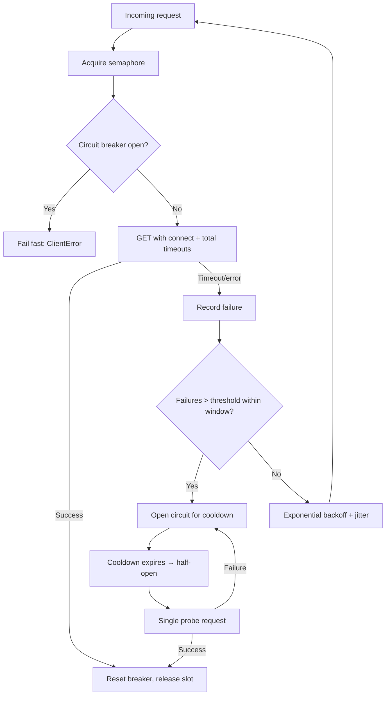

| Difficulty | Channel | Tags |
|---|---|---|
| advanced | backend | asyncio, aiohttp, concurrency |

In 2011, Netflix's API gateway was drowning — over 1 billion incoming calls a day, fanning out at a 1:6 ratio into several billion outgoing calls at peaks of 100k+ dependency requests per second. Then one slow dependency saturated the connection pools, and cascading failures took down the entire API even though every other service was healthy [1]. That catastrophe became the founding story of Hystrix and the discipline of circuit breaking. So here is the question every backend engineer eventually faces: what happens when your Python service pulls the same trick — one sluggish downstream, and your aiohttp connection pool becomes a black hole?

---

> ### Real-World Case — Netflix
>
> Netflix's API gateway served over 1 billion incoming calls per day, fanning out at a 1:6 ratio to several billion outgoing calls (peaks of 100k+ dependency requests/sec) across dozens of backend subsystems. In 2011 the team suffered a series of production incidents where a single slow dependency saturated connection and thread pools, causing cascading failures that took down the entire API even though every other dependency was healthy.
>
> | | |
> |---|---|
> | **Challenge** | A single latent dependency could block requests for seconds and rapidly saturate all available request threads, connection pool slots, and queues. With 30 dependencies each at 99.99% uptime, combined availability was only 99.7% — over 2 hours of downtime per month. The system had no way to isolate one bad dependency or shed load without failing every user request. |
> | **Solution** | Netflix built Hystrix, which combines exactly the patterns behind a resilient aiohttp pool manager: per-dependency thread pools and semaphores (bulkheads) to cap concurrent connections and reject instead of queueing, aggressive network and command timeouts, circuit breakers that trip at a 50% error rate over a rolling window to stop hammering dead services, and fallback logic that gracefully degrades (stale data, defaults, secondary systems) instead of failing fast when possible. Hystrix evolved directly out of these connection/thread-pool saturation incidents. |
> | **Outcome** | Hystrix matured into a library executing tens of billions of thread-isolated and hundreds of billions of semaphore-isolated calls per day at Netflix, with a dramatic improvement in uptime and resilience. The canonical example: 30 dependencies at 99.99% uptime produced 2+ hours/month downtime uncircuited — the warning that motivated isolating every dependency so no single one could saturate shared resources. |
> | **Lesson** | Don't respond to a saturated pool by adding more connections — that's how you DDoS your own backend. The counterintuitive rule: keep connection pools and semaphores small and let the circuit breaker shed load and fail fast so underlying systems can recover. Graceful degradation (fallbacks) plus a semaphore cap and circuit breaker beats endlessly scaling up the pool. |

---

## Hook — The Cascade You Never See Coming

Picture this: your deploy looks fine, dashboards are green, and then a single downstream service starts responding in 8 seconds instead of 80 milliseconds. Because your pool has no circuit breaker and no concurrency ceiling, requests pile up holding connections open. Latency compounds. Retries multiply load. Within minutes, an unrelated service also times out — not because it is broken, but because it shares the same exhausted resources. Sound familiar? This is the classic cascade failure, and the terrifying part is that every individual component technically "works." The failure lives in how they are connected. The lesson from Netflix's 2011 outage is blunt: without isolation, one bad dependency can consume everything shared around it [1]. That is the story this article tells — and the pool manager you will build by the end.

## Problem — Your Pool Is a Shared Buffet With No Bouncer

At its core, a connection pool is a shared resource problem. aiohttp gives you a `ClientSession` with a default connector limit, but defaults are not architecture. Without explicit controls, three things go wrong simultaneously. First, unbounded concurrency: hundreds of coroutines fire requests at once, and the OS file descriptor limit or the remote server's connection limit becomes your new, undocumented ceiling — Python's own docs warn that exceeding descriptor limits raises `OSError` on most systems [2]. Second, retry storms: a naive `try/except` that immediately retries a timeout converts a partial failure into a thundering herd. Third, no feedback loop: the pool never learns that a downstream is unhealthy, so it keeps queuing work into a service that is already drowning. Consequently, you need three orthogonal defenses — limiting concurrency, backing off on retries, and tripping a circuit — because each one catches what the others miss. Many developers discover this only after a 2am pager; the goal here is to skip that initiation ritual.

## Real-World Case — Netflix and the 99.99% Trap

Netflix's numbers make the problem visceral. Their API gateway handled 1B+ daily incoming calls fanning out 1:6 to billions of outgoing calls, peaking above 100k dependency requests per second across dozens of subsystems. In 2011, a series of production incidents showed that one slow dependency could saturate shared connection and thread pools and cascade into a full API outage — despite every other dependency being healthy [1]. The canonical math that motivated their fix: 30 dependencies each at 99.99% availability produce roughly 2+ hours of downtime per month when combined, unless every dependency is isolated so none can saturate shared resources [1]. The remedy, Hystrix, eventually executed tens of billions of thread-isolated and hundreds of billions of semaphore-isolated calls per day at Netflix [1]. The transferable insight for Python teams is that the circuit breaker is not a nice-to-have — it is the mechanism that converts "one dependency is sick" from an outage into a contained, observable degradation. You do not need Netflix's scale to need this pattern; you just need one unreliable third-party API.

## Deep Dive — Three Shields and Their Trade-Offs

Building on Netflix's isolation philosophy, a production-grade aiohttp pool layers three shields, each with real trade-offs. The table below compares them honestly. A **semaphore** is cheap and precise but purely local — it bounds your process, not the remote server's tolerance. **Exponential backoff** absorbs transient failures but, without jitter, synchronized clients retry in lockstep, which is exactly how outages get amplified; the standard remedy is randomized jitter, as codified in RFC 8305's "Happy Eyeballs" guidance and widely adopted retry guidance [3][4]. A **circuit breaker** adds state — closed, open, half-open — and the hard part is choosing thresholds: trip too eagerly and you shed load you could have handled; trip too slowly and you become the cascade. Moreover, timeouts themselves deserve scrutiny: aiohttp distinguishes total, connect, sock-read, and sock-connect timeouts [5], and conflating them is a classic battle scar.

| Defense | What it stops | Failure mode if misconfigured | When you actually need it |
|---|---|---|---|
| Semaphore | Local resource exhaustion, FD limits | Overly tight limits throttle healthy traffic | Any service with concurrent outbound calls |
| Exponential backoff + jitter | Retry storms, thundering herds | Sync retries without jitter amplify outages | Calls to anything with flaky latency |
| Circuit breaker | Cascade into shared pools | Bad thresholds shed good traffic | Any multi-dependency backend |
| Health-checked pruning | Stale keep-alive sockets | Aggressive pruning wastes TCP setup | Long-lived sessions behind load balancers |

⚠️ Watch Out: aiohttp's default `ClientTimeout` is 5 minutes total [5]. In a pool, that single default can hold semaphore slots long enough to deadlock your own throughput.

## Workflow — From Request to Response, With Escape Hatches

The solution follows a fixed decision path: acquire the semaphore, consult the circuit breaker, issue the timed request, then classify the outcome to update breaker state and back off on failure. The flowchart below is the mental model to keep in your head while writing the code. If the breaker is open, the request fails fast — that is the feature, not a bug, because a fast failure releases the semaphore slot instead of parking it behind a dead downstream. After a cooldown, the breaker moves to half-open and lets a single probe request through; success closes it, failure re-opens it [6]. This leads directly to the implementation: every arrow in the diagram becomes a method.



## Code Example — A Pool Manager That Degrades Gracefully

Here is the implementation distilled from everything above. It is intentionally framework-agnostic at the edges so you can drop it into an existing aiohttp service.

```python
import asyncio
import random
import time
from typing import Optional

import aiohttp

class CircuitOpenError(aiohttp.ClientError):
    """Raised fast when the downstream is known-unhealthy."""

class ConnectionPoolManager:
    def __init__(
        self,
        max_connections: int = 100,
        failure_threshold: int = 5,
        reset_timeout: float = 60.0,
    ):
        # Shield 1: bound concurrency so one process can't exhaust FDs [2]
        self.semaphore = asyncio.Semaphore(max_connections)
        self.session: Optional[aiohttp.ClientSession] = None
        # Split timeouts: fail fast on connect, allow more for the body [5]
        self._timeout = aiohttp.ClientTimeout(total=30, connect=5)
        self._failure_threshold = failure_threshold
        self._reset_timeout = reset_timeout
        self._failures = 0
        self._last_failure = 0.0
        self._state = "closed"  # closed | open | half-open

    async def start(self) -> None:
        # Build the session once; sharing it reuses keep-alive sockets
        self.session = aiohttp.ClientSession(timeout=self._timeout)

    async def close(self) -> None:
        # Battle scar: skipping this leaks connectors on shutdown
        if self.session:
            await self.session.close()

    def _circuit_allows(self) -> bool:
        if self._state == "closed":
            return True
        if self._state == "open":
            if time.monotonic() - self._last_failure >= self._reset_timeout:
                self._state = "half-open"  # let one probe through
                return True
            return False
        return True  # half-open admits a single probe

    def _record_success(self) -> None:
        self._failures = 0
        self._state = "closed"

    def _record_failure(self) -> None:
        self._failures += 1
        self._last_failure = time.monotonic()
        if self._failures >= self._failure_threshold:
            self._state = "open"  # stop hammering a sick dependency

    async def _backoff(self, attempt: int) -> None:
        # Exponential delay with jitter — pure backoff syncs clients [3][4]
        delay = min(2 ** attempt, 30) * random.uniform(0.5, 1.5)
        await asyncio.sleep(delay)

    async def make_request(self, url: str, max_retries: int = 3):
        async with self.semaphore:
            for attempt in range(max_retries):
                if not self._circuit_allows():
                    raise CircuitOpenError(f"breaker open for {url}")
                try:
                    assert self.session is not None
                    async with self.session.get(url) as resp:
                        resp.raise_for_status()
                        body = await resp.read()  # read before releasing slot
                        self._record_success()
                        return body
                except (asyncio.TimeoutError, aiohttp.ClientError):
                    self._record_failure()
                    if self._state == "open":
                        raise
                    await self._backoff(attempt)  # retry only when breaker allows
        raise aiohttp.ClientError(f"exhausted retries for {url}")
```

The walkthrough, piece by piece: `__init__` wires the semaphore (concurrency ceiling) and stores circuit-breaker state as three plain fields — failures, timestamp, state — because a breaker is just a state machine [6]. `start`/`close` manage a single shared `ClientSession`; reusing one session is what makes TCP keep-alive actually pay off. `_circuit_allows` implements closed → open → half-open transitions using `time.monotonic()` so wall-clock jumps cannot corrupt the cooldown. `make_request` acquires the semaphore first, so even a failing request cannot exceed your concurrency budget; on success it reads the body *inside* the `async with` block, which is the subtle part — returning an unread response would hold the connection until garbage collection, the classic aiohttp connection-leak battle scar. Failures increment the breaker and only then trigger exponential backoff with jitter, so retries never outpace the circuit's verdict.

## Lessons Learned — What to Do Differently Tomorrow

The journey from Netflix's 2011 outage to your aiohttp service is shorter than it looks, because the failure modes are identical: shared resources, unbounded fan-out, and no feedback loop. So what changes in your codebase after reading this? First, audit every shared `ClientSession` — give each dependency path an explicit concurrency ceiling, because defaults are not isolation [2]. Second, add jitter to any retry you already have; synchronized retries are how partial failures become full outages [4]. Third, put a circuit breaker in front of anything that fans out — the breaker's real value is releasing the semaphore slot on failure rather than parking it behind a dead host. Watch out for the silent killers: unread response bodies leaking connections, a 5-minute default timeout hogging slots [5], and SSL verification shortcuts that trade security for convenience. 🔥 Hot Take: most "we need a bigger pool" conversations are actually "we need a breaker" conversations — raising limits just delays the cascade. 🎯 Key Point: resilience is not about making requests succeed; it is about failing fast, isolating blast radius, and recovering deliberately. If one idea travels back to your team tomorrow, make it this: 30 dependencies at 99.99% still means hours of monthly downtime unless every dependency is isolated [1] — so isolate yours before the pager does it for you.

---

## Connection Pool Request Flow with Circuit Breaker


<details>
<summary><strong>Original Interview Question</strong></summary>

**Q:** How would you implement a connection pool manager for aiohttp that handles graceful degradation under high load and connection timeouts?

**A:** Implement a connection pool manager for aiohttp using a semaphore to limit concurrent connections, exponential backoff for retrying failed requests, and circuit breaker pattern to gracefully degrade under high load and connection timeouts.

</details>

## Conclusion

Netflix's 2011 lesson was that isolation, not capacity, is what keeps a system alive under fan-out [1] — and this article translated that lesson into 80 lines of aiohttp code. The journey ran from the cascade you never see coming, through the three shields of semaphore, backoff-with-jitter, and circuit breaker, into a flowchart and a working pool manager. Tomorrow, do three things: put an explicit concurrency ceiling on every shared ClientSession, add jitter to every retry loop you already ship, and put a breaker in front of every dependency that fans out. The memorable insight to take back to your team: resilience is measured not by how your system behaves when everything works, but by how fast it fails and how cleanly it recovers when one dependency does not — so fail fast, release the slot, and let the probe decide when to come back.

---

## References

1. [Netflix incident report](https://netflixtechblog.com/fault-tolerance-in-a-high-volume-distributed-system-91ab4faae74a) — article
2. [asyncio — Asynchronous I/O — Python documentation](https://docs.python.org/3/library/asyncio.html) — documentation
3. [RFC 8305 — Happy Eyeballs](https://datatracker.ietf.org/doc/html/rfc8305) — documentation
4. [MDN — HTTP retry-after and retry guidance](https://developer.mozilla.org/en-US/docs/Web/HTTP/Headers/Retry-After) — documentation
5. [aiohttp Client Reference — Timeouts](https://docs.aiohttp.org/en/stable/client_reference.html) — documentation
6. [Circuit breaker — Wikipedia](https://en.wikipedia.org/wiki/Circuit_breaker_design_pattern) — documentation
7. [Wikipedia — Cascade failure](https://en.wikipedia.org/wiki/Cascading_failure) — documentation
8. [Kubernetes docs — Managing Compute Resources](https://kubernetes.io/docs/concepts/configuration/manage-resources-containers/) — documentation

---

**Author:** Satishkumar Dhule — [GitHub](https://github.com/satishkumar-dhule) · [LinkedIn](https://linkedin.com/in/satishkumar-dhule) · [Website](https://satishkumar-dhule.github.io)
