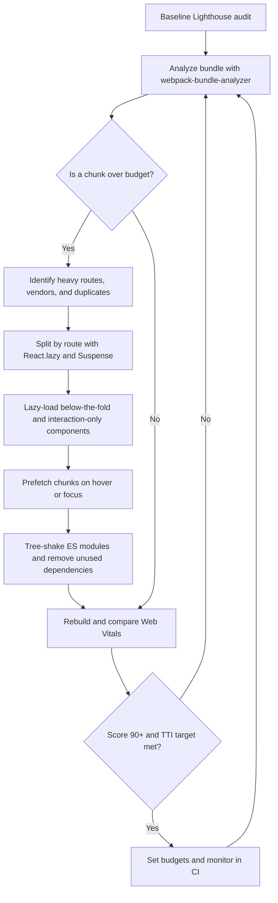

| Difficulty | Channel | Tags |
|---|---|---|
| intermediate | frontend | lighthouse, bundle, lazy-loading |

Imagine tapping a Pinterest link on a mid-range Android phone over a slow 3G connection and staring at a blank screen for 23 seconds before anything useful appears. That was not a rare edge case; it was the default experience for Pinterest's mobile web users, whose JavaScript monolith shipped over 2.5MB and lagged far behind the native apps [1]. More than half of Pinners lived outside the U.S., so every wasted second became a barrier to global growth. The fix was not a single heroic optimization but a disciplined campaign of bundle analysis, code splitting, and lazy loading — and it turned a 23-second wait into 5.6 seconds [1].

---

> ### Real-World Case — Pinterest
>
> Pinterest's old mobile web experience was a JavaScript monolith that shipped over 2.5MB of JavaScript (~1.5MB main bundle plus 1MB lazily loaded), leaving users waiting an average of 23 seconds on a slow 3G connection with mid-range Android hardware before any UI was usable. Mobile web engagement lagged far behind their native apps, and with more than half of Pinners based outside the U.S., this directly blocked global growth.
>
> | | |
> |---|---|
> | **Challenge** | Drastically reduce JavaScript payload and Time to Interactive on the mobile web while rebuilding the site from scratch in a single quarter — requiring systematic bundle analysis, code splitting, and lazy loading rather than micro-optimizations. |
> | **Solution** | Over three months Pinterest rebuilt mobile web with React, Redux and webpack, using webpack-bundle-analyzer to audit bundle composition and splitting JavaScript into three chunk categories (framework, shared, and ~13-18KB async route chunks). They applied route-based code splitting by default via React Router, added a component for component-level code splitting of heavy features, built route preloading into the client-side router, added a service worker to cache JS/CSS/static assets for repeat visits, and later hardened it with build-size alerts and a custom ESLint rule banning dependency-heavy imports. |
> | **Outcome** | Core bundle dropped from 650KB to 150KB (~150KB minified+gzipped for the home feed), home page JavaScript payload fell from ~490KB to ~190KB, First Meaningful Paint improved from 4.2s to 1.8s, and Time to Interactive dropped from 23s to 5.6s (3.9s on repeat visits). Business results: time spent +40%, user-generated ad revenue +44%, core engagements +60%, and signup conversion up significantly. |
> | **Lesson** | The bottleneck wasn't network download alone — parsing and compiling megabytes of JavaScript on a low-end main thread was what made the app uninteractive. Loading only the code needed for the current route (with service worker caching for repeats) turns a 23-second monolith into a sub-6-second app, and performance gains translate directly into revenue and engagement metrics. |

---

## Hook — The Blank Screen That Cost Pinterest 23 Seconds

A commuter taps a Pinterest link on a mid-range Android phone. The network is slow 3G, the device is warm, and the screen stays blank. Twenty-three seconds later, the first usable interface finally appears [1]. That is not a loading-spinner annoyance; it is a product losing a user before the first pin renders.

Now shrink the numbers to a typical React app: a 2.1MB bundle, a 4.2-second Time to Interactive, and a Lighthouse performance score of 65. The dashboard looks fine on a developer laptop with fiber internet. On a low-end phone, the main thread is still parsing JavaScript while the user is deciding whether to leave.

The stakes are simple. Every kilobyte of JavaScript must be downloaded, decompressed, parsed, compiled, and executed before the interface becomes responsive. A bundle is not a static asset; it is a queue of work placed directly in front of the user's first interaction.

So how does a team turn that blank screen into a fast, interactive experience without rewriting the entire app? The answer starts with understanding what is actually inside the bundle — and Pinterest's public case study shows exactly how much is possible.

## Problem — When a 65 Lighthouse Score Is a Business Signal

Lighthouse scores are easy to dismiss as vanity metrics until you watch a real user abandon a page before it renders. A score of 65 usually means the critical path is carrying too much JavaScript, too many blocking requests, or both. The 2.1MB bundle is the headline, but the user's phone pays a second cost after the download: parsing and compiling that JavaScript can multiply the time before the first click feels responsive [9].

This problem hits hardest on the devices and networks that product teams test least often. A flagship phone on office Wi-Fi can hide a 4.2-second Time to Interactive. A mid-range Android phone on a congested mobile network cannot. The same app that feels instant in a demo can feel broken to a customer in another country. That gap is not cosmetic; it directly affects signup conversion, engagement, and revenue.

Many developers discover that code splitting is conceptually simple but operationally messy. Wrapping every component in React.lazy() can turn one large download into a chain of smaller requests. Importing a heavy chart library inside a shared component can pull it back into the initial bundle. A dependency that looks tiny in package.json can arrive with a large transitive tree. And tree shaking only works when the module format and package configuration cooperate [2].

A 2.1MB bundle is not a bundle; it is a group project with no deadline. Everyone added something, nobody owned the total, and the user inherited the invoice. Before choosing a fix, the team needs a baseline that reflects real devices, real networks, and the actual user journey.

## Real-World Case — Pinterest's JavaScript Monolith Meets the Global Mobile Web

Pinterest is the clearest public example of this problem at global scale. Its old mobile web experience was a JavaScript monolith that shipped more than 2.5MB of JavaScript: roughly a 1.5MB main bundle plus about 1MB loaded lazily. On a slow 3G connection and mid-range Android hardware, users waited an average of 23 seconds before any UI was usable [1].

The first instinct might be to blame the network. The deeper issue was architecture. Too much code sat on the critical path, and the application paid for it before the user could see value. Mobile web engagement lagged far behind Pinterest's native apps, and with more than half of Pinners based outside the U.S., that gap directly blocked global growth [1].

The turnaround was measurable at every layer. The core bundle dropped from 650KB to 150KB, and the home page JavaScript payload fell from about 490KB to 190KB. First Meaningful Paint improved from 4.2 seconds to 1.8 seconds. Time to Interactive dropped from 23 seconds to 5.6 seconds, and repeat visits reached 3.9 seconds [1].

The business results made the engineering work impossible to ignore: time spent increased 40%, user-generated ad revenue rose 44%, core engagements grew 60%, and signup conversion improved significantly [1]. This is the plot twist that changes the conversation. Performance work was not a cleanup task tucked between feature launches; it was growth work. Pinterest proved the ceiling was much higher than most teams assumed. The next question is how to reproduce that result deliberately.

## Deep Dive — Bundle Anatomy, Splitting Strategies, and the Trade-Offs Nobody Warns You About

Start with bundle analysis, not code splitting. Tools such as webpack-bundle-analyzer produce a treemap of what actually shipped, including duplicate dependency versions and surprisingly large transitive packages [7]. The goal is to find the few chunks responsible for most of the weight. In a 2.1MB app, the top three chunks often explain more than half the problem. Look at both parsed size and compressed size, because a dependency can look modest on the wire and still be expensive to parse.

Once the map is clear, choose the splitting strategy that matches the user journey. Route-based splitting is usually the highest-leverage first move because it keeps the initial entry chunk small while preserving a clean mental model [2]. Component-based splitting works best for heavy widgets that are below the fold or behind an interaction, such as charts, editors, maps, and rich text toolbars. Vendor splitting can improve long-term caching, but it can also create a shared chunk that every route downloads. The real trade-off looks like this:

| Strategy | Best for | Strength | Risk |
| --- | --- | --- | --- |
| Route-based | Distinct top-level pages | Shrinks the initial entry chunk | Navigation can feel slow without prefetching |
| Component-based | Heavy below-the-fold widgets | Keeps first paint lean | Too many boundaries create request waterfalls |
| Vendor splitting | Stable third-party libraries | Better long-term caching | Can produce a large shared chunk |
| Intent-based prefetch | Likely next routes | Hides network latency | Wasted bytes when predictions are wrong |

Tree shaking is the next layer, and it depends on module format. ES modules give bundlers the static structure needed to remove unused exports, while CommonJS can defeat that analysis [8]. A package also needs sensible sideEffects metadata, and local barrel files can accidentally keep entire modules alive. This is where many performance efforts stall: the team adds React.lazy() but never fixes the import graph feeding it.

React.lazy() and Suspense make dynamic imports ergonomic in React [5], and the underlying import() expression is what gives the bundler a split point [3]. However, Suspense is a loading-state mechanism, not an optimization by itself. Place boundaries around what the user is about to see, not around the entire application. A single top-level Suspense boundary can replace a blank screen with a spinner, which is better but still not fast. A route-level boundary plus a component-level boundary around a heavy chart gives the page shell a chance to become interactive first.

The counterintuitive part is that lazy loading can make performance worse. If the initial route renders a shell that immediately requests three lazy components in sequence, the user experiences a waterfall of network round trips. If a critical above-the-fold component is lazy-loaded, the page may paint later than it would have with a slightly larger eager bundle. 💡 Insight: The initial route deserves the most aggressive diet; later routes can afford more weight because the user has already committed. ⚠️ Watch Out: A lazy boundary around every component is not a strategy. It is a way to turn one large download into a chain of smaller delays.

Use route splitting when the app has distinct top-level pages and the first route does not need the others. Use component splitting when a widget is genuinely heavy and not required for first interaction. Use intent-based prefetching when analytics show a likely next route, and trigger it on hover, focus, or viewport visibility rather than on initial load. 🔥 Hot Take: A Lighthouse score of 90 on a fast laptop is not a performance achievement; it is a measurement error. 🎯 Key Point: The fastest bundle is the one the user never needs, followed closely by the one that arrives before they ask for it.

## Workflow — A Repeatable Path from 2.1MB to a 90+ Score

With the diagnostic picture clear, the work becomes a loop rather than a one-time cleanup. The Mermaid flowchart below maps the feedback cycle: measure, analyze, split, prefetch, verify, and enforce a budget.

1. Establish a baseline on representative hardware. Run Lighthouse in mobile mode with CPU and network throttling, take multiple samples, and record cold-cache and repeat-visit behavior [9]. A single fast-laptop run is noise, not evidence.

2. Analyze the bundle before changing code. Use webpack-bundle-analyzer to identify the largest chunks, duplicate packages, and dependencies that arrived transitively [7]. Write down the top five offenders and their compressed sizes.

3. Set an explicit budget. For example, define a target for initial route JavaScript and a separate target for total JavaScript on the home page. Pinterest's 150KB core bundle is a useful reference point, not a universal law [1]. The budget should reflect the product and the audience's devices.

4. Split by route first. Convert top-level pages to React.lazy() imports with a Suspense fallback, then verify that the initial entry chunk actually shrank [5]. Route-based boundaries are usually the safest high-impact change.

5. Split heavy components second. Move charts, editors, maps, and other below-the-fold widgets behind their own lazy boundaries. Do not lazy-load the hero, the primary navigation, or anything required for the first meaningful interaction.

6. Replace eager third-party imports with dynamic imports where appropriate. A date-picker, syntax highlighter, or analytics SDK often does not need to be in the entry bundle [3]. Check the analyzer after each change because vendor code can reappear through shared imports.

7. Fix tree-shaking hygiene. Prefer ES module builds, remove unused dependencies, audit sideEffects configuration, and watch for barrel files that keep dead code alive [8]. Deleting code is often more effective than rearranging it.

8. Prefetch on intent. Warm likely next routes on hover or focus so navigation feels instant without inflating first load. This is the compromise between eager loading and a waterfall.

9. Cache and measure repeat visits. A service worker and sensible HTTP caching can make return visits dramatically faster [10]. Track First Meaningful Paint, Time to Interactive, and real-user metrics, not just the lab score.

10. Automate the budget in CI. Fail the build when the initial chunk exceeds its limit, and review bundle diffs like code diffs. Optimization that is not enforced will regress.

The order matters. Splitting before analysis produces random boundaries. Prefetching before measuring produces wasted bytes. Measurement without a budget produces a temporary win. The workflow turns performance into a system instead of a heroic sprint.

## Code Example — Route Splitting, Intent-Based Prefetching, and a Safety Net

Now that the strategy is clear, the implementation is surprisingly compact. The example below creates route-level chunks, adds a second boundary around a heavy chart, prefetches the analytics route on hover or focus, and wraps the chart in an error boundary so a failed chunk request does not take down the whole page [5]. It also uses the underlying dynamic import() expression for prefetching [3].

The key design choice is placement. The page shell stays eager enough to render immediately, while the expensive chart waits until its section is actually needed. The error boundary matters because code splitting introduces a new failure mode: the main bundle can load while a later chunk request fails.

## Lessons Learned — What to Do Differently Tomorrow

Pinterest's story is not a tale of one clever trick. It is a reminder that bundle size is an architectural property, and architecture improves through measurement, deletion, and deliberate boundaries [1]. The teams that succeed treat performance as a product metric, not a quarterly cleanup.

Here is what to carry forward:

- Measure on the devices and networks your users actually have. A fast laptop is a development convenience, not a performance test.
- Analyze before splitting. The treemap tells you where the weight is; intuition usually does not.
- Split by route first, then by heavy component. Keep the critical path eager and push optional work behind interaction or viewport visibility.
- Prefetch on intent. Hover, focus, and visibility are better signals than a blind timer.
- Fix the import graph. Tree shaking depends on ES modules, clean sideEffects metadata, and a lack of accidental barrel-file re-exports [8].
- Set a budget and enforce it in CI. A performance improvement without a guardrail is a temporary state.
- Cache repeat visits. The first load is expensive; the second should not be [10].
- Watch for waterfalls. More chunks are not automatically better. The goal is less critical-path work, not more network round trips.

Common battle scars are predictable. Teams lazy-load the hero and wonder why first paint got worse. They split every component and create a request cascade. They add a Suspense fallback that shifts layout and makes the page feel unstable. They forget that a third-party library can re-enter the main bundle through a shared utility. They celebrate a lab score while real users on mid-range Android phones still wait.

If this feels overwhelming, you are not alone. The fix does not require a rewrite. Start with the largest route chunk, split one boundary, measure the result, and repeat. The most dangerous phrase in a performance review is not a technical one; it is the assumption that the app loads fast because it loads fast on the developer's machine.

---

## Bundle Optimization Loop

<strong>Original Interview Question</strong>

**Q:** You're tasked with improving a React app's Lighthouse performance score from 65 to 90+. The bundle size is 2.1MB and Time to Interactive is 4.2s. What specific steps would you take to optimize the bundle and implement lazy loading?

**A:** Implement code splitting with React.lazy() and Suspense, analyze bundle composition with webpack-bundle-analyzer to identify largest chunks, remove unused dependencies and optimize imports, add dynamic imports for heavy components and third-party libraries, implement route-based splitting for better initial load times, and utilize tree shaking with proper ES module configuration.

## Conclusion

Pinterest's 23-second wait became a 5.6-second experience because the team treated JavaScript weight as a product problem, not a bundler setting [1]. The blank screen is not a law of nature, and a 2.1MB bundle is not a fixed cost. Tomorrow, open the bundle analyzer, find the largest route chunk, split one boundary, measure on a throttled mid-range device, and compare the result. Then set a budget so the improvement survives the next feature launch. The memorable insight worth sharing with your team is simple: the fastest JavaScript is the JavaScript you never ship — and the second fastest is the JavaScript that arrives before the user asks for it.

---

## References

1. [Pinterest incident report](https://medium.com/dev-channel/a-pinterest-progressive-web-app-performance-case-study-3bd6ed2e6154) — article
2. [Code splitting — Wikipedia](https://en.wikipedia.org/wiki/Code_splitting) — documentation
3. [Dynamic import() — MDN Web Docs](https://developer.mozilla.org/en-US/docs/Web/JavaScript/Reference/Operators/import) — documentation
4. [Lazy loading — MDN Web Docs](https://developer.mozilla.org/en-US/docs/Web/Performance/Lazy_loading) — documentation
5. [React repository — GitHub](https://github.com/facebook/react) — documentation
6. [webpack repository — GitHub](https://github.com/webpack/webpack) — documentation
7. [webpack-bundle-analyzer — GitHub](https://github.com/webpack-contrib/webpack-bundle-analyzer) — documentation
8. [Tree shaking — Wikipedia](https://en.wikipedia.org/wiki/Tree_shaking) — documentation
9. [Lighthouse (software) — Wikipedia](https://en.wikipedia.org/wiki/Lighthouse_(software)) — documentation
10. [HTTP caching — MDN Web Docs](https://developer.mozilla.org/en-US/docs/Web/HTTP/Guides/Caching) — documentation

---

**Author:** Satishkumar Dhule — [GitHub](https://github.com/satishkumar-dhule) · [LinkedIn](https://linkedin.com/in/satishkumar-dhule) · [Website](https://satishkumar-dhule.github.io)
