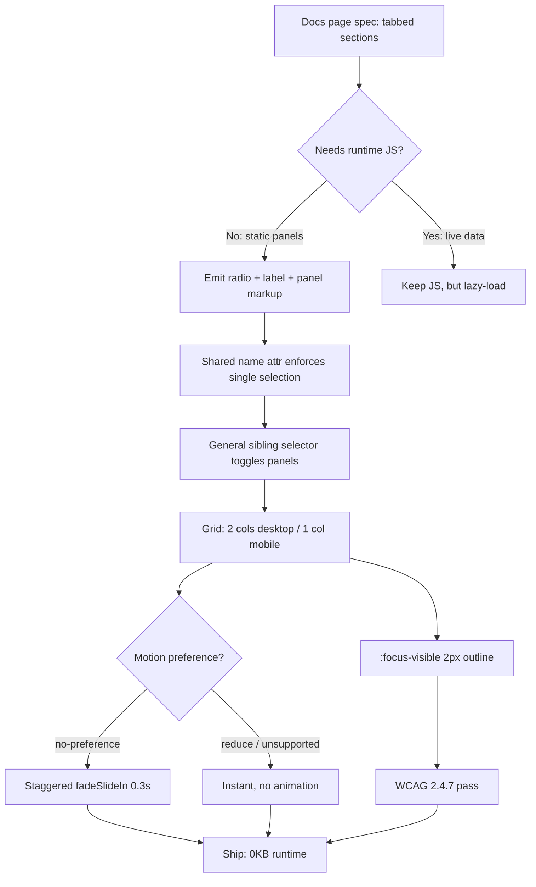

| Difficulty | Channel | Tags |
|---|---|---|
| beginner | frontend | css, flexbox, grid, animations |

Picture a hotel filter sidebar that ships 176KB of JavaScript before a traveler has even touched a single tab. That was trivago's reality: their tabbed and accordion filter sections were trapped in a legacy Marionette-based framework, burning 120ms+ on script evaluation and rendering alone [1]. Their fix did not add a fancier framework — it removed JavaScript from the interaction entirely. The bundle dropped to 53KB, evaluation time fell to 16ms, and the filters became fully keyboard accessible [1]. That is the story behind the humble CSS-only tab panel you are about to build.

---

> ### Real-World Case — trivago
>
> trivago's hotel filter sidebar — built around tabbed and accordion sections for refining search results — was stuck on their legacy Marionette-based Harmony framework. On mobile devices, initial script evaluation and rendering alone took over 120ms, and a 176KB bundle loaded immediately even though much of the tab/filter functionality required several interactions before users ever touched it.
>
> | | |
> |---|---|
> | **Challenge** | Rebuild the tabbed filter UI so it was fast on low-end mobile devices, fully keyboard accessible (the legacy tabs and accordions were not), and maintainable after abandoning their internal framework — without regressing filtering functionality used across their core search experience. |
> | **Solution** | They rewrote the filters on their newer Melody JS framework, loading the 'More filters' tab on demand instead of eagerly (it was 35KB loaded upfront regardless of use), dropped IE8 support so they could delete the Velocity animation library and rely solely on CSS animations/transitions, and reworked the tabs/accordions to be keyboard navigable after explicit accessibility research. |
> | **Outcome** | Bundle dropped from 176KB to 53KB (70% reduction, 13KB gzipped); script evaluation and rendering time fell from 120ms+ to 16ms (88% reduction); filters became fully keyboard accessible. Shipped after 306 commits over 5 weeks. |
> | **Lesson** | Interactive UI state (tabs, panels) and motion don't need heavyweight JS — CSS and native semantics can carry much of the load, and browser-support policy (dropping IE8) is itself a performance lever: it unlocked deleting an entire animation library. |

---

## Hook — A 176KB Bundle Before the First Click

Here is the uncomfortable math. A tab panel is a binary switch: one section visible, the others hidden. It is arguably the simplest interaction on the web — yet teams routinely pay for it with hydration cost, bundle weight, and a fragile event-listener graph.

Now raise the stakes. On a design-system docs page, tabs are everywhere: overview, usage, accessibility, props. Every one of those panels could be a chunk of JavaScript waiting to be parsed on a mid-range phone. Many developers assume that interactive UI requires a runtime, until they discover that the browser already ships a state machine for exactly this job — the humble radio input [2].

So the question is not "can you build tabs with JavaScript?" Of course you can. The question is: what are you paying for, and who is paying it?

> 🔥 Hot Take: If your tab switching logic needs a bundle, your tab switching logic is probably overbuilt.

## Problem — Tabs Are a UI Primitive, Not a Framework Feature

Consider what a docs page actually demands of a tab component:

- **State with mutual exclusivity** — exactly one panel visible at a time.
- **Keyboard accessibility** — arrow keys move between tabs, focus is always visible [4].
- **Responsive layout** — a 2×2 card grid on desktop, a single column on mobile [6].
- **Respect for motion preferences** — entrance animations must never fight the user's OS settings [5].
- **Zero-runtime delivery** — the page must work before, during, and without JavaScript.

The trap is that most teams reach for option A: a component library with a JS tab primitive. That works — until the docs site needs to server-render, the bundle creeps past a budget, or a keyboard user lands on a div with `role="tab"` and no actual focus handling.

However, the deeper problem is architectural. Tabs are *state*, and state you hand to JavaScript is state you must serialize, synchronize, and debug. State you hand to the platform is state the platform already tested across decades of browsers.

Here is the thing though: a radio group already enforces exactly one selected value per name [2], already supports arrow-key navigation natively, and already exposes checked state to assistive technology. You are not reinventing a state machine — you are adopting one.

| Approach | Bundle cost | Keyboard behavior | SSR-safe | Failure mode |
|---|---|---|---|---|
| JS tab component | ~3–15KB gzipped + hydration | Must be implemented | Hydration mismatch risk | Panel stuck hidden if JS fails |
| ``/`` accordion | 0KB | Native but single-open semantics | Yes | Weak multi-tab semantics |
| Radio + label CSS tabs | 0KB | Native arrow keys within group | Yes | Complex panel relationships get awkward |

⚠️ Watch Out: The common mistake is hiding panels with `display: none` on elements that are still reachable — or worse, leaving hidden panels in the tab order. If it is hidden, it must be removed from the accessibility tree entirely.

## Real-World Case — trivago's Filter Sidebar Reckoning

This is not a theoretical performance argument. trivago's hotel filter sidebar — built around tabbed and accordion sections for refining search results — was stuck on their legacy Marionette-based Harmony framework. On mobile devices, initial script evaluation and rendering alone took over 120ms, and a 176KB bundle loaded immediately even though much of the tab and filter functionality required several interactions before users ever touched it [1].

The team rebuilt the interaction layer rather than optimizing the old one. The result, shipped after 306 commits over five weeks [1]:

- **Bundle:** 176KB → 53KB (70% reduction, 13KB gzipped)
- **Script evaluation + rendering:** 120ms+ → 16ms (88% reduction)
- **Accessibility:** filters became fully keyboard navigable

> 💡 Insight: Notice what did *not* change — the features. Users saw the same filters. The win came from deleting a dependency, not adding one. That is the pattern worth stealing.

Consequently, the lesson generalizes far beyond trivago: interaction primitives that map cleanly onto platform semantics — tabs, toggles, disclosures — are the highest-ROI candidates for de-JavaScripting. Save your runtime for the things the browser genuinely cannot do.

What does that look like in practice? Let us crack open the mechanism.

## Deep Dive — Radio Buttons, Siblings, and the Anatomy of a CSS-Only Tab

Building on that case, the whole pattern rests on one selector relationship: a checked radio controlling the visibility of a panel that follows it in the DOM [8].

### The state engine

Each tab is an `` with a shared `name`. The browser guarantees only one can be checked at a time [2]. Each `` is the visible tab — clicking it checks the radio. Then CSS does the rest:

```css
.tabs input:not(:checked) ~ .panel { display: none; }
```

The general sibling combinator `~` reaches every following sibling, so each unchecked radio hides *its own* panel while the checked one leaves its panel alone [8]. No event listeners. No re-renders. No hydration.

### The layout engine

Each panel is a CSS Grid: `grid-template-columns: repeat(2, 1fr)` gives you the 2×2 card layout on desktop, and a `max-width: 768px` media query collapses it to `1fr` — one column on mobile [6]. Cards get `aspect-ratio: 16 / 9` on the image container, which means you never write a padding-top hack again [3].

### The motion engine

Entrance animation with a stagger is where many implementations quietly fail an audit. The fix is a single media query wrapper:

```css
@media (prefers-reduced-motion: no-preference) { ... }
```

Animals — rather, *animations* — only run when the user has not asked for reduced motion [5]. Wrapping in `no-preference` (rather than disabling inside `reduce`) is the safer direction: if the query is unsupported, animation still applies normally.

### The focus engine

`:focus-visible` gives you a 2px outline only for keyboard users, satisfying WCAG 2.4.7's focus-visible requirement without punishing mouse users [4][7].

> 🎯 Key Point: Four platform primitives — `:checked`, `aspect-ratio`, `prefers-reduced-motion`, `:focus-visible` — replace what many teams ship as a 4KB component.

### Battle scars worth knowing

- **Order matters.** Radios must precede their panels in the DOM for `~` to work. Reordering for visual design breaks the logic — use `order` on flex/grid children instead.
- **`display: none` vs. `visibility`.** Only `display: none` removes hidden panels from the accessibility tree. Using `opacity: 0` leaves phantom tab stops behind.
- **`nth-child` counting.** Stagger delays computed with `:nth-child` break the moment a card is conditionally rendered. Scope delays to the panel: `.panel.is-active .card:nth-child(2)`.
- **Label text overflow.** Long tab labels on narrow screens need `overflow-wrap` or truncation, or your 2×2 grid becomes a 1×4 mess.
- **Forgetting `checked` on the first radio.** With no default checked state, every panel hides on first paint — the classic "blank docs page" bug.

So the mechanism is clear. But how does this move from a snippet into a repeatable team workflow?

## Workflow — From Figma Spec to Shipped Panel

Here is the step-by-step process that keeps a CSS-only tab panel maintainable across a design system, visualized in the flow below:



**Step 1 — Model the state.** Write out which panel is open by default. That maps directly to `checked` on the first radio [2].

**Step 2 — Establish DOM order.** Place all radios first, then their labels, then panels. The `~` combinator depends on document order [8], so treat this as an invariant in code review.

**Step 3 — Lay out the grid.** One rule for desktop (`repeat(2, 1fr)`), one media query for mobile (`1fr`) [6]. Cards hold a fixed `aspect-ratio: 16/9` image box, a title, and a meta line [3].

**Step 4 — Layer motion conditionally.** Wrap every animation inside `@media (prefers-reduced-motion: no-preference)` and add `animation-delay` steps of 0.1s per card for the stagger [5].

**Step 5 — Audit focus.** Tab through the panel: every label must show a visible outline, and no hidden panel may be reachable [4][7].

**Step 6 — Measure.** Compare bundle size and Lighthouse accessibility before and after. If nothing changed in the audit but the bundle shrank, you did it right.

However, the proof is in the markup. Time to write it.

## Code Example — Building the Panel, Line by Line

The generator below is a production pattern: the tab markup and its styles are assembled at **build time**, so the shipped docs page contains zero runtime JavaScript while the source stays DRY across dozens of tabbed sections.

## Lessons Learned — What to Take Into Your Next Design-System PR

The journey started with a 176KB bundle and ended with 53KB and an 88% faster first render — not by optimizing harder, but by choosing a primitive that already existed [1]. That is the transformation worth internalizing.

Here is what to carry forward:

- **Start with the platform.** Radio inputs give you exclusivity, arrow-key navigation, and AT support for free [2]. Earn your JavaScript, do not default to it.
- **Layout with intent.** `aspect-ratio` kills the padding-top hack; one grid rule plus one media query covers desktop and mobile [3][6].
- **Motion is opt-in, not opt-out.** Gate every animation behind `prefers-reduced-motion: no-preference` — that is the direction that degrades gracefully [5].
- **Focus is not decoration.** A 2px `:focus-visible` outline is the cheapest accessibility win you will ever ship [4][7].
- **Beware the battle scars:** DOM order assumptions, phantom tab stops from `opacity` fades, brittle `:nth-child` staggers, and a missing default `checked` state.

⚠️ Watch Out: This pattern scales beautifully for 3–6 flat tabs. The moment panels need independent scroll state, deep-linked hashes, or async content, revisit the trade-off — at that point a tiny JS controller may genuinely be cheaper than fighting the selector engine.

**So what should you do tomorrow?** Open your docs site, find one tabbed section, and check how many bytes it costs to switch panels. If the answer is anything above zero, you have found a refactor with a measurable payoff.

The memorable insight to share with your team: **the browser is a state machine — most "interactive" UI is just asking it the right question.**

---

## CSS-Only Tab Panel Build Flow


<details>
<summary><strong>Original Interview Question</strong></summary>

**Q:** Build a CSS-only tab panel for a design-system docs page. Use radio inputs to switch tabs (no JavaScript). Desktop: a 2x2 grid of cards under each tab; mobile: single column. Each card has a fixed 16:9 image area, a title, and a short meta line. Add a subtle entrance animation with a stagger and keep focus-visible outlines; ensure prefers-reduced-motion is respected?

**A:** Use a set of radio inputs with a shared `name` attribute and corresponding `` elements for each tab section. The `:checked` state of each radio controls visibility of its associated panel via adjacent sibling selectors. Each panel renders a 2×2 card grid on desktop and collapses to a single column on mobile. Cards use `aspect-ratio: 16/9` for fixed image containers, with a title and meta line below.

</details>

## Conclusion

You started with a 176KB filter sidebar that took 120ms+ to evaluate before a user touched a tab, and you end with a panel whose entire state machine is three CSS selectors [1]. That is the journey: not learning a new framework, but unlearning the assumption that interactivity requires a runtime. A shared `name` on radio inputs gives mutual exclusivity and arrow-key navigation for free [2]; a sibling combinator toggles panels [8]; one grid rule plus one media query handles responsive cards [6][3]; and two media queries — `prefers-reduced-motion` and `:focus-visible` — cover motion safety and keyboard clarity [5][4][7]. Tomorrow, audit one tabbed section on your own docs site: count its runtime bytes and tab through it with the keyboard. If the bytes are above zero and the focus outline is missing, you have found a refactor that shrinks your bundle, speeds your first render, and makes your UI more accessible — all in the same commit.

---

## References

1. [trivago incident report — Melodic Filters](https://tech.trivago.com/post/melodic-filters-article) — article
2. [MDN: :checked CSS pseudo-class](https://developer.mozilla.org/en-US/docs/Web/CSS/:checked) — documentation
3. [MDN: aspect-ratio CSS property](https://developer.mozilla.org/en-US/docs/Web/CSS/aspect-ratio) — documentation
4. [MDN: :focus-visible CSS pseudo-class](https://developer.mozilla.org/en-US/docs/Web/CSS/:focus-visible) — documentation
5. [MDN: prefers-reduced-motion media query](https://developer.mozilla.org/en-US/docs/Web/CSS/@media/prefers-reduced-motion) — documentation
6. [MDN: grid-template-columns property](https://developer.mozilla.org/en-US/docs/Web/CSS/grid-template-columns) — documentation
7. [WCAG 2.1 Understanding SC 2.4.7 Focus Visible](https://www.w3.org/WAI/WCAG21/Understanding/focus-visible.html) — documentation
8. [MDN: General sibling combinator](https://developer.mozilla.org/en-US/docs/Web/CSS/General_sibling_combinator) — documentation
9. [WCAG 2.1 Understanding SC 2.3.3 Animation from Interactions](https://www.w3.org/WAI/WCAG21/Understanding/animation-from-interactions.html) — documentation
10. [MDN: HTML input element (radio type)](https://developer.mozilla.org/en-US/docs/Web/HTML/Element/input/radio) — documentation

---

**Author:** Satishkumar Dhule — [GitHub](https://github.com/satishkumar-dhule) · [LinkedIn](https://linkedin.com/in/satishkumar-dhule) · [Website](https://satishkumar-dhule.github.io)
