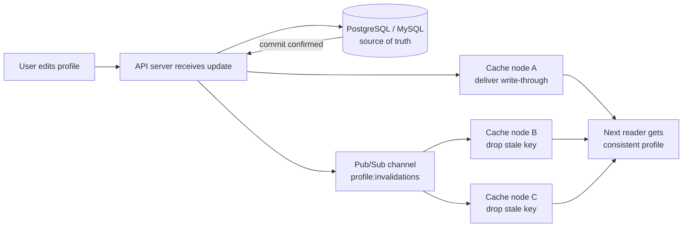

| Difficulty | Channel | Tags |
|---|---|---|
| beginner | backend | redis, memcached, cache-invalidation |

Hundreds of thousands of queries per second. Hundreds of thousands of chances to show a user a profile that no longer exists. When Facebook scaled MySQL reads with a massive look-aside memcache fleet, every profile edit risked stranding stale data across frontend clusters — and their published research revealed a startling fact: only 4% of deletes issued actually corresponded to cached data [1]. That is the world of cache invalidation: the write path is easy, the consistency story is brutal, and the difference between a fast system and a correct one is exactly one deleted key.

---

> ### Real-World Case — Facebook
>
> Facebook scaled MySQL reads with a massive look-aside memcache fleet across multiple frontend clusters per region, but every user profile or content update risked serving stale data in other clusters. With hundreds of thousands of queries per second hitting cache, a missed or slow invalidation meant users saw outdated profiles and posts indefinitely.
>
> | | |
> |---|---|
> | **Challenge** | Distributing cache invalidation correctly across many memcache clusters with no built-in coordination — memcached provides no server-to-server communication, no pub/sub, and no persistence, so every write path had to reliably broadcast deletes to every cluster holding replicated copies of the data. |
> | **Solution** | They used delete-on-write invalidation (write SQL to MySQL, then delete the key — deletes are idempotent, updates are not) and built an invalidation pipeline from the database itself: SQL statements are amended with the memcache keys to invalidate, and 'mcsqueal' daemons on every MySQL server parse the commit log, extract deletes, batch them, and broadcast them through mcrouter to every frontend cluster. They also introduced 'leases' — a token issued on cache miss that lets the filling client invalidate its own just-written value — to solve the classic stale-set race where a concurrent update is overwritten by a read of old data. |
> | **Outcome** | Batching deletes delivered an 18× improvement in median deletes per packet, avoiding packet storms across cluster boundaries; only 4% of deletes issued actually corresponded to cached data, so filtering mattered enormously. The lease mechanism eliminated stale-update races for hot items while also collapsing duplicate misses on popular keys (thundering herds) on the fill path. |
> | **Lesson** | When a cache serves the majority of reads, invalidation correctness becomes a correctness dependency, not a performance detail — and the most robust place to trigger invalidation is the database commit log itself, since it catches every write path (including ones that 'forget' to delete), rather than trusting each application to remember. Memcached's simplicity won at Facebook's scale precisely because invalidation was engineered outside the cache, not inside it. |

---

## Hook — The profile photo that never changes

Picture this: a user updates their avatar, hits save, sees the new photo — and every friend still sees the old one. Not for seconds. Indefinitely. Sound familiar? That is not a bug in your rendering layer; it is a cache that nobody invalidated correctly.

Here is the thing though — caches do not serve stale data because they are broken. They serve stale data because they are working exactly as designed. A cache is a bet that the copy in memory is still true, and every bet expires the moment someone edits the source of truth [4]. The tension is simple: you added a cache to make reads fast, but writes now have a new enemy — a distributed copy of the past that lives on machines you do not control.

🔥 Hot Take: Most teams ship the read path first and discover the invalidation path during their first incident review. Cache invalidation is not a follow-up ticket; it is the feature.

## Problem — Why invalidation is the actual hard part

Building on that tension, consider what happens on a typical profile update. The API receives a PATCH, writes to MySQL, returns 200 — and the cache still holds the previous document. Every subsequent read hits the cache-aside path, finds a "hit," and confidently serves outdated data. Nothing errors. Nothing logs. The system just lies quietly.

The stakes scale directly with traffic. At one hundred queries per second, a stale window is a footnote. At hundreds of thousands per second — Facebook's scale — a missed invalidation means users see outdated profiles and posts indefinitely [1]. Therefore the problem is not whether your cache gets out of sync; it is how long it stays out of sync and how many people observe it.

Many developers think a short TTL solves everything. It does not, for three compounding reasons:

- **Read amplification**: during the stale window, every read re-serves the old value, so the error rate is multiplied by your QPS, not by your write rate.
- **Write-to-read races**: if you delete the key before the database transaction commits, a concurrent reader can repopulate the cache with pre-commit data. The delete "succeeds," and the stale value wins anyway.
- **Thundering herds**: when a hot key finally expires, thousands of concurrent readers miss simultaneously and all rush to the database — turning one cache miss into a latency avalanche.

⚠️ Watch Out: TTL is a safety net, not a strategy. A 5–30 minute TTL bounds the damage; it does not prevent it. Users judge correctness in the first second after they click Save.

## Real-World Case — Facebook's fleet-wide invalidation nightmare

However, nobody felt this pain more acutely than Facebook. To scale MySQL reads, the company built a look-aside memcache fleet spanning multiple frontend clusters per region, absorbing enormous read pressure — hundreds of thousands of queries per second [1]. The architecture worked brilliantly... right up until someone edited a profile or a post.

Because each cluster maintained its own cache view, an update in one cluster had to fan out deletes to every other cluster. Three failures emerged, each quantified in their NSDI research [1]:

- **Packet storms**: issuing deletes one at a time across cluster boundaries caused congestion. Batching deletes delivered an **18× improvement in median deletes per packet** [1].
- **Wasted work**: only **4% of deletes issued actually corresponded to cached data** [1] — meaning 96% of invalidation traffic was noise, and filtering mattered enormously.
- **Stale-update races on hot keys**: a slow reader could refill the cache with an old value after an invalidation, resurrecting stale data. Their **lease mechanism** eliminated these races while simultaneously collapsing duplicate misses on popular keys — solving the thundering herd problem on the fill path [1].

The plot twist: the system was not under-provisioned. It was over-eager. The fix was not more cache — it was smarter invalidation: batched, filtered, and coordinated.

🎯 Key Point: Facebook did not win by making the cache faster. They won by making the invalidation path disciplined — batch it, filter it, and fence off concurrent refills.

## Deep Dive — Redis vs Memcached: the trade-offs that actually matter

This leads to the tooling question every backend team hits: Redis or Memcached? Both are in-memory stores that accelerate reads, but they encode fundamentally different philosophies about invalidation — and that difference decides which one can reproduce Facebook's fixes.

| Dimension | Redis [7] | Memcached [8] |
|---|---|---|
| Distributed invalidation | Built-in pub/sub broadcasts delete events across nodes | Requires manual coordination across nodes [2] |
| Data structures | Hashes, sets, sorted sets — great for partial updates | Flat key/value only |
| Persistence | RDB/AOF snapshots for durability | None — cache-only by design |
| Memory overhead | Higher per key (richer metadata) | Lower overhead, leaner for pure caching |
| Horizontal scaling | Redis Cluster with hash slots | Consistent hashing across a flat node pool |
| Complexity | More surface area, more to monitor | Deliberately simple architecture [3] |

So when would you actually reach for each? Choose **Memcached** when you need a pure, flat, high-throughput cache with minimal operational surface — Facebook's own fleet was built on it for exactly this reason [1]. Choose **Redis** when invalidation needs to travel: pub/sub lets one application server publish `profile:{id}:deleted` and every other node drops its copy instantly, without polling [2]. Redis persistence also means a restart does not empty the cache and trigger a herd of misses — whereas Memcached's cold-start behavior is famously abrupt [3].

Moreover, Redis's richer data structures change the invalidation granularity. With a Redis hash, updating one field of a profile can be an `HSET` instead of a full-key rewrite; with flat keys, every profile edit means delete-and-replace of the entire serialized blob.

💡 Insight: The real question is not "which is faster?" — for pure get/set both are sub-millisecond. The question is "where does my invalidation logic live?" If the answer is "in my application code, replicated by hand across every node," Redis pub/sub is probably worth the extra memory overhead.

## Workflow — From profile update to consistent cache, step by step

Now for the process itself. The following flow combines a write-through pattern for the updated node with a publish-based fan-out for every other node — the distributed-invalidation equivalent of Facebook's cross-cluster delete coordination [1].



Step by step, the ordering matters more than the code:

1. **Write the database first.** The database is the source of truth; the cache never outranks it.
2. **Wait for the commit.** Only then touch the cache — this is the race Facebook's lease mechanism was built to close [1].
3. **Update the local cache (write-through)**: delete the stale key and write the fresh payload with a TTL (5–30 minutes is a sensible window for profiles [4]).
4. **Publish the invalidation** on a shared channel so every other application node deletes its own copy.
5. **On read, use cache-aside**: check the cache, fall back to the database on a miss, then repopulate with a TTL.
6. **Monitor hit rate and miss latency** — a sudden hit-rate drop after a deploy usually means a key-format mismatch between writer and reader.

⚠️ Watch Out: Cache-aside reads and write-through writes can still race. If a reader loads the database *before* your commit and writes to the cache *after* your delete, stale data resurrects. Redis handles this cleanly with a per-key lease or short lock on the fill path — borrow Facebook's idea and fence the refill, not just the delete [1].

## Code Example — Write-through invalidation with Redis pub/sub

The following Python implementation encodes the full workflow: cache-aside reads, a write-through update path ordered after the database commit, and a pub/sub broadcast so every node in the fleet drops its copy — the same fan-out discipline Facebook applied across cluster boundaries [1].

```python
import json
import redis

# One client per application server; decode_responses keeps values as str
r = redis.Redis(host="cache-1", port=6379, decode_responses=True)
PROFILE_TTL = 300  # 5 minutes: bounds staleness even if invalidation is missed
CHANNEL = "profile:invalidations"

def get_profile(user_id: str) -> dict | None:
    """Cache-aside read path."""
    key = f"profile:{user_id}"
    cached = r.get(key)
    if cached:
        return json.loads(cached)  # fast path: no database involved

    # Miss path: single-flight guard so 500 concurrent readers do not
    # all query the database for the same hot key (thundering herd)
    with r.lock(f"lock:{key}", timeout=2, blocking_timeout=5):
        cached = r.get(key)  # double-check: another reader may have filled it
        if cached:
            return json.loads(cached)
        profile = db.fetch_profile(user_id)  # slow path: SQL round trip
        if profile:
            r.set(key, json.dumps(profile), ex=PROFILE_TTL)
        return profile

def update_profile(user_id: str, fields: dict) -> dict:
    """Write-through invalidation with distributed fan-out."""
    key = f"profile:{user_id}"

    # Step 1: commit to the source of truth BEFORE touching the cache.
    # Deleting first would let a concurrent reader repopulate stale data.
    profile = db.update_profile(user_id, fields)

    pipe = r.pipeline()
    pipe.delete(key)                        # Step 2: drop the stale copy
    pipe.set(key, json.dumps(profile), ex=PROFILE_TTL)  # Step 3: write-through
    # Step 4: tell every other node to drop its copy — this is the piece
    # Memcached cannot do without manual cross-node coordination [2].
    pipe.publish(CHANNEL, user_id)
    pipe.execute()
    return profile

def start_invalidator(node_name: str) -> None:
    """Run one of these on every application server in the fleet."""
    pubsub = r.pubsub()
    pubsub.subscribe(CHANNEL)
    for message in pubsub.listen():
        if message["type"] != "message":
            continue
        stale_user = message["data"]
        # Batching multiple deletes per round-trip mirrors Facebook's
        # 18x improvement from batched deletes per packet [1].
        r.delete(f"profile:{stale_user}")
        print(f"[{node_name}] invalidated profile:{stale_user}")
```

Walking through it:

- **`get_profile`** implements cache-aside: the cache is checked first, the database is consulted only on a miss, and the double-checked lock collapses duplicate misses on popular keys — the same herd-collapsing behavior Facebook's lease provides [1].
- **`update_profile`** is the heart of the pattern. Note the strict ordering: database commit, then delete, then write-through, then publish — all inside one pipeline so the local operations are atomic from the client's perspective.
- **`start_invalidator`** is the distributed piece. Each node subscribes once and reacts to published invalidation events, which is precisely the automatic fan-out Redis offers and Memcached requires you to build yourself [2].
- **The TTL** on every `set` is deliberate insurance. If a publish is dropped or a node is partitioned, staleness is bounded to five minutes instead of indefinite [4].

## Lessons Learned — What to do differently tomorrow

So what does this journey from Facebook's memcache fleet to your profile service actually teach? The moral is that read performance is the easy half of caching; the invalidation path is where systems quietly break in production.

Here is what to take back to your team:

- **Order writes as: commit → delete → repopulate → publish.** Reversing the first two steps is the single most common cause of "impossible" stale data.
- **Always set a TTL, even on a perfect invalidation path.** A 5–30 minute window turns an indefinite failure into a bounded one [4].
- **Batch and filter invalidations** before they cross service boundaries — Facebook measured an 18× gain from batching alone, and found 96% of deletes were for keys nobody had cached [1].
- **Fence the refill, not just the delete.** Use a lock or lease on hot-key misses to eliminate both stale-update races and thundering herds.
- **Watch your hit rate like a business metric.** A silent drop after a deploy almost always means your writer and reader disagree about key formats.
- **Let the tool match the topology.** Flat, single-node cache? Memcached's simplicity is a feature [3]. Multi-node fleet that must react to writes instantly? Redis pub/sub removes an entire class of hand-rolled coordination bugs [2].

Battle scar to remember: the team that "fixed" staleness by shortening TTLs from 30 minutes to 10 seconds, then spent the next month explaining the database latency spike. Shorter TTLs do not fix invalidation — they just trades stale reads for more misses.

The one sentence worth repeating in your next design review: **a cache without a designed invalidation path is a bug with good latency.**

If this felt like a lot, you are not alone — every senior engineer has shipped a cache-aside read path and only later discovered that the write path was the real system.

---

## Profile Update Invalidation Flow


<details>
<summary><strong>Original Interview Question</strong></summary>

**Q:** You're building a user profile service that caches frequently accessed profiles. How would you implement cache invalidation when a user updates their profile, and what trade-offs would you consider between Redis and Memcached?

**A:** Implement write-through caching with TTL-based expiration. On profile update, invalidate the cache by deleting the key and writing new data to both the database and cache. Redis offers pub/sub for automatic distributed invalidation, while Memcached requires manual coordination across nodes.

</details>

## Conclusion

Facebook's memcache fleet did not fail because caching was the wrong idea — it failed because invalidation was treated as an afterthought at hundred-thousand-QPS scale [1]. The fix was discipline, not horsepower: commit before deleting, batch cross-node deletes (18× faster), filter the 96% of deletes that hit nothing, and fence concurrent refills so hot keys cannot resurrect stale data. Tomorrow, pick one service and audit its write path: verify the database commit precedes the cache delete, confirm every key carries a TTL, and check whether other nodes ever hear about the change. Do that once and you will never look at a cache hit rate the same way again. The memorable takeaway to share with your team: a cache without a designed invalidation path is a bug with good latency.

---

## References

1. [Facebook incident report](https://www.usenix.org/system/files/conference/nsdi13/nsdi13-final170_update.pdf) — article
2. [Redis documentation](https://redis.io/docs/) — documentation
3. [Memcached project repository](https://github.com/memcached/memcached) — documentation
4. [Cache invalidation](https://en.wikipedia.org/wiki/Cache_invalidation) — documentation
5. [HTTP caching (MDN Web Docs)](https://developer.mozilla.org/en-US/docs/Web/HTTP/Caching) — documentation
6. [RFC 7234: Hypertext Transfer Protocol (HTTP/1.1) Caching](https://datatracker.ietf.org/doc/html/rfc7234) — documentation
7. [Redis](https://en.wikipedia.org/wiki/Redis) — documentation
8. [Memcached](https://en.wikipedia.org/wiki/Memcached) — documentation
9. [CacheLib — universal caching infrastructure by Meta](https://github.com/facebook/CacheLib) — documentation

---

**Author:** Satishkumar Dhule — [GitHub](https://github.com/satishkumar-dhule) · [LinkedIn](https://linkedin.com/in/satishkumar-dhule) · [Website](https://satishkumar-dhule.github.io)
