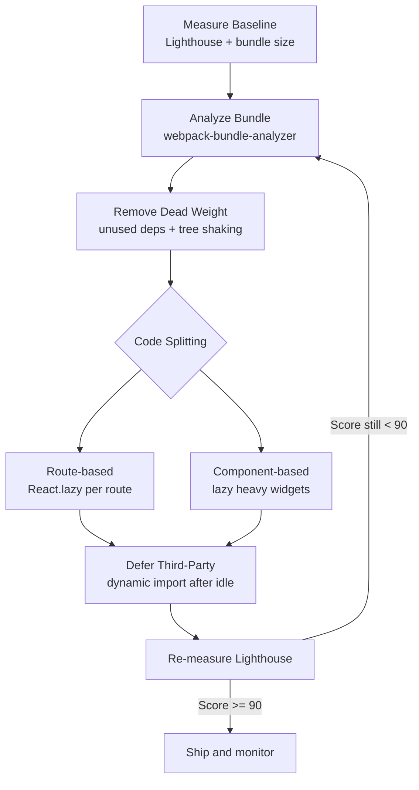

| Difficulty | Channel | Tags |
|---|---|---|
| intermediate | frontend | lighthouse, bundle, lazy-loading |

Picture a widget embedded on thousands of customer websites, quietly adding half a second of delay to every page it touches. That was Intercom's Messenger: a React app whose single monolithic JavaScript bundle had ballooned to nearly 600kb gzipped [1]. The fix wasn't a magic bullet — it was a systematic war on bundle bloat that cut size to 240kb, pushed Lighthouse from 59 to 100, and saved mobile users up to 11 seconds on slow 3G [1]. Now imagine your own app sitting at a 2.1MB bundle and a 4.2s Time to Interactive. The path from 65 to 90+ on Lighthouse exists — and this is the map.

---

> ### Real-World Case — Intercom
>
> Intercom's Messenger widget is a React.js app embedded on thousands of customer websites, and its single monolithic JavaScript bundle had ballooned to nearly 600kb gzipped as features accumulated, degrading load times for every visitor on every host site.
>
> | | |
> |---|---|
> | **Challenge** | The Messenger was served as one frame.js file containing all application and vendor code; the bundle grew from 400kb to almost 600kb in a single year, hurting mobile load times (up to 11 seconds on slow 3G) and yielding a Google Lighthouse score of only 59. |
> | **Solution** | They analyzed the bundle composition, split vendor packages (~40% of the bundle) into a cacheable separate chunk, code-split the app by routes using a Loadable component with React-style lazy loading, and preloaded the Messenger bundle on launcher hover to hide the added network latency of splitting. |
> | **Outcome** | Bundle cut from ~600kb to 240kb (65% reduction), Google Lighthouse score jumped from 59 to 100, and mobile users saved up to 5 seconds of load time on fast 3G and up to 11 seconds on slow 3G. |
> | **Lesson** | Code splitting and vendor chunking are high-leverage, but splitting introduces per-chunk network latency — pairing lazy loading with speculative preloading (e.g., on hover) recovers that cost, and measuring bundle composition first ensures you attack the largest wins. |

---

## Hook — The 4.2-Second Tax Nobody Talks About

Every millisecond of delay is a silent tax on your users. At 4.2 seconds of Time to Interactive on a 2.1MB bundle, you are not just losing Lighthouse points — you are losing conversions, rankings, and trust. Google's research has consistently shown that as page load time rises from 1s to 3s, bounce probability increases sharply [2], and a slow first paint on mobile is often the difference between a retained user and an abandoned session. Here is the uncomfortable truth most teams discover too late: bundle size rarely explodes in one dramatic commit. It creeps in — a new charting library here, a date utility there, an eagerly imported admin panel that 95% of users never open. Sound familiar? The good news is that the same playbook Intercom used can shrink your payload dramatically, and it starts with a single question: what is actually inside that 2.1MB?

## Problem — Why Bundle Bloat Is a Systems Problem, Not a One-Line Fix

Many developers think the answer to a slow React app is simply 'enable minification and call it done.' That is like dieting by skipping one cookie while the fridge is full of cake. The real problem is structural: without code splitting, a single JavaScript bundle carries every route, every feature, and every third-party library to the initial page load — even the code a visitor will never touch [3]. Consider what a 2.1MB bundle actually means. On a fast 3G connection (roughly 1.6Mbps down), transferring and parsing that much JavaScript can push Time to Interactive well past four seconds [4]. Consequently, the Lighthouse Performance score craters, Core Web Vitals like First Input Delay and Total Blocking Time suffer, and SEO rankings quietly erode. The stakes compound: each new feature makes the problem worse, because the cost is paid on every single page load. The deeper issue is that bundle optimization is not one technique — it is a workflow. Without analysis, you are guessing. Without splitting, analysis is pointless. And without dynamic imports for non-critical paths, splitting only gets you part of the way there. What follows is the systematic approach that turns a 65 into a 90+.

## Real-World Case — Intercom's Messenger Reckoning

Intercom's Messenger widget is a React.js application embedded across thousands of customer websites [1]. As features accumulated over years, the single monolithic bundle had grown to nearly 600kb gzipped — degrading load times for every visitor on every host site, not just Intercom's own users. This is the hidden multiplier of embedded widgets: your bundle bloat becomes someone else's performance problem, multiplied by every page view. The team attacked the problem systematically: analyzing bundle composition, splitting code so features loaded on demand, and aggressively tree-shaking unused exports [1]. The results were dramatic. The bundle dropped from ~600kb to 240kb — a 65% reduction. Google Lighthouse jumped from 59 to 100. Mobile users saved up to 5 seconds of load time on fast 3G, and up to 11 seconds on slow 3G [1]. For context, an 11-second delay on mobile is not a minor UX regression; it is a conversion cliff. Intercom's story proves a critical point: this level of improvement is achievable with existing tooling and no framework rewrite. But it also raises a question — where exactly do you start when your own bundle is the black box?

## Deep Dive — The Four Levers of Bundle Reduction

Building on Intercom's results, four techniques do most of the heavy lifting, and understanding their trade-offs separates strong candidates from those who merely memorize keywords [5]. First, bundle analysis. Before changing a single line, you need to see what you ship. Tools like webpack-bundle-analyzer [6] render an interactive treemap of every module in your bundle, exposing the library that quietly weighs 300kb or the icon pack imported wholesale when only twelve icons are used. You cannot optimize what you cannot see. Second, code splitting — the art of breaking the monolithic bundle into smaller chunks loaded on demand. There are two flavors, and the tradeoff matters: Approach Tradeoff Route-based splitting Loads one chunk per route. Best ROI for multi-page apps; minimal code on first paint. Component-based splitting Isolates heavy widgets (charts, editors, maps). Great for single-page apps with occasional heavy features. Third, tree shaking — the bundler's ability to eliminate unused exports when modules use proper ES module syntax [7]. Here is the plot twist many developers miss: importing a library with CommonJS interop (`import _ from 'lodash'`) can defeat tree shaking entirely, while `import { debounce } from 'lodash-es'` lets the bundler drop everything else. The same library, the same functions — a completely different bundle size. Fourth, dynamic imports for non-critical features. Third-party libraries that only run after user interaction — a markdown editor, a PDF viewer, a payment SDK — have no business in the critical path. A dynamic `import()` call defers them until the moment they are actually needed [8]. Together, these four levers form a feedback loop: analyze, split, shake, defer — then analyze again.

## Workflow — A Repeatable Path from 65 to 90+

This leads to the practical question: in what order should these techniques be applied? Rushing to lazy-load components before analyzing the bundle often means optimizing the wrong 50kb while a 400kb monolith sits untouched. Follow this sequence: 1. Measure the baseline — run Lighthouse and note Performance, TBT, and bundle size. Reproduce it; do not guess. 2. Analyze composition — generate a bundle report with webpack-bundle-analyzer or your bundler's equivalent [6]. Identify the top five modules by size. 3. Remove dead weight — prune unused dependencies, replace full libraries with per-method imports, and switch to tree-shakeable ES module builds [7]. 4. Split by route — wrap each top-level route in React.lazy so the initial load only ships the landing or dashboard code [3]. 5. Split by component — isolate heavy widgets (charts, maps, editors) behind dynamic imports with Suspense fallbacks [3]. 6. Defer third-party scripts — analytics, chat widgets, and payment SDKs should load after interaction or idle, never in the critical path. 7. Re-measure — rebuild, re-run Lighthouse, and confirm each change moved the metric. The workflow is visible below:



Notice the loop back from re-measurement to analysis. Bundle optimization is iterative — Intercom did not reach 240kb in a single pass [1]. Each cycle reveals the next bottleneck that was previously hidden behind a larger one. A common battle scar here: teams skip the re-measure step, declare victory after the first split, and ship a bundle that is 15% smaller while TTI barely moves. The metric, not the technique, is the finish line.

## Code Example — Route and Component Splitting in Practice

Here is a production-shaped implementation combining route-based splitting, component-based lazy loading, and an error boundary so a failed chunk fetch does not white-screen the entire app. The pattern below is the backbone of most successful React bundle optimizations [3]:

```javascript
import React, { Suspense, lazy } from 'react';
import { Routes, Route } from 'react-router-dom';
import LoadingSpinner from './LoadingSpinner';
import ErrorBoundary from './ErrorBoundary';

// Route-based code splitting: each route becomes its own chunk.
// The Dashboard code is NOT downloaded until the user navigates to /dashboard.
const Dashboard = React.lazy(() => import('./Dashboard'));
const Analytics = React.lazy(() => import('./Analytics'));

// Component-based splitting: isolate a heavy third-party chart widget
// so it never blocks the initial page render.
const HeavyChart = React.lazy(() => import('./HeavyChart'));

function App() {
  return (
    <ErrorBoundary fallback={<div>Something went wrong loading this page.</div>}>
      {/* Suspense shows a lightweight spinner while the chunk downloads */}
      <Suspense fallback={<LoadingSpinner />}>
        <Routes>
          <Route path="/dashboard" element={<Dashboard />} />
          <Route path="/analytics" element={<Analytics />}>
            {/* Lazy-load the chart only when the Analytics route mounts */}
            <Route index element={<HeavyChart />} />
          </Route>
        </Routes>
      </Suspense>
    </ErrorBoundary>
  );
}

export default App;
```

Walking through it: each `React.lazy(() => import('./Module'))` call tells the bundler to emit a separate chunk for that module and fetch it only when the component renders [3]. The `Suspense` boundary provides the fallback UI during that fetch, so users see a spinner instead of a blank screen. The `ErrorBoundary` wrapping the tree handles the real-world failure mode — a chunk request that times out or 404s after a deploy, which is the classic battle scar of code splitting without error handling. For teams on Vite or a modern bundler, the same dynamic `import()` syntax works unchanged [9]; only the build configuration differs. The key design decision is granularity: split too finely and you create dozens of round trips; split too coarsely and you barely move the needle. Route-level boundaries are the sweet spot for most applications, with component-level splits reserved for genuinely heavy widgets.

## Lessons Learned — What the Battle Scars Teach

So what should you take away from Intercom's 65% reduction and the workflow above? Here are the principles that survive contact with real codebases: Analysis before action. Running webpack-bundle-analyzer before touching lazy imports routinely reveals that 40% of a bundle is a single misconfigured library [6]. Measure first. Tree shaking requires discipline. ES module syntax, `sideEffects: false` in package.json, and avoiding CommonJS interop imports are the difference between shipping 80kb and shipping 300kb of the same library [7]. Lazy loading needs error boundaries. A failed dynamic import without a fallback is a white screen. Every `React.lazy` should live inside an error boundary [3]. Third-party scripts are the silent killer. Analytics, chat widgets, and A/B testing tools often outweigh your own application code. Load them after idle or interaction, not in the critical path. Optimization is a loop, not a launch. Re-measure after every change. Intercom's results came from sustained iteration, not a single heroic commit [1]. If this feels overwhelming, start with one route and one Lighthouse run. Tomorrow, profile your bundle, pick the single largest chunk, and split it. That first 20% reduction is usually the easiest — and it builds the habit that gets you to 90+.

---

## Bundle Optimization Workflow


<details>
<summary><strong>Original Interview Question</strong></summary>

**Q:** You're tasked with improving a React app's Lighthouse performance score from 65 to 90+. The bundle size is 2.1MB and Time to Interactive is 4.2s. What specific steps would you take to optimize the bundle and implement lazy loading?

**A:** Implement code splitting with React.lazy() and Suspense, analyze bundle composition with webpack-bundle-analyzer to identify largest chunks, remove unused dependencies and optimize imports, add dynamic imports for heavy components and third-party libraries, implement route-based splitting for better initial load times, and utilize tree shaking with proper ES module configuration.

</details>

## Conclusion

Intercom turned a 600kb monolith into a 240kb weapon and moved Lighthouse from 59 to 100 [1] — not by rewriting the app, but by analyzing, splitting, shaking, and deferring in a disciplined loop. Your 2.1MB bundle and 4.2s TTI are not a mystery; they are a backlog. Run webpack-bundle-analyzer today [6], split your heaviest route with React.lazy [3], and re-measure Lighthouse before you touch anything else. The single insight to share with your team tomorrow: you cannot Lighthouse-score your way out of a monolith — you have to split it, and the metric, not the technique, is the finish line.

---

## References

1. [Intercom incident report](https://www.intercom.com/blog/reducing-intercom-messenger-bundle-size) — article
2. [Web Performance — Wikipedia](https://en.wikipedia.org/wiki/Web_performance) — documentation
3. [React — lazy](https://react.dev/reference/react/lazy) — documentation
4. [MDN — setTimeout](https://developer.mozilla.org/en-US/docs/Web/API/Window/setTimeout) — documentation
5. [web.dev — Optimize First Input Delay](https://web.dev/articles/optimize-fid) — documentation
6. [webpack-bundle-analyzer](https://github.com/webpack-contrib/webpack-bundle-analyzer) — documentation
7. [MDN — Tree shaking](https://developer.mozilla.org/en-US/docs/Glossary/Tree_shaking) — documentation
8. [MDN — Dynamic import()](https://developer.mozilla.org/en-US/docs/Web/JavaScript/Reference/Operators/import) — documentation
9. [Vite — Build for Production](https://vitejs.dev/guide/build.html) — documentation

---

**Author:** Satishkumar Dhule — [GitHub](https://github.com/satishkumar-dhule) · [LinkedIn](https://linkedin.com/in/satishkumar-dhule) · [Website](https://satishkumar-dhule.github.io)
