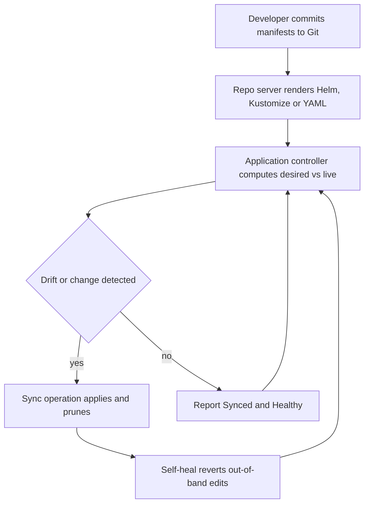

| Difficulty | Channel | Tags |
|---|---|---|
| beginner | devops | argocd, flux, declarative |

Intuit's lift-and-shift to the cloud bought little more than 'slight increases in development velocity' - releases still took days. The team that wrote Argo CD fixed it by making Git the only place a change can happen, and deploys collapsed to minutes [1]. Here is how that reconcile loop actually works, and why the declarative-versus-imperative choice decides whether a platform scales or quietly rots.

---

> ### Real-World Case — Intuit
>
> Intuit was the company that literally invented Argo CD. After a lift-and-shift migration to public cloud gave them only 'slight increases in development velocity' (teams still took days, sometimes weeks, to ship a release), they acquired Applatix in early 2018, open-sourced Argo CD in January 2018, and turned it into the company-wide delivery platform for thousands of microservices across 150+ Kubernetes clusters serving QuickBooks, TurboTax and Mint. The same team that wrote Argo CD had to make it survive real enterprise scale — hundreds of applications across dozens of clusters — without turning a GitOps reconciler into a bottleneck.
>
> | | |
> |---|---|
> | **Challenge** | Scale declarative GitOps delivery to thousands of microservices without giving every one of ~4,000 developers raw kubectl access to production clusters. Intuit had to remove the imperative path (manual kubectl/Helm scripts run by senior engineers) without losing deployment speed, and had to keep the reconciler fast enough that 'declare in Git, get it in the cluster' felt faster than the old imperative scripts rather than slower. |
> | **Solution** | A two-repo GitOps model: a separate deployment repo (one repo per service, separate access control from source, separate branch/overlay per environment) holding K8s manifests, and a Jenkins CI pipeline (12,000+ jobs/day) that promoted images purely by committing a new image tag to the deployment repo. Crucially, 'the pipeline does not have access to k8s clusters' — CI could not touch the cluster at all. Argo CD's Application CRDs pointed at the Git repos and continuously reconciled live cluster state against declared desired state, reporting OutOfSync, reverting manual drift (self-heal), and supporting SSO/RBAC + multi-cluster management. To make the reconciler scale, Intuit redesigned the Argo CD Application Controller to use the Kubernetes watch API with lightweight in-memory caching of only essential resource state instead of querying the API server on every reconciliation. |
> | **Outcome** | Argo CD application reconciliation time went from minutes to seconds (Istio-based app reconciliation dropped from ~1 minute to ~0.5 seconds after the controller redesign); Argo CD went from working on 'a couple clusters and a few dozen applications' to hundreds of applications across dozens of Kubernetes clusters at Intuit, later running as a shared service for hundreds of developers powering 1,000+ deployments daily. On the business side: MTTR fell from 45 minutes to under 5 minutes, the deployment cycle went from days to minutes, creating or upgrading a service with automated e2e build+deploy pipelines took under 10 minutes, and Intuit scaled from zero to ~2,000 services on Kubernetes in 18 months (100+ clusters / 500 services in 2018, 150+ clusters a year later). |
> | **Lesson** | The way to make declarative beat imperative is not to 'write YAML instead of running kubectl' — it is to architect the reconciler so the declarative path is faster than the imperative one, and to strip cluster credentials out of CI entirely so Git is the only write path. Intuit's Jenkins pipeline never had Kubernetes access at all; promotion was a git commit of an image tag, and Argo CD did the rest. The counterintuitive part: the initial Argo CD implementation was too slow (minutes-long reconciliation) and would have felt worse than the old imperative scripts — the watch-API-plus-caching controller redesign (0.5s vs 1 minute) is what turned GitOps from a compliance checkbox into the fastest path to production. |

---

## Hook - The release that took three days

The deploy looked fine in the terminal. It was also three days old. That was the pattern at Intuit after the move to public cloud: infrastructure changed fast, delivery cadence did not [1]. Engineers patched clusters by hand, so nobody could answer three questions without a spelunking expedition through shell history - what is running, who changed it, and how do you undo it?

Sound familiar? The deeper problem, however, is that the cluster keeps perfect records of what happened, but none of who, why, or whether the change was even intentional. Argo CD attacked that gap by moving the decision upstream, into version control, where every change has an author, a message, and a revert.

💡 Insight: a GitOps setup turns 'what is running?' from a cluster archaeology question into a `git log` question. That single shift unlocks everything that follows - and it is exactly where most tutorials get the details wrong.

## Problem - The cluster remembers everything you forgot

Imperative Kubernetes is seductive. `kubectl scale`, `kubectl edit`, `kubectl apply` - instant feedback, instant results, no YAML file to maintain. The catch arrives later, when the cluster and the repository describe different realities.

That gap is configuration drift, and it compounds. Every manual patch becomes invisible history, environments diverge, and the rollback plan becomes 'hope another team saved a copy of the manifest'. Kubernetes documentation draws the line explicitly: declarative management declares a desired state in files and reconciles it, while imperative management issues direct calls to the API server and forgets [7] [8].

| | Declarative (GitOps) | Imperative (kubectl) |
|---|---|---|
| Source of truth | Git commit | Live cluster state |
| Audit trail | Every change reviewed | Shell history, if lucky |
| Rollback | `git revert` and push | Manual reconstruction |
| Drift | Detected and reverted | Silently accumulates |
| Scaling | Costs Git repos, not brain | Costs heroics |

⚠️ Watch Out: `kubectl edit` during an incident feels like a fix and behaves like a time bomb. Argo CD's self-heal mode will eventually revert it, which is exactly what you want in steady state and exactly what nobody wants mid-incident if the team was not warned.

🔥 Hot Take: GitOps does not ban kubectl. It demotes kubectl from 'deployment tool' to 'debugging tool'. Teams that try to ban it outright end up with a slower platform and an untrusted one.

## Real-World Case - Intuit

Intuit is the company that literally invented Argo CD. After acquiring Applatix in early 2018, the team open-sourced the project in January 2018 and turned it into the company-wide delivery platform for thousands of microservices running across 150+ Kubernetes clusters - the infrastructure behind QuickBooks, TurboTax and Mint [1].

Scale forced a redesign. A controller that began on 'a couple clusters and a few dozen applications' had to reconcile hundreds of applications across dozens of clusters without becoming the bottleneck itself [1]. The fix was architectural. Consequently, a single application-controller now does the reconciliation, backed by a repo-server that renders the manifests and shares a cache. Istio-based application reconciliation went from roughly one minute to roughly half a second [1].

The business numbers followed. Mean time to recovery dropped from 45 minutes to under 5. Creating or upgrading a service with automated build-and-deploy pipelines took under 10 minutes. The company scaled from zero to roughly 2,000 services on Kubernetes in 18 months - 100+ clusters and 500 services in 2018, 150+ clusters a year later [1].

💡 Insight: 'GitOps scales' does not mean the YAML scales. It means the control loop scales without a human in it. Intuit's journey from days to minutes is the argument for taking that loop seriously.

## Deep Dive - Declarative vs imperative, and the machine between them

Here is the thing most posts skip: Argo CD is not a webhook and not a CI runner. It is a continuous reconciler, and its design follows the Kubernetes control plane model [9].

The Application CRD is the contract. One Kubernetes object names the Git repository, the path, the target cluster, the namespace, and the sync policy [2]. Two flags do most of the work:

- `automated` - sync automatically when Git changes instead of waiting for a human to click Sync [3]
- `selfHeal` - revert changes made directly in the cluster, restoring the Git-declared state [3]

The famous '3 minutes' in the classic interview answer is not a health-check knob. It is Argo CD's default reconciliation timeout and poll cadence - a ceiling on how long a change may take to surface, not a scheduling promise [3].

Now the plot twist, and it matters specifically because of how Argo CD models state. Declarative does not mean 'Argo CD owns every object in the cluster', and it definitely does not mean 'apply this YAML once'. Declarative means the desired state is a function of inputs: Git plus the Application spec plus the diff settings. When those inputs disagree, you get a fight loop, and the reconciler will dutifully flip the resource back and forth forever.

⚠️ Watch Out: `prune=true` deletes cluster resources that are missing from Git. Enable it before the manifests are complete and you delete production resources a human created years ago and never committed.

🎯 Key Point: Argo CD's diff is three-way - live state, Git state, and the last-applied configuration - which is how it tells an intentional deletion apart from an accidental one [5].

## Workflow - From commit to cluster, and back again

Everything above converges into one loop, and in fact it is the only mental model that matters. The diagram is the mental model worth memorizing: Git holds the desired state, Argo CD is the diff engine, and the cluster is the thing that keeps arguing back.



Concretely, each pass looks like this:

1. Commit a change. The commit is the deployment API call.
2. Argo CD renders the target manifests - Helm, Kustomize, or plain YAML [2].
3. The controller diffs desired against live, including what to prune [4].
4. It applies the diff, then watches health until the workload settles.
5. If someone edits the cluster directly, self-heal restores the Git-declared version [3].

The step that surprises people is the health gate. Moreover, Argo CD does not call a sync complete when the API call returns. It waits for the workload health check to report Healthy, because a Deployment that was accepted but never became ready is not a successful deploy [2].

💡 Insight: put the Application manifest in the same repo as the app and the system bootstraps itself - one root Application syncing everything else, the pattern Argo CD calls app-of-apps [6].

## Code Example - The whole setup in one script

Most GitOps tutorials hand-wave the wiring and focus on the ceremony. Therefore, here is the whole path - login, project, Application, auto-sync, self-heal - as one script.

```bash
argocd login "$ARGOCD_SERVER" --username "$ARGOCD_USER" --password "$ARGOCD_PASSWORD" --insecure

argocd app create payments-api \
  --repo "https://github.com/acme/platform.git" \
  --path "services/payments" \
  --dest-server "https://kubernetes.default.svc" \
  --dest-namespace payments \
  --project payments-platform \
  --upsert

argocd app set payments-api --sync-policy automated --self-heal
argocd app wait payments-api --sync --health --timeout 120
```

The full script below adds drift testing and a rollback path. What matters in this excerpt:

- `argocd app create` registers the Application CRD. `--dest-server` and `--dest-namespace` matter: a repo holding many services usually splits into one Application per service, each pinned to its own namespace [2].
- `argocd app set --sync-policy automated` flips the app from 'human clicks Sync' to 'Git drives the cluster'. Add `--prune` only later [3].
- `argocd app wait --health` blocks until the app reports Synced and Healthy, which is how a pipeline knows the deploy actually landed [3].

⚠️ Watch Out: `--prune` deletes resources missing from Git. Add it on day one and a hand-created resource from three years ago becomes a deletion ticket nobody wrote.

🔥 Hot Take: teams that script `kubectl apply` in CI and call it GitOps are still doing imperative deployment with extra steps. The commit has to be the trigger.

## Lessons Learned - what survives contact with production

Building on the Intuit story, the durable lessons are less about Argo CD syntax and more about operating a reconciler honestly.

- Start declarative, add pruning later. Automate sync first, then enable prune once the repo is provably the complete inventory of what should run.
- Treat the Application manifest as code. It deserves review, version control, and the same change management as the workloads it deploys [2].
- Expect the fight loop. Two controllers writing the same field, an Argo CD app and a Helm operator for instance, produce a tug-of-war no retry will fix [4].
- Keep a break-glass path. During an incident a direct cluster edit may be the right move, so tell the team how to pause self-heal before they need it [3].
- Measure the loop, not the pipeline. Intuit's win was reconciliation time collapsing from minutes to seconds, with MTTR falling from 45 minutes to under 5 [1].

For example, for teams weighing Argo CD against Flux, the honest summary is that both implement the same principle with different ergonomics: Flux leans on a single binary and Git-based coordination, while Argo CD ships a UI, a richer sync model, and Projects for multi-tenancy [10] [11].

🎯 Key Point: the team that answers 'what is running and why?' in one command is the team that ships on a Friday afternoon.

---

## Argo CD Reconciliation Loop


<details>
<summary><strong>Original Interview Question</strong></summary>

**Q:** You're setting up GitOps for a microservices deployment. How would you configure ArgoCD to automatically sync changes from your Git repository to Kubernetes, and what's the difference between declarative and imperative approaches in this context?

**A:** I'd configure ArgoCD by setting up a Git repository containing Kubernetes manifests or Helm charts, creating an Application CRD that points to the Git repository, enabling auto-sync with a health check interval of 3 minutes, and implementing self-healing to automatically revert any manual changes. The declarative approach involves defining the desired state in Git through YAML manifests, Helm charts, or Kustomize configurations, where ArgoCD continuously reconciles the actual state with the desired state. In contrast, the imperative approach uses kubectl commands to make direct changes to the cluster, bypassing the Git repository as the single source of truth.

</details>

## Conclusion

Intuit's Kubernetes journey went from days-long releases to minutes because the decision to change a cluster moved into Git, and Argo CD kept enforcing it [1]. Declarative versus imperative is not academic - it separates platforms that scale from platforms that rot. Tomorrow: pick one service, commit its manifests, and let the reconciler do the remembering.

---

## References

1. [Intuit incident report](https://www.cncf.io/case-studies/intuit/) — article
2. [Argo CD Application Specification](https://argo-cd.readthedocs.io/en/stable/user-guide/application-specification/) — documentation
3. [Argo CD Automated Sync and Self-Heal](https://argo-cd.readthedocs.io/en/stable/user-guide/auto_sync/) — documentation
4. [Argo CD Sync Options (prune, replace, hooks)](https://argo-cd.readthedocs.io/en/stable/user-guide/sync-options/) — documentation
5. [Argo CD Diffing and Drift Detection](https://argo-cd.readthedocs.io/en/stable/user-guide/diffing/) — documentation
6. [Argo CD Declarative Setup and App of Apps](https://argo-cd.readthedocs.io/en/stable/operator-manual/declarative-setup/) — documentation
7. [Kubernetes: Declarative Management of Objects Using Configuration Files](https://kubernetes.io/docs/tasks/manage-kubernetes-objects/declarative-config/) — documentation
8. [Kubernetes API Concepts: Imperative vs Declarative](https://kubernetes.io/docs/reference/using-api/api-concepts/) — documentation
9. [Kubernetes Components: The Control Plane](https://kubernetes.io/docs/concepts/overview/components/) — documentation
10. [Argo CD Source Code and Project Home](https://github.com/argoproj/argo-cd) — documentation
11. [Flux: The GitOps Toolkit for Kubernetes](https://github.com/fluxcd/flux2) — documentation
12. [kubectl Quick Reference: Imperative Commands Cheat Sheet](https://kubernetes.io/docs/reference/kubectl/quick-reference/) — documentation

---

**Author:** Satishkumar Dhule — [GitHub](https://github.com/satishkumar-dhule) · [LinkedIn](https://linkedin.com/in/satishkumar-dhule) · [Website](https://satishkumar-dhule.github.io)
