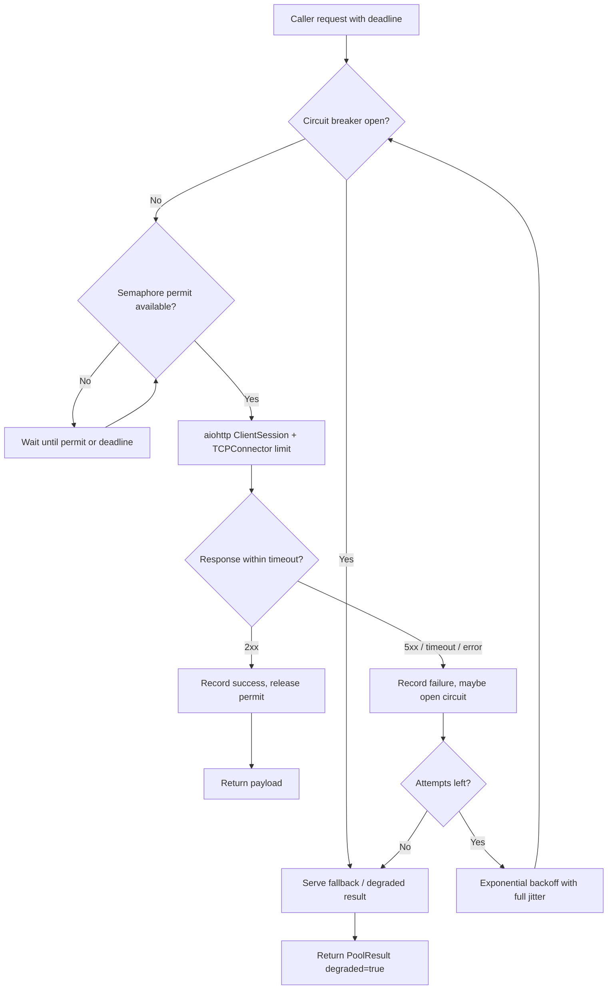

| Difficulty | Channel | Tags |
|---|---|---|
| advanced | backend | asyncio, aiohttp, concurrency |

At 2:47 AM on an unremarkable Tuesday, Netflix's API was returning 200s and serving nothing anyone wanted: one slow internal backend had quietly consumed the thread pools underneath the API in seconds, while 1+ billion daily calls fanned out into a 1:6 burst of dependency traffic [1]. The failure mode was not errors - it was latency, and latency cascades in ways errors never do. That is exactly the shape of the problem aiohttp developers hit when a downstream service degrades: the event loop stays perfectly responsive while your connection pool fills up and your service stops being useful. Here is how to build a pool that sheds load instead of hoarding it.

---

> ### Real-World Case — Netflix
>
> The Netflix API received 1+ billion inbound calls per day, fanning out to several billion outbound calls (a 1:6 ratio) across dozens of internal backends on thousands of EC2 instances, with peaks over 100k dependency requests per second. When a single backend went slow (latency, not even errors), it blocked client request threads and could saturate every Tomcat thread pool in seconds or sub-seconds, taking the entire API down and cascading into the systems layered above it.
>
> | | |
> |---|---|
> | **Challenge** | How to stop one slow or failing dependency from consuming all client connection resources and cascading into a full outage, while still serving users a degraded-but-working response during the incident. |
> | **Solution** | Netflix built Hystrix around four combined fault-tolerance mechanisms: (1) network-level timeouts and retries, (2) per-dependency thread pools as bulkheads, (3) semaphores acquired via tryAcquire — never a blocking call, so requests are rejected instantly instead of queued — and (4) circuit breakers that trip at a ~50% error rate over a 10-second rolling window and reject all traffic until health checks pass. Every failure mode (timeout, thread-pool rejection, semaphore rejection, short-circuit) routes through the same fallback ladder: cache → eventual consistency (queue the write) → stubbed data → empty response (fail silent). Semaphores also protected the fallback path itself, since a fallback that unexpectedly performs a network call could otherwise take down the app. |
> | **Outcome** | Hystrix reached 10+ billion thread-isolated and 200+ billion semaphore-isolated command executions per day across 100+ Hystrix Command types and 40+ thread pools, with a documented 'dramatic improvement in uptime and resilience.' Circuits tripped on roughly one-third of the cluster during a latency incident while every other circuit stayed green, and dashboards showed no increase in 500s because fallbacks served a degraded-but-functional experience. Math that motivated the whole effort: 30 dependencies each at 99.99% uptime compounds to 2+ hours of downtime per month, and one latent dependency could zero out the API in under a second. |
> | **Lesson** | Fail fast and shed load rather than queueing — requests piling up is what kills you. The counter-intuitive part, documented in the Hystrix Operations wiki: when a dependency goes latent, do NOT raise the pool size, semaphore permits, queue length, or timeouts to 'give it breathing room.' With 100 servers x 10 connections allowed (1,000 total) and healthy usage at 200-300, a latency wave pins all 1,000; bumping to 20 per box means 2,000 connections held open against an already-struggling backend, making things worse — Netflix's own words: 'you DDOS yourself.' Size your timeouts near the 99.5th percentile of a healthy system so they cut off bad requests instead of consuming resources. |

---

## Hook - The 2:47 AM Outage That Looked Perfectly Healthy

It was 2:47 AM on a completely unremarkable Tuesday, and the Netflix API was returning 200s while serving nothing anyone wanted. One internal backend had started answering slowly - not failing, just slow - and because that service sat behind six other calls in the fan-out, it consumed the thread pools underneath the API in a matter of seconds [1]. The kicker: the dashboards stayed green. No 500s, no error spike. Just a platform quietly running on empty.

Here is the part worth stealing for your own Python service: errors fail loudly, latency fails silently. A single slow dependency never has to be broken to take your API down. It only has to be slower than the patience of everything queued behind it.

Now translate that into asyncio. A hung aiohttp request does not block a Tomcat thread - it blocks a connection slot, a semaphore permit, and a slice of your latency budget. The loop keeps spinning, the health check keeps returning OK, and your service degrades into something that answers every request slowly. That is a much quieter failure than a stack trace, and it is exactly what a production connection pool has to be designed against.

## Problem - Your Pool Is a Queue That Pretends to Be a Pool

The trouble starts with a misapprehension. Developers call aiohttp's ClientSession a 'pool' and assume the hard part is done. What ClientSession actually gives you is a connector with a default limit of 100 live connections [2] - a ceiling, not a strategy. Underneath it, aiohttp's default ClientTimeout is 300 seconds for an entire request [2], which means one wedged backend can park a connection slot for five full minutes. Five minutes times a hundred slots is how a pool becomes a parking garage full of zombies.

Then the math gets hostile. Netflix's version is the cleanest available: 30 dependencies each at 99.99% uptime compound to more than two hours of downtime per month [1]. Compounding, not adding. One hidden dependency with a bad afternoon and the whole API is down in under a second [1]. Your 'fast' internal service is only fast when its own dependencies are fast, and dependency chains are precisely where latency hides.

So the real problem statement is this: how do you bound the damage when a dependency slows down, without turning your own service into the bottleneck? That means answering four questions, in order:

- How many concurrent calls are allowed? (a ceiling you can reason about)
- How long will you wait before giving up? (a deadline, not a hope)
- What happens on a transient failure? (retry, but politely)
- What happens when retries are not enough? (stop sending traffic entirely)

Sound familiar? These are the same four questions a circuit breaker answers, and the same ones Netflix Hystrix answered with thread isolation and semaphore isolation [7] - where semaphore isolation is the asyncio-native cousin: a shared counter of permits instead of a private pool of threads.

## Real-World Case - Netflix and the 1:6 Fan-Out That Ate the API

Netflix is the canonical war story here, and the numbers are almost too large to be useful - which is exactly why they are useful, because they delete the excuse that 'our traffic is different' [1].

At the top of their stack sat an API taking more than a billion inbound calls per day. Each one fanned out into several billion outbound calls across dozens of internal backends - a 1:6 ratio - running on thousands of EC2 instances, with peaks above 100,000 dependency requests per second [1]. Every one of those fan-out calls was a potential thread blocked on a slow service.

The incident that shaped the architecture was not a traffic spike. It was a single backend that got slow. Because requests were isolated per thread pool, that one slow service would block client threads, saturate every Tomcat thread pool in seconds or sub-seconds, and cascade into the systems layered above it [1]. The API went down while the graphs looked healthy.

The fix was Hystrix: circuit breakers with fallbacks, two flavors of isolation (dedicated thread pools, plus semaphore-based isolation for high-volume commands), and rolling windows of health data. The scale of the adoption is the headline - 10+ billion thread-isolated and 200+ billion semaphore-isolated command executions per day, across 100+ Hystrix Command types and 40+ thread pools [1]. Netflix called the result a 'dramatic improvement in uptime and resilience' [1].

Two details are worth stealing. First, during a latency incident, circuits tripped on roughly a third of the cluster while every other circuit stayed green [1] - degradation is per-dependency, not global. Your payment service can be on fire while your recommendation service is fine, and a good pool should know the difference. Second, the dashboards showed no increase in 500s, because fallbacks served a degraded-but-functional experience [1]. The service was slower and less complete, but it was up - and 'up but degraded' is a very different business outcome from 'down'.

## Deep Dive - The Four Levers and Their Real Trade-Offs

Building on those four questions, here is the machinery - and the trade-offs that make it production-shaped rather than textbook-shaped.

| Lever | What it bounds | If you get it wrong |
|---|---|---|
| Concurrency limit (semaphore + connector limit) | Simultaneous in-flight calls | Too low and you head-of-line block your own healthy traffic; too high and you become the load generator that kills the dependency |
| Layered timeouts (connect / read / total) | How long one call can occupy a slot | One giant total timeout means a dead peer parks a slot for minutes; no timeout means the slot is never returned |
| Exponential backoff with jitter | Retry pressure on a struggling peer | Backoff without jitter synchronises every client into the same retry wave; uncapped retries are a self-inflicted DDoS |
| Circuit breaker with fallback | Total traffic sent to a sick peer | No half-open probe and the breaker never discovers recovery; no fallback and 'open' just converts slow failures into fast ones |

The concurrency lever deserves the most attention in an asyncio codebase, because the semantics invert compared to a threaded service. In Netflix's world, isolation meant dedicating a thread pool to each dependency so one slow service could not consume the shared pool [1][7]. In asyncio you cannot dedicate threads to dependencies - but you can dedicate *permits*. asyncio.Semaphore is the concurrency primitive that bounds how many tasks may proceed past a point [4], and it is remarkably close in spirit to Netflix's semaphore isolation strategy [7]. Two subtle points bite in practice:

- The semaphore and the connector limit are not the same knob. The connector limit caps sockets; the semaphore caps *your work*, including time spent on headers, retries and JSON parsing. If you only set the connector limit, slow body reads still pin sockets. Set both, and remember the effective concurrency is the lower of the two.
- A semaphore is not a queue-management strategy by itself. Waiting on acquire() can wait forever, which turns saturation into an unbounded pile-up of pending tasks. Wrap the wait in asyncio.timeout (Python 3.11+) [3] or asyncio.wait_for so saturation surfaces as a fast, explicit rejection.

The timeout lever is where teams under-engineer. One 'total' timeout flattens three distinct failure modes: a TCP connect that hangs in a network blackhole, a peer that accepts the connection and then never replies, and a response body that trickles forever. aiohttp exposes connect, sock_read and total separately [2], and layered budgets let cheap failures fail fast while expensive ones get a little more room.

The retry lever needs one specific warning, and it is the thing most hand-rolled retry loops get wrong: exponential backoff *without jitter* synchronises every caller into the same retry wave, turning a small recovery into a thundering herd that re-kills the service you are waiting for. The AWS Builders' Library is the canonical write-up on adding jitter so retries spread out instead of aligning [8]. Cap the attempts, cap the delay, and only retry what is actually retryable - connection errors and timeouts, never a 4xx.

Finally, the circuit breaker, the piece that makes degradation possible. The pattern is a state machine [5]:

- CLOSED - traffic flows, failures are counted.
- OPEN - traffic is shed entirely; a fast, cheap failure replaces a slow, expensive one.
- HALF_OPEN - after a cool-down, a small number of probe requests test whether the dependency recovered. Success closes the circuit, one failure re-opens it.

The half-open state is the part teams skip, and skipping it means the breaker either never recovers or flaps. Netflix's version is the reset window in Hystrix, and the observed behaviour was exactly what you want: during a latency incident, circuits tripped on about a third of the cluster while the rest stayed green [1].

One counterintuitive truth is worth sitting with: retries and circuit breakers pull in opposite directions. Retries keep sending traffic *into* a service that may be dying; the breaker stops the traffic so that service can recover. Healthy clients use both - retry for the blip, break for the outage. If your system has only one of the two, it will be either too eager (a retry storm) or too brittle (failing fast on the first hiccup). Google SRE's guidance on overload makes the same argument from the capacity side: shedding load deliberately is far cheaper than the collapse you get by accepting everything [9].

And a plot twist about aiohttp specifically, because it sits in the snippet most blogs copy: `async with session.get(url) as response: return response` looks fine and is not. The `async with` block releases the connection back to the pool the moment you exit it, so returning the response object hands the caller a socket that is already gone [2][10]. Read the body inside the context manager and return plain data. Small detail, spectacular 3 AM bug.

## Workflow - How a Request Flows Through the Pool

Here is the request path, end to end, and how the pieces fit together:

1. **The caller arrives** with a deadline of its own. Everything below is bounded by that deadline - the pool never exceeds the caller's patience.
2. **Circuit breaker check first, not last.** If the circuit for this dependency is OPEN, the call is rejected immediately and a fallback is served. This is the load-shedding step and it costs microseconds.
3. **Acquire a permit** from the semaphore. If no permit is free the caller waits - but only until its timeout fires, then it fails fast rather than piling up.
4. **Execute the call** through the shared aiohttp ClientSession, whose TCPConnector enforces the hard socket ceiling and keeps DNS in a TTL cache [2][10].
5. **Classify the outcome**: a 2xx resets the failure counter, while 5xx, aiohttp.ClientError or asyncio.TimeoutError counts as a failure and feeds the breaker.
6. **Retry with backoff and jitter** if the failure looks transient and attempts remain.
7. **Degrade, do not explode**: when attempts are exhausted or the circuit is open, the pool returns a fallback payload flagged `degraded=True`, so the caller can tell a reduced answer from a real one.
8. **Release the permit** - always, including on the failure path. A leaked permit is a permanently smaller pool.
9. **On shutdown, close the session** so sockets are closed cleanly instead of leaking file descriptors across a reload [2].

The Mermaid diagram below traces that flow, including the two exits that keep the system alive: the degraded response and the jittered retry loop.

Notice what is *not* in the flow: no unbounded wait, no uncapped retry, and no raw exception escaping the pool boundary untyped. Callers get a result, not a surprise.

## Code Example - A Pool Manager That Degrades Instead of Collapsing

Dive into the implementation below and a few decisions stand out.

The breaker is a dataclass with its own lock, so concurrent tasks cannot corrupt the state machine while it is transitioning between CLOSED, OPEN and HALF_OPEN. `allow()` is the only gate that matters: it returns False fast when the circuit is open, and it limits how many half-open probes may run at once so that recovery testing never becomes a second outage.

The request loop checks the breaker *before* touching the semaphore. That ordering matters. If the circuit were checked after acquiring a permit, a sick dependency would still occupy your permits while you reject it - you would be shedding traffic in the slowest, most wasteful way possible.

Retries reuse the same session and the same permit, so a retry storm cannot multiply your concurrency. The backoff ceiling is `min(base * 2 ** (attempt - 1), max_delay)`, and the sleep uses `random.uniform(0, ceiling)` - full jitter, which spreads retries across the whole window instead of bunching them at the top of it [8].

The result object is deliberately not aiohttp's ClientResponse. The payload is read inside the `async with` block and returned as plain data, because the connection is recycled the moment that block exits [2]. A `PoolResult` also carries the `degraded` flag, so a fallback answer is never mistaken for a complete one by the caller.

Finally, `__aenter__`/`__aexit__` make the manager an async context manager. That is how the session gets closed deterministically on shutdown instead of leaking sockets and file descriptors - the asyncio equivalent of the cleanup discipline Netflix's thread pools needed.

## Lessons Learned - Battle Scars and the Checklist

Netflix did not solve this with a clever library call. They solved it with explicit isolation, explicit deadlines, explicit breakers and explicit fallbacks [1] - and the same four levers are available to you in aiohttp in about 120 lines.

**Battle scars - the mistakes that show up in every post-mortem:**

- **Unbounded waits.** A semaphore without a timeout is a slow-motion outage. Always pair the acquire with a deadline.
- **One giant timeout.** Split connect / read / total so a blackholed TCP connect fails in 2 seconds instead of 120.
- **Retries without jitter.** Synchronised retries are a coordinated denial of service you are paying for [8].
- **Retrying 4xx.** A 400 or a 422 will never succeed on a retry. Retry errors, timeouts and 429s (respecting Retry-After).
- **Returning the response outside its context manager.** The socket is already released; read the payload first [2].
- **Session leaks.** One ClientSession per request instead of one per application leaks sockets and file descriptors. Close it on shutdown.
- **Blocking the loop.** A single synchronous HTTP call inside a coroutine stalls every task in the process - the asyncio twin of Netflix's blocked Tomcat threads [1].
- **Forgetting the fallback path.** Graceful degradation is not 'return 503'. It is returning a usable, deliberately reduced answer (cached data, a default ranking, a partial response) and marking it as degraded.

**When would you actually reach for each lever?**

- *Single dependency, low traffic:* a ClientSession with a sane timeout is probably enough. Do not build a framework for a hello world.
- *Several dependencies, moderate traffic, occasional slow calls:* semaphore plus layered timeouts plus jittered retries. This is the 90% case.
- *A dependency that can be slow for minutes* (payments, third-party APIs): add a circuit breaker with a fallback. This is where the real money is saved.
- *Fan-out services where one slow callee blocks a whole response:* per-dependency breakers, so one green circuit stays green [1].

**The checklist to run tomorrow morning:**

1. Does every outbound call have a total timeout? (A 300-second default is not a timeout, it is a scheduling policy.)
2. Is there a hard concurrency ceiling, and is it lower than what the dependency can serve?
3. Do retries have a cap, jitter, and an explicit retryable-error list?
4. Does a sick dependency get a circuit breaker with a half-open probe?
5. Is there a fallback that returns something useful rather than nothing?
6. Are permits released on every path, including exceptions and cancellation?
7. Is the session closed on shutdown, and are you certain there is exactly one per process?

**The one insight worth sharing with your team:** every timeout you set is a promise you make to your caller. The pool's job is not to make slow dependencies fast - it is to guarantee that when the network misbehaves, the failure stays small, local and cheap. Netflix's dashboards showed no increase in 500s during a latency incident because fallbacks kept serving [1]. That is the real goal: not 'never fail', but 'fail small'.

---

## Request Flow Through the Connection Pool

<strong>Original Interview Question</strong>

**Q:** How would you implement a connection pool manager for aiohttp that handles graceful degradation under high load and connection timeouts?

**A:** Implement a connection pool manager for aiohttp using a semaphore to limit concurrent connections, exponential backoff for retrying failed requests, and circuit breaker pattern to gracefully degrade under high load and connection timeouts.

## Conclusion

Netflix's API handled more than a billion calls a day through a 1:6 fan-out and survived the failure of a single slow backend - not because the backend was fast, but because the layers underneath it were bounded [1]. Thirty dependencies at 99.99% uptime still compound into more than two hours of downtime a month, which means the only real question is not 'will a dependency fail' but 'how small will the blast radius be when it does'.

So tomorrow, find the one outbound call in your service with the least defensive code around it - the one where the timeout is 30 seconds or 'none', where retries are unbounded, or where a slow response holds a worker hostage. Give it a deadline, a ceiling, jittered retries, a breaker with a fallback, and a semaphore permit that is always returned. Then turn the pressure up in a load test: make the dependency slow on purpose and watch the service stay up and degraded instead of up and useless.

The memorable version, the one worth repeating in a standup: graceful degradation is not a feature you add when the outage happens - it is a budget you set long before the outage arrives. Netflix's 200+ billion semaphore-isolated executions per day [1] are not a badge of honour. They are proof that the boring defensive layer was built before the bad Tuesday showed up.

---

## References

1. [Netflix incident report](https://netflixtechblog.com/fault-tolerance-in-a-high-volume-distributed-system-91ab4faae74a) — article
2. [aiohttp Client Reference: connectors, timeouts and sessions](https://docs.aiohttp.org/en/stable/client_reference.html) — documentation
3. [Python asyncio: Coroutines, Tasks and Timeouts](https://docs.python.org/3/library/asyncio-task.html) — documentation
4. [Python asyncio Synchronization Primitives (Semaphore)](https://docs.python.org/3/library/asyncio-sync.html) — documentation
5. [Circuit Breaker Design Pattern](https://en.wikipedia.org/wiki/Circuit_breaker_design_pattern) — documentation
6. [Exponential Backoff](https://en.wikipedia.org/wiki/Exponential_backoff) — documentation
7. [Netflix Hystrix: Circuit Breaker and Isolation Library](https://github.com/Netflix/Hystrix) — documentation
8. [AWS Builders' Library: Timeouts, Retries and Backoff with Jitter](https://aws.amazon.com/builders-library/timeouts-retries-and-backoff-with-jitter/) — blog
9. [Google SRE Book: Handling Overload](https://sre.google/sre-book/handling-overload/) — documentation
10. [aiohttp: Async HTTP client/server framework for asyncio](https://github.com/aio-libs/aiohttp) — documentation

---

**Author:** Satishkumar Dhule — [GitHub](https://github.com/satishkumar-dhule) · [LinkedIn](https://linkedin.com/in/satishkumar-dhule) · [Website](https://satishkumar-dhule.github.io)
