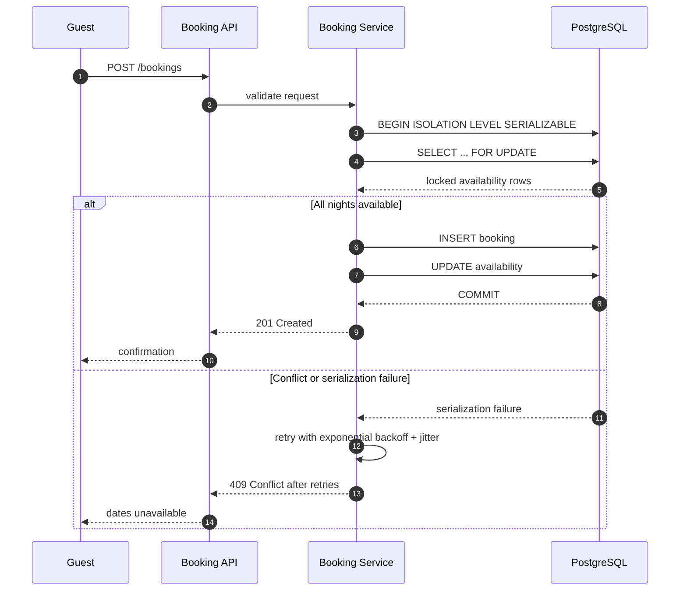

| Difficulty | Channel | Tags |
|---|---|---|
| intermediate | database | acid, isolation-levels, mvcc |

Two travelers tap “Reserve” on the same seaside villa at the same instant. Both see the same availability calendar, both get a confirmation, and only later does one discover the reservation never really existed. Booking.com ran straight into this problem when its Order Platform moved reservation data onto Cassandra to escape the operational pain of sharded MySQL, only to find that checkout and modification are multi-step read-modify-write operations that Cassandra's row-level isolation could not protect [1]. The platform now holds roughly 20 TB of reservation data across three regions and reports 99.999% availability with a 99.99998% write SLI, but only after the team explicitly traded raw write availability for strong ACID guarantees [1]. Here is how to design that trade-off for an Airbnb-style booking system without turning your database into a global queue.

---

> ### Real-World Case — Booking.com
>
> Booking.com built its Order Platform, the centralized system that owns reservations across hotels, flights, and cars, on Cassandra to escape the operational pain of sharded MySQL. But reservation data is transactional: checkout and modification require multi-step read-modify-write operations across multiple rows and partitions, and Cassandra offered only row-level isolation.
>
> | | |
> |---|---|
> | **Challenge** | Cassandra had no ACID transactions, so the team denormalized aggressively and added a locking layer built on lightweight transactions to make multi-row reservation updates atomic. The locking layer timed out unpredictably, and the team could not tell whether a timeout meant the booking condition genuinely failed or the database was having an unrelated problem, exactly the ambiguity that can turn a retry into a duplicate or lost booking. |
> | **Solution** | Booking.com migrated Order Platform to CockroachDB, a distributed SQL database whose transactions are serializable and MVCC-backed. ACID guarantees let the team remove the fragile locking layer and extra cross-checks, while secondary indexes and native CDC eliminated the separate OpenSearch sync path. They run one cluster across Frankfurt, London, and Ireland so a node or region can fail without disturbing reservations. |
> | **Outcome** | Order Platform now holds about 20 TB of reservation data and runs across 3 regions with 99.999% availability. Booking.com reports a 99.99998% write SLI, after explicitly accepting lower raw write availability than Cassandra in exchange for strong ACID guarantees. |
> | **Lesson** | For the booking commit, consistency is the availability feature: high availability means surviving a region loss without corrupting the reservation invariant, not serving stale reads on the write path. Row-level isolation is not enough when the invariant spans rows, so let the database enforce atomic check-and-write instead of rebuilding it with application-level locks. |

---

## Hook — Two Guests, One Villa, One Dangerous Refresh

At 11:58 p.m., two travelers open the same listing, see the same green calendar, and tap Reserve within milliseconds of each other. The API accepts both requests, the database writes both rows, and two confirmation emails land in two inboxes. The villa has one set of keys. What happens next is not a database detail; it is a support ticket, a refund, a cancelled trip, and a customer who never trusts the calendar again. The uncomfortable truth is that this failure does not require a crashed server or a network partition. It only requires two requests that read availability before either one writes. That tiny gap between read and write is where booking systems earn or lose their reputation.

## Problem — The Check-Then-Write Race

The hook exposes a deceptively simple race condition. A booking request must answer three questions atomically: are all the requested nights free, can a reservation be inserted, and can those nights be marked unavailable? In a naive implementation, those are separate steps. Request A reads the calendar, sees an open week, and pauses. Request B reads the same calendar, sees the same open week, and writes first. Request A resumes, still believing its snapshot is current, and writes second. Both transactions may succeed because nothing in the database knows that the two reads were supposed to be mutually exclusive. This is the classic lost-update and write-skew family of anomalies, and it is exactly why ACID matters for reservation data [6].

The stakes are asymmetric: a slow checkout annoys one user, but a double booking damages trust, creates refunds, and can strand a family at midnight. The problem gets harder when availability is stored as ranges rather than nights, when reads hit replicas, and when popular properties concentrate thousands of requests on a handful of rows. Many developers reach for a transaction and assume the job is done. However, a transaction without the right isolation level or lock strategy can still let two correct-looking writes collide. The next question is what happens when a company tries to solve this by changing databases.

## Real-World Case — Booking.com's Cassandra Detour

Booking.com's Order Platform is the centralized system that owns reservations across hotels, flights, and cars. To escape the operational pain of sharded MySQL, the team moved reservation data onto Cassandra. The appeal was obvious: horizontal scale, multi-region distribution, and fewer shard-management headaches. Then the shape of the workload reasserted itself. Checkout and modification are multi-step read-modify-write operations across multiple rows and partitions, while Cassandra offered only row-level isolation [1][7]. Row-level isolation is useful, but it does not make a multi-row itinerary atomic. A flight, a hotel night, and a car reservation can each be individually consistent while the combination is not.

The plot twist is what Booking.com did next: it accepted lower raw write availability in exchange for strong ACID guarantees [1]. That sounds backwards until you remember what the product sells. A reservation system that is always writable but occasionally wrong is not highly available in any meaningful sense. Today the Order Platform holds about 20 TB of reservation data, runs across three regions, and reports 99.999% availability with a 99.99998% write SLI [1]. The lesson is not that Cassandra is bad. The lesson is that row-level isolation is the wrong tool when the unit of correctness is a multi-row itinerary [8].

## Deep Dive — SERIALIZABLE, MVCC, and the Cost of Being Right

Building on that case, the core design choice is not which database logo appears on the slide. It is where you enforce the invariant that a property cannot be sold twice for the same night. There are three broad approaches, and each buys a different kind of pain.

Pessimistic locking makes conflicting writers wait by taking row locks before they modify data [9]. Optimistic concurrency control lets writers proceed and then checks a version or predicate at commit time, aborting one of them if the world changed [5]. SERIALIZABLE isolation goes further, making the database behave as if transactions ran one at a time, even when they physically overlap [2]. In PostgreSQL, SERIALIZABLE uses serializable snapshot isolation, which detects dangerous structures and returns a serialization failure instead of committing a corrupted result [2]. That distinction matters: SERIALIZABLE does not remove conflicts. It converts silent corruption into a retryable error.

MVCC is the other half of the story. Most reads see a snapshot rather than blocking writers, which keeps availability checks fast and dashboards responsive [4]. But a snapshot can be stale by the time you write, so the write path still needs a lock, a version check, or predicate protection. A practical pattern is one row per property per night, with a primary key on property_id and stay_date. Lock the exact nights in a deterministic order with SELECT FOR UPDATE, verify that the number of locked rows matches the number of nights, insert the booking, and mark those rows unavailable in the same transaction [3]. This turns a range problem into a set of point locks. It also limits the blast radius: a hot property locks its own nights, not the entire calendar.

The trade-off is lock contention. A Taylor Swift concert weekend can concentrate thousands of requests on the same rows, so the system needs bounded retries, jitter, and a fast failure path. Read replicas help availability checks, but they must never be the source of truth for the final write. Caching helps too, provided invalidation happens after commit and not before. The table below summarizes the real trade-offs.

| Approach | Strength | Failure mode | Best fit |
| --- | --- | --- | --- |
| Pessimistic row locks | Simple mental model; conflicts wait | Deadlocks, lock contention, pool exhaustion | High-contention inventory with short transactions |
| Optimistic version check | No blocking; good throughput | Retry storms; lost work under contention | Low-to-moderate contention, read-heavy flows |
| SERIALIZABLE | Strongest correctness; detects write skew | Serialization failures require retries | Multi-row invariants and financial or reservation data |
| Read replica check | Low latency for browsing | Stale reads; unsafe for final commit | Search and display only |

💡 Insight: The invariant is the product. A calendar that says “available” is a promise, and the transaction is how you keep it.

⚠️ Watch Out: SELECT FOR UPDATE on a range without a proper index can lock more rows than you expect, which turns a busy calendar into a queue [9].

## Workflow — From Request to Committed Reservation

Here is the workflow that turns the theory into a repeatable booking path. The Event Sequence diagram below shows both the happy path and the conflict path.

1. Validate the request shape: property, guest, check-in, check-out, and an idempotency key. Reject invalid date ranges before touching the database.
2. Begin a SERIALIZABLE transaction so the entire read-modify-write unit is protected [2].
3. Lock the exact availability rows for the requested nights with SELECT FOR UPDATE, ordered by stay_date to keep lock acquisition deterministic [3].
4. Verify that the locked row count equals the number of nights. A gap means at least one night is already sold.
5. Insert the reservation row with a status of confirmed.
6. Update the same availability rows to unavailable before committing.
7. Commit. If the database detects a serialization conflict, roll back the whole unit and retry with exponential backoff plus jitter.
8. Return 201 Created on success or 409 Conflict after the retry budget is exhausted.
9. Invalidate the availability cache only after a successful commit, never before.
10. Emit metrics for lock wait time, retry rate, 409 rate, and per-property contention so hot properties are visible before they become incidents.

The important detail is that retries happen outside the transaction boundary. A serialization failure rolls back everything, so replaying the whole unit of work is safe. A business rejection such as “dates unavailable” is not retryable and should fail fast. That distinction keeps the system honest under load.

## Code Example — A Retry-Safe Booking Function

The code below implements the core of that workflow in Python with psycopg and PostgreSQL. It assumes a property_availability table with one row per property per night, a primary key on (property_id, stay_date), and a boolean is_available column. The function wraps the read, validation, insert, and update in a single SERIALIZABLE transaction, locks the exact nights in date order, and retries only on serialization failures. That last restriction matters: retrying a validation error or a business rejection just wastes capacity and delays the user.

## Lessons Learned — What to Change Tomorrow

Booking.com's experience points to a simple moral: correctness is an availability feature [1]. If the calendar lies, the system is down for the user who planned a trip around it. Here are the takeaways worth carrying into the next design review.

- Model the invariant, not the UI. One row per property per night with a unique key makes double booking a database-level impossibility, not a code-review hope.
- Use SERIALIZABLE for multi-row reservations, and treat serialization failures as normal traffic. The database is doing its job by refusing to commit a dangerous interleaving [2].
- Lock in a deterministic order and keep transactions short. Never call an external payment or notification API while holding row locks.
- Add exponential backoff with jitter, cap the retry budget, and return a clear 409 when the dates are gone. Retry storms are self-inflicted outages.
- Cache after commit, read replicas for browsing only. Stale reads are fine for search results and fatal for final confirmation.
- Monitor lock waits, retry rates, and per-property contention. A single hot listing can exhaust a connection pool faster than a global traffic spike.
- Test with concurrent clients, not just unit tests. Two threads, one property, and a barrier before the write will reveal more than a hundred happy-path assertions.
- Battle scar to avoid: range locks without indexes. Battle scar to avoid: duplicate client retries without idempotency keys. Battle scar to avoid: cache invalidation before commit.

🔥 Hot Take: If your booking flow checks availability with a plain SELECT and then inserts, you do not have a booking system. You have a suggestion box.

For teams on DynamoDB, a conditional write on a version attribute can enforce the same invariant, but the item key must be designed around the reservation boundary [10]. The database changes; the invariant does not.

---

## Event Sequence

<strong>Original Interview Question</strong>

**Q:** You're building a booking system for Airbnb where multiple users can reserve the same property simultaneously. How would you design the transaction handling to prevent double bookings while maintaining high availability?

**A:** Use SERIALIZABLE isolation with optimistic concurrency control. Implement row-level locks on property availability tables, use MVCC snapshot reads for checking availability, and apply application-level validation to ensure atomic booking operations.

## Conclusion

Two guests, one villa, zero double bookings. That outcome is not achieved by hoping the database is fast enough. It is achieved by making the invariant explicit, modeling availability at the right granularity, and treating conflicts as a normal part of the protocol. Booking.com learned that lesson at enormous scale: a system that is always writable but occasionally wrong is not highly available to the customer standing at the front desk [1]. The next time your team designs a booking flow, ask one question before choosing a database: what is the smallest unit that must be atomic? If the answer spans multiple rows or partitions, row-level isolation is not enough. Model the nights, lock the set deterministically, retry the conflict, and measure the result. Your future on-call engineer will thank you.

---

## References

1. [Booking.com incident report](https://www.cockroachlabs.com/customers/booking-com/) — article
2. [PostgreSQL Documentation: Transaction Isolation](https://www.postgresql.org/docs/current/transaction-iso.html) — documentation
3. [PostgreSQL Documentation: SELECT and FOR UPDATE](https://www.postgresql.org/docs/current/sql-select.html#SQL-FOR-UPDATE-SHARE) — documentation
4. [Multiversion Concurrency Control](https://en.wikipedia.org/wiki/Multiversion_concurrency_control) — documentation
5. [Optimistic Concurrency Control](https://en.wikipedia.org/wiki/Optimistic_concurrency_control) — documentation
6. [ACID](https://en.wikipedia.org/wiki/ACID) — documentation
7. [Apache Cassandra Documentation](https://cassandra.apache.org/doc/latest/) — documentation
8. [Serializability](https://en.wikipedia.org/wiki/Serializability) — documentation
9. [PostgreSQL Documentation: Explicit Locking](https://www.postgresql.org/docs/current/explicit-locking.html) — documentation
10. [Amazon DynamoDB: Working with Items and Conditional Writes](https://docs.aws.amazon.com/amazondynamodb/latest/developerguide/WorkingWithItems.html#WorkingWithItems.ConditionalUpdate) — documentation

---

**Author:** Satishkumar Dhule — [GitHub](https://github.com/satishkumar-dhule) · [LinkedIn](https://linkedin.com/in/satishkumar-dhule) · [Website](https://satishkumar-dhule.github.io)
