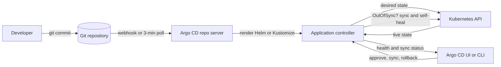

| Difficulty | Channel | Tags |
|---|---|---|
| beginner | devops | argocd, flux, declarative |

In January 2019, Intuit's platform team promoted Argo CD to its first production instance tracking roughly 150 applications, and the controller barely moved. The tool that had felt magical across a couple of clusters and a few dozen apps was suddenly the bottleneck in a GitOps dream [1]. The fix was not a bigger kubectl habit; it was a controller redesign that made reconciliation faster and more scalable [1]. What follows is the practical path from that painful wake-up call to an Argo CD setup that can keep Kubernetes honest.

---

> ### Real-World Case — Intuit
>
> Intuit was an early Kubernetes adopter running hundreds of microservices, and its platform team built Argo CD internally to replace imperative kubectl/Helm release runbooks with declarative GitOps. The initial version worked fine for a couple of clusters and a few dozen applications, so they promoted it to their first production instance tracking roughly 150 applications.
>
> | | |
> |---|---|
> | **Challenge** | The straightforward Argo CD controller design did not scale: after the production upgrade, reconciliation speed barely improved, and the Kubernetes Go client's built-in throttling silently capped API requests at 5 QPS. The tool that was supposed to make deployments declarative and self-healing was becoming the bottleneck, while teams still relied on imperative blue/green and canary steps that broke the GitOps model. |
> | **Solution** | Intuit reworked Argo CD's core architecture rather than adding more workers: they introduced aggressive caching of cluster state and Git manifests, redesigned the application controller to avoid repeated API calls, and removed reconciliation bottlenecks. They also separated deployment manifests from source code in Git, used Jenkins CI to promote immutable image tags by committing to deployment repos, and enabled automated sync plus self-healing so Argo CD continuously reconciled live state to Git. For progressive delivery, they built Argo Rollouts so blue/green and canary orchestration became declarative and idempotent instead of imperative scripts. |
> | **Outcome** | The redesigned controller let Intuit scale Argo CD from dozens to hundreds of applications across dozens of Kubernetes clusters; the company later reported 160+ clusters, 1,300 deployments per day, deployment cycles cut from days to minutes, and MTTR reduced from 45 minutes to 5 minutes. |
> | **Lesson** | GitOps is not just 'install Argo CD and turn on auto-sync.' The declarative model only delivers self-healing and auditability if the controller itself is engineered for scale, and any imperative step left in the pipeline — like manual canary promotion — will eventually undermine the single source of truth. |

---

## Hook — The Dashboard Said Synced. The Pager Disagreed.

At 2 a.m., a Kubernetes dashboard can look perfectly calm while a release is quietly rotting. A developer scales a deployment to chase a latency spike, someone hot-fixes a ConfigMap in production, and a stale image tag drifts from the one recorded in Git. Nothing is on fire yet—but the cluster no longer matches the source of truth.

That is the moment GitOps stops being a buzzword and becomes a reliability strategy. The question is not whether teams can deploy with kubectl; it is whether they can prove what changed, why it changed, and how to get back to a known-good state without archaeology. Intuit ran into that question at production scale, and the answer reshaped Argo CD itself [1].

## Problem — Drift Is a Slow-Motion Outage

That calm dashboard hides the real enemy: configuration drift. In a microservices estate, drift is not a cosmetic issue. It is a slow-motion outage. An imperative workflow—kubectl apply here, helm upgrade there—works beautifully on one cluster and becomes untenable across dozens [5]. Each command is a tiny, invisible commit to the cluster; the audit trail lives in shell history, Slack threads, and someone's laptop.

The stakes rise with every service. A platform team may own the deployment mechanism, but product teams own the manifests. Without a single source of truth, environments diverge: staging gets a resource limit that production never sees, a hotfix survives a rollback, and a new hire cannot reproduce the current state from any repository [6]. The result is slower releases, longer incident response, and a growing fear of touching the cluster.

⚠️ Watch Out: `kubectl edit` is the enemy of reproducibility. It feels fast because it skips the pull request, the review, and the paper trail—exactly the steps that protect you at 3 a.m.

## Real-World Case — Intuit's 150-App Wake-Up Call

Drift gets expensive the moment a platform crosses from dozens of apps to hundreds. In January 2019, Intuit's platform team promoted Argo CD from a promising internal tool to its first production instance tracking roughly 150 applications [1]. The original controller had been comfortable with a couple of clusters and a few dozen apps. At 150, the reconciliation loop was not keeping up; even after an upgrade, the team saw almost no improvement in reconciliation speed [1].

The diagnosis was not "Kubernetes is slow." It was architecture. The controller was doing too much work per application, re-fetching and re-comparing state inefficiently, and carrying bottlenecks that only appear at scale. Intuit's engineers added caching, redesigned the controller, and removed those bottlenecks [1]. The result was Argo CD v0.11, a release that could handle the load and became the foundation for much larger fleets.

The payoff was measurable. Intuit later reported managing more than 160 clusters, running 1,300 deployments per day, cutting deployment cycles from days to minutes, and reducing MTTR from 45 minutes to 5 minutes [1]. That is the real promise of GitOps: not just prettier YAML, but a faster, safer operating model.

## Deep Dive — Declarative vs. Imperative, Without the Dogma

The way out starts with a shift in ownership: Argo CD is a Kubernetes controller, not a wrapper around kubectl [2]. It continuously compares the live state of your cluster with the desired state declared in Git, marks any difference as OutOfSync, and can either report the drift or correct it [2]. The Application custom resource is the contract: it names the repo, the path, the target cluster, and the sync policy [3].

### Declarative vs. Imperative

| Dimension | Declarative (GitOps) | Imperative (kubectl/Helm CLI) |
|---|---|---|
| Source of truth | Git commit history [6] | Shell commands and human memory [5] |
| Change review | Pull request, diff, approval | Often none, or a Slack message |
| Drift detection | Continuous reconciliation [2] | Manual comparison, if any |
| Rollback | Revert the commit | Re-run an older command and hope |
| Auditability | Built into version control [8] | Scattered across terminals and CI logs |

Declarative does not mean "no commands." It means the command creates or updates a declaration, and a controller owns the ongoing result. Imperative is not evil either; `kubectl run` is perfect for a throwaway debug pod. The mistake is using imperative commands for durable production state.

The subtle part is the sync policy. Auto-sync makes Git commits flow to the cluster without a human clicking Sync [4]. Self-healing goes further: if someone edits a Deployment directly, Argo CD reverts it to the Git version [4]. That is powerful, and a little terrifying. If an on-call engineer scales a deployment during an incident, self-healing may undo the fix before the incident is over. Mature teams therefore treat emergency changes as Git commits, or temporarily disable self-healing with an explicit, audited exception.

🔥 Hot Take: A three-minute reconciliation interval is a safety net, not a deployment strategy. If a release must wait three minutes for a controller to notice it, add webhooks or a CI-triggered sync; polling is the backstop, not the fast path [2].

## Workflow — From Commit to Reconciled Cluster

With the mental model clear, the workflow becomes surprisingly mechanical. The Mermaid diagram below shows the reconciliation loop: a developer commits to Git, Argo CD renders the desired state, the controller compares it with the cluster, and the sync policy decides whether to act.

1. **Structure the repository around environments.** Keep application source separate from deployment configuration. A common layout has `apps//base` plus `overlays/dev`, `overlays/staging`, and `overlays/prod`, using Kustomize to patch environment-specific values [9]. Helm charts work equally well when the team already standardizes on Helm [10].
2. **Make the desired state renderable.** Pin chart versions and image digests where possible. A manifest that depends on `latest` is not declarative in any meaningful sense; the same commit can produce different clusters on different days.
3. **Install Argo CD and define a Project.** The Project scopes which repositories and destinations an Application may use. This is the guardrail that prevents a typo from deploying the payments service into the wrong cluster.
4. **Create the Application custom resource.** Point `source.repoURL` at Git, set `targetRevision`, choose the manifest path, and name the destination cluster and namespace [3]. Start with manual sync if the team is new to GitOps.
5. **Enable automated sync deliberately.** Turn on `prune` only after the team understands which resources Argo CD owns. Turn on `selfHeal` once emergency changes have a Git-based escape hatch [4]. Add retry/backoff so a transient API error does not leave a release half-applied.
6. **Tune detection, not just deployment.** Use webhooks for immediate notification and keep a reconciliation interval as a backstop. The commonly used three-minute interval is a trade-off: faster drift detection costs more Git and API traffic; slower detection saves resources but widens the window where the cluster lies about its state.
7. **Close the loop with health checks and alerts.** Argo CD's health assessment tells you whether resources are progressing or degraded, not merely whether the YAML applied [2]. Route OutOfSync and Degraded events into the same on-call channel as your application alerts.

🎯 Key Point: The Git repository should be boring. If a production change cannot be represented as a reviewed commit, the process has a gap—not a shortcut.

## Code Example — Wiring Auto-Sync and Self-Healing

The snippet below turns that workflow into a production-oriented Application with automated sync, pruning, self-healing, and a three-minute polling backstop. It assumes Argo CD is installed in the `argocd` namespace and that the deployment repo already contains a Kustomize overlay at `apps/payments/overlays/prod`.

The `Application` object is the only thing a human applies directly. From that point on, Git is the interface: a merged pull request becomes a deployment, and a revert becomes a rollback. The script also waits for health before returning control to CI, which prevents a pipeline from declaring success while pods are still crash-looping.

## Lessons Learned — What Survives Production

The Intuit story is a reminder that GitOps is not a one-time migration; it is an operating discipline that has to survive scale. The first version worked for a few dozen apps. Production demanded a better controller, not more runbooks [1].

Here are the lessons worth carrying into the next cluster:

- **Declare the desired state, then let a controller own it.** Argo CD's reconciliation loop is the product; kubectl is just the bootstrap [2].
- **Start with manual sync, graduate to automated.** Auto-sync is a trust exercise. Prove the manifests and the rollback path before removing the human gate [4].
- **Treat `prune` as a loaded weapon.** Deleting from Git can delete from production. Use Projects, namespaces, and staged environments to contain the blast radius.
- **Do not confuse speed with safety.** Intuit cut deployment cycles from days to minutes and MTTR from 45 minutes to 5 minutes, but those gains came with controller redesign and operational discipline [1].
- **Keep secrets out of Git.** Use External Secrets, Sealed Secrets, or your cloud secret manager. A declarative repo is still a repo; committing a production credential is forever.
- **Measure the loop.** Track sync duration, OutOfSync age, and deployment frequency. If reconciliation takes minutes, the bottleneck may be your Git provider, your cluster API, or the controller itself.

💡 Insight: The best GitOps setup is the one where the answer to `what changed?` is a commit hash, and the answer to `roll it back` is `git revert`. Everything else is implementation detail.

---

## GitOps Reconciliation Loop

<strong>Original Interview Question</strong>

**Q:** You're setting up GitOps for a microservices deployment. How would you configure ArgoCD to automatically sync changes from your Git repository to Kubernetes, and what's the difference between declarative and imperative approaches in this context?

**A:** I'd configure ArgoCD by setting up a Git repository containing Kubernetes manifests or Helm charts, creating an Application CRD that points to the Git repository, enabling auto-sync with a health check interval of 3 minutes, and implementing self-healing to automatically revert any manual changes. The declarative approach involves defining the desired state in Git through YAML manifests, Helm charts, or Kustomize configurations, where ArgoCD continuously reconciles the actual state with the desired state. In contrast, the imperative approach uses kubectl commands to make direct changes to the cluster, bypassing the Git repository as the single source of truth.

## Conclusion

Intuit's 150-application wake-up call is the plot twist in the GitOps story: the tool that makes Kubernetes manageable can also become the bottleneck if it is treated as magic [1]. The fix was not to abandon declarative delivery, but to make the controller scale—caching, redesign, and a relentless focus on the reconciliation loop.

For your team, the next step is smaller than a platform rewrite. Pick one service, put its manifests in Git, create an Application, and run it in manual sync until the diff is boring. Then enable auto-sync, add self-healing, and watch what happens when someone edits the cluster by hand. That first deliberate drift test will teach more than any diagram.

The memorable takeaway: **Git is not where deployment ends; it is where production begins.** Make every production change a commit, make every rollback a revert, and let the controller do the unglamorous work of keeping the cluster honest.

---

## References

1. [Intuit incident report](https://blog.argoproj.io/doing-gitops-at-scale-6313f5889775) — article
2. [Argo CD Documentation: Declarative GitOps CD for Kubernetes](https://argo-cd.readthedocs.io/en/stable/) — documentation
3. [Argo CD Application Specification](https://argo-cd.readthedocs.io/en/stable/user-guide/application-specification/) — documentation
4. [Argo CD Automated Sync Policy and Self-Healing](https://argo-cd.readthedocs.io/en/stable/user-guide/auto_sync/) — documentation
5. [Kubernetes Documentation: Managing Kubernetes Objects Using Imperative Commands](https://kubernetes.io/docs/tasks/manage-kubernetes-objects/imperative-command/) — documentation
6. [Kubernetes Documentation: Declarative Management of Kubernetes Objects Using Configuration Files](https://kubernetes.io/docs/tasks/manage-kubernetes-objects/declarative-config/) — documentation
7. [Argo CD GitHub Repository](https://github.com/argoproj/argo-cd) — documentation
8. [OpenGitOps Principles](https://opengitops.dev/) — documentation
9. [Kubernetes Documentation: Managing Kubernetes Objects Using Kustomize](https://kubernetes.io/docs/tasks/manage-kubernetes-objects/kustomization/) — documentation
10. [Helm Documentation](https://helm.sh/docs/) — documentation

---

**Author:** Satishkumar Dhule — [GitHub](https://github.com/satishkumar-dhule) · [LinkedIn](https://linkedin.com/in/satishkumar-dhule) · [Website](https://satishkumar-dhule.github.io)
