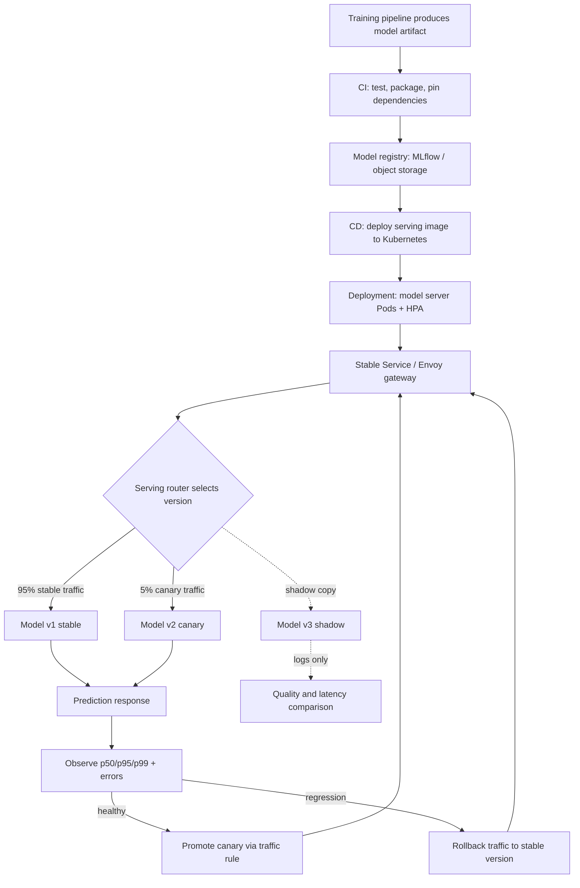

| Difficulty | Channel | Tags |
|---|---|---|
| beginner | devops | mlops, deployment |

At Netflix, roughly one million inference requests hit the centralized ML serving platform every second, and more than 30 client services expect answers without knowing which model version, cluster shard, or VIP is behind the curtain [1]. That single API is a beautiful illusion — and behind it sits the distinction most engineers learn the hard way. Deployment gets a model into production; serving keeps it fast, correct, and alive under load. This is the story of why that difference matters, and how to design for it before the pager goes off.

---

> ### Real-World Case — Netflix
>
> Netflix runs a centralized ML serving platform that powers recommendations, commerce, and fraud detection, hosting hundreds of model types and versions and handling roughly 1 million requests per second. Client microservices needed a single API to get inference without knowing which model version, cluster shard, or VIP address was serving it.
>
> | | |
> |---|---|
> | **Challenge** | Netflix had to separate model deployment concerns (packaging, versioning, canary rollout, shadow testing, rollback) from serving concerns (context-aware request routing, model selection, and low-latency inference at massive scale). Off-the-shelf API gateways and service mesh proxies could not integrate with Netflix's experimentation platform, expose gRPC, or handle model-specific lifecycle stages. |
> | **Solution** | Netflix built Switchboard, a custom gRPC proxy introducing an 'Objective' abstraction that decouples clients from concrete models. Switchboard routed each request using user context and A/B allocation, enabled dynamic traffic splitting, shadow mode, and instant rollback. As scale exposed a 10-20ms latency penalty and a single point of failure in the hot path, Netflix refactored to Lightbulb, which resolves model-selection metadata separately and delegates actual routing to Envoy. |
> | **Outcome** | The platform serves about 1 million inference requests per second across hundreds of model versions and over 30 client services. The Lightbulb/Envoy redesign removed Switchboard's 10-20ms serialization overhead and its single-point-of-failure risk while preserving single-integration, canary, shadow, and rollback capabilities. |
> | **Lesson** | Deployment is the contract and lifecycle; serving is the hot path. Custom routing logic belongs close to the model-selection layer, but the actual packet routing should stay in proven infrastructure like Envoy—putting a bespoke proxy in the request path at 1M RPS creates latency and availability risk that only becomes obvious at scale. |

---

## Hook — The API Call That Knew Too Much

Picture a product engineer adding recommendations to a microservice. They call one endpoint, pass a user context, and get a prediction back. They never choose a model version, never resolve a cluster shard, and never think about a VIP address. Yet behind that ordinary function call, hundreds of model types and versions are competing for compute, and roughly one million requests per second are being routed across Netflix's ML platform [1].

The simplicity is the point — and it is also the illusion. Many developers assume that shipping a model and serving a model are two names for the same job. They are not. One is about getting an artifact safely into an environment. The other is about making a runtime decision in milliseconds, under load, with a versioned model that may be cold, overloaded, or quietly wrong.

That gap is where incidents live. So here is the uncomfortable question: when your model responds slowly at 2 a.m., will you know whether the problem is your deployment pipeline, your serving router, or the model itself?

## Problem — A Model in Production Is Not a Model in Service

Deployment answers a supply-chain question: how does a trained artifact become a running, observable, reversible unit of infrastructure? That means CI/CD pipelines, container images, environment configuration, secrets, rollout strategy, monitoring hooks, and rollback plans. Kubernetes Deployments, for example, manage replicated Pods and controlled rollouts, but a healthy rollout only tells you that containers started — not that inference is fast or correct [2].

Serving answers a runtime question: how does a request find the right model, get an answer inside its latency budget, and survive traffic spikes and version changes? That means request routing, model loading, batching, version selection, autoscaling, and response optimization. The technologies look different because the concerns are different.

Here is the trap: a deployment can be perfectly green while serving is on fire. A new Pod may be ready from Kubernetes' perspective but still loading multi-gigabyte weights. A CPU-based autoscaler may see low utilization while a GPU queue grows. A canary may receive 5% of traffic but none of the expensive requests. Consequently, teams that instrument only infrastructure metrics often discover user-facing latency problems from support tickets instead of dashboards.

The stakes are concrete. Recommendations drive engagement, fraud detection blocks bad transactions, and commerce systems price and rank offers. A serving regression is not an abstract SLO violation; it is a worse product experience for every user in the blast radius.

## Real-World Case — Netflix

Netflix built a centralized ML serving platform so domain teams could get inference through one integration instead of each team wiring up model versions, clusters, and routing rules themselves. As of 2025, that platform served hundreds of model types and versions at about one million requests per second across more than 30 client services [1]. The client-facing promise was deliberately boring: call one API, and let the platform figure out where the request should go.

The original routing layer, Switchboard, fulfilled that promise but sat directly in the request path. It deserialized requests, selected a route, and re-serialized them — adding roughly 10–20 milliseconds of overhead per request and creating a single point of failure for ML traffic [1]. At small scale, that overhead is easy to ignore. At one million requests per second, it becomes an architectural tax and a reliability risk.

The fix was not to remove routing; it was to move routing metadata out of the hot path. Netflix introduced Lightbulb, a decoupled service that resolves the minimal request context into routing metadata, while Envoy handles the actual request forwarding using header-based routing rules [1]. The redesign removed the 10–20ms serialization overhead and the single-point-of-failure risk, while preserving the capabilities teams depended on: one integration, canary releases, shadow traffic, and rollback [1].

The lesson is sharp: Netflix did not win by deploying models more elegantly. It won by treating serving routing as a first-class product capability with its own latency budget, failure domain, and operational model.

## Deep Dive — The Trade-Offs That Decide Your Architecture

The cleanest mental model is a control plane and a data plane. Deployment is the control plane: build, register, schedule, observe, and roll back. Serving is the data plane: route, load, batch, infer, and respond. Confusing the two leads to teams scaling the wrong layer or celebrating the wrong dashboard.

| Concern | Deployment plane | Serving plane |
|---|---|---|
| Primary question | How does this artifact reach production safely? | How does this request get the right answer fast? |
| Core tools | Kubernetes, Docker, Terraform, MLflow, SageMaker, CI/CD | FastAPI, gRPC, TensorFlow Serving, TorchServe, BentoML, Envoy |
| Scaling signal | Rollout health, replica count, resource requests | Queue depth, concurrency, p95/p99 latency, GPU utilization |
| Failure mode | Bad image, broken config, failed rollout | Cold start, overload, bad model version, routing hotspot |
| Rollback unit | Artifact or Deployment revision | Traffic rule, model version, or serving configuration |

The first trade-off is latency versus throughput. Batching requests improves GPU utilization and throughput, but it adds waiting time and can hurt tail latency. Real-time inference often targets sub-100ms responses, while batch or asynchronous inference can tolerate seconds or minutes [4]. The right answer depends on whether a user is waiting for the answer or a background job is collecting it later.

The second trade-off is cold start versus cost. Keeping warm replicas avoids loading model weights on the critical path, but idle capacity is expensive. Many teams preload models, use readiness probes that check model availability, and maintain a small warm pool for latency-sensitive endpoints [5]. The subtle trap is that Kubernetes readiness may pass before the model server is actually ready to infer; probe the real dependency, not just the process.

The third trade-off is horizontal versus vertical scaling. Adding Pod replicas helps with concurrent requests, but it does not fix a model that does not fit on one GPU or a server that serializes every request behind a Python GIL. Horizontal Pod Autoscaling can scale on CPU or memory, yet ML workloads often need custom metrics such as queue depth or in-flight requests [3]. Vertical scaling — more GPU memory, faster accelerators — can be simpler, but it has a ceiling and a larger failure domain.

The fourth trade-off is version flexibility versus operational control. Serving multiple versions enables canaries, A/B tests, and instant rollback, but every additional version consumes memory and complicates routing. Model servers such as TensorFlow Serving, TorchServe, and BentoML provide version-aware loading and management, while research systems like Clipper explored low-latency prediction serving with caching and batching [6][9]. The practical rule: make version selection explicit in the request path, and make the default deterministic.

🔥 Hot take: Kubernetes is not a model server. It is excellent at scheduling containers and terrible at understanding tokenization, tensor shapes, or GPU memory pressure. Use it as the substrate, then put a real serving layer on top.

## Workflow — From Artifact to Answer in Seven Steps

The Mermaid diagram below tells the visual story: a model moves from CI into a registry, then into a Kubernetes deployment, then through an Envoy-based routing layer that splits stable, canary, and shadow traffic before monitoring decides whether to promote or roll back.

Step 1: Package the model as an immutable artifact. Pin the runtime, dependencies, preprocessing code, and model weights together so the serving environment cannot drift from the training environment.

Step 2: Register metadata, not just files. Record the model version, training data reference, evaluation metrics, and intended traffic class in a registry such as MLflow [8]. This is what makes rollback and audit possible later.

Step 3: Build a serving image with a real readiness contract. The container should fail readiness until weights are loaded and a sample inference succeeds. A process that is alive but not ready is a latency bomb.

Step 4: Deploy behind a stable Service and an Envoy-based gateway. Keep the client contract constant while the platform changes model versions, shards, or VIPs underneath [7]. This is the Netflix single-integration pattern in miniature.

Step 5: Route a small canary slice. Send 1–5% of traffic to the candidate version, ideally with sticky or deterministic assignment so the same user does not flip between versions on every request.

Step 6: Mirror traffic to a shadow model. Shadow inference produces predictions without affecting user responses, giving teams a safe comparison of quality, latency, and error rates before promotion [1].

Step 7: Promote or roll back based on serving signals. Watch p50, p95, p99, error rate, timeout rate, queue depth, and model-specific quality metrics. If the canary is worse, change the traffic rule — not the entire deployment.

The important shift is that steps 1–3 are deployment work, while steps 4–7 are serving work. Mature teams automate the handoff between them, but they do not pretend they are the same pipeline.

## Code Example — A Tiny Version-Aware Serving Layer

The following FastAPI service is deliberately small, but it demonstrates the serving-plane ideas that matter: explicit version selection, deterministic canary routing, a readiness check that means something, and shadow logging kept off the hot path. In production, the model registry and shadow queue would be external services, but the control flow is the same.

## Lessons Learned — What to Do Before the Next Deploy

The Netflix case is not a story about a clever proxy. It is a story about recognizing that serving has its own failure modes, latency budget, and ownership model [1]. Here is what to carry forward.

- **Separate the dashboards.** Track deployment health and serving health independently. A green rollout with a red p99 is still an incident.
- **Make routing a product capability.** One stable client contract, explicit version selection, canary traffic, shadow evaluation, and instant rollback are not extras; they are the interface between platform teams and product teams.
- **Benchmark cold starts honestly.** Measure time-to-first-inference, not time-to-container-start. Preload weights, use readiness gates, and keep warm capacity for latency-critical endpoints.
- **Scale on inference signals.** CPU is a weak proxy for GPU-bound or queue-bound workloads. Autoscale on concurrency, queue depth, and tail latency where possible [3].
- **Keep logging off the hot path.** A synchronous call to a feature store, shadow logger, or metrics backend can erase the gains from a faster model. Use asynchronous queues or sidecars.
- **Pin versions and rehearse rollback.** An unpinned model version is an incident waiting for a quiet Friday deploy. Practice rollback before you need it.

⚠️ Watch Out: The most common battle scar is not a bad model. It is a serving layer that was treated as an afterthought until traffic arrived. Teams deploy a model, pat themselves on the back, and then discover that the real product is the request path around it.

The memorable insight: users never experience your deployment pipeline. They experience the answer, the latency, and the version that produced it. Build for that moment first.

---

## Deployment to Serving Request Flow

<strong>Original Interview Question</strong>

**Q:** Explain the key differences between model serving and model deployment in ML systems, including specific technologies, scaling considerations, and real-world implementation patterns?

**A:** Deployment encompasses CI/CD pipelines, infrastructure setup, and monitoring using tools like Kubernetes, MLflow, and SageMaker. Serving focuses on runtime inference APIs with frameworks like TensorFlow Serving, TorchServe, or BentoML, handling request routing, model versioning, and autoscaling. Key trade-offs include latency vs throughput, batch vs real-time inference, and cold start optimization.

## Conclusion

The next time you ship a model, ask two different questions: can this artifact reach production safely, and can this request reach the right model fast? Netflix's answer was not a bigger deployment pipeline; it was a serving architecture with a one-million-request-per-second routing problem treated as a product capability [1]. Start tomorrow by separating your deployment and serving dashboards, pinning model versions explicitly, measuring time-to-first-inference, and rehearsing a traffic rollback. The memorable takeaway for your team: deployment gets the model into the building, but serving is what actually meets the user.

---

## References

1. [Netflix incident report](https://netflixtechblog.com/state-of-routing-in-model-serving-16e22fe18741) — article
2. [Kubernetes Documentation: Deployments](https://kubernetes.io/docs/concepts/workloads/controllers/deployment/) — documentation
3. [Kubernetes Documentation: Horizontal Pod Autoscaling](https://kubernetes.io/docs/tasks/run-application/horizontal-pod-autoscale/) — documentation
4. [TensorFlow Serving: Serving a TensorFlow Model](https://www.tensorflow.org/tfx/guide/serving) — documentation
5. [TorchServe: A flexible and easy-to-use tool for serving PyTorch models](https://github.com/pytorch/serve) — documentation
6. [BentoML: Build, ship, and scale AI applications](https://github.com/bentoml/BentoML) — documentation
7. [Envoy Proxy Documentation: What Is Envoy?](https://www.envoyproxy.io/docs/envoy/latest/intro/what_is_envoy) — documentation
8. [MLflow: Open-source platform for the machine learning lifecycle](https://github.com/mlflow/mlflow) — documentation
9. [Clipper: A Low-Latency Online Prediction Serving System](https://arxiv.org/abs/1612.03079) — paper
10. [gRPC Documentation: Introduction to gRPC](https://grpc.io/docs/what-is-grpc/introduction/) — documentation

---

**Author:** Satishkumar Dhule — [GitHub](https://github.com/satishkumar-dhule) · [LinkedIn](https://linkedin.com/in/satishkumar-dhule) · [Website](https://satishkumar-dhule.github.io)
