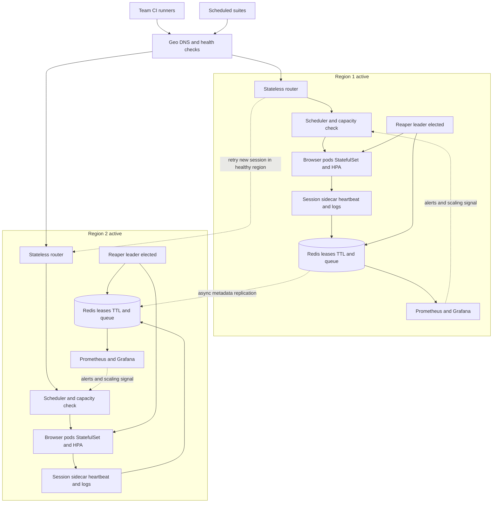

| Difficulty | Channel | Tags |
|---|---|---|
| advanced | system-design | selenium, webdriver, grid |

By 2015, Yandex was routing thousands of UI tests from different teams, languages, and frameworks through Selenium Grid, peaking around 2,000 parallel browsers and tens of millions of sessions per week. The stock Hub could not keep up: beyond roughly 20–30 connected nodes it became unstable, leaked memory, and offered no real high-availability story, so a single Hub crash took every node offline [1]. That is the uncomfortable truth hiding inside many “scalable” test grids: the browser fleet is rarely the first thing to break—the control plane is. What follows is the architecture that turns that failure mode into a boring, bounded, recoverable system, and the decisions that matter when you scale from a few hundred sessions to 10,000.

---

> ### Real-World Case — Yandex
>
> By 2015, Yandex was running thousands of UI automation tests across multiple teams using different languages and frameworks, with peaks of around 2,000 browsers running in parallel for hours and tens of millions of sessions per week. Its stock Selenium Grid setup could not keep up: the central Hub became unstable and slow beyond roughly 20-30 connected nodes, leaked memory, and had no real high-availability story, so one Hub failure took every node offline.
>
> | | |
> |---|---|
> | **Challenge** | Scale Selenium to thousands of concurrent browser sessions across multiple data centers without a stateful central Hub becoming the bottleneck or single point of failure, while ensuring stale browsers and leaked sessions did not accumulate on nodes. |
> | **Solution** | Yandex replaced the monolithic Hub with a stateless Go Grid Router (GGR), a small load balancer that randomly routes each new session to one of many small Selenium hubs, retrying in another region if a data center fails. They then built Selenoid, a Go implementation of the Selenium protocol that launches every browser in a fresh Docker container, so session cleanup is inherent: when the session ends, the container and its browser state are destroyed. Multiple GGR instances sit across five data centers, with no central session database to corrupt or fail over. |
> | **Outcome** | The resulting cluster handled 5,000+ parallel browsers, 2.5 million sessions per day, 4,000 requests per second, over 2 Gbit/s of traffic, across five data centers, 24/7/365. Selenoid used about 10x less memory than the Java Selenium server under the same load (roughly 50-60 MB versus 500 MB with ~10 sessions), and the GGR binary was only 6 MB while sustaining 400 rps in about 200 MB of RAM. |
> | **Lesson** | The counterintuitive move was to stop trying to make the Hub highly available and instead make it stateless and disposable. Routing sessions randomly across many small hubs removed the central state bottleneck, and running each browser in a fresh container turned memory-leak cleanup and node-failure recovery into properties of the architecture rather than operational chores. |

---

## Hook — The 3 A.M. Pager and the Hub That Took Everything Down

The pager goes off at 3:07 a.m. A regression suite that was green an hour ago is now a wall of timeouts. The browser nodes are healthy, the network is fine, and the machines have plenty of CPU. The Selenium Hub is down. Again.

At 200 sessions, a Hub restart is annoying. At 10,000, it is a company-wide outage: every team that depends on UI tests loses signal at the same moment. The dashboard says “degraded.” Your release process says “blocked.” And the postmortem will almost certainly contain the phrase “unexpected memory growth.”

The uncomfortable lesson is that scaling a grid is not about adding more browser nodes. It is about designing a control plane that can lose pieces without losing the whole. Keep that image in your head as you read the architecture below: the goal is not a Hub that never dies. The goal is a Hub whose death is uneventful.

## Problem — One Stateful Hub Is a Shared Fate Boundary

At small scale, the hub-and-node model feels elegant [2]. One central router owns the queue, knows which nodes are free, and hands out sessions. Nodes are disposable. Life is good.

At 10,000 concurrent sessions, that central role becomes a shared fate boundary. Every new session, heartbeat, status poll, and timeout passes through the same stateful process. When it leaks memory, the leak is proportional to the entire fleet’s activity. When it restarts, every in-flight session becomes a question mark. When it is slow, backpressure turns into a queue, and the queue turns into timeouts. Grid 4 splits the router, distributor, session map, and event bus, which helps, but a single logical grid can still become everyone’s shared failure domain [2].

The 99.9% requirement makes this concrete: 43 minutes of downtime per 30-day month. That sounds generous until one cross-region failover takes 90 seconds and a bad deployment burns the rest. Availability is not a feeling; it is a budget, and every reconnect, cold start, and stuck session spends from it.

The “zero memory leaks” phrase is also a trap. You can eliminate leaks in your code; you cannot eliminate leaks in every browser, driver, OS package, and logging library. What you can build is bounded memory: every session has an owner, a deadline, and a cleanup path. If a process survives past its lease, it is guilty until proven innocent.

Finally, cost. 10,000 sessions is not a node-count problem alone. It is a density problem. The whiteboard math says 10,000 ÷ 50 sessions per node = 200 nodes, at 2 GB each, 400 GB baseline, 520 GB with 30% headroom. That is a useful first guess, but it is not a capacity plan. Browser memory depends on the page, the framework, the test, and the day. Never sign a purchase order based on a spreadsheet that assumes every session behaves like a blank page.

⚠️ Watch Out: If you cannot explain which process owns a session, how long the lease lasts, and who deletes it when the lease expires, you do not have lifecycle management. You have hope with a TTL.

## Real-World Case — Yandex Outgrew the Hub, Then Removed It

Yandex hit this wall from the inside. By 2015, its test estate spanned multiple teams, languages, and frameworks, with peaks around 2,000 parallel browsers and tens of millions of sessions per week. The stock Grid Hub began to buckle at roughly 20–30 connected nodes, leaked memory, and had no credible high-availability story; one Hub failure took the whole fleet offline [1]. Adding nodes made the central bottleneck worse, not better.

The fix was architectural, not incremental. Yandex built Selenoid, which launches each browser session in its own container, and GGR, a stateless grid router that could spread load across multiple Selenoid clusters [3][4]. Instead of one precious Hub, the design separated routing from execution and made browser environments disposable.

The results were not subtle. The resulting cluster handled 5,000+ parallel browsers, 2.5 million sessions per day, 4,000 requests per second, and more than 2 Gbit/s of traffic across five data centers, 24/7/365 [1]. Selenoid used roughly 10x less memory than the Java Selenium server under comparable load—about 50–60 MB versus 500 MB with around 10 sessions—while the GGR binary was only 6 MB and sustained 400 rps in about 200 MB of RAM [1].

💡 Insight: The win came from splitting one stateful bottleneck into three independently scalable concerns: routing, session state, and browser execution. That is the pattern to steal, even if you never run Selenoid or GGR.

The plot twist? A bigger Hub would have failed faster. More nodes meant more heartbeats, more session metadata, and more ways for the central process to fall over. Yandex did not scale the bottleneck; it removed the bottleneck from the hot path.

## Deep Dive — Three Planes, One Lease, and a Lot of Bounded Failure

Understanding why the Yandex approach worked requires looking at the three planes of a grid. The control plane handles authentication, routing, admission, and queueing. It should be stateless or sharded, because it sees every request. The state plane stores session ownership, health, and deadlines. It needs durability, TTLs, and a clear consistency model. The data plane runs browsers. It should be disposable, isolated, and replaceable at any moment.

Most teams scale the data plane and forget the other two. That is like adding lanes to a highway while leaving a one-booth toll plaza. A 10,000-session grid needs regional routers, a session store that does not become an unbounded in-memory database, and browser pods with memory limits that actually mean something [5][6].

Session lifecycle should be a lease, not a row in a table:

- Create: reserve capacity and write a session record with owner, pod, region, and deadline.
- Heartbeat: refresh the lease only when the browser can answer a health check, not merely when the process exists.
- Drain: stop accepting new work, finish or fail in-flight commands, and remove the session from the router.
- Reap: delete the pod, profile directory, logs, and lease when the deadline expires.

The TTL must be longer than the longest legitimate pause—think garbage collection, network jitter, and a slow page load—but shorter than the time your team is willing to pay for a leaked browser. Too short, and flaky tests kill healthy sessions. Too long, and dead sessions hold RAM hostage. The most common battle scar is a TTL tuned in staging and never revisited after real test suites arrived.

Memory management needs the same discipline. Run one browser per container or process so a leak cannot poison the whole node. Set cgroup limits. Track working set, page faults, and browser RSS rather than requested memory. Recycle a pod after a fixed number of sessions or hours, but drain it first. Rotate logs and wipe temporary profiles. If Redis is the session store, do not let maxmemory eviction silently discard active leases; monitor memory and use replicas. Alerts should fire on growth rate, not just a static 80% threshold.

High availability across data centers is not a copy-paste exercise. Use active-active regional shards behind geo DNS with health checks. Create sessions in the nearest healthy region and keep session traffic local; replicate metadata asynchronously. A cross-DC write on every heartbeat is a latency tax and a new failure mode. Elect one reaper leader per shard so multiple controllers do not race. Use circuit breakers: after three consecutive health failures, eject a node for 30 seconds, then allow a half-open probe. PodDisruptionBudgets protect minimum capacity during voluntary disruptions [7].

Use per-session containers when isolation and leak containment matter more than raw startup density. Use regional shards when one team’s load spike must not starve every other team. Use circuit breakers when a single bad node can otherwise consume retries until the queue collapses.

| Decision | What it buys | What it costs |
| --- | --- | --- |
| One global Grid | Simple routing | One stateful blast radius |
| Regional shards + geo DNS | Fault isolation and lower latency | Session affinity and more operational surface |
| Redis TTL leases | Automatic cleanup | Careful clock, TTL, and replica tuning |
| One browser per container | Memory isolation | Slower starts and more overhead |
| Weekly full restarts | Temporary leak relief | Scheduled disruption that hides the root cause |

🔥 Hot Take: A weekly rolling restart is not memory management. It is a scheduled outage with better PR. Use recycling as a backstop, not a strategy.

## Workflow — From Request to Reclaimed Capacity

Those principles become an operating loop that a team can actually run. The diagram below shows two active regions, each with its own router, scheduler, browser pool, session leases, and reaper.

1. Route at the edge. Geo DNS or anycast sends each test runner to the nearest healthy region; unhealthy regions are removed from rotation.
2. Admit with backpressure. The regional router rejects or queues work based on measured capacity, not hope. Queue depth is a first-class signal, and overload handling is a safety mechanism rather than a failure [10].
3. Create a session record. Reserve capacity, write an owner, timestamp, and deadline, and label the pod with session ID and team.
4. Start with a lease. Redis stores the lease with a TTL; the browser pod starts only after the reservation is visible [8].
5. Heartbeat from the sidecar. Every 10 seconds, the sidecar checks the browser and refreshes the sorted-set score and TTL.
6. Observe in real time. Prometheus collects queue depth, start latency, memory working set, reaped sessions, and node failures; Grafana alerts on SLO burn [9].
7. Reap aggressively. A leader-elected controller deletes expired pods and orphaned volumes, then clears the lease.
8. Fail small. Circuit breakers eject unhealthy nodes after three failures; sessions retry on fresh capacity, and PDBs keep 85% available during drains [7].
9. Deploy like a fleet. Canary new browser images in one region, watch memory and flake rate, then roll forward; roll back automatically on SLO breach.

The key is that every step has a failure path. If the router dies, another region accepts new sessions. If a browser pod leaks, its lease expires and the pod disappears. If a data center degrades, DNS removes it from rotation. No single action requires a human to open a runbook at 3 a.m.

## Code Example — A Reaper That Treats Sessions as Leases

The workflow only becomes real when cleanup is a controller, not a runbook. The Python service below is the reaper at the heart of the session lifecycle: it watches Redis leases, finds sessions that stopped heartbeating, and deletes their pods. It is intentionally small, because the dangerous part of cleanup is ambiguity, not line count.

A sidecar calls heartbeat() every 10 seconds. The controller runs reap_orphans() in a loop. Sessions that miss their lease are assumed dead, but the controller only clears Redis after the pod deletion succeeds or the pod is already gone. That distinction matters: a transient Kubernetes API error must not hide a browser that is still consuming memory. In production, add leader election, a fallback scan of labeled pods, and metrics for every reap attempt.

## Lessons Learned — Make Failure Local, Observable, and Cheap

The journey from a 3 a.m. Hub failure to a 10,000-session grid is mostly a journey away from shared fate. Here is what matters most:

- Availability is a routing property, not a replica count. A standby Hub that cannot take over in seconds is not high availability.
- Treat every session as a lease with an owner and a deadline. If it cannot prove it is alive, it should not keep holding memory.
- Measure p95 memory per session, not average memory per node. Averages hide the one test case that eats a gigabyte.
- Separate routing, state, and execution. Each plane should fail and scale independently.
- Make failure cheap. Circuit breakers, PDBs, and retries are not decorations; they are how a 10,000-session grid survives Tuesday.
- Replace zero leaks with bounded leaks. Process isolation, recycling, and TTL cleanup are the practical version of perfection.
- Do not restart everything weekly and call it stability. That masks the leak you should be measuring.
- Test the failure paths. Kill a Hub, drain a zone, expire a lease, and watch what actually happens.

The first step tomorrow is not a bigger cluster. It is visibility: add session IDs, owner labels, creation timestamps, memory per session, and a TTL to every session. Then run a failure drill. The numbers will tell you which plane is lying.

If this feels overwhelming, start with the smallest useful version: one regional router, one Redis lease store, one reaper, and one dashboard. You can shard later. You cannot debug what you never measured.

---

## Multi-Region Selenium Grid Architecture

<strong>Original Interview Question</strong>

**Q:** Design a scalable Selenium Grid architecture to handle 10,000 concurrent test sessions with 99.9% uptime, ensuring zero memory leaks through automatic session lifecycle management, real-time monitoring, and graceful node failure recovery across multiple data centers?

**A:** Deploy Kubernetes cluster with auto-scaling node pools, Redis session store with TTL policies, Prometheus metrics for memory monitoring, circuit breakers for node isolation, and sidecar containers for session cleanup. Implement health checks, resource quotas, and rolling updates.

## Conclusion

Yandex’s story started with a Hub that could not survive 20–30 nodes. It ended with a fleet that handled thousands of parallel browsers across five data centers because the architecture stopped treating one process as the center of the universe [1].

The same lesson applies at 10,000 sessions. You will not get 99.9% uptime by promising that nothing will fail. You get it by making failure local, observable, and cheap. You get it by giving every browser a deadline, every session an owner, and every region the ability to say ‘not me’ without taking down the suite.

So here is the memorable version for your next design review: the goal is not a Hub that never dies; the goal is a Hub whose death is uneventful. Build for that, and the 3 a.m. page becomes a footnote instead of an outage.

---

## References

1. [Yandex incident report](https://testcon.lt/wp-content/uploads/2019/11/Ivan-Krutov-WORKSHOP-Efficient-Selenium-Infrastructure-with-Selenoid.pdf) — article
2. [Selenium Grid documentation](https://www.selenium.dev/documentation/grid/) — documentation
3. [Selenoid: browser automation in containers](https://github.com/aerokube/selenoid) — documentation
4. [GGR: scalable Selenium Grid router](https://github.com/aerokube/ggr) — documentation
5. [Kubernetes StatefulSets](https://kubernetes.io/docs/concepts/workloads/controllers/statefulset/) — documentation
6. [Kubernetes Horizontal Pod Autoscaling](https://kubernetes.io/docs/tasks/run-application/horizontal-pod-autoscale/) — documentation
7. [Kubernetes Pod Disruptions and PodDisruptionBudgets](https://kubernetes.io/docs/concepts/workloads/pods/disruptions/) — documentation
8. [Redis EXPIRE command](https://redis.io/docs/latest/commands/expire/) — documentation
9. [Prometheus overview](https://prometheus.io/docs/introduction/overview/) — documentation
10. [Google SRE: Handling Overload](https://sre.google/sre-book/handling-overload/) — documentation

---

**Author:** Satishkumar Dhule — [GitHub](https://github.com/satishkumar-dhule) · [LinkedIn](https://linkedin.com/in/satishkumar-dhule) · [Website](https://satishkumar-dhule.github.io)
