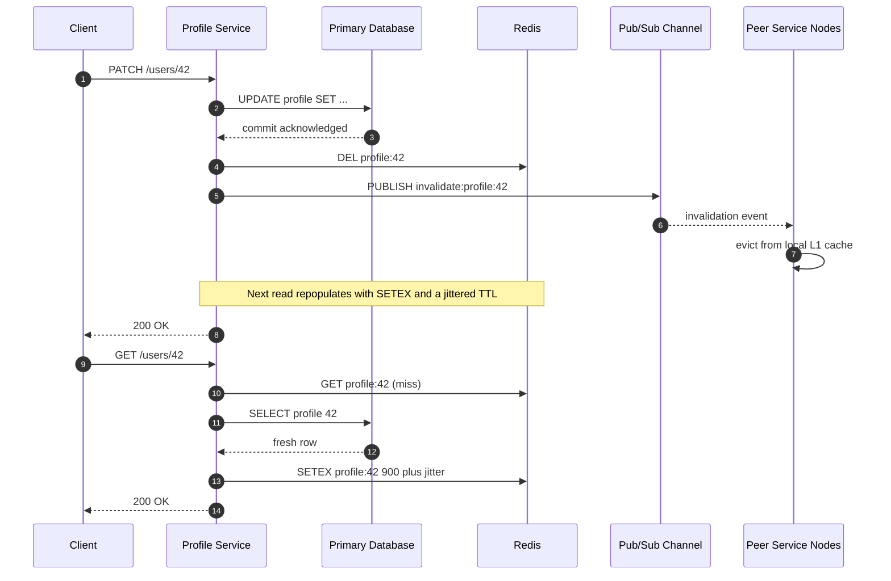

| Difficulty | Channel | Tags |
|---|---|---|
| beginner | backend | redis, memcached, cache-invalidation |

At its peak, Meta's Memcached tier absorbed billions of requests per second across globally distributed data centers, yet a single mismatch between cache and MySQL could still surface as a stale profile or a resurrected privacy setting [1]. The company discovered that invalidation is not a background chore—it is a distributed systems problem hiding inside a one-line DELETE. This is the story of how that lesson scales from a single Redis instance to a global cache fleet, and how you can apply it to a profile service that fits on one whiteboard.

---

> ### Real-World Case — Meta (Facebook)
>
> As Facebook scaled to hundreds of millions (and eventually billions) of users, its Memcached deployment had to serve billions of requests per second across globally distributed data centers. Simple client-driven invalidation couldn't keep caches consistent with MySQL at that scale.
>
> | | |
> |---|---|
> | **Challenge** | Keep cached profile/objects consistent across many frontend clusters and regions when updates occur, without creating unacceptably high packet rates or long windows of stale reads in a massive distributed deployment. |
> | **Solution** | Facebook embedded cache keys to invalidate into SQL statements committed by databases. Invalidation daemons (mcsqueal) on each DB extracted those keys and broadcast deletes across regions; mcrouter batched/ routed deletes in frontend clusters (achieving ~18x more deletes per packet). They also used web-server invalidation for read-after-write in the local cluster and adopted regional pools/gutters to trade replication for memory efficiency. |
> | **Outcome** | Handled billions of requests/sec across the cache tier; batching yielded an 18× improvement in deletes per packet; invalidation reliability reached ~4 nines within 1s and ~5 nines within 1h when source/dest co-located in master region (and ~3 nines within 1s across regions), with later consistency measured up to ~10 nines on 5-minute windows via Polaris. |
> | **Lesson** | For massive scale, write-path invalidation must be driven from the authoritative store (DB commit log) with batching/routing and explicit regional trade-offs; measuring client-observable consistency (not just cache hit rate) is essential to know when invalidation is actually correct. |

---

## Hook — The 2:47 A.M. Stale Profile

At 2:47 a.m., a support ticket lands in your queue: a customer changed their display name an hour ago, yet the profile page still shows the old one. The database says the update committed. The cache says otherwise. You refresh, and for a second the new name appears—then it flips back, like the system is gaslighting you.

That single stale field is the tip of a very large iceberg. Profile services are read-heavy, latency-sensitive, and deceptively simple: one row, a handful of columns, a cache key. But the moment multiple service instances, a cache cluster, and a primary database share responsibility for the same bytes, updating a profile stops being a CRUD endpoint and becomes a consistency protocol. The stakes are not abstract—stale identity data can expose old privacy settings, resurrect a deleted photo, or show a banned user as active.

So how do you invalidate a cache without turning every write into a distributed coordination ceremony? And why did one of the largest cache fleets on earth need a custom protocol to answer that question?

## Problem — When a One-Line Update Becomes a Distributed Systems Problem

Picture the shape of the workload. Profile reads outnumber writes by 50:1 or 100:1, a database round trip costs 5–50 milliseconds, and a cache hit costs roughly 1 millisecond. Caching is not optional if you want p99 latency under 100 ms. The trouble starts when freshness matters more than speed for a small fraction of requests.

A TTL alone is a freshness compromise, not a consistency strategy. With a 15-minute TTL, a user can update their avatar and still see the old one for another 14 minutes. Delete-on-write fixes that case, but it introduces a subtler race:

- A reader misses the cache and queries the database.
- A writer commits new data and deletes the cache key.
- The reader, still holding the old row, writes it back into the cache.
- The cache is now stale, and no future write will fix it until the TTL expires.

This is the classic stale-set problem, and it is why `SET` after a write feels safer than `DEL` but is often worse: two concurrent writers can reorder their cache updates just as easily as their database commits. Add multiple service nodes with local in-memory caches, retries that duplicate writes, and cross-region replication lag, and the simple question—how do I invalidate this key?—turns into a protocol design exercise [7].

The core tension is unavoidable: you can optimize for latency, freshness, or availability, but not all three at full strength. The right answer depends on how stale a profile is allowed to be, and for how long. That question is exactly what Meta had to answer at a scale where 'usually correct' was not good enough.

## Real-World Case — Meta (Facebook)'s Memcached Fleet

In 2013, engineers at Facebook published 'Scaling Memcache at Facebook,' a paper describing how the company's cache tier served billions of requests per second while keeping Memcached coherent with MySQL [1]. The scale is hard to picture: hundreds of millions of users at the time, multiple globally distributed data centers, and a read-heavy workload where a single stale entry could outlive the write that should have killed it.

Rather than pushing invalidation onto every application thread, Facebook built a dedicated invalidation pipeline. Writers committed to MySQL; a separate tier watched the commit stream and broadcast deletes to Memcached servers. Batching those invalidation messages produced an 18× improvement in deletes per packet—a reminder that at scale, the shape of the protocol matters as much as the cache itself [1].

The reliability numbers tell the real story. Invalidation reached roughly 4 nines of requests within 1 second and 5 nines within 1 hour when the source and destination were co-located in the master region, and about 3 nines within 1 second across regions. Later work with Polaris measured consistency up to roughly 10 nines on 5-minute windows [1].

The plot twist: Facebook did not abandon Memcached for a magic consistency feature. It kept the simple cache and invested in an explicit invalidation protocol, leases to blunt stale sets and thundering herds, and careful monitoring [1]. The cache stayed dumb; the system around it got smarter.

## Deep Dive — Redis, Memcached, and the Invalidation Trade-Offs

Building on that lesson, the choice between Redis and Memcached is less about raw speed and more about which invalidation primitives you want to own. Both store key-value data in memory, but they diverge sharply once coordination enters the picture.

| Dimension | Redis | Memcached |
|---|---|---|
| Invalidation primitives | Pub/Sub, keyspace notifications, Streams [4] | No built-in broadcast; coordinate in clients |
| Data structures | Strings, hashes, sorted sets, streams [3] | Opaque key-value blobs |
| Persistence | RDB snapshots and AOF logs | None by design |
| Memory overhead | Higher per key | Lower, slab-allocated |
| Horizontal scaling | Cluster mode and replicas | Simple client-side sharding |
| Best fit | Complex invalidation, leaderboards, locks | Pure ephemeral caching at massive scale |

Redis Pub/Sub is the headline feature for distributed invalidation: a writer publishes a message, and every subscribed service node evicts its local copy [4]. However, Pub/Sub is fire-and-forget. A subscriber that is reconnecting or temporarily partitioned misses the message entirely, so a TTL backstop or a durable stream is still required for correctness. Memcached offers no equivalent broadcast mechanism [2]; Facebook's answer was to build invalidation outside the cache, which is why its architecture looks more like a messaging system than a cache configuration [1].

Moreover, the delete-versus-update debate has a counterintuitive conclusion. Deleting is usually safer than overwriting because it forces the next read to fetch from the source of truth, but deletion also triggers a cache miss storm under load. That is the cache stampede, and it is why production systems add jitter to TTLs and single-flight logic to collapse concurrent rebuilds [8]. Redis's richer structures make versioned keys and distributed locks easy [3]; Memcached's lower memory footprint makes it attractive when the working set is enormous and the values are simple [6].

💡 Insight: Redis gives you better tools to build an invalidation protocol. Memcached gives you a cheaper blank slate. Neither one gives you consistency for free.

## Workflow — From Commit to Cache Eviction

This leads to a repeatable workflow that keeps the database as the source of truth and treats the cache as a disposable copy. The sequence diagram below shows the happy path and the rebuild that follows it.

1. Commit the profile update to the primary database. Do not touch the cache before the commit succeeds; a cache delete followed by a failed transaction creates a permanent cold key.
2. Delete the cache key rather than overwriting it. A delete forces the next reader to rebuild from committed data, which avoids out-of-order writes landing stale bytes.
3. Publish an invalidation event to a channel such as `cache:invalidate:profiles`. Include the key and a unique event ID so consumers can deduplicate retries.
4. Evict local L1 caches on every service node. Process-local maps are the sneakiest source of stale reads because they bypass Redis entirely.
5. Rebuild on the next read using cache-aside: check the cache, fall back to the database, then write back with `SETEX`.
6. Add a jittered TTL as a safety net, not as the primary strategy. A 15-minute TTL plus 0–120 seconds of jitter prevents synchronized expiry across the fleet [9].
7. Instrument hit rate, invalidation lag, and stale-read reports. If invalidation lag grows, the protocol is failing before the cache is.

The ordering is the whole game. Commit first, invalidate second, rebuild lazily. Reverse any two of those steps and you have built a machine for generating 2:47 a.m. support tickets.

## Code Example — A Write-Invalidate Pipeline in Python

Here is a compact implementation of that workflow using Redis. It combines cache-aside reads, write-invalidate updates, jittered TTLs, and a Pub/Sub listener for local caches.

```python
import json
import random
import uuid

import redis

r = redis.Redis(host='redis.internal', port=6379, decode_responses=True)
PROFILE_TTL_SECONDS = 900
INVALIDATION_CHANNEL = 'cache:invalidate:profiles'
LOCAL_CACHE = {}

def load_profile_from_db(user_id: int) -> dict:
    raise NotImplementedError('wire this to your database driver')

def save_profile_to_db(user_id: int, profile: dict) -> None:
    raise NotImplementedError('wire this to your database driver')

def get_profile(user_id: int) -> dict:
    key = f'profile:{user_id}'
    if key in LOCAL_CACHE:
        return LOCAL_CACHE[key]

    cached = r.get(key)
    if cached is not None:
        profile = json.loads(cached)
        LOCAL_CACHE[key] = profile
        return profile

    profile = load_profile_from_db(user_id)
    ttl = PROFILE_TTL_SECONDS + random.randint(0, 120)
    r.setex(key, ttl, json.dumps(profile))
    LOCAL_CACHE[key] = profile
    return profile

def update_profile(user_id: int, changes: dict) -> dict:
    profile = load_profile_from_db(user_id)
    profile.update(changes)

    save_profile_to_db(user_id, profile)

    key = f'profile:{user_id}'
    r.delete(key)
    LOCAL_CACHE.pop(key, None)

    r.publish(
        INVALIDATION_CHANNEL,
        json.dumps({'key': key, 'event_id': str(uuid.uuid4())}),
    )
    return profile

def listen_for_invalidations() -> None:
    pubsub = r.pubsub()
    pubsub.subscribe(INVALIDATION_CHANNEL)
    for message in pubsub.listen():
        if message['type'] != 'message':
            continue
        payload = json.loads(message['data'])
        LOCAL_CACHE.pop(payload['key'], None)
```

The `get_profile` function implements cache-aside: it checks the local cache, then Redis, then the database. The jittered `setex` call prevents every profile from expiring at the same moment, which is a small change that prevents a large thundering herd [8]. The `update_profile` function commits to the database first, then deletes the Redis key and the local copy, and finally publishes an invalidation event. Deleting instead of overwriting means the next reader cannot write an older value back over a newer one. The listener closes the loop for peer nodes, though production code should add reconnect handling and treat Pub/Sub delivery as best-effort [4]. For stronger guarantees, replace the channel with a Redis Stream and track a consumer offset.

## Lessons Learned — What to Do Before the Next Stale Read

The journey from 'just delete the key' to a reliable invalidation protocol comes down to a handful of hard-won lessons.

- **The database is the source of truth; the cache is a copy.** Every design decision should preserve that hierarchy. If the cache and database disagree, the database wins and the cache gets evicted.
- **Delete, do not overwrite, on update.** Overwrites can arrive out of order and silently pin stale data until the TTL expires. Deletion forces a rebuild from committed state.
- **Treat TTL as a backstop, not a strategy.** A TTL bounds how long a bug can hurt you, but it does not prevent the bug. Use it with jitter to avoid synchronized expiry [9].
- **Pub/Sub is not a guarantee.** Redis Pub/Sub is fast and simple, but disconnected subscribers miss messages [4]. Durable streams or versioned keys close that gap.
- **Invalidate local caches too.** Process-local maps are invisible to Redis and are a frequent source of 'but I cleared the cache' bugs.
- **Measure invalidation lag, not just hit rate.** A 99% hit rate means nothing if 1% of reads return data from three writes ago [1].
- **Expect the stale-set race and design for it.** Leases, single-flight rebuilds, and short TTLs are the standard defenses [1][8].

⚠️ Watch Out: A cache delete that happens before a failed database commit leaves a cold key that will be rebuilt from old data. Commit first, always.

🔥 Hot Take: Most 'cache bugs' are actually protocol bugs. The cache is doing exactly what you told it to do—you just told it to keep a copy that nobody invalidated.

---

## Write-Invalidate and Rebuild Sequence



<details>
<summary><strong>Original Interview Question</strong></summary>

**Q:** You're building a user profile service that caches frequently accessed profiles. How would you implement cache invalidation when a user updates their profile, and what trade-offs would you consider between Redis and Memcached?

**A:** Implement write-through caching with TTL-based expiration. On profile update, invalidate the cache by deleting the key and writing new data to both the database and cache. Redis offers pub/sub for automatic distributed invalidation, while Memcached requires manual coordination across nodes.

</details>

## Conclusion

The next time a profile update seems to vanish, resist the urge to blame the cache. The cache stored exactly what it was given; the missing piece was the protocol around it. Commit to the database first, delete rather than overwrite, propagate invalidation to every layer including local memory, and treat TTLs as a safety net with jitter. Choose Redis when you need built-in pub/sub and richer coordination primitives, and choose Memcached when cheap, simple, massive-scale caching is the whole job—but budget for the invalidation system either way. The memorable takeaway is simple: a cache is not a faster database; it is a distributed copy that needs a protocol to grow up.

---

## References

1. [Meta (Facebook) incident report](https://www.usenix.org/system/files/conference/nsdi13/nsdi13-final170.pdf) — article
2. [Memcached — Wikipedia](https://en.wikipedia.org/wiki/Memcached) — documentation
3. [Redis — Wikipedia](https://en.wikipedia.org/wiki/Redis) — documentation
4. [Redis PUBLISH command documentation](https://redis.io/docs/latest/commands/publish/) — documentation
5. [Redis source repository](https://github.com/redis/redis) — documentation
6. [Memcached source repository](https://github.com/memcached/memcached) — documentation
7. [HTTP caching — MDN Web Docs](https://developer.mozilla.org/en-US/docs/Web/HTTP/Guides/Caching) — documentation
8. [Cache stampede — Wikipedia](https://en.wikipedia.org/wiki/Cache_stampede) — documentation
9. [What is Amazon ElastiCache? — AWS documentation](https://docs.aws.amazon.com/AmazonElastiCache/latest/dg/WhatIs.html) — documentation
10. [Cache (computing) — Wikipedia](https://en.wikipedia.org/wiki/Cache_(computing)) — documentation

---

**Author:** Satishkumar Dhule — [GitHub](https://github.com/satishkumar-dhule) · [LinkedIn](https://linkedin.com/in/satishkumar-dhule) · [Website](https://satishkumar-dhule.github.io)
