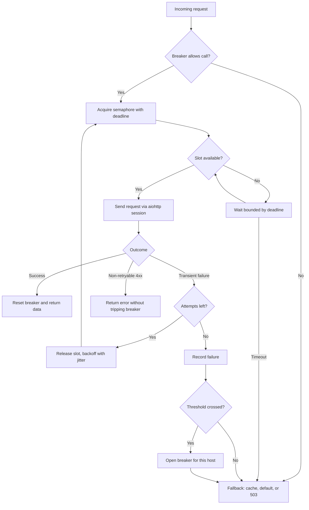

| Difficulty | Channel | Tags |
|---|---|---|
| advanced | backend | asyncio, aiohttp, concurrency |

Netflix's API once absorbed more than a billion incoming calls per day, fanning out roughly 6x to billions of outgoing calls across dozens of services and thousands of EC2 instances. A single slow dependency could saturate connection and thread pools and cascade into an outage in seconds. What kept the platform standing was not a bigger pool, but a system that knew when to stop calling a failing dependency and return a degraded answer instead [1]. The same lesson applies to every aiohttp service: your connection pool is a shock absorber, and without a circuit breaker it can become the fuse that takes down the entire request path.

---

> ### Real-World Case — Netflix
>
> Netflix's API handled more than 1 billion incoming calls per day, fanning out roughly 6x to several billion outgoing calls to dozens of backend services across thousands of EC2 instances. A single slow dependency could saturate connection and thread pools and cascade into a full API outage within seconds.
>
> | | |
> |---|---|
> | **Challenge** | How to cap concurrent connections per dependency, time out slow calls, and degrade gracefully under load without letting one failing service exhaust the resources of the entire fleet. |
> | **Solution** | Netflix built Hystrix, wrapping each dependency call in a small isolated thread pool or semaphore with strict timeouts, a circuit breaker that trips on error or latency thresholds (for example, ~50% errors in a 10-second window), and fallback logic. When a dependency degrades, the breaker opens and rejects calls fast instead of queueing them, shedding load so the downstream service can recover. |
> | **Outcome** | Hystrix operated at 100+ command types, 40+ thread pools, and 10+ billion thread-isolated plus 200+ billion semaphore-isolated executions per day. In one incident, the circuit breaker tripped on about one-third of the cluster for a single latent dependency while other circuits stayed healthy; with fallbacks, 500s did not increase and users received a degraded but functional experience. |
> | **Lesson** | Under latency, the instinct to enlarge connection pools, queues, and timeouts makes things worse—Netflix describes it as DDoSing yourself. Bound concurrency, fail fast, and let the circuit breaker release pressure so the downstream can recover instead of retrying and queueing into a dying service. |

---

## Hook — The 2:47 A.M. Wake-Up Call

It is 2:47 a.m., and the pager fires. The API is not down—not yet. P99 latency has climbed from 180 ms to 9 seconds, error budgets are burning, and every retry is making the queue longer. Somewhere downstream, one service is responding slowly, and your aiohttp workers are holding thousands of connections open waiting for it.

This is the moment when architecture stops being academic. A pool with a fixed number of slots feels like capacity, but under stress it becomes a queue with a deadline. The question is not whether your service will meet a slow dependency. It is whether that encounter will degrade one feature or take down the entire request path.

Netflix learned this at a scale that makes the stakes obvious. The company's API handled more than a billion incoming calls per day, fanning out roughly 6x to several billion outgoing calls across dozens of backend services and thousands of EC2 instances [1]. One slow dependency could saturate connection and thread pools and cascade into a full outage within seconds. The lesson that emerged is the one you are about to apply: graceful degradation is a design property, not an operational hope.

## Problem — Why a Bigger Pool Makes Things Worse

Connection pools are deceptively simple. You set a limit, hand out connections, and assume the pool protects you. In reality, a pool only controls how many requests wait; it does not decide which requests should be abandoned, which failures deserve a retry, or when a dependency should be temporarily quarantined.

The math is unforgiving. By Little's Law, concurrency equals throughput multiplied by latency. If 100 in-flight slots serve requests that take 2 seconds, the pool can sustain about 50 requests per second. Let latency rise to 10 seconds and the same 100 slots sustain only 10 requests per second. Throughput collapses even though nothing is technically broken.

Fan-out multiplies the pain. An API that receives 1,000 requests per second and calls six downstream services creates 6,000 outgoing operations per second. Add a retry policy of three attempts and the worst case becomes 18,000 attempts, many aimed at the dependency that is already struggling. This is how a slowdown becomes a retry storm.

Aiohttp makes the trap easier to fall into because its default total timeout is five minutes [2]. Five minutes is an eternity in a request path. Without explicit deadlines, a slow dependency can pin every slot, every waiter, and every upstream caller long after the user has given up. The fix is not a larger pool. The fix is a set of controls that decide when to wait, when to retry, and when to fail fast.

## Real-World Case — Netflix and the Circuit That Held

Netflix did not solve this with heroics. It solved it with isolation and deliberate failure. Hystrix, the library Netflix open-sourced, wrapped every dependency call in its own command with its own timeout, thread pool or semaphore, circuit breaker, fallback, and metrics stream [7]. At its peak, Hystrix operated more than 100 command types, 40-plus thread pools, 10-plus billion thread-isolated executions per day, and 200-plus billion semaphore-isolated executions per day [1].

The decisive incident was not a total outage. It was a partial one. A single dependency became latent, and the circuit breaker tripped on roughly one-third of the cluster for that dependency while other circuits stayed healthy [1]. Because each dependency had its own isolation boundary and fallback, the failure did not spread. HTTP 500 responses did not increase, and users received a degraded but functional experience [1].

That detail matters more than the billion-call statistic. The system did not need to keep every feature perfect. It needed to contain the blast radius. A per-dependency breaker turned a fleet-wide risk into a local decision: stop calling the slow thing, serve the fallback, and let the healthy paths continue.

The takeaway for an aiohttp service is direct. If one shared semaphore and one global failure counter guard every downstream call, a single bad dependency can consume the entire budget. Isolation has to exist at the dependency boundary, not just at the process boundary.

## Deep Dive — Semaphores, Breakers, and Timeout Budgets

Building on the Netflix case, the first design decision is to separate two limits that developers often conflate. Aiohttp's TCPConnector already bounds open sockets with limit and limit_per_host, and it queues requests when the limit is reached [9]. A semaphore adds a second, higher-level budget around the work you control: retries, fallback lookups, and response processing. The two limits serve different purposes, and setting them without understanding the relationship creates head-of-line blocking. An asyncio.Semaphore is a counter with waiters, not a fairness guarantee, so queue depth and wait time still need to be measured [3].

| Control | What it protects | Failure mode if misused |
| --- | --- | --- |
| Connector limit | Sockets and file descriptors | Too high exhausts the OS; too low serializes healthy traffic |
| Semaphore | End-to-end in-flight work | Held during backoff, it idles capacity; too small, it sheds too aggressively |
| Timeout budget | Caller patience | Too generous pins slots; too tight causes false failures |
| Circuit breaker | Failing dependency | Global instead of per-host, it takes down healthy paths |
| Bounded queue | Burst absorption | Unbounded, it turns latency into memory growth |

Next, the circuit breaker. In the closed state, calls pass through. Failures increment a counter. When the threshold is crossed, the breaker opens and calls fail fast. After a cooldown, it moves to half-open and allows a small number of probes. A success closes it; a failure reopens it [4]. The subtle part is what counts as a failure. Timeouts, connection errors, 5xx responses, and some 429s are dependency failures. A 404 or 400 is usually a caller bug and should not trip the breaker.

Retries need equal discipline. Exponential backoff with full jitter spreads retries across time so that clients do not synchronize into a thundering herd [5]. Respect Retry-After when a server provides it [10], and cap the total retry budget rather than retrying every request three times by default [8]. A retry is not free capacity; it is borrowed capacity from a system that may already be overloaded.

Timeouts deserve their own budget. Aiohttp exposes total, connect, sock_connect, and sock_read timeouts, and the total deadline includes time spent acquiring a connection [6]. If the caller's deadline is three seconds, a downstream total timeout of eight seconds is not a safety net; it is a guarantee that the caller gives up first while your worker stays busy. Propagate the remaining deadline, and let the innermost call fail before the outermost one does.

💡 Insight: Use a circuit breaker when a dependency is shared and failure is contagious. Use a semaphore when you need to cap work that the connector cannot see, such as retries and fallbacks. Use both when the dependency is both shared and slow.

🔥 Hot Take: Increasing the pool size is often the fastest way to make a latency incident worse. More concurrent calls to a saturated dependency means more queueing, more timeouts, and more retries.

## Workflow — From Request to Graceful Fallback

With the controls understood, the workflow becomes a sequence of decisions rather than a pile of settings. Follow the flow in the diagram as you read through the steps.

1. Define the request deadline. Start from the caller's SLO, not from the downstream service's convenience. If the endpoint must answer in 3 seconds, every downstream budget must fit inside that window.
2. Resolve the dependency identity. Use the host or route as the breaker key so that one unhealthy service cannot open the circuit for every other service.
3. Check the breaker before acquiring a slot. Failing fast is cheaper than waiting in a queue for a call that is already doomed.
4. Acquire the semaphore with a timeout. The semaphore bounds in-flight work; the timeout prevents an unbounded wait behind a saturated pool.
5. Send the request through the shared aiohttp session with explicit connect and total timeouts.
6. Classify the outcome. Success resets the breaker. Transient failures are retried within budget. Non-retryable 4xx responses are returned to the caller without poisoning the breaker.
7. Back off with full jitter, and honor Retry-After when present. Release the semaphore slot while sleeping so that backoff does not idle capacity.
8. Record the result. Open the breaker only after the failure threshold is crossed, then allow a controlled half-open probe after the cooldown.
9. Fall back deliberately. Return cached data, a safe default, or a 503 with Retry-After. A fallback must be cheaper than the failed call and must not depend on the same broken service.
10. Emit metrics and close cleanly. Track breaker state, queue wait time, retry count, and fallback rate. On shutdown, stop accepting work, drain in-flight requests, and close the session.

The diagram traces the same path visually: request, breaker check, semaphore, attempt, classification, backoff or fallback. The important property is that every path ends in a bounded outcome. No request waits forever, and no failure loops without a counter.

## Code Example — A Production-Shaped aiohttp Manager

The code below packages the workflow into a small manager. It is deliberately compact, but every branch maps to a decision from the previous section.

The manager owns one aiohttp session, one connector, one semaphore, and one breaker per host. The semaphore is acquired per attempt, not around the entire retry loop, so a sleeping retry does not hold a slot. The breaker is checked before the slot is acquired, which lets rejected calls fail fast. Transient HTTP statuses are converted into a retryable signal, while ordinary 4xx responses are allowed to propagate without opening the circuit.

⚠️ Watch Out: This example is a foundation, not a finished library. In production, add structured metrics, deadline propagation, per-route configuration, and a retry budget shared across the process. Also ensure that the session is closed during application shutdown, or aiohttp will warn about unclosed connectors [2].

## Lessons Learned — What Survives the Incident

The journey from a billion-call fan-out to a single aiohttp manager ends with a handful of durable lessons.

- **Bound the work, not just the sockets.** The connector limit controls connections. The semaphore controls in-flight operations. The deadline controls how long either can matter. Teams need all three, and they need them to agree.
- **Isolate failures per dependency.** Netflix's partial incident is the proof [1]. One breaker for all downstream services turns a local slowdown into a global outage. One breaker per host keeps the blast radius local.
- **Retry less than you think.** Three attempts across six downstream calls is eighteen chances to amplify a problem. Cap retries at two or three for idempotent operations, use full jitter, and respect server-provided delays [5][10].
- **Treat timeouts as a budget.** A downstream timeout longer than the caller's deadline is a queue leak. Propagate the remaining time and fail early [6].
- **Make fallbacks boring.** A fallback that calls another remote service is not a fallback; it is a second dependency. Prefer cached data, safe defaults, or an explicit 503 with Retry-After [10].
- **Measure the right things.** Track breaker opens, semaphore wait time, retry rate, fallback rate, and P99 latency by dependency. A pool that is full is a symptom; the metric that matters is why it is full.

Battle scars show up in predictable places. Connection leaks after cancellation, sessions created per request, SSL contexts disabled to make errors disappear, and shutdown paths that close the event loop before the session. Each one is avoidable with a small amount of discipline.

🎯 Key Point: Graceful degradation is not about serving every request. It is about choosing which requests to serve, which to degrade, and which to reject before they consume the capacity needed by everyone else.

---

## Graceful Degradation Flow

<strong>Original Interview Question</strong>

**Q:** How would you implement a connection pool manager for aiohttp that handles graceful degradation under high load and connection timeouts?

**A:** Implement a connection pool manager for aiohttp using a semaphore to limit concurrent connections, exponential backoff for retrying failed requests, and circuit breaker pattern to gracefully degrade under high load and connection timeouts.

## Conclusion

Netflix's partial circuit-breaker incident is the ending the story deserves. The system did not avoid failure; it contained it. One-third of the cluster tripped for a single latent dependency, other circuits stayed healthy, and users received a degraded experience instead of a wall of 500s [1]. That outcome came from isolation, timeouts, fallbacks, and the willingness to stop calling a service that was already struggling.

Your aiohttp service can adopt the same posture without Netflix's scale. Start tomorrow with three changes: set an explicit total timeout that fits inside the caller's deadline, add a per-host circuit breaker around the slowest dependency, and replace blind retries with capped exponential backoff and jitter. Then measure breaker opens, queue wait time, and fallback rate before the next incident finds them for you.

The memorable insight is simple: a connection pool is not a promise of capacity. It is a budget. Circuit breakers, deadlines, and fallbacks are how you refuse to go bankrupt when a dependency starts spending your capacity faster than you can earn it back.

---

## References

1. [Netflix incident report](https://github.com/Netflix/Hystrix/wiki/Operations) — article
2. [aiohttp client quickstart](https://docs.aiohttp.org/en/stable/client_quickstart.html) — documentation
3. [Python asyncio synchronization primitives](https://docs.python.org/3/library/asyncio-sync.html) — documentation
4. [Circuit breaker design pattern](https://en.wikipedia.org/wiki/Circuit_breaker_design_pattern) — article
5. [Retry with backoff and jitter](https://docs.aws.amazon.com/general/latest/gr/api-retries.html) — documentation
6. [Python asyncio timeouts](https://docs.python.org/3/library/asyncio-task.html#timeouts) — documentation
7. [Netflix Hystrix repository](https://github.com/Netflix/Hystrix) — documentation
8. [Google SRE book: Handling overload](https://sre.google/sre-book/handling-overload/) — documentation
9. [aiohttp client reference and connector limits](https://docs.aiohttp.org/en/stable/client_reference.html) — documentation
10. [RFC 7231: HTTP/1.1 semantics and status codes](https://datatracker.ietf.org/doc/html/rfc7231) — documentation

---

**Author:** Satishkumar Dhule — [GitHub](https://github.com/satishkumar-dhule) · [LinkedIn](https://linkedin.com/in/satishkumar-dhule) · [Website](https://satishkumar-dhule.github.io)
