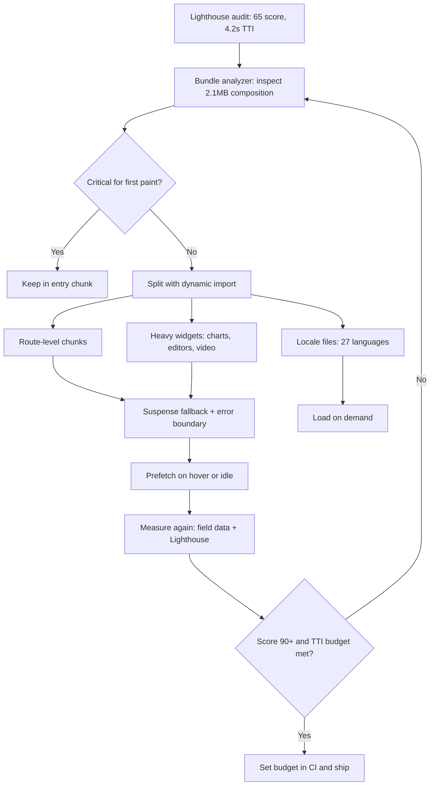

| Difficulty | Channel | Tags |
|---|---|---|
| intermediate | frontend | lighthouse, bundle, lazy-loading |

The dashboard is brutally simple: Lighthouse 65, Time to Interactive 4.2 seconds, and a 2.1MB bundle. Your product manager wants 90+. Your users want the page to feel instant. And somewhere in that bundle is a 400KB charting library that only one screen uses. Discord ran into a scaled-up version of this problem as its desktop and web apps grew to millions of daily users, and the answer was not a heroic one-time cleanup. It was a hard budget: roughly 700KB for the initial boot payload, with everything else loaded on demand [1]. That distinction — budget versus cleanup — is the difference between a score that stays at 90 and one that drifts back to 65 the moment the next feature ships.

---

> ### Real-World Case — Discord
>
> By 2018 Discord's desktop and web app served millions of daily users, and every new feature—video chat, screen sharing, the in-game overlay, and 27 languages—risked making the app slower to boot, use more memory, and compete for CPU with the games users were already running. The team needed to keep shipping features without growing the initial payload.
>
> | | |
> |---|---|
> | **Challenge** | The app suffered from software bloat: everything was bundled together, so every user downloaded, parsed, and held in memory code, styles, animations, and locale files for features and routes they might never use. |
> | **Solution** | Discord applied route-level code splitting with webpack, wrapping each route's components in a loader function so webpack emitted separate on-demand chunks. Stylesheets and animations were split and lazy-loaded as well, and translations were split per locale so only the user's language shipped. Because lazy chunk requests can fail, the team built a custom loader called makeLazy that retries at increasing intervals until the chunk loads. |
> | **Outcome** | The initial boot payload was held to about 700KB of JavaScript, fonts, images, and stylesheets—roughly the size of Google's minimal homepage—with everything else loaded on demand. Splitting 27 translations at roughly 30KB each saves users nearly 1MB, and new users accepting an invite no longer download the entire web app. |
> | **Lesson** | Code splitting isn't just about shrinking one bundle; it's about never shipping code, styles, or locales a given user won't use. It also means owning the failure mode—lazy chunks can fail to load, so production loaders need retry logic with backoff. |

---

## Hook — The Score Is a Symptom, Not the Disease

A 65 Lighthouse score looks like a configuration problem. It rarely is.

The number is a symptom. The 2.1MB bundle is the receipt for dozens of small, reasonable decisions: a charting library added for one dashboard, an icon package imported through a barrel file, three polyfills for browsers nobody supports anymore, and a translation system that ships every language to every user. None of those decisions felt reckless at the time. Together, they put 4.2 seconds between a user and their first interaction.

This is where most performance work goes wrong. Teams treat the audit as a scavenger hunt for one big dependency, delete it, and celebrate a score that creeps back to 65 after the next sprint. Discord took a different route at a much larger scale: it treated the boot payload as a budget that every feature has to fit inside [1]. That mindset turns a one-time cleanup into a system that keeps working.

The uncomfortable question is not 'What can be removed?' It is 'What has earned the right to load before the user can do anything?'

## Problem — A 2.1MB Bundle Is a Tax Every User Pays

Every kilobyte in a JavaScript bundle is paid for three times: once on the network, once when the browser parses and compiles it, and again when the main thread executes it. On a fast laptop, that tax is easy to ignore. On a mid-range Android phone on a congested network, it is the difference between a usable app and a spinner that users abandon.

Time to Interactive makes the cost visible. A 4.2-second TTI means the page may paint, but the main thread is still busy enough that taps feel broken. Lighthouse rolls several signals into a single score, which is useful for tracking but dangerous as a target [9]. A team can raise the number by shaving a few kilobytes while the real user experience stays sluggish.

The usual suspects are predictable:

- Barrel imports that pull an entire icon set or utility library into the entry chunk
- Heavy widgets — charts, editors, video players — loaded on every route
- Duplicate copies of the same dependency hiding in different packages
- Locale files shipped in full when a user needs exactly one language
- Third-party scripts that quietly become part of the critical path

Here is the thing though: the problem is not that developers add dependencies. The problem is that nothing forces a dependency to justify its place in the initial payload. Without a budget, every feature ships with a permanent performance tax and no owner.

⚠️ Watch Out: A bundle that grows gradually produces no single alarming commit. The regression is invisible until an audit, a user complaint, or a business metric forces the team to look.

## Real-World Case — Discord

By 2018, Discord's desktop and web app served millions of daily users, and every new feature — video chat, screen sharing, the in-game overlay, and support for 27 languages — threatened to make the app slower to boot, hungrier for memory, and more demanding of the CPU that users needed for their games [1].

The team could have treated performance as a feature freeze. Instead, it treated the initial payload as a contract. The boot payload was held to roughly 700KB of JavaScript, fonts, images, and stylesheets — about the size of a minimal homepage — while everything else loaded on demand [1].

The translation detail is the one that tends to make developers pause. Splitting 27 translations at roughly 30KB each saves users nearly 1MB compared with shipping every language up front [1]. New users accepting an invite also stopped downloading the entire web app before they could see the thing they were invited to. That is the plot twist: the biggest wins came from bytes users never downloaded, not from clever minification of bytes they did.

Discord's approach also reframes the interview question. The goal is not to make 2.1MB smaller by 10%. The goal is to decide which 700KB — or 300KB, or 150KB — has earned the right to block first paint, then make everything else arrive when intent appears.

## Deep Dive — Split by Intent, Not by File Size

Code splitting is the mechanical part. Deciding what to split, and when, is the part that separates a demo from a production win.

React.lazy and Suspense make component-level splitting feel almost free: wrap a dynamic import in React.lazy, render the component inside Suspense, and the bundler emits a separate chunk [3][4]. The catch is that every lazy boundary introduces a loading state, a potential error state, and a network request. Split too aggressively and the initial bundle shrinks while the interaction path becomes a waterfall.

Most teams start with route-based splitting because URL boundaries map cleanly to user intent. A user on /dashboard rarely needs /analytics immediately. Webpack's code-splitting guide describes the same principle: create a split point where the module is only needed later [5]. Component-based splitting is better for heavy widgets that are below the fold or behind a tab, such as a chart, a rich text editor, or a video call panel.

| Strategy | Best for | The real trade-off |
| --- | --- | --- |
| Route-based splitting | Distinct pages with separate URLs | Navigation may briefly show a fallback; chunk count grows with routes |
| Component-based splitting | Heavy widgets below the fold or behind interaction | More requests and a risk of request waterfalls |
| Vendor chunking | Stable third-party code | Better caching, but unused code can hide inside the vendor blob |
| On-demand locales | Multi-language apps | One extra request on the first language switch |
| Service worker caching | Repeat visits and offline resilience | Stale-cache bugs when versioning is sloppy [10] |

Tree shaking is the other half of the story, and it is less automatic than many developers assume. The bundler can only drop unused exports when it can prove they are unused, which generally means ES modules with static import and export syntax [2]. A CommonJS dependency, a barrel file with side effects, or a missing sideEffects declaration can quietly defeat the optimization.

💡 Insight: The fastest bundle is not the one with the most chunks. It is the one where the entry chunk contains only what is needed to render the first meaningful screen, and every other byte has a clear trigger for loading.

🔥 Hot Take: Most 2.1MB bundles are not one giant library. They are forty small 'just this once' imports that each looked harmless in code review.

Two more nuances matter in interviews and in production. First, measure composition before choosing a strategy: webpack-bundle-analyzer turns a vague complaint into a ranked list of chunks and modules [6]. Second, lazy loading is not only about JavaScript. Images and iframes can be deferred with the loading attribute or an IntersectionObserver, which keeps off-screen media from competing with the critical path [7][8].

However, deferring too much can backfire. If a component is needed for the first interaction, lazy-loading it makes TTI look better while making the actual tap slower. That is the kind of regression a Lighthouse score can miss and a real user will not.

## Workflow — From Audit to Guardrail in Seven Steps

The workflow that holds up under a deadline looks less like a heroic refactor and more like a short, repeatable loop. The flowchart below tells the visual story, from the first audit to the guardrail that keeps the score from drifting.

1. Establish a baseline on a throttled mid-range device. Record the score, TTI, and the size of every chunk. A desktop measurement flatters almost every app.
2. Attribute the bytes. Run the bundle analyzer and group the output by route, feature, and vendor library [6]. Find the chunks that load on the first screen, not just the biggest chunks overall.
3. Classify every large module as critical, conditional, or optional. Critical means the first meaningful screen cannot render without it. Conditional means a route or interaction unlocks it. Optional means it can wait for idle time or never load at all.
4. Set a budget before splitting. Pick a realistic entry-chunk target, then enforce it in CI. A budget turns performance into a reviewable constraint instead of a quarterly cleanup.
5. Split at intent boundaries. Start with routes, then move heavy widgets behind dynamic imports. Keep shared vendor code in stable chunks so caching works across deploys [5].
6. Add intent-based prefetching. Load a route chunk on hover or focus so navigation feels instant without putting the chunk in the initial payload. Use idle time for likely next steps, not for everything.
7. Verify with field data. A lab score is a proxy; real users on real networks are the ground truth. Re-run the audit after each split and watch for interaction regressions.

The loop is deliberately boring. Boring loops survive sprint planning, reorgs, and the next feature launch.

## Code Example — Lazy Routes, Error Boundaries, and Intent Prefetch

The following example combines route-level lazy loading, a shared error boundary, and prefetching triggered by user intent. It is intentionally small enough to adapt, but the structure mirrors what production apps do: keep the shell eager, defer routes, and never let a failed chunk take down the whole app.

The key design choice is that the loader function is separated from the lazy component. That makes it possible to call the same dynamic import on hover or focus without duplicating the chunk or waiting for a click.

## Lessons Learned — What Actually Keeps the Score at 90

Performance work fails in predictable ways. Here are the scars worth avoiding.

- **Lazy-loading the first screen.** Splitting a component that is needed for the first meaningful paint improves the audit and worsens the experience.
- **Forgetting the error path.** A chunk request can fail on a flaky network. Without an error boundary, one failed chunk turns into a blank page.
- **Splitting by file size alone.** A 300KB module used on every route may belong in the entry chunk. A 40KB module used once may not.
- **Prefetching everything.** Intent-based prefetching is powerful; speculative prefetching of every route recreates the bundle problem one request at a time.
- **Testing only on a fast laptop.** Throttle the CPU and network, or the regression will be invisible until it reaches users.
- **Treating the budget as a one-time project.** A budget without CI enforcement is a suggestion.

Many developers think code splitting automatically improves perceived performance. It improves startup, but it can hurt interaction if the split boundary sits in front of the next likely action. The nuance is to split along intent: a route the user has not chosen, a widget below the fold, or a language the user has not selected.

✅ Keep the entry chunk boring: shell, router, critical styles, and the smallest possible state layer.

✅ Use the analyzer before and after every major split, or the team is optimizing by vibes [6].

✅ Prefetch on hover or focus, cache aggressively, and version service workers carefully [10].

✅ Measure real-user TTI and interaction latency, not just the lab score [9].

When would you actually use component-based splitting? When a widget is expensive, below the fold, and irrelevant to the first task. A chart on an analytics tab is a perfect candidate. A login form is not.

The so-what is simple: the goal is not a smaller bundle. The goal is a shorter path from arrival to value, with every deferred byte earning its delay.

---

## Bundle Optimization Flow

<strong>Original Interview Question</strong>

**Q:** You're tasked with improving a React app's Lighthouse performance score from 65 to 90+. The bundle size is 2.1MB and Time to Interactive is 4.2s. What specific steps would you take to optimize the bundle and implement lazy loading?

**A:** Implement code splitting with React.lazy() and Suspense, analyze bundle composition with webpack-bundle-analyzer to identify largest chunks, remove unused dependencies and optimize imports, add dynamic imports for heavy components and third-party libraries, implement route-based splitting for better initial load times, and utilize tree shaking with proper ES module configuration.

## Conclusion

Discord's 700KB budget is not a magic number, and copying it blindly misses the point. The lesson is that performance is a budget you enforce, not a score you chase [1]. The next time the dashboard says 65, do not start by deleting a dependency. Start by asking which bytes are on the critical path, which bytes are waiting for intent, and which bytes nobody has needed in months. Run the analyzer, pick the three largest first-screen offenders, move one route behind a dynamic import, and add an entry-size check to CI. Do that consistently and the score becomes a byproduct of a healthier architecture. The memorable insight worth sharing with your team: fast apps are not built by removing features; they are built by making every feature wait its turn.

---

## References

1. [Discord incident report](https://discord.com/blog/how-discord-maintains-performance-while-adding-features) — article
2. [MDN: JavaScript modules](https://developer.mozilla.org/en-US/docs/Web/JavaScript/Guide/Modules) — documentation
3. [React docs: lazy](https://react.dev/reference/react/lazy) — documentation
4. [React docs: Suspense](https://react.dev/reference/react/Suspense) — documentation
5. [Webpack: Code Splitting guide](https://webpack.js.org/guides/code-splitting/) — documentation
6. [webpack-bundle-analyzer on GitHub](https://github.com/webpack-contrib/webpack-bundle-analyzer) — documentation
7. [MDN: Lazy loading](https://developer.mozilla.org/en-US/docs/Web/Performance/Lazy_loading) — documentation
8. [MDN: Intersection Observer API](https://developer.mozilla.org/en-US/docs/Web/API/Intersection_Observer_API) — documentation
9. [Chrome for Developers: Lighthouse overview](https://developer.chrome.com/docs/lighthouse/overview/) — documentation
10. [MDN: Service Worker API](https://developer.mozilla.org/en-US/docs/Web/API/Service_Worker_API) — documentation

---

**Author:** Satishkumar Dhule — [GitHub](https://github.com/satishkumar-dhule) · [LinkedIn](https://linkedin.com/in/satishkumar-dhule) · [Website](https://satishkumar-dhule.github.io)
