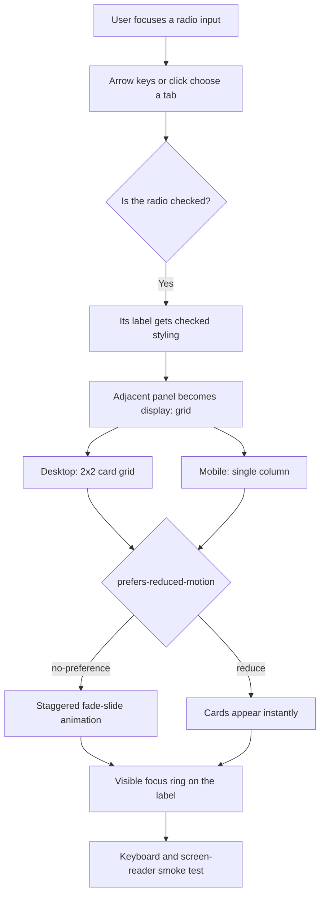

| Difficulty | Channel | Tags |
|---|---|---|
| beginner | frontend | css, flexbox, grid, animations |

Picture a hotel-search page on a mid-range Android phone. The filter sidebar is one of the largest and oldest parts of trivago's frontend, still running on Harmony, a legacy fork of Marionette, and it is slow on mobile and not fully keyboard accessible, so some visitors cannot use the filters at all [1]. That is the uncomfortable truth behind every "simple" UI pattern: the cost is paid by the people who can least afford it. The same failure can hide inside a tiny design-system tab panel, which is why this CSS-only exercise is really a lesson in restraint, semantics, and knowing when to stop.

---

> ### Real-World Case — trivago
>
> trivago's hotel-search filter sidebar was one of the largest and oldest parts of its frontend, still running on Harmony, a legacy fork of Marionette. The component was slow on mobile and not fully keyboard accessible, so some visitors could not use the filters at all.
>
> | | |
> |---|---|
> | **Challenge** | Rebuild a complex tabbed and accordion-based filter UI to be keyboard accessible without dragging along a render-blocking legacy JavaScript framework. On slower mobile devices, script evaluation and rendering took over 120ms because a 176KB bundle loaded immediately, even for features most users never opened. |
> | **Solution** | The team rebuilt the filters on Melody JS and removed legacy weight: they dropped IE8 support, deleted the Velocity animation library and relied solely on CSS for animation, and changed the "More filters" tab to load on demand instead of shipping 35KB up front. They also implemented accessible tab and accordion semantics after researching ARIA patterns. |
> | **Outcome** | The filter bundle fell from 176KB to 53KB, a 70% reduction (13KB gzipped). Script evaluation and rendering time dropped from over 120ms to 16ms, an 88% reduction, and the filters became completely keyboard accessible. |
> | **Lesson** | Accessibility and performance are often the same project: an accessibility-driven rewrite forced the team to remove a JavaScript animation library, let CSS handle motion, and defer non-critical UI, which produced the biggest performance win. |

---

## Hook — The Filter Panel That Couldn't Be Tamed

The page looked harmless. A row of checkboxes, a price slider, a few star ratings. But behind that ordinary hotel-search sidebar sat one of trivago's oldest frontend components, still running on Harmony, a legacy fork of Marionette [1]. On mobile it was slow. For keyboard users it was partly unusable. Some visitors could not operate the filters at all [1].

That is the moment the stakes become real. A filter panel is not a decorative widget; it is the difference between finding a room and giving up. And the failure was not caused by one dramatic bug. It was the accumulated cost of too much runtime machinery around an interaction that should have been simple.

Now shrink the scene down to a design-system docs page. You need tabs, a 2×2 card grid, a mobile stack, and a small entrance animation. No JavaScript. It sounds like a party trick. It is also the same design question trivago faced at production scale: how much machinery does this interaction actually deserve?

## Problem — When "No JavaScript" Becomes an Excuse

CSS-only tabs are seductive. There is no hydration boundary, no state library, no event listener to leak, and the page still works when a script fails. For documentation, static style guides, prototypes, and low-stakes content switchers, that is a genuinely good trade [2].

However, the pattern fails in predictable ways when developers stop at "it works with a mouse." The three most common cracks are:

- Hiding the radio with `display: none`, which removes it from the keyboard tab order and makes the labels the only discoverable control.
- Forgetting that a radio group announces itself as a radio group, not as a tablist, and therefore needs a clear legend and visible focus treatment [2].
- Adding a staggered animation without a `prefers-reduced-motion` guard, which turns a nice detail into nausea for motion-sensitive users [5].

So when should you actually reach for this pattern? Use it when the state is shallow and local: a docs page switching between "Overview" and "Tokens," a pricing comparison, a static demo. Avoid it when you need deep-linkable tab state, dynamically loaded panels, or full ARIA tab semantics. In those cases, a small JavaScript controller is the honest choice.

| Requirement | CSS radio tabs | JavaScript tabs |
| --- | --- | --- |
| Zero JavaScript | Yes | No |
| Deep-linkable state | Awkward | Straightforward |
| Full tab ARIA semantics | No; radio-group semantics | Yes |
| Native arrow-key switching | Yes | Custom code required |
| Best fit | Static docs, demos | App navigation, complex state |

That table is the first plot twist: "CSS-only" is not automatically more accessible. It is only more accessible when the markup and focus model are designed correctly.

## Real-World Case — trivago

In trivago's case, the problem was not a missing CSS trick. The company's hotel-search filter sidebar was one of the largest and oldest parts of its frontend, still running on Harmony, a legacy fork of Marionette [1]. The component was slow on mobile and not fully keyboard accessible, so some visitors could not use the filters at all [1].

The fix was a deliberate simplification, not a cosmetic refactor. The filter bundle fell from 176KB to 53KB, a 70% reduction, or 13KB gzipped. Script evaluation and rendering time dropped from over 120ms to 16ms, an 88% reduction, and the filters became completely keyboard accessible [1].

Notice what the win is not. It is not "CSS is better than JavaScript." It is not "frameworks are bad." The win is that trivago removed obsolete abstraction, cut the amount of work the browser had to do, and treated keyboard access as part of the definition of done [1]. That reframing matters because the CSS-only tab pattern is a smaller version of the same question: can you express the state with the platform instead of piling on more machinery?

The answer is often yes, but only if you respect the sharp edges. The next section looks at exactly where those edges are.

## Deep Dive — The Radio Input Is a State Machine

At its core, the pattern is a tiny state machine made of form controls. Each radio input represents one possible state, and a shared `name` attribute groups them into a single-selection set [2]. When a radio becomes checked, the `:checked` pseudo-class matches it [3], and a sibling combinator lets the CSS reveal the matching panel.

The happy path looks like this: the input, its label, and its panel are siblings in that exact order. The selector `.tabs input:checked + label + .panel` then says, "when this input is checked, show the panel that follows its label." Clicking the label checks the input. Pressing the arrow keys moves between radios in the same group. No JavaScript state, no event delegation, no hydration. Building on that, `aspect-ratio: 16 / 9` reserves the image box before the image loads, which prevents the card grid from jumping as assets arrive [4]. The panel itself uses CSS Grid with `repeat(2, minmax(0, 1fr))` on desktop and a single column on mobile [7][8].

But here is the twist: the selector is also the fragility. Move the panel into a wrapper div and the adjacent-sibling chain breaks. Reorder the markup and the CSS silently stops working. That is the price of zero JavaScript, and it is why the DOM structure is not an implementation detail; it is the API.

Accessibility adds another layer. A visually hidden radio can still receive focus if it is hidden with the clip pattern rather than `display: none`. The visible label can then show a `:focus-visible` outline, so keyboard users can see where they are [6]. The radio group semantics are also honest: a screen reader will announce "radio button, 1 of 2," not "tab, 1 of 2." For a documentation switcher with a clear ``, that is usually acceptable. For primary app navigation, use real tabs.

💡 **Insight:** The best CSS-only patterns are not clever because they avoid JavaScript. They are clever because the browser already knows how to manage focus, selection, and keyboard navigation for form controls.

⚠️ **Watch Out:** If you hide the inputs with `display: none`, mouse clicks still work through the labels, but keyboard users cannot reach the controls. The demo looks fine in a screenshot and fails in real use.

## Workflow — From Markup to Motion

Here is the sequence that keeps the pattern honest. The diagram below traces the full state flow from focus to visible panel, including the reduced-motion branch.

1. **Start with a fieldset and legend.** The group needs a name before it needs a style. This gives assistive technology context and keeps the tab strip semantically grouped [2].
2. **Write one radio and one label per panel.** Give every radio the same `name`, a unique `id`, and a label with a matching `for`. Make the first radio `checked` so the page has a valid initial state.
3. **Keep the panel as a sibling of its label.** The CSS selector depends on this order. Do not wrap the panel in an extra container unless you are prepared to change the selector strategy [3].
4. **Hide the radio visually, not from the keyboard.** Use the clip pattern, then move the focus ring to the label with `:focus-visible` [6].
5. **Lay out the cards with Grid.** Use `repeat(2, minmax(0, 1fr))` for the desktop 2×2 and `1fr` below your mobile breakpoint [7][8]. Give every image container `aspect-ratio: 16 / 9` [4].
6. **Add motion only inside `prefers-reduced-motion: no-preference`.** Stagger the cards with `nth-child` delays, and use `animation-fill-mode: backwards` so the first frame is applied before the delay finishes [5].
7. **Test with the keyboard, not just the mouse.** Tab into the group, use arrow keys to switch, confirm the focus ring is visible, and then enable "reduce motion" in the OS and repeat.

The workflow is deliberately boring. That is the point. The interesting part is not the selector trick; it is the discipline of checking the states that a screenshot cannot show.

## Code Example — The Markup That Does the Work

The example below uses TypeScript only as a build-time wrapper that returns a static string. The shipped page contains no event listeners; the interaction is entirely CSS. The important details are the sibling order, the visually hidden radios, the `:checked` panel reveal, the Grid breakpoint, and the reduced-motion guard.

Specifically, notice the selector `.tabs__radio:checked + .tabs__label + .panel`. It reveals a panel only when its own radio is checked, which is what makes multiple panels coexist without JavaScript. The focus ring is attached to the label, because the input is visually hidden. The animation is opt-in through `prefers-reduced-motion: no-preference`, so users who ask for less motion get an instant, stable layout [5].

The code is illustrative rather than copy-paste production markup: the image paths are placeholders, and a real design-system page should also test screen-reader announcements and color contrast. But the structure is the part worth stealing.

## Lessons Learned — What to Do Differently Tomorrow

The trivago story is not a mandate to delete every framework. It is a reminder that interaction cost compounds. A 176KB filter bundle and a 120ms script-evaluation budget were not caused by one bad decision; they were caused by layers that no longer earned their place [1]. The CSS-only tab pattern is a small way to practice the same judgment.

Here is what to carry forward:

- **Design the focus model first.** If the control cannot be reached and seen with a keyboard, the pattern is not finished [6].
- **Hide visually, not semantically.** A radio that is removed from the tab order is a radio that some users cannot operate [2].
- **Respect motion preferences by default.** Put animation behind `prefers-reduced-motion: no-preference` rather than assuming everyone wants the flourish [5].
- **Use the platform for shallow state.** Radio groups already provide selection and arrow-key behavior. Do not rebuild that in JavaScript unless you need more than it offers [3].
- **Know when to graduate.** Deep links, restored state, dynamic panels, and full tab semantics are legitimate reasons to add a small controller.
- **Measure the boring numbers.** Bundle size, script evaluation, rendering time, and keyboard completion rate tell you whether the simplification actually helped.

The battle scar to remember is the one that looks like success: a tab panel that switches perfectly in a demo but traps keyboard users in production. trivago's filters became completely keyboard accessible only when accessibility was treated as a requirement, not a polish pass [1]. That is the standard worth copying.

---

## CSS-Only Tab State Flow

<strong>Original Interview Question</strong>

**Q:** Build a CSS-only tab panel for a design-system docs page. Use radio inputs to switch tabs (no JavaScript). Desktop: a 2x2 grid of cards under each tab; mobile: single column. Each card has a fixed 16:9 image area, a title, and a short meta line. Add a subtle entrance animation with a stagger and keep focus-visible outlines; ensure prefers-reduced-motion is respected?

**A:** Use a set of radio inputs with a shared `name` attribute and corresponding `` elements for each tab section. The `:checked` state of each radio controls visibility of its associated panel via adjacent sibling selectors. Each panel renders a 2×2 card grid on desktop and collapses to a single column on mobile. Cards use `aspect-ratio: 16/9` for fixed image containers, with a title and meta line below.

## Conclusion

Before you reach for a tab library, ask what the interaction actually needs. If it is shallow, local, and static, radio inputs plus a careful focus model can ship less code and exclude fewer people. Skip `display: none` on the inputs, put the focus ring where users can see it, guard animation with `prefers-reduced-motion`, and test the panel with a keyboard before calling it done. trivago's filter rewrite is the memorable version of the same lesson: the biggest accessibility win is often the moment you remove machinery instead of adding it [1].

---

## References

1. [trivago incident report](https://tech.trivago.com/post/melodic-filters-article) — article
2. [MDN: <input type="radio">](https://developer.mozilla.org/en-US/docs/Web/HTML/Element/input/radio) — documentation
3. [MDN: :checked](https://developer.mozilla.org/en-US/docs/Web/CSS/:checked) — documentation
4. [MDN: aspect-ratio](https://developer.mozilla.org/en-US/docs/Web/CSS/aspect-ratio) — documentation
5. [MDN: prefers-reduced-motion](https://developer.mozilla.org/en-US/docs/Web/CSS/@media/prefers-reduced-motion) — documentation
6. [MDN: :focus-visible](https://developer.mozilla.org/en-US/docs/Web/CSS/:focus-visible) — documentation
7. [MDN: CSS Grid Layout](https://developer.mozilla.org/en-US/docs/Web/CSS/CSS_grid_layout) — documentation
8. [Responsive web design](https://en.wikipedia.org/wiki/Responsive_web_design) — documentation

---

**Author:** Satishkumar Dhule — [GitHub](https://github.com/satishkumar-dhule) · [LinkedIn](https://linkedin.com/in/satishkumar-dhule) · [Website](https://satishkumar-dhule.github.io)
