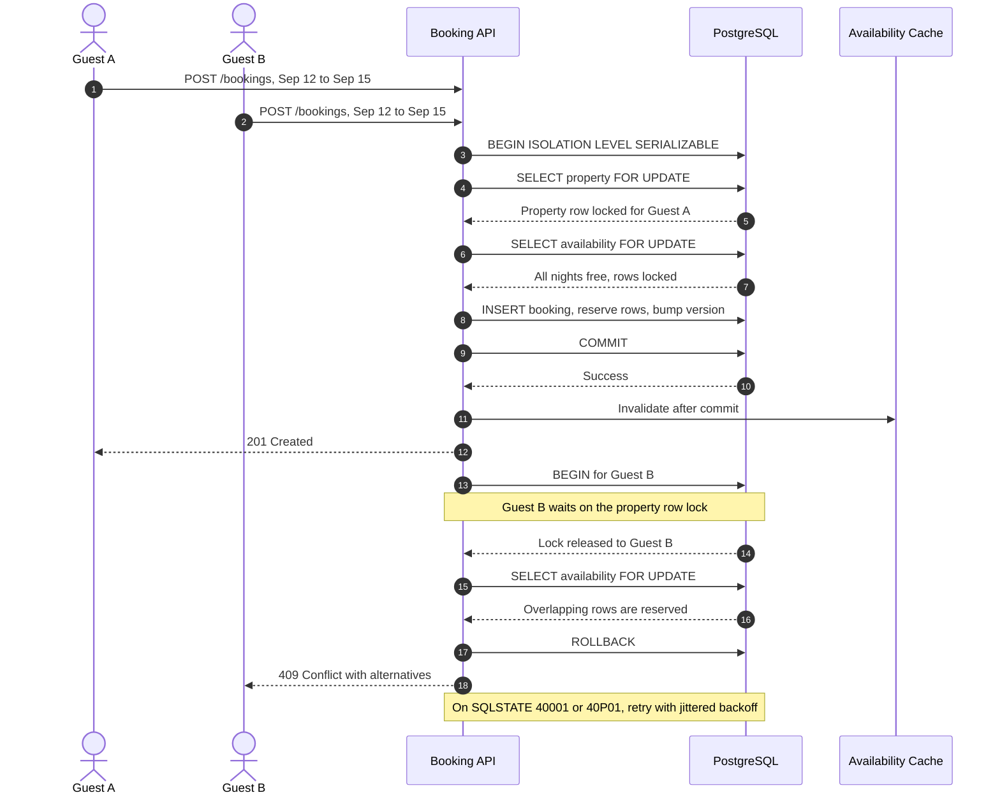

| Difficulty | Channel | Tags |
|---|---|---|
| intermediate | database | acid, isolation-levels, mvcc |

The countdown timer says 14:59, and two guests on opposite sides of the world are looking at the same beach house. Both click Book. Both see an availability calendar that says the dates are free. Only one can win, and the database has roughly 40 milliseconds to decide which one. Shopify learned this lesson at extreme scale: its oversell protection reserves inventory during payment, and on Black Friday 2025 the platform handled a record $5.1 million in sales per minute while keeping oversells at zero [1]. The hard part was not raw query speed. It was making the reserve-and-claim decision atomic across systems that had historically lived apart [1].

---

> ### Real-World Case — Shopify
>
> Shopify's oversell protection reserves inventory during payment so two concurrent checkouts cannot claim the same unit. On Black Friday 2025, merchants hit a record $5.1 million in sales per minute at peak, and reservations ran on every checkout touching inventory. For years the system used Redis, but reservations and the inventory ledger lived in separate systems, so the reserve and claim steps could not be wrapped in one atomic transaction.
>
> | | |
> |---|---|
> | **Challenge** | Prevent two buyers from purchasing the same last unit while sustaining flash-sale throughput, respecting multi-location inventory, and keeping ACID guarantees between reservations and the inventory ledger. Earlier MySQL attempts failed because a single row with a quantity column became a contention hotspot under concurrent checkouts. |
> | **Solution** | Shopify rebuilt reservations in MySQL using one row per sellable unit instead of one row per item, capped at a bounded pool of 1,000 rows per item/location. Reserving uses SELECT ... FOR UPDATE SKIP LOCKED so concurrent transactions skip locked rows instead of queueing. They switched from a auto-increment primary key to a composite key to cut InnoDB locks from two per reservation to one, used READ COMMITTED instead of the default REPEATABLE READ to avoid gap/supremum locks during replenishment, standardized lock ordering to eliminate deadlocks, and batched multi-item carts with UNION ALL. They ran Redis and MySQL in shadow mode before a pod-by-pod cutover with a kill switch. |
> | **Outcome** | The system met peak 2025 traffic targets with no oversells: writer CPU stayed under 50% and reader CPU under 16% during high-volume flash sales. Cleanup of the checkout path removed 50% of reads and 33% of transactions on the primary database. The real bottleneck turned out not to be query speed or CPU but connection hold time in unrelated checkout code. |
> | **Lesson** | Double-booking is often solved better by schema design than by cranking isolation to SERIALIZABLE: one row per unit plus SKIP LOCKED makes conflicting work naturally disjoint. Also, if CPU is low but throughput is capped, the bottleneck is probably connection occupancy elsewhere in the request path — instrument who holds connections, not just which query is slow. |

---

## Hook — Two Clicks, One House, and a Race You Cannot See

The browser paints a green calendar and a reassuring Book now button. Two guests, one in Berlin and one in Austin, click it within the same second. Their requests land on different application servers, and both servers run the same innocent query: find availability rows for those dates where reserved is false. Both get rows back. Both write a booking. Both send a confirmation email.

The race stays invisible until the first guest arrives and finds someone else already inside. That is not a database bug. It is a boundary bug: the check and the write happened in different moments, and nothing forced the second transaction to respect the first.

This is the uncomfortable truth behind every double-booking story. A read is not a promise. Availability is a fact that must be re-established at write time, under a lock, inside the same transaction that claims the inventory. The rest of this journey is about building that boundary without turning a hot property into a global bottleneck.

## Problem — The 40-Millisecond Window Between Check and Claim

Most teams start with a read-check-write flow because it matches how humans reason. You look at the calendar, you confirm the dates are free, and you book. In code, that becomes a SELECT, an if statement, and an INSERT. It works perfectly in development, where two requests rarely arrive in the same millisecond.

In production, the gap between check and write is the whole problem. The availability check may hit a read replica that lags by 50 to 200 milliseconds. The cache may hold a snapshot from before the last booking. The application server may pause for garbage collection after reading the row but before writing it. This is a time-of-check to time-of-use failure, and it gets wider as traffic grows.

The first instinct is a global lock. That serializes every booking on the platform and turns a flash sale into a queue. The second instinct is to trust SERIALIZABLE as a magic switch. It does protect against serialization anomalies [2][8], but it also converts contention into aborts, and aborts become retry storms if the transaction is wide.

ACID is the contract that makes atomic booking possible [5], but the contract only covers work inside the transaction boundary. If the availability check reads a replica and the write goes to the primary, no isolation level can save you. The real design question is narrower: what is the smallest fact that must be atomic, and how do you lock only that fact? Shopify ran into this exact boundary at a scale where the cost of getting it wrong is measured in millions per minute.

## Real-World Case — Shopify

Shopify's oversell protection reserves inventory during payment so two concurrent checkouts cannot claim the same unit. Every checkout that touches inventory creates a reservation, which means the reservation path is not a rare edge case. It is part of the hot path on the busiest shopping days of the year.

For years, the system used Redis for reservations while the inventory ledger lived in a separate system. That split made the reserve and claim steps impossible to wrap in one atomic transaction [1]. The architecture was fast, but it left a seam where concurrency could leak through.

The 2025 redesign met its targets under extreme load. During Black Friday 2025, Shopify hit a record $5.1 million in sales per minute at peak, with reservations running on every checkout touching inventory [1]. Writer CPU stayed under 50% and reader CPU under 16% during high-volume flash sales, and the system reported no oversells [1]. Cleanup of the checkout path also removed 50% of reads and 33% of transactions on the primary database [1].

Here is the plot twist. The real bottleneck was not query speed or CPU. It was connection hold time in unrelated checkout code. The database was doing its job; the surrounding code was keeping connections open longer than the critical section required. That detail matters because it reframes the solution. Isolation levels and locks protect correctness, but transaction scope protects throughput. A perfectly correct transaction that waits on a payment API is still a scalability problem.

## Deep Dive — Isolation Levels, Locks, and the Cost of Being Right

Start with the invariant. For a booking system, the rule is simple: no two active bookings may overlap for the same property. Every design choice should make that rule easier to enforce, not harder to reason about.

SERIALIZABLE is the strongest isolation level PostgreSQL offers. It guarantees that concurrent transactions produce a result equivalent to running them one at a time [2][8]. That sounds like exactly what a booking system needs, and often it is. The catch is that PostgreSQL implements it with serializable snapshot isolation, which detects dangerous conflicts and aborts one transaction rather than blocking forever. Under contention, correctness becomes a retry policy.

MVCC is the reason readers do not block writers. Each transaction sees a snapshot of the database, so availability checks can run without waiting for in-flight bookings [6]. That is excellent for read throughput and terrible for assumptions. A snapshot can be stale by the time the transaction commits, which is why the write path must re-check the rows under a lock.

Pessimistic locking with SELECT ... FOR UPDATE gives you exclusive access to specific rows [3][4]. It is direct, easy to reason about, and ideal when you know exactly which rows matter. The cost is waiting, possible deadlocks, and connection hold time. Optimistic concurrency control takes the opposite approach: read a version, write only if the version has not changed, and retry if it has [7]. It shines when contention is low or when the user spends time thinking between read and write.

The real trade-off looks like this:

| Approach | What it buys you | What it costs | Use it when |
| --- | --- | --- | --- |
| `SELECT ... FOR UPDATE` | Exclusive access to specific rows | Waiting, deadlocks, connection hold time | You know the exact rows and the transaction is short |
| Optimistic version check | Detects lost updates without blocking | Retries under contention | Contention is low or think time is long |
| `SERIALIZABLE` | Protects multi-row invariants and phantoms | Aborts, retry storms if transactions are wide | The rule spans rows or tables |
| Distributed lock in Redis | Cross-service coordination | Lease expiry, split-brain, no ACID rollback | You need coordination, not authoritative state |

Many developers think these approaches are competing religions. They are not. A robust booking path often combines them: SERIALIZABLE for the invariant, row locks to keep the critical section narrow, and version columns to detect stale writes. The combination works because each tool covers a different failure mode.

There is another subtlety. A cache invalidation before commit can publish a lie. If the booking rolls back after the cache is cleared, readers repopulate the cache from the old state and the next request sees availability that no longer exists. Invalidate after commit, or use a versioned cache key that changes with the property version. The goal is not to eliminate every lock. The goal is to make the critical section small enough that contention stays boring.

## Workflow — A Reservation Protocol That Holds Under Load

Here is the sequence that keeps the invariant intact without serializing the whole platform:

1. Validate the request and normalize the stay into a half-open date range.
2. Open a transaction on a single database connection. Do not mix replicas into this step.
3. Lock the property row with `SELECT ... FOR UPDATE` to funnel bookings for that property.
4. Lock the overlapping availability rows with a range predicate and read their reserved flags.
5. Verify that every required night exists and is free. Partial availability is not availability.
6. Insert the booking, mark the rows reserved, and bump the property version in the same transaction.
7. Commit, then invalidate or version the availability cache.
8. Retry only retryable failures such as serialization errors and deadlocks; return a real conflict for dates that are genuinely gone.

The Mermaid sequence diagram below shows the same story from the database's point of view. Guest A acquires the locks first and commits. Guest B waits, then sees the reserved rows and receives a conflict instead of a duplicate confirmation.

Two details keep this workflow honest. First, the retry policy must distinguish a transient serialization failure from a permanent business conflict. Retrying `40001` and `40P01` with jittered exponential backoff is standard practice [9]. Retrying a sold-out date just burns CPU and delays the user. Second, the booking endpoint should accept an idempotency key so a client retry after a network timeout does not create a second reservation [10]. A conflict should surface as `409 Conflict`, not as a generic 500 [11].

Finally, keep the cache update after the commit. If the cache is updated before the transaction succeeds, a rollback leaves the cache advertising inventory that the database never sold. That is how a correctness fix becomes a new correctness bug.

## Code Example — A Transaction That Refuses to Guess

The TypeScript example below uses node-postgres and a one-row-per-night availability table. It does four things in one transaction: locks the property, locks the overlapping nights, verifies that every night is free, and claims the inventory before inserting the booking.

The transaction opens at SERIALIZABLE so the database can detect multi-row anomalies. The property row lock is a deliberate funnel: it serializes bookings for the same property without locking the entire availability table. The range lock then protects the specific nights, and the row count check prevents a partial stay from being reserved. The update and insert commit together, so there is no moment where inventory is claimed without a booking or a booking exists without claimed inventory.

The retry wrapper is equally important. It retries only SQLSTATE `40001` (serialization failure) and `40P01` (deadlock detected) with jittered exponential backoff. It does not retry `DatesUnavailableError`, because a real conflict will not resolve itself. In production, the request would also carry an idempotency key so a client retry cannot create a duplicate booking.

Notice what is missing from the transaction: no payment provider call, no email send, and no Redis round trip. Those belong after commit or in an outbox. Shopify's experience points to the same lesson: connection hold time, not raw query speed, is often the real bottleneck [1].

## Lessons Learned — What Survives Black Friday

Double bookings are rarely caused by a missing index. They are caused by a transaction boundary that does not match the business invariant. Here is what survives contact with real traffic:

- **Make the invariant executable.** Write down the rule as a database constraint, a lock protocol, or both. If the rule is only in application code, every new endpoint becomes a chance to bypass it.
- **Lock the smallest set of rows.** A property-level lock is usually enough to funnel bookings for one listing. A table-level lock is a throughput disaster waiting for a flash sale.
- **Keep the transaction boring.** No network calls, no emails, no cache writes, and no long computations inside the critical section. Commit, then do the side effects.
- **Invalidate after commit.** A cache cleared before commit can be repopulated with stale data after a rollback.
- **Retry the right errors.** Serialization failures and deadlocks are retryable [9]. Sold-out dates are not. Mixing the two creates retry storms and angry users.
- **Make writes idempotent.** A client retry after a timeout should return the same booking, not a second one [10].
- **Watch connection hold time.** Track how long checkout requests hold a database connection, not just query latency. Shopify found the bottleneck in unrelated checkout code, not in the reservation query itself [1].
- **Test with concurrency.** A unit test with one request proves nothing. Run parallel booking attempts against the same dates and assert that exactly one succeeds.

Battle scars show up in predictable places. Checking availability on a read replica and writing to the primary is the classic mistake; replication lag becomes the race window. Holding a row lock while calling a payment provider is the second; the lock outlives the transaction's useful work and queues everyone behind it. Invalidating the cache before commit is the third; it turns a rollback into a public availability lie.

None of these failures are exotic. They are ordinary code paths under extraordinary concurrency. The memorable insight is this: availability is not a boolean you read once. It is a fact you re-establish at write time, inside the same transaction that claims it.

---

## Concurrent Booking Reservation Sequence

<strong>Original Interview Question</strong>

**Q:** You're building a booking system for Airbnb where multiple users can reserve the same property simultaneously. How would you design the transaction handling to prevent double bookings while maintaining high availability?

**A:** Use SERIALIZABLE isolation with optimistic concurrency control. Implement row-level locks on property availability tables, use MVCC snapshot reads for checking availability, and apply application-level validation to ensure atomic booking operations.

## Conclusion

Shopify's zero-oversell Black Friday did not come from a faster query. It came from a transaction boundary that matched the business invariant, and from removing work that did not belong inside that boundary [1]. The same principle applies whether you are running a global marketplace or a small booking service: make the check and the claim atomic, keep the critical section short, and treat retries as part of the design rather than an afterthought.

Tomorrow, pick one write path and audit where the check happens. Is it reading a replica? Is the cache invalidated before commit? Is a payment call holding a row lock open? Fix the boundary first, then measure. Lock wait time, retry rate, and connection hold time will tell you more than raw query latency ever will.

Remember the line worth sharing with your team: availability is a fact you re-establish at write time, not a memory you trust from read time.

---

## References

1. [Shopify incident report](https://shopify.engineering/scaling-inventory-reservations) — article
2. [PostgreSQL Documentation: Transaction Isolation](https://www.postgresql.org/docs/current/transaction-iso.html) — documentation
3. [PostgreSQL Documentation: Explicit Locking](https://www.postgresql.org/docs/current/explicit-locking.html) — documentation
4. [PostgreSQL Documentation: SELECT](https://www.postgresql.org/docs/current/sql-select.html) — documentation
5. [ACID](https://en.wikipedia.org/wiki/ACID) — article
6. [Multiversion Concurrency Control](https://en.wikipedia.org/wiki/Multiversion_concurrency_control) — article
7. [Optimistic Concurrency Control](https://en.wikipedia.org/wiki/Optimistic_concurrency_control) — article
8. [Serializability](https://en.wikipedia.org/wiki/Serializability) — article
9. [Exponential Backoff](https://en.wikipedia.org/wiki/Exponential_backoff) — article
10. [Idempotence](https://en.wikipedia.org/wiki/Idempotence) — article
11. [MDN Web Docs: 409 Conflict](https://developer.mozilla.org/en-US/docs/Web/HTTP/Status/409) — documentation

---

**Author:** Satishkumar Dhule — [GitHub](https://github.com/satishkumar-dhule) · [LinkedIn](https://linkedin.com/in/satishkumar-dhule) · [Website](https://satishkumar-dhule.github.io)
