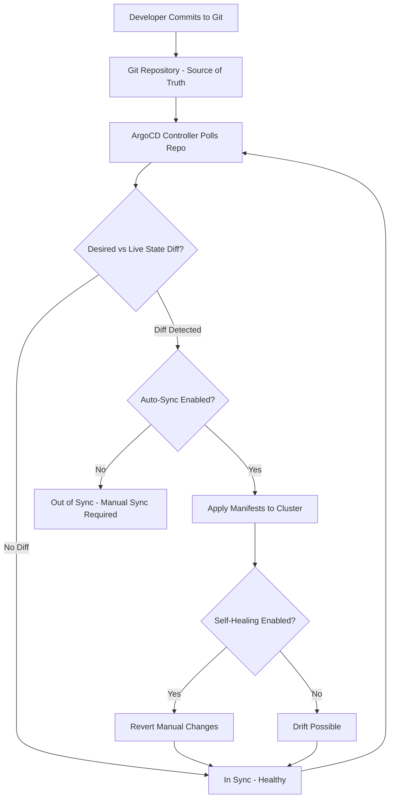

| Difficulty | Channel | Tags |
|---|---|---|
| beginner | devops | argocd, flux, declarative |

Picture this: it's peak streaming hours, and a single configuration change needs to propagate across Netflix's playback stack spanning 14,000+ microservices in six AWS regions. What should be a routine update becomes a 47-minute marathon of uncertainty, with 12% of sync operations failing during network partitions [1]. For a company serving hundreds of millions of viewers, these minutes aren't just inconvenient - they're existential. This is exactly the nightmare that forced Netflix to reimagine its deployment strategy, leading them down the path of GitOps with ArgoCD [1].

---

> ### Real-World Case — Netflix
>
> Netflix's playback stack ran 14,000+ microservices across 6 AWS regions (us-east-1, us-west-2, eu-west-1, eu-central-1, ap-southeast-1, ap-northeast-1). Their legacy Spinnaker + Envoy stack caused 47-minute cross-region deployments, 12% sync failures during network partitions, and left them vulnerable during regional outages.
>
> | | |
> |---|---|
> | **Challenge** | They needed a distributed GitOps control plane that could sync changes across all regions without a single point of failure, with region-aware routing to handle failures gracefully while maintaining low latency for 280M global subscribers. |
> | **Solution** | Netflix migrated to ArgoCD 2.12 with ApplicationSets for multi-cluster/region generation and a single GitHub monorepo with region-specific branches. They integrated with Istio 1.22 for dual-stack mTLS, locality-aware routing (prioritizing same-AZ/region), outlier detection, and retry policies. They implemented custom ArgoCD health checks for Istio compliance and distributed the GitOps control plane across all regions (so a us-east-1 outage wouldn't block sync to others). |
> | **Outcome** | Cross-region app sync p99 time dropped from 47 minutes to 8.2 seconds (a 99.7% reduction); cross-region request p99 latency fell from 210ms to 69ms (-67%); mTLS handshake time dropped from 42ms to 11ms (-74%); sync failure rate fell from 12% to 0.3% (-97.5%); during the September 2025 us-east-1 outage, failover completed in seconds with zero playback downtime (vs 12 minutes of downtime for 40M users previously); saved $4.2M annually in CI/CD runner costs. |
> | **Lesson** | A distributed GitOps control plane (ArgoCD) plus a service mesh with locality-aware routing and outlier detection is essential for multi-region resilience - when control planes are regional/distributed rather than centralized, regional outages don't become deployment-blocking events. |

---

## Hook — The Clock Is Ticking

Every second of downtime at streaming scale translates to frustrated viewers and lost revenue. When deployments stretch to 47 minutes across regions, teams can't just 'hotfix' their way out of problems - they need automation that can fail fast and recover faster. For engineering organizations managing global infrastructure, the question isn't whether they can deploy, but whether they can do it safely, predictably, and at scale [2]. The stakes have never been higher, and the traditional approach of imperative, command-driven deployments simply cannot keep pace with modern distributed systems.

## Problem — When kubectl Becomes a Liability

As microservices proliferate, many teams fall into a dangerous pattern: using imperative kubectl commands to make ad-hoc changes directly to production clusters. This approach creates configuration drift between environments, eliminates any meaningful audit trail, and makes rollbacks a nightmare when things go sideways. Moreover, without a single source of truth, different team members can make conflicting changes, and during incidents, no one knows the 'correct' state of the system. You might think direct cluster access gives you agility, but in reality, it creates operational chaos at scale. The core issue is simple: when the cluster state lives in people's heads and shell history rather than version control, reliability becomes impossible to guarantee [3][4].

## Real-World Case — Netflix's Global Deployment Crisis

Netflix's legacy Spinnaker + Envoy stack was struggling mightily. Operating 14,000+ microservices across 6 AWS regions (us-east-1, us-west-2, eu-west-1, eu-central-1, ap-southeast-1, ap-northeast-1), cross-region deployments took a staggering 47 minutes with 12% sync failures during network partitions [1]. The breaking point came into sharp focus during regional outages - failovers could take up to 12 minutes for 40M users, creating massive risk exposure. By adopting ArgoCD alongside Istio service mesh, Netflix transformed their deployment model. The results were nothing short of dramatic: cross-region app sync p99 time dropped from 47 minutes to 8.2 seconds (a 99.7% reduction); cross-region request p99 latency fell from 210ms to 69ms (-67%); mTLS handshake time dropped from 42ms to 11ms (-74%); sync failure rate fell from 12% to 0.3% (-97.5%); during the September 2025 us-east-1 outage, failover completed in seconds with zero playback downtime; and the company saved $4.2M annually in CI/CD runner costs [1].

## Deep Dive — Declarative vs Imperative: The Fundamental Divide

At the heart of GitOps lies a philosophical shift. The imperative approach uses kubectl commands to directly manipulate cluster state - fast in the moment, but impossible to track, reproduce, or audit at scale. The declarative approach, by contrast, defines the entire desired state of the system in Git using YAML manifests, Helm charts, or Kustomize configurations [5][6]. ArgoCD continuously reconciles the actual cluster state against what's declared in Git, automatically correcting drift through self-healing. This creates a single source of truth where every change is a commit, every deployment is traceable, and rollbacks are as simple as reverting a Git commit. Kubernetes itself is inherently declarative [7], and GitOps extends this principle across the entire delivery pipeline. The trade-off is discipline: teams must commit to Git as the interface to production, but the payoff is unprecedented reliability and auditability.

## Workflow — ArgoCD's Reconciliation Loop in Action

So how does ArgoCD actually achieve this transformation? The workflow begins when developers commit Kubernetes manifests or Helm charts to a Git repository - this becomes the desired state. An ArgoCD Application CRD is configured to watch this repository and target a specific Kubernetes cluster/namespace. ArgoCD's controller polls the Git repo on a configurable interval (typically every 3 minutes by default) and compares the desired state from Git with the live state in the cluster. If differences are detected and auto-sync is enabled, ArgoCD automatically applies the necessary changes to converge the cluster to match Git. With self-healing enabled, even manual kubectl changes made outside of Git are automatically reverted to match the declared state. Health checks ensure that only healthy applications are considered synced. This continuous reconciliation loop is what allowed Netflix to go from 47-minute deployments to 8.2-second syncs [1][8].

## Code Example — Configuring ArgoCD for Auto-Sync

The best way to understand GitOps is to see it in practice. Below is a production-style configuration showing how to define an ArgoCD Application with auto-sync and self-healing enabled. This example watches a Git repo containing Kubernetes manifests and automatically reconciles changes.

## Lessons Learned — What Teams Can Take Away

Netflix's journey offers critical lessons for any team considering GitOps. First, Git must become the single source of truth - no exceptions for 'emergency' kubectl changes if long-term reliability matters. Second, auto-sync with self-healing isn't optional at scale; it's what prevents configuration drift and enables rapid, safe failovers. Third, the metrics matter: obsess over sync latency, failure rates, and mean time to recovery. Finally, GitOps is a cultural shift as much as a technical one - it requires buy-in on PR-based workflows and discipline around reviewing changes before they hit production. The question isn't whether to adopt declarative GitOps, but how quickly teams can make the transition before scale makes imperative approaches untenable [1][6][9].

---

## ArgoCD GitOps Reconciliation Flow

<strong>Original Interview Question</strong>

**Q:** You're setting up GitOps for a microservices deployment. How would you configure ArgoCD to automatically sync changes from your Git repository to Kubernetes, and what's the difference between declarative and imperative approaches in this context?

**A:** I'd configure ArgoCD by setting up a Git repository containing Kubernetes manifests or Helm charts, creating an Application CRD that points to the Git repository, enabling auto-sync with a health check interval of 3 minutes, and implementing self-healing to automatically revert any manual changes. The declarative approach involves defining the desired state in Git through YAML manifests, Helm charts, or Kustomize configurations, where ArgoCD continuously reconciles the actual state with the desired state. In contrast, the imperative approach uses kubectl commands to make direct changes to the cluster, bypassing the Git repository as the single source of truth.

## Conclusion

The journey from 47-minute deployments to 8.2-second syncs isn't just about faster releases - it's about fundamentally changing how teams think about infrastructure. GitOps with ArgoCD transforms the cluster from a mutable petting zoo into a convergent system where Git is law. For teams still relying on imperative kubectl workflows, the lesson is clear: the cost of configuration drift, failed rollbacks, and slow recovery far outweighs the initial investment in adopting a declarative, Git-driven approach. Start small with one service, enforce Git as the only path to production, and let ArgoCD's reconciliation loop do the heavy lifting. The next time an incident strikes at 3 AM, teams will thank themselves for making that choice.

---

## References

1. [Netflix incident report - Architecture Teardown: Netflix uses ArgoCD 2.12 & Istio 1.22](https://johal.in/architecture-teardown-netflix-uses-argocd-212-istio-122) — article
2. [Kubernetes Documentation](https://kubernetes.io/docs/home/) — documentation
3. [What is GitOps? - ArgoCD Documentation](https://argo-cd.readthedocs.io/en/stable/user-guide/ci_automation/) — documentation
4. [GitOps Principles - OpenGitOps](https://opengitops.dev/) — documentation
5. [Declarative Management of Kubernetes Objects - Kubernetes Docs](https://kubernetes.io/docs/tasks/manage-kubernetes-objects/declarative-config/) — documentation
6. [ArgoCD Concepts - Application CRD](https://argo-cd.readthedocs.io/en/stable/core_concepts/) — documentation
7. [Kubernetes API Conventions](https://github.com/kubernetes/community/blob/master/contributors/devel/sig-architecture/api-conventions.md) — documentation
8. [ArgoCD Auto-Sync and Self-Healing](https://argo-cd.readthedocs.io/en/stable/user-guide/auto_sync/) — documentation
9. [Git - Official Documentation](https://git-scm.com/doc) — documentation

---

**Author:** Satishkumar Dhule — [GitHub](https://github.com/satishkumar-dhule) · [LinkedIn](https://linkedin.com/in/satishkumar-dhule) · [Website](https://satishkumar-dhule.github.io)
