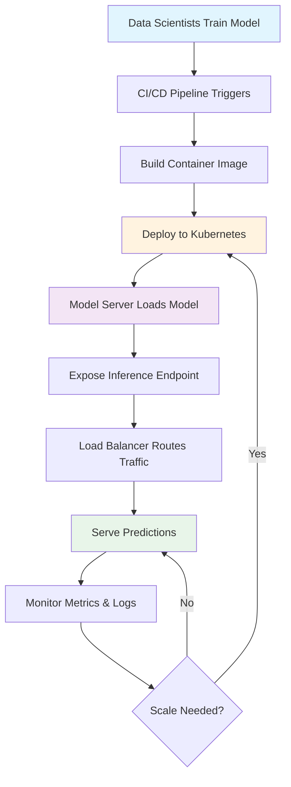

| Difficulty | Channel | Tags |
|---|---|---|
| beginner | devops | mlops, deployment |

Ever wondered why your ML model works flawlessly in a Jupyter notebook, but the moment you try to serve predictions at scale, everything falls apart? The answer often lies in a critical distinction that many developers miss: model deployment and model serving are not the same thing. This confusion isn't just academic - it's cost teams dearly. In fact, when Uber [1] set out to scale their ML infrastructure through the Michelangelo platform, they discovered just how nuanced this distinction really is, and the performance tradeoffs that come with getting it wrong.

---

> ### Real-World Case — Uber
>
> Uber's Michelangelo platform trained and served thousands of models across rides, Eats, fraud, and support. To let data scientists use arbitrary Spark MLlib pipelines instead of a restricted custom format, Uber tried standardizing on Spark's native model serialization for both batch and online deployment.
>
> | | |
> |---|---|
> | **Challenge** | The same model artifact had to work in two very different runtimes. Loading a Spark pipeline the out-of-the-box way starts a local Spark session and invokes the Catalyst optimizer per request, adding huge memory overhead and latency that violated millisecond-scale p99 SLAs for online serving. Model load time at deploy/startup was also too slow for a multi-tenant serving cluster. |
> | **Solution** | Uber separated deployment from serving concerns inside Michelangelo: models are deployed as artifacts to either offline Spark containers or online prediction clusters behind load balancers. For online serving they added an OnlineTransformer interface with a lightweight scoreInstance call that bypasses Catalyst, tuned model loading, and served features from a Cassandra feature store. Models are loaded into memory and routed by a header in a multi-model prediction service. |
> | **Outcome** | After tuning, native Spark model load time dropped from 8x-44x slower than Uber's custom protobuf format to only 2x-3x slower, a 4x-15x speedup. Online models achieved P95 latency under 5 ms without Cassandra features and under 10 ms with them, while the highest-traffic models served over 250,000 predictions per second. |
> | **Lesson** | Deployment and serving are distinct engineering problems: an artifact format optimized for training and batch jobs can be disastrous for online inference. Teams must optimize the serving load path, per-request overhead, and feature access separately from the deployment pipeline. |

---

## Hook — When the Notebook Becomes a Nightmare

Picture this: you have just trained what might be your best model yet. Accuracy is through the roof, validation metrics look pristine, and your team is excited to ship it. But the moment real traffic hits, latency spikes, memory usage explodes, and your service crashes. Sound familiar? The harsh truth is that training a model is only a fraction of the battle. Getting it to production reliably, at scale, with acceptable latency is an entirely different game. Many developers think pushing a model file to production is the finish line, but in reality, it is merely the starting line of a much more complex race.

## Problem — Two Concepts, One Big Confusion

Here is the thing though: the terms 'model deployment' and 'model serving' are often used interchangeably, and that ambiguity causes real problems. Deployment is about the broader lifecycle - think infrastructure provisioning, CI/CD pipelines, environment configuration, monitoring, rollbacks, and governance [2]. Serving, on the other hand, is laser-focused on the runtime: loading models into memory, exposing inference endpoints, routing requests, handling concurrency, and optimizing for latency and throughput [3]. You might think these are sequential steps of the same process, but they have completely different concerns. Deployment answers 'how do we get this model into our infrastructure safely?', while serving answers 'how do we actually respond to prediction requests efficiently?' Mixing these up leads to teams over-engineering the wrong parts or missing critical optimizations entirely.

## Real-World Case — Uber's Michelangelo Platform

This distinction became painfully clear at Uber. The company built Michelangelo, a machine learning platform that trained and served thousands of models across rides, Eats, fraud detection, and support [1]. Initially, Uber wanted to give data scientists the flexibility to use arbitrary Spark MLlib pipelines rather than restricting them to a custom format. To achieve this, they attempted to standardize on Spark's native model serialization for both batch and online deployment [1]. The results were eye-opening. Native Spark model loading was initially 8x to 44x slower than Uber's custom protobuf format. After extensive tuning, they managed to bring this down to only 2x to 3x slower - a 4x to 15x speedup [1]. More importantly, their online models achieved P95 latency under 5 ms without Cassandra features and under 10 ms with them, while the highest-traffic models served over 250,000 predictions per second [1]. The lesson here is profound: the choice of serialization format, model loading strategy, and serving architecture can make or break performance at scale. What worked for batch wasn't optimized for low-latency, high-throughput online serving, and bridging that gap required treating serving as its own distinct engineering challenge.

## Deep Dive — The Nuanced Tradeoffs

Building on Uber's experience, the tradeoffs become clearer when examined side by side. For deployment, teams typically lean on tools like Kubernetes [4] for orchestration, Docker [5] for containerization, and CI/CD systems to automate releases. The focus here is reliability, reproducibility, and safe rollouts with monitoring and rollback capabilities [2]. For serving, the priorities shift entirely. Tools like TensorFlow Serving [6], TorchServe [7], or BentoML [8] are built specifically to optimize inference. Here, considerations like model warm-up, batching strategies, GPU utilization, and request routing take center stage. Moreover, there is a constant tension between latency and throughput. Real-time inference often demands sub-100ms responses, while batch inference can prioritize throughput over speed [3]. A/B testing adds another layer of complexity - you need traffic splitting and gradual rollouts without disrupting users [2]. Cold starts are another hidden enemy, especially in serverless or auto-scaled environments where models may need to be loaded from scratch [3]. The key insight: deployment builds the highway, but serving is what determines how fast traffic actually moves.

## Workflow — From Deployment Pipeline to Serving Architecture

So how do these pieces fit together in practice? The workflow begins with deployment: version control triggers a CI/CD pipeline, tests run, containers are built, and infrastructure is provisioned via tools like Kubernetes [4]. Once deployed, serving takes over. Models are loaded into dedicated model servers, health checks are established, and load balancers distribute traffic [3]. Scaling happens at both layers - horizontal scaling adds more replicas during traffic spikes, while vertical scaling allocates more GPU memory for larger models [2]. Monitoring is crucial throughout, tracking everything from request latency to model drift [2]. The diagram below illustrates this flow, showing how deployment and serving operate as complementary but distinct processes. Notice how deployment is concerned with the 'what and where', while serving handles the 'how fast and how many' of prediction requests.

## Code Example — A Practical Serving Implementation

To make this concrete, consider a simple but production-inspired pattern using FastAPI as the serving layer. While this example is lightweight, it demonstrates the serving concerns - request validation, model loading, inference, and response formatting - separate from the deployment concerns of containerization and orchestration. The key is understanding that this API is what gets served, but it needs to be deployed properly via containers and orchestrated by something like Kubernetes to scale effectively.

## Lessons Learned — What You Should Take Away

After tracing this journey from confusion to clarity, a few lessons stand out. First, never conflate the two terms - deployment is infrastructure and lifecycle, serving is runtime inference optimization [2][3]. Second, optimize for your use case. A fraud detection model needing sub-10ms responses requires different serving strategies than a recommendation model that can tolerate slightly higher latency [1]. Third, plan for scale early. Uber's experience shows that serialization choices and loading strategies can have orders of magnitude impact [1]. Fourth, instrument everything. You cannot optimize what you do not measure, so track latency, throughput, errors, and model performance metrics [2]. Finally, remember that this is an iterative process. What works at 1,000 requests per second may crumble at 250,000. The goal isn't perfection on day one, but building systems flexible enough to evolve. As you move forward, ask yourself not just 'can we deploy this model?' but more importantly, 'can we serve it well when it matters most?'

---

## Model Deployment vs Serving Flow

<strong>Original Interview Question</strong>

**Q:** Explain the key differences between model serving and model deployment in ML systems, including specific technologies, scaling considerations, and real-world implementation patterns?

**A:** Deployment encompasses CI/CD pipelines, infrastructure setup, and monitoring using tools like Kubernetes, MLflow, and SageMaker. Serving focuses on runtime inference APIs with frameworks like TensorFlow Serving, TorchServe, or BentoML, handling request routing, model versioning, and autoscaling. Key trade-offs include latency vs throughput, batch vs real-time inference, and cold start optimization.

## Conclusion

The journey from notebook to production reveals a simple truth: training is science, but serving and deploying at scale is engineering. By treating model deployment and model serving as distinct disciplines, you avoid the pitfalls that plague so many ML initiatives. The next time you ship a model, don't just ask if it's deployed - ask if it's truly optimized to serve. Your users, and your infrastructure bill, will thank you for it.

---

## References

1. [Uber incident report](https://www.uber.com/us/en/blog/michelangelo-machine-learning-model-representation/) — blog
2. [MLOps: Continuous delivery and automation pipelines in machine learning](https://cloud.google.com/architecture/mlops-continuous-delivery-and-automation-pipelines-in-machine-learning) — documentation
3. [Machine Learning Model Serving](https://en.wikipedia.org/wiki/Model_serving) — documentation
4. [Kubernetes Documentation](https://kubernetes.io/docs/home/) — documentation
5. [Docker Documentation](https://docs.docker.com/) — documentation
6. [TensorFlow Serving](https://github.com/tensorflow/serving) — documentation
7. [TorchServe](https://github.com/pytorch/serve) — documentation
8. [BentoML](https://github.com/bentoml/BentoML) — documentation

---

**Author:** Satishkumar Dhule — [GitHub](https://github.com/satishkumar-dhule) · [LinkedIn](https://linkedin.com/in/satishkumar-dhule) · [Website](https://satishkumar-dhule.github.io)
