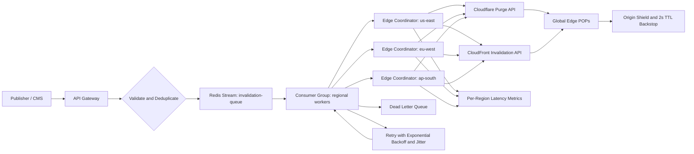

| Difficulty | Channel | Tags |
|---|---|---|
| intermediate | system-design | edge, caching, purging |

Imagine pressing publish on a CMS update and watching it vanish from every edge on earth in under five seconds, while 10,000 other invalidations compete for the same bandwidth. Fastly has lived this problem at global scale, and its public account of a firewall-induced partition is a masterclass in graceful degradation [1]. The company's purge latency has hovered around 150ms since 2011, even as throughput climbed from a few thousand to roughly 60,000 purges per second [1]. Here is how to design a system that keeps that promise when the network does not cooperate.

---

> ### Real-World Case — Fastly
>
> Fastly operates a global CDN where customers needed cache invalidation to be part of normal publishing workflows, not just an emergency cleanup. As traffic and network size grew, its original purge system hit scaling limits, and batching large purge requests actually made things worse by exploding a batch into individual purges that flooded the system.
>
> | | |
> |---|---|
> | **Challenge** | Guarantee fast, reliable cache invalidation across every POP worldwide while scaling from thousands to tens of thousands of purge requests per second. A centralized purge queue would add latency and create a single point of failure, especially during network partitions and packet loss. |
> | **Solution** | Fastly decentralized purging using Bimodal Multicast: the nearest cache server broadcasts each purge to all other servers over UDP, without waiting for acknowledgments, then a gossip protocol repairs any lost messages. They later added hierarchical intra-POP rebroadcasting and true batch purge processing instead of splitting batches into individual requests, eliminating self-inflicted floods and manual rate limiting. |
> | **Outcome** | Global purge latency has stayed around 150ms since 2011, and Fastly scaled from roughly 2,000-3,000 purges/sec in 2018 to about 60,000 purges/sec today, with confidence to handle hundreds of thousands per second. During a real network partition caused by a firewall misconfiguration, 95th-percentile purge latency rose by two orders of magnitude but purges still completed in about 10 seconds, and all messages were eventually recovered during an eight-minute outage. |
> | **Lesson** | For multi-region invalidation, decentralization and probabilistic delivery can beat a perfect centralized queue. Broadcasting purges everywhere and repairing losses with gossip avoids maintaining content-location maps and acknowledgment round trips, while true batch processing prevents a high-volume invalidation stream from turning into a self-inflicted denial of service. |

---

## Hook — The Publish Button That Exposed a Distributed System

Picture a CMS publish button that fans out to every region on the planet. The origin returns fresh HTML, the purge request returns 200 OK, and five seconds later a user in Singapore still gets yesterday's price. That gap between 'the API said yes' and 'the edge actually changed' is where multi-region invalidation lives.

Fastly has described exactly this tension in public. Its purge system had to become part of normal publishing workflows, not just an emergency lever, and growth exposed hard scaling limits [1]. The most counterintuitive part: making purge requests bigger did not make the system faster. It made the blast radius larger.

🔥 Hot Take: A cache purge is not a delete. It is a distributed write with an SLA, a failure mode, and a cost model.

## Problem — Five Seconds Is a Latency SLO, Not a Feeling

At 10,000 invalidations per second, the naive design collapses under its own API calls. Each purge is a small write to a control plane, and control planes are deliberately rate-limited. Multiply by regions, providers, and retries, and a traffic spike becomes a self-inflicted denial-of-service.

The requirements pull against each other:

| Requirement | Target | The hidden tension |
|---|---|---|
| Global latency | Under 5 seconds | Cross-region coordination adds hops |
| Throughput | 10,000 invalidations/sec | Provider APIs throttle aggressively |
| Availability | 99.99% | Retries amplify outages |
| Consistency | Strong across regions | Partitions make 'strong' a negotiation |

Many teams reach for a giant batch: collect 1,000 URLs, send one API call, celebrate. But Fastly's experience shows the trap. Batching large purge requests could explode a batch into individual purges, flooding the very system the batch was meant to protect [1]. The bottleneck was never the HTTP request. It was the fan-out behind it.

💡 Insight: Batch at the provider boundary, where the API actually accepts arrays. Do not batch at the queue boundary and assume the provider will honor your abstraction.

## Real-World Case — Fastly's Decade-Long Purge Evolution

Fastly's instant purge has been in production since 2011, and its global purge latency has stayed around 150ms for more than a decade [1]. That stability is impressive, but the more useful story is what happened underneath it.

As Fastly's network and customer traffic grew, the original purge system reached scaling limits. The team found that batching large requests did not reduce pressure; it expanded batches into individual purges and flooded the system [1]. Throughput still climbed from roughly 2,000–3,000 purges per second in 2018 to about 60,000 today, with confidence to handle hundreds of thousands per second [1].

Then came the real test. A firewall misconfiguration caused a network partition. During that partition, 95th-percentile purge latency rose by two orders of magnitude. Purges still completed in about 10 seconds, and every message was eventually recovered during an eight-minute outage [1].

That is the standard worth stealing: not zero failure, but bounded failure. The system degraded loudly, kept accepting work, and reconciled later. No silent data loss. No heroic manual replay at 3am.

⚠️ Watch Out: An eight-minute outage feels short until you measure it in missed purges. The recovery mechanism matters more than the happy-path dashboard.

## Deep Dive — The Four Trade-Offs Behind Every Purge

Building on that case, four trade-offs dominate the design.

**1. TTL versus explicit purge.** A short TTL is a safety net, not a strategy. `Cache-Control: max-age=2, must-revalidate` bounds staleness even if a purge is lost [3], and HTTP caching semantics are standardized in RFC 9111 [2]. `stale-while-revalidate` can hide latency from users, but it also means 'fresh' has a spectrum [9]. Use TTL to cap the worst case; use purge to hit the five-second SLO.

**2. Push versus pull coordination.** Edge workers can receive purge events and update regional state without a round trip to a central coordinator [8]. That reduces latency, but it creates a new question: who owns the truth when two regions disagree? The practical answer is an idempotent invalidation log with per-region checkpoints, not a global lock.

**3. Queue semantics.** Redis Streams with consumer groups give you at-least-once delivery, pending-entry tracking, and replay [6]. That is enough for purges if every purge is idempotent. A purge that runs twice is harmless; a purge that is silently dropped is not. A dead-letter queue is not optional.

**4. Provider behavior.** Cloudflare and CloudFront expose different purge models and limits [4][5]. The table below is the trade-off most teams miss:

| Dimension | Cloudflare | CloudFront |
|---|---|---|
| Purge unit | URL, tag, hostname, everything | Path invalidation |
| Batching | Array of files or tags | Batch invalidation request |
| Cost model | Plan-dependent | Per-path invalidation fees |
| Best fit | Tag-based publishing workflows | Path-oriented static assets |

Consequently, the winning architecture is not 'pick one CDN.' It is a provider-agnostic invalidation queue with provider-specific adapters. The queue absorbs bursts, the adapters respect rate limits, and the edge coordinators track regional completion.

💡 Insight: Strong consistency across regions is usually the wrong goal. What you actually want is monotonic freshness: once a region reports a purge complete, it must never serve the older object again.

🎯 Key Point: Treat every purge as an idempotent event with an ID, a target, a region set, and a deadline. Everything else is an implementation detail.

## Workflow — From Publish to Edge in Under Five Seconds

Here is the journey from a publish event to a globally consistent edge.

1. **Ingress:** The publisher calls an API with patterns, target regions, and an idempotency key. The gateway authenticates and rejects duplicates.
2. **Deduplicate:** Identical patterns within a short window collapse into one logical invalidation. This is where 10,000 requests per second become a manageable stream.
3. **Enqueue:** The event lands in a Redis Stream with a consumer group [6]. The stream is the buffer that absorbs bursts.
4. **Route:** Regional coordinators claim messages and filter them to affected regions. A European-only change should not wake up every POP on earth.
5. **Batch:** Each coordinator groups up to 100 patterns per provider and zone. This is the batch size that matches the provider API, not an arbitrary queue chunk [4][5].
6. **Purge:** Adapters call Cloudflare or CloudFront with a tight timeout, typically 1.5 seconds.
7. **Acknowledge:** A message is acknowledged only after the provider confirms success. Failures retry with exponential backoff and jitter, then land in a dead-letter queue [7].
8. **Verify:** Metrics track p95 and p99 purge latency per region, and the 2-second TTL acts as the final backstop [3].

The Mermaid diagram below shows the full pipeline, including the retry and dead-letter paths.

[Diagram: Global Purge Pipeline]

⚠️ Watch Out: Acknowledging before provider confirmation is the classic bug. It makes the dashboard green and the cache stale.

## Code Example — A Batched, Retrying Invalidation Worker

The TypeScript worker below implements the core loop: group by zone, batch by 100, call the provider, and retry with capped exponential backoff plus jitter.

**Step by step:**

- The `Invalidation` type keeps zone, pattern, and region together so routing never loses context.
- `backoff` computes an exponentially growing delay with random jitter, which prevents synchronized retry storms [7].
- `purgeBatch` sends the provider request with a 1.5-second timeout so one slow API call cannot stall the whole consumer.
- `processInvalidations` slices the stream into batches of 100 and groups patterns by zone before fan-out.
- `Promise.allSettled` ensures one failed zone does not cancel successful purges in other zones.
- After three failed attempts, the batch is logged for the dead-letter queue instead of retrying forever.

The design is intentionally boring. Boring is what you want when the network is on fire.

## Lessons Learned — What to Do Differently Tomorrow

Fastly's story ends with a system that still completed purges in about 10 seconds during a partition and recovered every message [1]. That did not happen by accident. It happened because the system was designed to fail in small, observable, recoverable ways.

Here is what to carry into your next design review:

- **Make purge a first-class workflow.** If publishing depends on it, it deserves SLOs, dashboards, and runbooks, not a cron job and a prayer.
- **Batch at the API boundary.** Respect provider limits and never assume a batch stays a batch internally [1].
- **Use TTL as a backstop.** A 2-second TTL bounds staleness when the queue is unhealthy [3].
- **Retry with jitter and a cap.** Unbounded retries turn a regional outage into a global one [7].
- **Ack only after confirmation.** At-least-once delivery plus idempotent purges is safer than optimistic acknowledgment [6].
- **Track per-region p95 and p99.** A global average hides the region that is quietly failing.
- **Test the partition.** Inject network splits and provider throttling before production does it for you.

**Battle scars to avoid:**

- Sending one API call per object and calling it 'real-time.'
- Building a batch layer that expands into individual purges downstream.
- Retrying without jitter, then wondering why every worker retries at the same millisecond.
- Treating a 200 response as proof that every edge has the new object.
- Forgetting the dead-letter queue until the first incident.

💡 Insight: The best purge systems are judged by what happens when the network breaks, not by how fast they are on a sunny Tuesday.

---

## Global Purge Pipeline

<strong>Original Interview Question</strong>

**Q:** How would you design a multi-region CDN cache purging system that guarantees content propagation within 5 seconds while handling 10,000 concurrent invalidations per second?

**A:** Implement Cloudflare API + AWS CloudFront with distributed invalidation queue, edge compute coordination, and 2-second TTL. Use batch invalidation, exponential backoff, and regional cache headers for 5-second SLA.

## Conclusion

The next time you press publish, remember Fastly's partition: 95th-percentile latency rose by two orders of magnitude, yet purges still finished in about 10 seconds and every message was recovered [1]. That is the real promise of a multi-region purge system. Not that nothing goes wrong, but that nothing goes missing.

Start with an idempotent invalidation log, a Redis Stream consumer group, provider-specific batch adapters, and a 2-second TTL backstop. Then measure the p95 in every region and practice the failure. Your users will never see the architecture. They will only notice that the old price disappeared when it was supposed to.

🎯 Key Point: Five seconds is not a magic number. It is a contract you keep by designing for the seconds when the network refuses to cooperate.

---

## References

1. [Fastly incident report](https://www.fastly.com/blog/over-a-decade-later-evolution-of-instant-purge) — article
2. [RFC 9111: HTTP Caching](https://datatracker.ietf.org/doc/html/rfc9111) — documentation
3. [MDN: Cache-Control header](https://developer.mozilla.org/en-US/docs/Web/HTTP/Headers/Cache-Control) — documentation
4. [Cloudflare: Purge cache documentation](https://developers.cloudflare.com/cache/how-to/purge-cache/) — documentation
5. [AWS: Invalidating files in CloudFront](https://docs.aws.amazon.com/AmazonCloudFront/latest/DeveloperGuide/Invalidation.html) — documentation
6. [Redis Streams documentation](https://redis.io/docs/latest/develop/data-types/streams/) — documentation
7. [AWS Builders Library: Timeouts, retries, and backoff with jitter](https://aws.amazon.com/builders-library/timeouts-retries-and-backoff-with-jitter/) — blog
8. [Cloudflare Workers documentation](https://developers.cloudflare.com/workers/) — documentation
9. [RFC 5861: HTTP Cache-Control Extensions for Stale Content](https://datatracker.ietf.org/doc/html/rfc5861) — documentation
10. [Wikipedia: Content delivery network](https://en.wikipedia.org/wiki/Content_delivery_network) — blog

---

**Author:** Satishkumar Dhule — [GitHub](https://github.com/satishkumar-dhule) · [LinkedIn](https://linkedin.com/in/satishkumar-dhule) · [Website](https://satishkumar-dhule.github.io)
