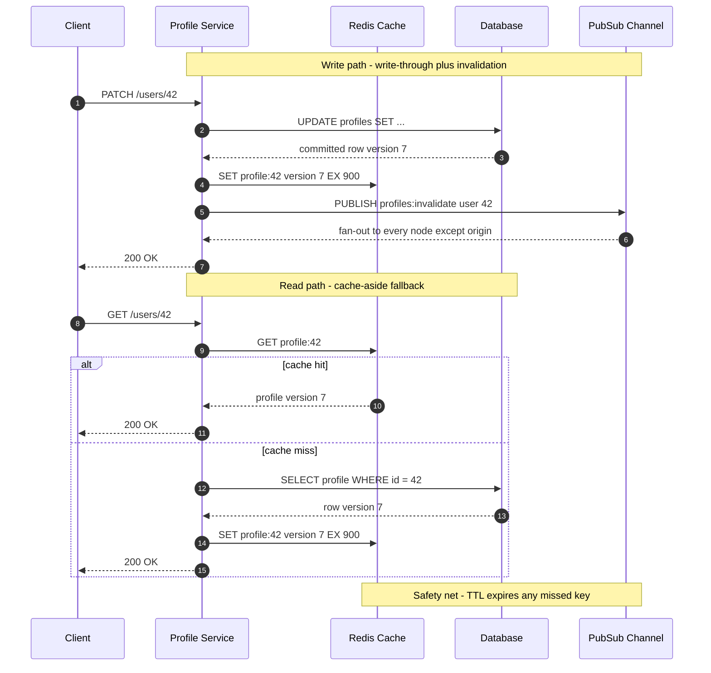

| Difficulty | Channel | Tags |
|---|---|---|
| beginner | backend | redis, memcached, cache-invalidation |

Picture a service answering roughly 30 million requests every second — not every day, every second. That is the scale at which Netflix runs its caching layer, and somewhere inside that flood is a member's profile: a name, a rating, a half-watched show on a Tuesday night [1]. Now imagine that member changes their display name, the database commits the new value, and the cache still holds the old one. For the next few minutes, every screen lies to them. That gap between the truth in your database and the copy in your cache is where latency wins turn into trust incidents.

---

> ### Real-World Case — Netflix
>
> Netflix operates at massive global scale, serving hundreds of millions of members across multiple AWS regions. They needed low-latency, high-reliability caching for microservices to access frequently used data like viewing history, ratings, and personalized recommendations. With over 30 million requests/sec and petabytes of data across tens of thousands of Memcached instances, they needed a solution that could scale globally while handling cross-region replication and cache warming.
>
> | | |
> |---|---|
> | **Challenge** | How to maintain fast, globally-consistent cache access across multiple AWS regions while dealing with cache misses during region failover, scaling operations causing cold caches, and the need to replicate updates without overwhelming databases. They needed to handle trillions of requests per day with sub-100 microsecond latency while ensuring reliability. |
> | **Solution** | Netflix built EVCache, a distributed caching layer based on Memcached optimized for cloud use. For cross-region invalidation, they use a Kafka-based replication system that can send either full data updates or just DELETE/invalidation messages to other regions. For cache warming during scaling or node replacement, they developed a sophisticated system using Memcached LRU crawler to dump keys/values to S3, which are then consumed by populator workers to warm new replicas without impacting production traffic. They employ 'write data in one region, replicate metadata/invalidation globally' patterns depending on cross-region traffic patterns. |
> | **Outcome** | EVCache routinely handles upwards of 30 million requests/sec, storing hundreds of billions of objects across tens of thousands of Memcached instances - translating to just under 2 trillion requests per day globally. Their cache warming system can warm 700 TB with 46 billion items across 380 nodes in ~24 hours using 570 populator instances, and can warm replaced instances in under 15 minutes with millions of items. Cache hit rates typically exceed 99.9%. |
> | **Lesson** | Sometimes simpler, battle-tested technologies (Memcached) with custom orchestration can scale better than more complex alternatives when the requirements allow eventual consistency. The key insight is to replicate 'just enough' - sometimes only invalidation metadata rather than full data - and to build intelligent cache warming infrastructure for operational resilience at scale. |

---

## Hook — Thirty Million Requests a Second, One Stale Username

A cache is supposed to make a system feel instant. Instead, it quietly creates a second version of reality. The database says the user's name is Alex; the cache says it is still Alexandra from three password resets ago. Most of the time nobody notices. Then a privacy setting changes, an account is deleted, or a support agent reads the wrong email back to a customer, and the stale copy stops being a performance detail and becomes an incident.

What makes this so uncomfortable is that the better your cache performs, the less often the database is consulted — which means a stale entry can survive longer without anyone catching it. High hit rates feel like success right up until they hide a correctness bug.

Many developers assume invalidation is a single line of code: delete the key on update and move on. In practice, that line of code sits inside a distributed system where messages get lost, writes race, and nodes restart. The question is not whether you can delete a key. It is whether every node that might serve that key learns about the deletion in time.

## Problem — The Fifteen Minutes Your Users See the Old Name

Every cache introduces a second source of truth. The moment a profile row is copied into Redis or Memcached, two versions of reality exist, and they will disagree eventually. The only real questions are how often, for how long, and whether anyone notices before the support tickets arrive.

A TTL is the simplest answer: let the copy expire and refetch. It is also the answer most teams over-trust. Set a 15-minute TTL on profiles and you have accepted that a user can see a stale name, avatar, or preference for up to 15 minutes. For a display name, that is mildly annoying. For an email change, a privacy setting, or an account deletion, it can be a compliance problem.

The three patterns you will actually choose between:

- **Cache-aside (lazy loading):** read from the cache, fall back to the database on a miss, then populate the cache. Simple, resilient, and the default for most profile services.
- **Write-through:** update the database and the cache in the same request path. Reads stay hot, but every write pays the cache latency and partial failures become your problem.
- **Write-behind:** write to the cache and let it flush to the database asynchronously. Great for throughput, dangerous for data you cannot afford to lose.

None of these removes the invalidation problem. They only change where the stale window lives. The web itself had to codify this tension in RFC 9111, which defines freshness, validation, and invalidation rules for the largest cache in existence [9]. MDN's caching guide is the practical companion for the same concepts [10]. Your profile service is running the same playbook at a smaller scale, with higher stakes per row.

💡 Insight: A TTL is not a consistency strategy. It is a bet that nobody will notice the stale window. Sometimes that bet is fine; sometimes it is the bug report.

## Real-World Case — Netflix

Netflix did not solve this problem by finding a cleverer cache. It solved it by treating caching as infrastructure.

The company's engineering team built EVCache on top of Memcached to serve data such as viewing history, ratings, and personalized recommendations across microservices and AWS regions [1]. The published numbers are the kind that make architects sit up: upwards of 30 million requests per second, hundreds of billions of objects, and just under 2 trillion requests per day across tens of thousands of Memcached instances [1].

But the number that matters most for invalidation is 99.9%. EVCache routinely sustains cache hit rates above 99.9%, which means almost every read avoids the database entirely [1]. That only works if the cached copy is trustworthy. Netflix's answer includes cross-region replication, a dedicated cache-warming system, and operational tooling that can warm 700 TB and 46 billion items across 380 nodes in about 24 hours — or refill a replaced instance with millions of items in under 15 minutes [1].

Here is the plot twist: at that scale, the invalidation message is as much of a scaling problem as the data itself. A naive broadcast to every node can become its own traffic spike. Netflix leans on replication and warming so that a cold or replaced node becomes useful quickly, rather than assuming every invalidation reaches every node instantly [1].

The lesson is not to copy Netflix. The lesson is that cache correctness is an operational discipline: replication, warming, monitoring, and a fallback path when a node misses an invalidation. Many teams install Redis on Monday and discover on Friday that nobody owns the invalidation path.

## Deep Dive — Redis, Memcached, and the Trade-off Nobody Puts on the Slide

Building on that, the Redis versus Memcached question is usually framed as a speed contest. It is really a question about coordination.

| Dimension | Redis | Memcached |
|---|---|---|
| Data model | Strings, hashes, lists, sets, streams | Key-value blobs only |
| Invalidation fan-out | Built-in pub/sub and keyspace notifications | No native pub/sub; coordination is on you |
| Persistence | Optional RDB and AOF snapshots | None; a restart means a cold cache |
| Eviction control | Multiple policies and per-key TTL | LRU-oriented with per-key TTL |
| Memory overhead | Higher per key due to richer structures | Lower per key for pure blob caching |
| Best fit | Complex invalidation, durability, data structures | Simple, massive, disposable cache |

Memcached's project describes it as a high-performance distributed memory object caching system, and its design reflects that focus: simple, fast, and intentionally not a database [6]. Redis ships pub/sub, streams, and persistence, which is exactly what you need when an invalidation has to reach every service instance [3][5]. Managed services such as Amazon ElastiCache support both engines, so the decision is rarely about operations alone [4].

The trade-off in practice:

- **Choose Redis** when you need pub/sub invalidation, sorted sets for leaderboards, streams for audit events, or persistence across restarts. You pay in memory overhead and operational complexity.
- **Choose Memcached** when the workload is pure, disposable blob caching at massive horizontal scale and a cold cache after restart is tolerable. Netflix's EVCache is a strong example of Memcached pushed to an extreme with custom tooling [1][2].

Now the nuance most interview answers miss. Write-through caching has a subtle ordering problem. If you write the database and then write the cache, a concurrent reader can repopulate the cache with the old value between those two steps. If you delete the cache instead of writing it, the next read repopulates from the database — usually safer, but it leaves a cold key and a brief latency spike.

The common fixes:

1. **Delete, do not update, on writes.** A delete is idempotent and avoids two writers racing to install their version of the truth.
2. **Version your values.** Store a monotonically increasing version with each profile and reject a cache write with an older version. This is cache coherence in the classical sense [7].
3. **Add TTL jitter.** If every profile key expires at the same second, the database gets a synchronized stampede. Randomize the TTL by 10-20%. The thundering herd problem is well documented and entirely self-inflicted [8].
4. **Treat pub/sub as best-effort.** Redis pub/sub is fire-and-forget: a node that is down or partitioned during a publish will miss the message [5]. TTLs are your safety net, not your primary strategy.

🔥 Hot Take: The strongest invalidation design assumes messages will be lost. Version checks, jittered TTLs, and read-through fallbacks are what keep a missed message from becoming a stale profile.

## Workflow — From PATCH Request to Global Consistency

Here is the sequence that holds up in production. The diagram below traces a single profile update and the reads that follow it.

The write path has four non-negotiable steps:

1. **Commit to the database first.** The database remains the source of truth. If the cache write fails later, the profile change still succeeded.
2. **Write the fresh value through to Redis with a jittered TTL.** The next read should be hot, not a miss.
3. **Publish an invalidation event** containing the user ID, the new version, and the originating node.
4. **Let every other node delete its local copy.** Each node skips its own event because it already refreshed the value.

The read path stays deliberately boring:

1. **Try the cache.** On a hit, return immediately.
2. **On a miss, read the database and repopulate** with a jittered TTL.
3. **Return the value and record the hit or miss.** If hit rate drops below your baseline, something in the invalidation path is wrong.

Finally, the safety net: every key has a TTL, so even a lost pub/sub message self-heals. That is eventual consistency with a bounded window — the honest contract most profile services can actually offer.

⚠️ Watch Out: In a multi-region deployment, a local pub/sub channel only reaches nodes in the same region. Cross-region invalidation needs a replicated stream, a global event bus, or region-local TTLs short enough to bound staleness. Netflix's cross-region replication is a reminder that this is an architecture decision, not a library setting [1].

## Code Example — A Write-Through Profile Cache With Pub/Sub Invalidation

The implementation below uses Python and redis-py, but the pattern ports directly to Node.js, Go, or Java. It combines write-through on update with pub/sub fan-out, TTL jitter, and an origin check that prevents a node from deleting the value it just refreshed.

The key design choices:

- **The database write happens before the cache write.** A cache failure cannot roll back a committed profile change.
- **The event carries an origin node ID.** Without it, the writing node would delete the value it just wrote, turning every update into an unnecessary cache miss.
- **TTL jitter is applied on every write.** It spreads expirations across time instead of concentrating them at the top of every hour.
- **The listener skips malformed messages.** A noisy channel should not take down the service.
- **The cache is never the source of truth.** If Redis is empty, the read path still works.

One honest limitation: this example uses pub/sub, which is fire-and-forget. For stronger delivery guarantees, replace the channel with Redis Streams and a consumer group, or persist invalidation events in an outbox table. The TTL remains the backstop either way.

## Lessons Learned — What to Do Before Your Next Profile Update

Netflix's cache serves trillions of requests per day, but the lesson scales all the way down to a single profile service: correctness is a design property, not a configuration toggle [1].

Here is what to carry into your next architecture review:

- **Pick the consistency contract before the cache.** Decide how stale a profile may be, then choose TTLs and invalidation to meet that number. 'Eventually' is not a contract.
- **Delete on write, or version aggressively.** Updating a cache key invites races; deleting it or rejecting older versions is easier to reason about [7].
- **Jitter every TTL.** A synchronized expiry is a self-inflicted outage waiting for traffic to grow [8].
- **Assume invalidation messages get lost.** TTLs, read-through fallbacks, and alerting are not optional extras [5].
- **Measure hit rate, miss latency, and invalidation lag.** A 99.9% hit rate is meaningless if the remaining 0.1% of misses take 800 ms.
- **Choose Redis for coordination, Memcached for disposable scale.** The decision is about invalidation semantics, not benchmark charts [2][3].
- **Warm critical caches deliberately.** Netflix's warming system exists because a cold cache at scale is an outage with extra steps [1].

🎯 Key Point: The battle scar most teams earn is adding a cache to reduce latency, then discovering the cache introduced a consistency bug that is harder to debug than the original performance problem. The fix is rarely a bigger cache. It is a clearer invalidation design.

---

## Profile Update and Invalidation Flow

<strong>Original Interview Question</strong>

**Q:** You're building a user profile service that caches frequently accessed profiles. How would you implement cache invalidation when a user updates their profile, and what trade-offs would you consider between Redis and Memcached?

**A:** Implement write-through caching with TTL-based expiration. On profile update, invalidate the cache by deleting the key and writing new data to both the database and cache. Redis offers pub/sub for automatic distributed invalidation, while Memcached requires manual coordination across nodes.

## Conclusion

So back to that 3 A.M. profile update. The difference between a routine write and an incident is not the database, and it is not whether the team chose Redis or Memcached. It is whether the invalidation path was designed, tested, and monitored before traffic arrived.

Netflix did not reach 30 million requests per second by hoping caches stay fresh [1]. Teams get there by treating invalidation as a first-class part of the write path: commit first, write through with a jittered TTL, publish the invalidation, and let TTLs catch what the network drops.

The memorable insight to share with your team: a cache is a promise about freshness, and every TTL you set is a clause in that promise. Write the clause down, test it, and measure it — or your users will find the loophole for you.

---

## References

1. [Netflix incident report](https://netflixtechblog.com/caching-for-a-global-netflix-7bcc457012f1) — article
2. [Memcached — Wikipedia](https://en.wikipedia.org/wiki/Memcached) — documentation
3. [Redis — Wikipedia](https://en.wikipedia.org/wiki/Redis) — documentation
4. [Amazon ElastiCache caching strategies](https://docs.aws.amazon.com/AmazonElastiCache/latest/dg/Strategies.html) — documentation
5. [redis/redis — GitHub repository](https://github.com/redis/redis) — documentation
6. [memcached/memcached — GitHub repository](https://github.com/memcached/memcached) — documentation
7. [Cache coherence — Wikipedia](https://en.wikipedia.org/wiki/Cache_coherence) — documentation
8. [Thundering herd problem — Wikipedia](https://en.wikipedia.org/wiki/Thundering_herd_problem) — documentation
9. [RFC 9111: HTTP Caching](https://datatracker.ietf.org/doc/html/rfc9111) — documentation
10. [HTTP caching — MDN Web Docs](https://developer.mozilla.org/en-US/docs/Web/HTTP/Guides/Caching) — documentation

---

**Author:** Satishkumar Dhule — [GitHub](https://github.com/satishkumar-dhule) · [LinkedIn](https://linkedin.com/in/satishkumar-dhule) · [Website](https://satishkumar-dhule.github.io)
