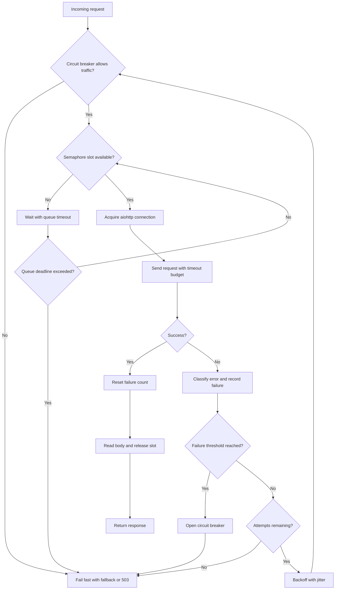

| Difficulty | Channel | Tags |
|---|---|---|
| advanced | backend | asyncio, aiohttp, concurrency |

On February 14, 2025, Stripe's API started returning P99 latencies above eight seconds and intermittent 503 responses [1]. The downstream payment service did what most well-meaning clients do under stress: it waited longer, retried harder, and held connections open. Within minutes, a misconfigured circuit breaker and an increased timeout turned a slow dependency into a full connection-pool outage [1]. This is the story of how a pool manager becomes the difference between graceful degradation and a 47-minute pileup.

---

> ### Real-World Case — Stripe
>
> On February 14, 2025, Stripe's API began returning elevated latency (P99 > 8s) and intermittent 503 responses. A downstream payment service calling Stripe saw requests slow down, and due to a misconfigured circuit breaker combined with an increased timeout, connections were held for too long and the connection pool exhausted.
>
> | | |
> |---|---|
> | **Challenge** | Prevent cascading failures when an upstream dependency (Stripe) degrades - the payment service needed graceful degradation (fail fast) under high load/connection timeouts without exhausting its connection pool. |
> | **Solution** | The team identified the issue stemmed from circuit breaker thresholds set too high (10 consecutive failures over 30s) and an increased Stripe client timeout (5s → 15s in a recent deploy). The fix was to roll back the deployment and increase circuit breaker sensitivity (reduce threshold to fail-fast). The recommended improvements included tighter circuit breaker configuration, connection pool tuning/per-endpoint limits, and adding a payment fallback (cached card tokens) to reduce single-vendor dependency. |
> | **Outcome** | 47-minute complete outage affecting ~12,000 users and ~3,400 failed transactions (~$340K lost revenue). After rollback to v2.4.0 and circuit breaker tuning, systems normalized by 15:10 UTC. |
> | **Lesson** | Fail-fast with properly tuned circuit breakers is critical for upstream dependencies; small timeout increases have multiplicative effects on connection pool exhaustion; upstream status/health signals and graceful fallbacks (not just retries) are essential for resilience. |

---

## Hook — The 47-Minute Valentine's Day Outage

The symptoms looked ordinary at first: rising P99 latency, a few 503s, a handful of retries. That is exactly what makes pool exhaustion so dangerous. Nothing explodes loudly. Instead, each slow request keeps its slot a little longer, each retry adds another waiter, and the queue quietly grows until the service stops accepting new work.

At Stripe, that ordinary-looking slowdown escalated into a 47-minute outage affecting roughly 12,000 users and about 3,400 failed transactions [1]. The deploy was not obviously broken. The dependency was not fully down. The killer was a control-loop mismatch: a circuit breaker that allowed too much traffic through, paired with a timeout increase that gave every stuck request more time to occupy a pooled connection [1].

💡 **Insight:** A connection pool is not just a bucket of sockets. It is a feedback system. When the feedback is wrong, retries become a denial-of-service attack that your own service launches against itself.

## Problem — When Good Retries Go Bad

Under load, every request needs two scarce resources: a connection slot and a unit of time. aiohttp gives you tools to manage both, but the defaults are not a complete reliability strategy [2]. Without a semaphore or connector limit, a burst of traffic can create unbounded concurrent requests, exhaust file descriptors, and bloat memory. With a semaphore but no timeout discipline, slow downstream calls hold their slots indefinitely, and healthy traffic waits behind unhealthy traffic.

The second trap is retry logic. A naive retry loop assumes that failure is temporary and that trying again quickly is harmless. In reality, retries multiply load precisely when the downstream system is least able to handle it. If 100 requests fail and each retries three times, the failing service suddenly sees 400 attempts. Add a longer timeout and those attempts occupy pool slots for longer, which reduces throughput for everyone else [3].

Consequently, teams often see a confusing pattern: CPU is fine, memory is fine, the network is fine, but request latency climbs and 503s appear. The bottleneck is not raw capacity. It is the control plane around connection acquisition, timeout budgeting, retry pacing, and failure isolation. Without those controls, a small downstream hiccup becomes a cascading outage.

⚠️ **Watch Out:** Increasing a timeout to fix slow requests can make pool exhaustion worse. You are giving each struggling request more time to hold a connection that another request needs.

## Real-World Case — Stripe's API Timeout

On February 14, 2025, Stripe's API began returning elevated latency with P99 values above eight seconds, along with intermittent 503 responses [1]. A downstream payment service calling Stripe experienced the slowdown and responded in a way that felt reasonable: it waited longer and retried failed requests. But the circuit breaker was misconfigured, and an increased timeout meant connections were held for too long. The connection pool exhausted.

The impact was severe. The incident produced a 47-minute complete outage affecting approximately 12,000 users and roughly 3,400 failed transactions, with an estimated $340K in lost revenue [1]. Teams rolled back to v2.4.0 and tuned the circuit breaker, and systems normalized by 15:10 UTC [1].

🎯 **Key Point:** This was not simply a Stripe capacity failure. It was a client-side resilience failure. The downstream service had the right ingredients — retries, timeouts, and a circuit breaker — but the settings worked against one another. The circuit breaker stayed too permissive while the timeout stayed too patient, so the pool had no chance to recover.

What makes this case so instructive is how familiar it feels. Most teams have a retry wrapper, a timeout constant, and maybe a circuit breaker library. Far fewer have tested how those three interact when the downstream dependency is slow but not dead. That gap between having the patterns and tuning the patterns is where production incidents live.

## Deep Dive — The Four Control Loops Behind a Healthy Pool

A production-grade aiohttp pool manager needs four control loops working together. First, concurrency limiting decides how many requests may be in flight. A semaphore is the simplest tool: it caps concurrent work and makes waiting explicit [4]. Second, timeout budgeting decides how long any single request may consume a slot. Timeouts should be split into connect, read, and total budgets rather than a single vague number [5]. Third, retry pacing decides when a failed request may try again. Exponential backoff with jitter prevents synchronized retry storms [7]. Fourth, failure isolation decides when to stop calling a dependency altogether. A circuit breaker moves from closed to open to half-open so that a failing service gets breathing room [6].

| Control | What it protects | Failure mode if missing |
| --- | --- | --- |
| Semaphore / connector limit | Event loop, sockets, memory | Unbounded concurrency and resource exhaustion |
| Timeout budget | Pool slot turnover | Slow requests hold connections indefinitely |
| Backoff with jitter | Downstream recovery | Retry storms and thundering herds |
| Circuit breaker | Overall system stability | Cascading failures and pool exhaustion |

The counterintuitive part is that these controls can conflict. A circuit breaker with a high failure threshold lets too many bad requests through. A timeout that is too generous keeps slots occupied. A retry policy without jitter synchronizes clients. Therefore, tuning each control in isolation is not enough. The settings must be designed as a system, with a total failure budget that matches your latency SLO.

Moreover, HTTP semantics matter. A 503 is explicitly a signal that the server is temporarily unable to handle the request, often with a Retry-After hint [9]. Treating every 503 as an invitation to retry immediately ignores that signal. Similarly, connection reuse through keep-alive reduces TCP and TLS overhead, but it also means a dead or degraded connection can affect multiple requests if health checks and cleanup are missing [8].

🔥 **Hot Take:** The most important number in your pool manager is not max_connections. It is the maximum amount of time a request is allowed to occupy a slot while contributing nothing useful.

## Workflow — The Request Lifecycle

Here is the request lifecycle that keeps the pool healthy. The accompanying **Connection Pool Request Lifecycle** diagram shows the same flow visually.

1. **Admit or reject.** An incoming request checks whether the circuit breaker allows traffic. If the breaker is open, fail fast instead of consuming a pool slot.
2. **Wait with a deadline.** The request tries to acquire a semaphore slot. The wait itself has a timeout, so queue saturation produces a fast, observable failure rather than an invisible backlog.
3. **Send with a timeout budget.** Once admitted, the request uses a bounded aiohttp timeout. Connect, read, and total timeouts are configured separately so a stuck TCP handshake does not consume the full request budget.
4. **Classify the outcome.** Success resets the breaker failure count. Timeouts, connection errors, 5xx responses, and 429 responses count as failures. Client errors such as 400 or 404 usually should not trip the breaker.
5. **Retry with backoff and jitter.** If the failure is retryable and attempts remain, wait for an exponentially increasing delay plus random jitter, then loop back to admission.
6. **Trip the breaker when needed.** If failures cross the threshold, open the circuit for a cooldown period. After cooldown, allow a single half-open probe. A successful probe closes the circuit; a failed probe reopens it.
7. **Release the slot.** The semaphore is released only after the response body is consumed or the request fails, ensuring the pool reflects actual work in progress.
8. **Degrade deliberately.** When the breaker is open or the queue is saturated, return a cached response, a fallback, or a clear 503 with Retry-After rather than silently hanging.

The diagram is not just a flowchart; it is a contract. Every arrow represents a place where a team must decide whether to wait, retry, fail, or degrade. If any arrow is missing, the pool will eventually discover the gap under load.

## Code Example — A Production-Shaped aiohttp Pool Manager

The implementation below combines a semaphore, a bounded queue wait, an aiohttp connector limit, explicit timeouts, exponential backoff with jitter, and a three-state circuit breaker. It is intentionally compact enough to read, but it keeps the important production boundaries visible.

The `fetch` method reads the response body before releasing the semaphore. That detail matters. If you return a response object and release the slot immediately, the caller can still be downloading a body while the next request believes a connection is free. For streaming workloads, use an async context manager that holds the slot until the stream is closed. For ordinary JSON or text calls, reading the body inside the guarded section is simpler and safer.

Also notice that the circuit breaker checks happen before acquiring the semaphore. An open breaker should reject work without touching the pool at all. That is the difference between graceful degradation and a queue full of doomed requests.

## Lessons Learned — Design for the Bad Day

The Stripe incident is a reminder that resilience patterns are only as good as their tuning [1]. Here is what teams should take away:

- **Treat timeouts as a budget, not a guess.** If your P99 target is two seconds, a 30-second total timeout is not patience; it is a slot-occupancy bug waiting to happen [5].
- **Make queue waiting visible.** A semaphore without a bounded wait turns saturation into silent latency. Measure acquisition time separately from request time.
- **Use backoff with jitter.** Exponential backoff alone still synchronizes clients. Jitter spreads retries and reduces thundering-herd effects [7].
- **Tune the circuit breaker against your retry policy.** A breaker that opens after 50 failures is useless if each request retries five times and the pool only has 100 slots.
- **Do not count every error the same way.** A 500 from a downstream service is different from a 404 caused by bad input. Only failures that indicate dependency health should trip the breaker [6].
- **Hold the slot until the work is done.** Releasing a semaphore before the response body is consumed creates a false sense of capacity.
- **Test the failure path.** Run chaos drills with slow dependencies, partial outages, and 503 storms. If the pool manager has never seen a bad day, it is not ready for one.

⚠️ **Battle scar:** Many teams add a circuit breaker after an outage, then never revisit the threshold. Six months later, traffic patterns change and the breaker becomes either uselessly permissive or prematurely aggressive. Review breaker thresholds alongside load tests and SLO changes.

💡 **Insight:** Graceful degradation is not a single feature. It is the combination of admission control, timeout discipline, retry pacing, failure isolation, and a deliberate fallback path. Remove any one of those, and the others have to work much harder.

---

## Connection Pool Request Lifecycle

<strong>Original Interview Question</strong>

**Q:** How would you implement a connection pool manager for aiohttp that handles graceful degradation under high load and connection timeouts?

**A:** Implement a connection pool manager for aiohttp using a semaphore to limit concurrent connections, exponential backoff for retrying failed requests, and circuit breaker pattern to gracefully degrade under high load and connection timeouts.

## Conclusion

Stripe's 47-minute outage is the kind of story that makes resilience patterns feel less like architecture trivia and more like operational survival [1]. The lesson is not that retries, timeouts, or circuit breakers are bad. The lesson is that they must be tuned as one system. Tomorrow, audit three things in your aiohttp client: how long a request may wait for a connection slot, how long it may hold that slot, and how many failures it takes before the breaker stops sending traffic. Then test those settings against a slow downstream service, not just a dead one. The memorable takeaway is simple: a connection pool does not fail because it runs out of sockets. It fails because the code around it keeps handing out hope long after the downstream service has stopped earning it.

---

## References

1. [Stripe incident report](https://www.prodrescueai.com/incidents/stripe-api-timeout) — article
2. [aiohttp client quickstart](https://docs.aiohttp.org/en/stable/client_quickstart.html) — documentation
3. [aiohttp client reference](https://docs.aiohttp.org/en/stable/client_reference.html) — documentation
4. [asyncio synchronization primitives: Semaphore](https://docs.python.org/3/library/asyncio-sync.html#asyncio.Semaphore) — documentation
5. [asyncio timeouts](https://docs.python.org/3/library/asyncio-task.html#timeouts) — documentation
6. [Circuit breaker design pattern](https://en.wikipedia.org/wiki/Circuit_breaker_design_pattern) — article
7. [Exponential backoff](https://en.wikipedia.org/wiki/Exponential_backoff) — article
8. [RFC 7231: HTTP/1.1 Semantics and Content](https://datatracker.ietf.org/doc/html/rfc7231) — documentation
9. [HTTP 503 Service Unavailable](https://developer.mozilla.org/en-US/docs/Web/HTTP/Status/503) — documentation
10. [aiohttp GitHub repository](https://github.com/aio-libs/aiohttp) — documentation

---

**Author:** Satishkumar Dhule — [GitHub](https://github.com/satishkumar-dhule) · [LinkedIn](https://linkedin.com/in/satishkumar-dhule) · [Website](https://satishkumar-dhule.github.io)
