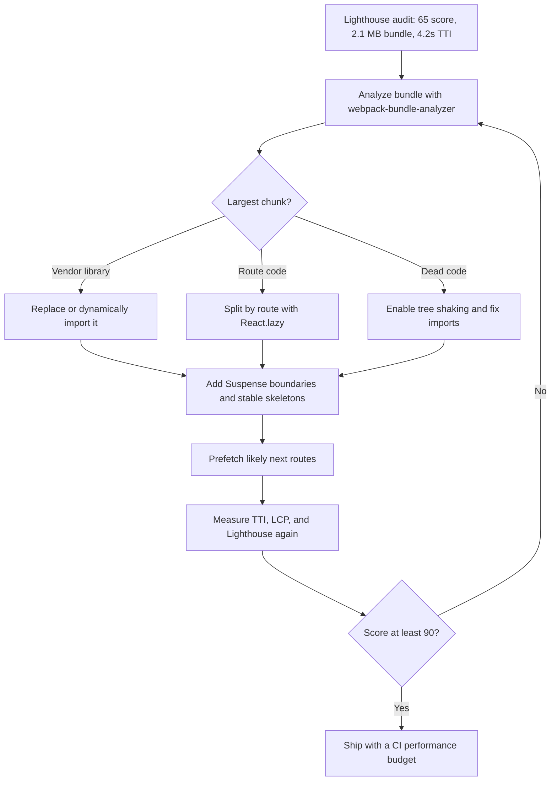

| Difficulty | Channel | Tags |
|---|---|---|
| intermediate | frontend | lighthouse, bundle, lazy-loading |

Pinterest's mobile web team watched a growing share of users arrive on low-end phones and slow networks, only to wait through a bloated JavaScript bundle before the experience became usable [1]. The Progressive Web App looked modern, but its Time to Interactive told a different story, and every extra second put engagement and ad revenue at risk [1]. The fix was not a heroic rewrite; it was a disciplined campaign of bundle analysis, code splitting, and lazy loading that cut JavaScript by more than 70% [1]. Here is how that journey works, and how you can take a React app from a Lighthouse score of 65 to 90+ without shipping a blank screen to your users.

---

> ### Real-World Case — Pinterest
>
> Pinterest's mobile web experience was struggling with performance as a growing share of users accessed the platform on low-end mobile devices over slow networks. Their Progressive Web App (PWA) had a large JavaScript bundle that resulted in slow Time to Interactive and poor Lighthouse scores, putting user engagement and growth at risk.
>
> | | |
> |---|---|
> | **Challenge** | The PWA's monolithic JavaScript bundle was too large for mobile networks, causing long load times and poor interactivity. Pinterest needed to drastically reduce bundle size and improve initial load performance without sacrificing features. |
> | **Solution** | Pinterest engineers performed bundle analysis to identify heavy dependencies, implemented route-based code splitting and lazy loading with dynamic imports, replaced large libraries with smaller alternatives (e.g. reducing reliance on heavy date/utility libraries), removed unused code, and optimized their webpack build configuration for tree shaking. They also focused on critical path optimization for their PWA. |
> | **Outcome** | Pinterest reduced their JavaScript bundle size by over 70%. These performance improvements contributed to a 40% decrease in wait time, a 44% increase in user-generated ad revenue, and a 35% increase in search engine traffic to their mobile site. |
> | **Lesson** | Systematic bundle analysis combined with aggressive code splitting and dependency optimization can dramatically improve real-world performance metrics. For content platforms at scale, these improvements translate directly to engagement and revenue. |

---

## Hook — The 4.2-Second Wait That Costs More Than a Redesign

Picture a user on a mid-range Android phone, two bars of signal, tapping a link to your React app. The HTML arrives quickly. Then comes the JavaScript: 2.1 MB of it, parsed, compiled, and executed before the main thread can breathe. Lighthouse reports 65. Time to Interactive sits at 4.2 seconds. The page is technically loaded, but the user is still waiting, and patience is not a performance metric that trends upward.

That gap between 'loaded' and 'usable' is where products lose people. Pinterest saw the same pattern at scale: a PWA that worked beautifully on fast connections became a liability on the devices most of its next billion users actually owned [1]. The stakes are not abstract. A slow interactive experience quietly taxes every session, every ad impression, and every search landing page.

💡 Insight: A Lighthouse score is not a grade for your codebase. It is a proxy for how much time your users spend waiting for your architecture decisions.

## Problem — When 2.1 MB Becomes a Business Problem

The core problem is not that JavaScript is heavy. The problem is that most of it is unnecessary for the first screen. A typical React app bundles the landing route, the dashboard, the analytics view, the settings page, three charting libraries, a date utility, and a UI kit into one monolithic download. The browser must fetch, parse, and execute all of it before the user can click anything meaningful.

Time to Interactive measures exactly that moment when the page has rendered useful content and can reliably respond to input within 50 milliseconds [9]. A 4.2-second TTI means four seconds of tapping a button and hoping. Lighthouse's performance score weighs signals like TTI, Largest Contentful Paint, and Total Blocking Time, so a single oversized bundle can drag the whole score down [10].

Many teams respond by compressing assets and calling it done. Compression helps, but it does not change the amount of code the CPU must execute. Others add more third-party scripts to 'monitor' the problem, which makes the main thread busier. The real question is sharper: which bytes are required for this route, right now, for this user?

⚠️ Watch Out: A 2.1 MB uncompressed bundle can still be hundreds of kilobytes of gzipped JavaScript. Network transfer is only half the cost; parse and execution time on low-end devices is the other half.

## Real-World Case — Pinterest's 70% JavaScript Diet

Pinterest did not stumble into performance by accident. As mobile web usage grew, the company found that its PWA's large JavaScript bundle produced slow Time to Interactive and weak Lighthouse scores, especially on low-end devices and slow networks [1]. That mattered because the mobile web was not a side project; it was a growth channel.

The team attacked the bundle systematically rather than tweaking symptoms. They analyzed what was inside it, split code along meaningful boundaries, deferred non-critical work, and shipped less JavaScript to the first load [1]. The result was a reduction in JavaScript bundle size of over 70% [1].

The business impact was not subtle. Pinterest reported a 40% decrease in wait time, a 44% increase in user-generated ad revenue, and a 35% increase in search engine traffic to its mobile site [1]. Those numbers are a reminder that performance work is revenue work wearing a hoodie.

🎯 Key Point: Pinterest's biggest win came from removing and deferring code, not from micro-optimizing the code that remained. The cheapest JavaScript is the JavaScript the browser never downloads.

## Deep Dive — Code Splitting Is an Architecture Decision, Not a Syntax Trick

React.lazy() and Suspense make code splitting feel like a syntax feature, but the hard part is deciding where to split [2][3]. A split boundary is a contract with the user: everything on the other side can arrive later. Get that contract wrong and you trade a slow first paint for a janky navigation.

Route-based splitting is the safest default because routes already represent user intent. A user visiting /dashboard does not need the analytics charts, the billing settings, or the admin console. Component-based splitting makes sense for heavy, below-the-fold, or interaction-triggered features such as a rich text editor, a charting widget, or a modal that most sessions never open. Vendor splitting is a third lever: isolating stable dependencies so they cache separately from frequently changing application code.

Tree shaking is the complementary discipline. Modern bundlers can remove unused exports when modules are statically analyzable and side-effect-free [8]. That breaks down with CommonJS requires, barrel files that re-export everything, and packages with poorly declared side effects. The result is code that looks split but still drags half a library into the bundle.

| Strategy | Best for | Real trade-off |
|---|---|---|
| Route-based splitting | Distinct pages with clear navigation | Adds a small loading state on first visit to each route |
| Component-based splitting | Heavy widgets, editors, charts, modals | Can cause layout shift if the fallback has the wrong dimensions |
| Vendor splitting | Stable third-party libraries | Too many chunks can increase request overhead |
| Tree shaking | Removing dead exports | Requires ES modules and clean side-effect metadata |
| Dynamic import on interaction | Rarely used features | The first interaction can feel slower unless prefetched |

🔥 Hot Take: If your 'lazy loaded' component is rendered on the first screen, you did not lazy load it. You added a network waterfall and called it architecture.

## Workflow — From Audit to 90+: The Five-Move Playbook

The workflow starts with evidence, not guesses. Run Lighthouse on a throttled mobile profile, then inspect the bundle with webpack-bundle-analyzer to see which chunks dominate [5][10]. The goal is to find the 20% of code responsible for 80% of the wait.

The flowchart below maps the loop from audit to shipped performance budget:

1. Establish a baseline. Record Lighthouse score, TTI, bundle size, and the largest chunks. Without a baseline, every optimization is a vibe.
2. Classify the weight. Separate route code, vendor libraries, dead exports, and assets. A charting library that appears on every route is a routing problem disguised as a dependency problem.
3. Split along intent. Convert top-level routes to React.lazy() with Suspense boundaries [2][3]. Move rarely used widgets behind dynamic imports.
4. Remove and replace. Delete unused dependencies, fix barrel imports, and prefer smaller alternatives where the API surface is genuinely smaller.
5. Measure again and enforce a budget. Re-run Lighthouse, compare TTI, and add a bundle-size check to CI so the regression does not return next sprint [6].

This is an iterative loop, not a one-time cleanup. The first pass usually exposes the obvious offenders. The second pass reveals the structural issues: a shared component that imports a heavy library, or a utility barrel file that quietly pulls in an entire design system.

💡 Insight: Optimize for the route, not the repository. A clean repository with one giant bundle is still a slow product.

## Code Example — Wiring Route-Level Splitting Without the White Screen

The code below shows a production-minded version of route-based splitting. Each route becomes its own chunk, Suspense provides a stable fallback, and an error boundary prevents a failed chunk request from taking down the entire app [2][3].

The key detail is the fallback. A spinner with no dimensions causes layout shift; a skeleton that reserves space keeps the page stable. The error boundary matters because chunk loading is a network operation, and networks fail. Retry behavior should be explicit rather than leaving the user stranded.

For routes the user is likely to visit next, prefetching on hover or intent can hide the loading state entirely. The code stays intentionally small so the pattern is easy to adapt to React Router, TanStack Router, or a custom router.

## Lessons Learned — What Actually Moves the Needle

The Pinterest case is not a story about a clever React API. It is a story about removing work from the critical path [1]. The same lesson applies to a 2.1 MB React bundle: the fastest code is the code that never reaches the device, and the second fastest is the code that arrives after the user needs it.

Here are the battle scars worth remembering:

- **Do not split everything.** Twenty tiny chunks can be slower than three well-chosen ones because of request overhead and waterfall effects.
- **Do not lazy load the first screen.** The initial route should be eager and fast; defer the destinations and interactions that are not immediately needed.
- **Do not trust a dependency's size label.** Inspect the actual parsed cost in the analyzer, including transitive dependencies [5].
- **Do not skip the fallback design.** Loading states are part of the user experience, not an afterthought.
- **Do not ship without a budget.** A performance improvement without a CI guard is a temporary improvement [6].

If this feels overwhelming, start with one route and one measurement. The first split rarely gets you from 65 to 90. The fifth one, guided by real bundle data, often does.

So what should you do differently tomorrow? Open the bundle analyzer, find the largest chunk that is not needed on the first screen, and split it. Then measure TTI before and after. That single loop, repeated with discipline, is how teams turn a 4.2-second wait into a product that feels instant.

---

## Bundle Optimization Flow

<strong>Original Interview Question</strong>

**Q:** You're tasked with improving a React app's Lighthouse performance score from 65 to 90+. The bundle size is 2.1MB and Time to Interactive is 4.2s. What specific steps would you take to optimize the bundle and implement lazy loading?

**A:** Implement code splitting with React.lazy() and Suspense, analyze bundle composition with webpack-bundle-analyzer to identify largest chunks, remove unused dependencies and optimize imports, add dynamic imports for heavy components and third-party libraries, implement route-based splitting for better initial load times, and utilize tree shaking with proper ES module configuration.

## Conclusion

Pinterest's turnaround started with a blunt question: why is the browser downloading code this user does not need yet [1]? The answer led to a 70% smaller JavaScript bundle, a 40% drop in wait time, and measurable revenue growth [1]. Your 2.1 MB React bundle deserves the same interrogation. Measure the baseline, open the analyzer, split by route, remove what is dead, and guard the result with a performance budget. The memorable insight to share with your team is simple: performance work is not about making code faster; it is about making the browser do less before the user can act.

---

## References

1. [Pinterest incident report](https://medium.com/pinterest-engineering/pinterest-progressive-web-app-performance-case-study-3bd6ed2e6154) — article
2. [React docs: lazy](https://react.dev/reference/react/lazy) — documentation
3. [React docs: Suspense](https://react.dev/reference/react/Suspense) — documentation
4. [webpack: Code Splitting guide](https://webpack.js.org/guides/code-splitting/) — documentation
5. [webpack-bundle-analyzer repository](https://github.com/webpack-contrib/webpack-bundle-analyzer) — documentation
6. [web.dev: Reduce JavaScript payloads with code splitting](https://web.dev/articles/reduce-javascript-payloads-with-code-splitting) — blog
7. [MDN: Lazy loading](https://developer.mozilla.org/en-US/docs/Web/Performance/Lazy_loading) — documentation
8. [Wikipedia: Tree shaking](https://en.wikipedia.org/wiki/Tree_shaking) — article
9. [web.dev: Time to Interactive](https://web.dev/articles/tti) — blog
10. [Chrome for Developers: Lighthouse overview](https://developer.chrome.com/docs/lighthouse/overview) — documentation

---

**Author:** Satishkumar Dhule — [GitHub](https://github.com/satishkumar-dhule) · [LinkedIn](https://linkedin.com/in/satishkumar-dhule) · [Website](https://satishkumar-dhule.github.io)
