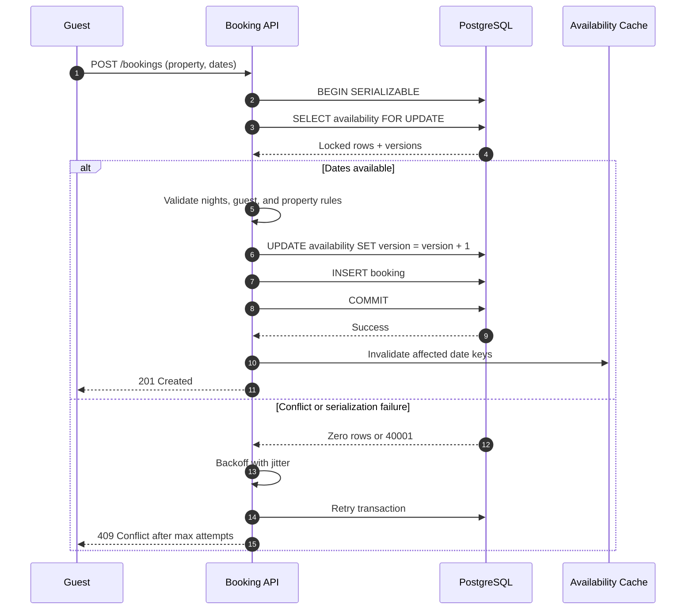

| Difficulty | Channel | Tags |
|---|---|---|
| intermediate | database | acid, isolation-levels, mvcc |

At 11:59 p.m. on Black Friday, two shoppers hit 'Complete purchase' on the last unit of the same product. For years, Shopify's experience with oversell protection showed the danger: reservations lived in Redis while the inventory ledger lived in MySQL — two systems that could not commit together [1]. That split created a quiet failure mode: a payment could succeed without inventory being deducted, or inventory could be deducted while a reservation lingered. The fix was not a faster cache; it was a harder question: where should atomicity actually live?

---

> ### Real-World Case — Shopify
>
> Every checkout that touches inventory must reserve stock so two buyers cannot claim the same last unit. Shopify ran this oversell protection on Redis for years, with reservations and the inventory ledger living in two separate systems that could not be updated atomically.
>
> | | |
> |---|---|
> | **Challenge** | The reserve/claim split between Redis and MySQL meant a payment could succeed while inventory was never deducted, or inventory could be deducted while still marked reserved. Shopify needed ACID guarantees, multi-location awareness, and correctness at Black Friday scale, where merchants hit a record $5.1 million in sales per minute. |
> | **Solution** | Shopify rebuilt reservations inside MySQL using one row per sellable unit instead of a quantity column, selecting rows with SELECT ... FOR UPDATE SKIP LOCKED so contending transactions skip locked rows instead of waiting. They capped the available-row pool at 1,000 per item/location, used a composite primary key to cut locks from two per reservation to one, switched those transactions to READ COMMITTED to avoid gap/supremum locks during replenishment, standardized lock ordering to eliminate deadlocks, and batched multi-item carts with UNION ALL. They shadow-ran MySQL alongside Redis before moving the source of truth. |
> | **Outcome** | The system met peak 2025 traffic targets: during high-volume flash sales, writer CPU stayed under 50% and reader CPU under 16%. Cleanup of the checkout path removed 50% of reads and 33% of transactions on the primary database. The real ceiling turned out to be connection hold time in unrelated checkout code, not the reservation queries themselves. |
> | **Lesson** | SERIALIZABLE is not automatically the right answer for double-booking prevention. Shopify deliberately chose READ COMMITTED plus SKIP LOCKED, and the actual bottleneck was code elsewhere holding database connections too long. If CPU is low but queuing is high, instrument the whole path rather than optimizing only the reservation query. |

---

## Hook — The Last Room Problem

Picture the booking calendar for a beachfront property on the first sunny weekend of summer. Forty browser tabs are open. One room is left. Every few seconds, another traveler refreshes the page, sees the same green 'Reserve' button, and feels the same rush of luck. Then two of them click it at almost the same instant.

On the surface, the system looks fine: both requests read 'available,' both pass validation, both write a booking. Under the surface, the database has just promised the same room twice. A double booking is not a UI bug or a caching glitch; it is a consistency failure with a very human cost — a canceled trip, a refund, a support ticket, and a host who now has to choose which guest to disappoint.

The uncomfortable truth is that most booking systems are tested on the happy path, where requests arrive one at a time and the calendar politely updates between clicks. Production does not behave that way. Traffic arrives in bursts, retries arrive twice, and the last unit is always the most contested row in the database. The question is not whether two requests will collide. The question is what your system does when they do.

## Problem — When Two Clicks Become One Nightmare

Building on that scene, the core challenge is a classic read-check-write race. Two transactions read the same availability snapshot, both conclude that the dates are free, and both attempt to write. Without a conflict-detection mechanism, the database has no reason to reject either write. ACID transactions guarantee that each write is atomic and durable [11], but they do not automatically serialize two transactions that never touched the same locked row [2].

The subtlety is that a booking is a range, not a point. A stay from Friday to Monday touches three nights, and the invariant is not 'this row is free' but 'no overlapping stay exists for this property.' That distinction matters because row-level locks protect rows that already exist. They do not, by themselves, prevent a concurrent transaction from inserting a new row into the gap you just checked. Developers often learn this the hard way after a load test that looked perfect with one request at a time.

Then there is the availability trap. Read replicas and caches are excellent for rendering a calendar quickly, but they are snapshots of the past. A replica can be milliseconds behind; a cache can be seconds behind. If the final availability decision is made against stale data, the system is not enforcing an invariant — it is making a hopeful guess. The authoritative check has to happen inside the same transaction that writes the booking.

Finally, correctness competes with availability. Long transactions, lock waits, and retry storms can turn a hot property into a bottleneck for every other checkout. The design goal is therefore not 'lock everything.' It is 'lock the smallest thing that makes the invariant true, for the shortest time possible.'

## Real-World Case — Shopify's Redis-to-MySQL Reservation Rebuild

That race is not theoretical. Shopify's inventory reservation system shows just how far the principle can be pushed. For years, oversell protection ran on Redis: reserving an item meant decrementing a quantity key, and releasing it meant incrementing the key. The inventory ledger, however, lived in MySQL. The claim step — payment succeeded, so permanently deduct the unit — had to update both systems, and those updates could not be wrapped in a single atomic transaction [1]. Depending on the order of operations, the split could produce overselling or underselling.

The team's first instinct was not a more exotic database. It was a different data model. Instead of one row per item with a quantity column, Shopify moved to one row per sellable unit. An item with 10 units has 10 rows; reserving three units means selecting and moving three rows in one transaction. MySQL 8's `SKIP LOCKED` lets a transaction skip rows already locked by another transaction, which reduces waiting and contention [7]. To keep the table bounded, the team maintains a pool of at most 1,000 available rows per item and location, replenishing it from the ledger when needed [1].

The details are a masterclass in production pragmatism. A composite primary key reduced the number of row locks per reservation. Changing the transaction isolation level to READ COMMITTED avoided gap locks that blocked replenishment. A consistent lock ordering — always delete from the units table before inserting into the reserved quantities table — eliminated a class of deadlocks. Batching multiple line items with `UNION ALL` cut round trips. And the cutover was deliberately boring: dual writes in shadow mode, Redis as the source of truth, then a gradual switch with a kill switch [1].

The payoff was concrete. During Black Friday 2025, Shopify merchants hit a record $5.1 million in sales per minute at peak. After the migration and a checkout-path cleanup, writer CPU stayed under 50% and reader CPU under 16% during high-volume flash sales. The cleanup alone removed 50% of reads and 33% of transactions on the primary database [1].

But the plot twist is the part most teams miss. The reservation queries were not the ceiling. The real bottleneck was connection hold time in unrelated checkout code. The database looked healthy, CPU was not maxed out, and reservation latency was acceptable — yet threads queued because other processes held connections across long transactions. Shopify only found it after tagging SQL statements by business process and measuring connection hold time at the proxy layer [1]. The lesson is uncomfortable: optimizing the query you are staring at is easy; instrumenting the path you are not staring at is what saves the launch.

## Deep Dive — Isolation, MVCC, and the Myth of the Silver Bullet

However, Shopify's design is not a universal prescription. It is a set of trade-offs shaped by a specific invariant: one row per unit, with a bounded pool and a reservation that can be claimed later. A date-range booking system has a different shape, because the conflict is an overlap rather than a single row. That difference should change how you choose your concurrency control.

The first decision is isolation level. SERIALIZABLE is the strongest guarantee PostgreSQL offers, and it is implemented with Serializable Snapshot Isolation, which detects dangerous read-write dependencies and aborts one of the conflicting transactions [4]. That makes it a natural fit for range predicates such as 'find any booking that overlaps these dates.' The catch is that serialization failures are normal, not exceptional: your application must retry them with backoff, and your transaction must be safe to replay [2][8].

READ COMMITTED with explicit row locks is often faster and more predictable, but it requires you to prove that every conflict path is covered. `SELECT ... FOR UPDATE` locks the rows it returns, and `FOR UPDATE` can be combined with ordering to avoid deadlocks [3][10]. What it does not do, by itself, is prevent a phantom insert that falls between the rows you checked. In PostgreSQL, a concurrent transaction can insert a new overlapping booking unless you also use a predicate lock, an exclusion constraint, or a serialized lock on a parent row such as the property itself.

Optimistic concurrency control takes a different approach: read a version number, write only if the version has not changed, and retry if it has [6]. It avoids blocking and works beautifully when contention is low. Under heavy contention, however, it becomes a retry lottery — many transactions do work and all but one throw it away. For a hot property on a holiday weekend, that is exactly the wrong workload for naive optimism.

MVCC is the mechanism that makes these options possible, but it is also a source of confusion. Multiversion concurrency control lets readers see a consistent snapshot without blocking writers [5]. That is wonderful for calendar reads. It is not a reservation. A snapshot is a photograph of the past; the write still needs a conflict rule. Many developers discover this after building a beautiful read path that is perfectly consistent and completely insufficient at the moment of truth.

Here is the practical comparison:

| Strategy | What it buys you | What it costs you | Best fit |
|---|---|---|---|
| SERIALIZABLE + retry | Strongest anomaly protection, including range conflicts [4] | Aborts and retries under contention | Date-range bookings, financial invariants |
| READ COMMITTED + `FOR UPDATE` | Predictable blocking, fewer aborts [3] | Phantom inserts unless paired with a parent lock or constraint | Unit-level inventory, hot rows with a clear lock order |
| Optimistic version column | No blocking, simple reads [6] | Retry storms when contention is high | Low-contention edits and user profiles |
| Unique or exclusion constraint | Database-enforced last line of defense | Schema complexity and constraint-specific errors | Any invariant that must never be violated |

🎯 Key Point: The strongest design is usually layered. Use a database constraint to make the invariant impossible to violate, a transaction boundary to make the check and write atomic, and application-level validation to produce a useful error instead of a raw constraint violation.

## Workflow — A Booking Transaction That Refuses to Double-Book

With those trade-offs on the table, here is a workflow that keeps the invariant intact without turning every booking into a global queue. The sequence diagram below tells the story visually; the steps that follow explain the reasoning.

1. **Accept the request idempotently.** Generate or require an idempotency key so a client retry cannot create a second booking. Store the key with the result, not just with the request.
2. **Open a short transaction.** Set the isolation level explicitly. If you choose SERIALIZABLE, treat serialization failures as expected control flow [4]. If you choose READ COMMITTED, lock a parent row for the property before checking overlapping dates.
3. **Perform the authoritative check.** Read the availability rows or the booking ranges inside the transaction. Never make the final decision from a replica or a cache.
4. **Validate business rules.** Confirm the date range is valid, the guest is eligible, the property is active, and the number of nights matches the requested stay. This is where application-level validation earns its keep.
5. **Write the reservation and the ledger entry together.** Insert the booking, mark the nights unavailable, and update any version columns. If you use an exclusion constraint on a date range, let the database reject overlaps as a backstop.
6. **Commit before touching the cache.** Invalidate the cache only after a successful commit. Invalidating first creates a window where a reader can repopulate stale data.
7. **Return a clear conflict.** A 409 response tells the client the dates are gone; a 500 tells the client to retry blindly [9]. Distinguish between 'sold out' and 'try again.'
8. **Retry with exponential backoff and jitter.** Retry only transient serialization failures and deadlocks, and only if the whole operation is safe to replay [8]. Cap the attempts and surface a conflict after the cap.
9. **Separate hold from confirmation.** If payment is involved, create a reservation with a TTL, commit it, and confirm the booking in a later transaction. Never hold a database lock while waiting on a payment provider.

The order matters. Transaction first, cache second. Constraint first, friendly error second. Short lock first, long external call never.

## Code Example — Serializable Reservation with Optimistic Version Checks

At this point, the workflow needs a concrete implementation. The code below implements the middle of that workflow in Python with PostgreSQL. It sets SERIALIZABLE isolation, locks the availability rows for the requested date range, validates that every night is present, updates each row with a version check, and inserts the booking. The retry loop handles serialization failures and deadlocks with exponential backoff and jitter.

The version check is deliberately redundant with the row lock. In a perfect world, the lock is enough. In a real codebase, other paths may update availability without taking the same lock, so the version column acts as a second pair of eyes. The `rowcount` check turns a silent lost update into a conflict the application can handle.

The most important line is the one that is not there: there is no call to a payment provider, no email send, and no cache write inside the transaction. Those belong after the commit. Holding a lock while waiting on a third-party API is how a booking system becomes a very expensive queue.

## Lessons Learned — What Actually Keeps a Booking System Honest

Building on Shopify's experience and the trade-offs above, the lessons are less about a single isolation level and more about a way of thinking.

- **Make the invariant explicit.** Write it down: 'No two confirmed bookings may overlap for the same property.' Then ask which database mechanism makes that statement false or impossible.
- **Put the authority in one place.** A cache can tell you what is probably available. Only the transactional database can promise what is actually yours [1][5].
- **Prefer the cheapest enforcement that is actually correct.** A unique or exclusion constraint is often simpler and faster than a distributed lock. A property-level lock is often simpler than global SERIALIZABLE.
- **Keep transactions short.** Shopify's real ceiling was connection hold time, not reservation CPU [1]. Measure how long callers hold connections, not just how long queries take.
- **Retry with discipline.** Serialization failures are part of the contract, not a bug [4]. Use exponential backoff with jitter, idempotency keys, and a bounded attempt count [8].
- **Order your locks.** Inconsistent lock ordering creates deadlocks that look random until you draw the cycle [10].
- **Watch the hot key.** A single popular property can defeat an otherwise healthy system. Bound the work, queue the contention, or partition by property.
- **Test the race, not just the flow.** Fire concurrent bookings at the same dates in a load test. If your test never produces a conflict, it is not testing the thing that breaks.

⚠️ Watch Out: The most common battle scar is the check-then-act pattern against a replica. It passes every functional test because the replica is usually current enough. Then a flash sale arrives, replication lag grows, and two guests get the same room. The second most common is invalidating the cache before the commit, which repopulates it with pre-booking availability.

🔥 Hot Take: 'High availability' does not mean 'no locking.' It means locking so briefly, so narrowly, and so predictably that contention never becomes an outage.

---

## Reservation Transaction Flow

<strong>Original Interview Question</strong>

**Q:** You're building a booking system for Airbnb where multiple users can reserve the same property simultaneously. How would you design the transaction handling to prevent double bookings while maintaining high availability?

**A:** Use SERIALIZABLE isolation with optimistic concurrency control. Implement row-level locks on property availability tables, use MVCC snapshot reads for checking availability, and apply application-level validation to ensure atomic booking operations.

## Conclusion

Two clicks on the last unit will always be a race. The winning design does not pretend the race away; it makes the database the referee. Shopify's journey from Redis reservations to MySQL-backed reservations is a reminder that atomicity is not a performance feature you bolt on later — it is a property of where the data lives and how the transaction is drawn [1].

So the next time you design a booking flow, start with the invariant, not the framework. Decide what must never be true, choose the narrowest lock or constraint that makes it impossible, keep the transaction short, and retry only what is safe to replay. Then instrument the whole path, because the bottleneck is rarely the query you are admiring.

The memorable version: a cache can tell you what is probably available, but only a transaction can promise what is actually yours.

---

## References

1. [Shopify incident report](https://shopify.engineering/scaling-inventory-reservations) — article
2. [PostgreSQL Documentation: Transaction Isolation](https://www.postgresql.org/docs/current/transaction-iso.html) — documentation
3. [PostgreSQL Documentation: SELECT](https://www.postgresql.org/docs/current/sql-select.html) — documentation
4. [Serializable Snapshot Isolation in PostgreSQL](https://arxiv.org/abs/1208.4179) — paper
5. [Multiversion Concurrency Control](https://en.wikipedia.org/wiki/Multiversion_concurrency_control) — documentation
6. [Optimistic Concurrency Control](https://en.wikipedia.org/wiki/Optimistic_concurrency_control) — documentation
7. [MySQL 8.0 Reference Manual: Locking Reads](https://dev.mysql.com/doc/refman/8.0/en/innodb-locking-reads.html) — documentation
8. [Retry with Backoff Pattern](https://docs.aws.amazon.com/prescriptive-guidance/latest/cloud-design-patterns/retry-backoff.html) — documentation
9. [HTTP 409 Conflict](https://developer.mozilla.org/en-US/docs/Web/HTTP/Status/409) — documentation
10. [PostgreSQL Documentation: Explicit Locking](https://www.postgresql.org/docs/current/explicit-locking.html) — documentation
11. [ACID](https://en.wikipedia.org/wiki/ACID) — documentation

---

**Author:** Satishkumar Dhule — [GitHub](https://github.com/satishkumar-dhule) · [LinkedIn](https://linkedin.com/in/satishkumar-dhule) · [Website](https://satishkumar-dhule.github.io)
