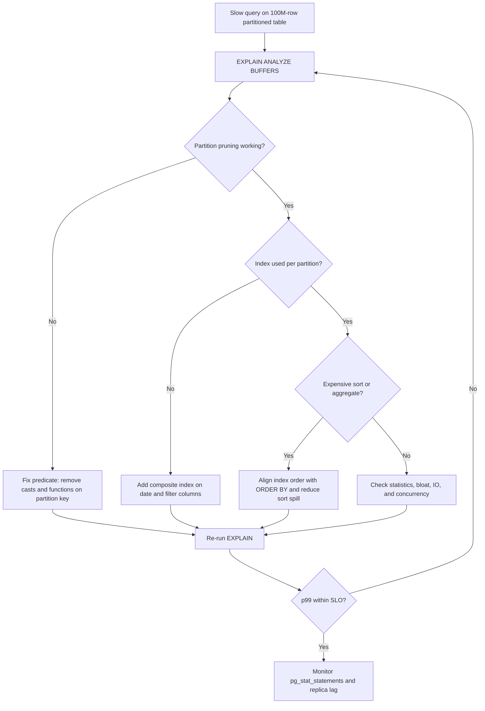

| Difficulty | Channel | Tags |
|---|---|---|
| intermediate | database | explain, query-plan, partitioning |

CoinGecko's hourly crypto price table quietly grew past 1TB over eight years, and by the time engineers noticed, average queries were taking more than 30 seconds. IOPS slammed into provisioned limits, request queues ballooned, Apdex fell, and replicas lagged—putting SLO and SLA commitments on the line [1]. The team did what most experienced PostgreSQL engineers would recommend: they partitioned the table. Performance improved 6–8x in dry runs, p99 latency fell from 4.13s to 578ms, and replica lag vanished—yet one query actually got slower after partitioning [1]. That counterintuitive regression is the heart of this story, and it is exactly the kind of mystery hiding inside your EXPLAIN plan.

---

> ### Real-World Case — CoinGecko
>
> CoinGecko's hourly crypto price table grew past 1TB over 8 years, with average queries taking over 30 seconds. IOPS repeatedly breached provisioned limits, request queues grew, Apdex fell, and replicas lagged, threatening SLO/SLA commitments.
>
> | | |
> |---|---|
> | **Challenge** | Adding indexes was ineffective because queries filtered through JSONB currency keys, so the team range-partitioned the table by month on the timestamp. After switching, some date-range queries became slower than on the unpartitioned table: queries with only an open-ended bound such as created_at > ? could not prune partitions, forcing scans across every partition, including future empty partitions pre-created for 2025. |
> | **Solution** | The team migrated to monthly range partitions on the timestamp, warmed partitions with pg_prewarm, and inspected query behavior to find plans touching all partitions. They rewrote the offending queries to include both lower and upper date bounds, removed unnecessary future partitions, and monitored IOPS, CPU, and replica lag with CloudWatch before and after the cutover. |
> | **Outcome** | p99 response time dropped from 4.13s to 578ms, an 86% reduction, IOPS fell by 20%, query performance improved 6-8x in dry runs, and replica lag disappeared. The migration also surfaced a counterintuitive regression where partitioning temporarily made one query slower than the original table. |
> | **Lesson** | Partitioning only helps when the query gives the planner enough predicates to prune. Missing even one date bound can turn a selective query into an Append over every partition, including empty future ones, making it slower than an unpartitioned table. Check EXPLAIN for how many partitions are actually scanned, not just whether the table is partitioned. |

---

## Hook — The Query That Looked Optimized and Wasn't

Picture a dashboard query asking for four weeks of events from a 100-million-row table. The table is partitioned by date, the WHERE clause includes the date range, and everyone assumes PostgreSQL will touch only a handful of partitions. Instead, the query runs for 30 seconds, pins IOPS at the ceiling, and lets replica lag creep upward. Sound familiar?

Here is the uncomfortable truth: partitioning is a storage-layout decision, not a performance guarantee [2]. It narrows the haystack, but it does not promise that the planner will skip the wrong partitions, that each partition has the right index, or that a giant sort will not appear at the end of the plan. Those are three separate problems wearing the same trench coat.

The stakes are real. A slow range query is not just an annoying spinner on a dashboard; it consumes shared IO, delays replication, and turns one bad predicate into a fleet-wide incident [1]. The good news? EXPLAIN tells you which of the three problems you actually have—if you know where to look.

💡 **Insight:** Partitioning decides which files PostgreSQL opens. Indexes and predicates decide how fast it walks through each file.

## Problem — Three Suspects, One Slow Query

Most teams inherit a table like `events`, partitioned monthly or daily, with a query that filters on `event_date` and `status`. The query looks innocent: select everything completed in January. Yet it is slow. Why?

The first suspect is **partition pruning**. PostgreSQL can eliminate partitions only when it can prove the predicate is safe [2]. A cast, a function, a timezone conversion, or a parameter type mismatch can quietly disable pruning. The plan then scans every partition, and the date filter becomes a filter after the fact rather than a boundary. In other words, you asked for January, but the database opened the whole calendar.

The second suspect is **index utilization**. Even with pruning, each surviving partition may fall back to a sequential scan if the index does not match the predicate or if statistics are stale [4]. A single-column index on `event_date` helps, but it still leaves the `status` filter to be checked row by row.

The third suspect is an **expensive sort or aggregate**. A query that returns data in an unexpected order can trigger a sort that spills to disk, and a `GROUP BY` can build a hash table larger than `work_mem`. The scan looks fine in isolation, but the plan's cost is dominated by a step you never noticed.

Here is the diagnostic shortlist:

- **Partition pruning:** Are you touching one partition or one hundred?
- **Index usage:** Is each partition doing an index scan or a sequential scan?
- **Sort and aggregate cost:** Are there temp blocks, external merge sorts, or hash batches?

You might think the answer is always 'add an index.' But an index on the wrong column order can be expensive decoration. The plan will tell you the truth—if you ask a precise question.

## Real-World Case — CoinGecko

CoinGecko lived this exact story. Its hourly crypto price table grew past 1TB over eight years, and average queries stretched beyond 30 seconds. IOPS repeatedly breached provisioned limits, request queues grew, Apdex fell, and replicas lagged—putting SLO and SLA commitments at risk [1].

The team partitioned the table, and the results were dramatic: p99 response time dropped from 4.13s to 578ms, an 86% reduction; IOPS fell by 20%; dry runs showed 6–8x faster queries; and replica lag disappeared [1]. That is the fairy-tale ending most partitioning articles stop at.

But the migration also exposed a plot twist: partitioning temporarily made one query slower than it had been on the original table [1]. Same data, same SQL, worse plan. The lesson is not that partitioning failed. The lesson is that a new physical layout creates new planner choices, and at least one of them can be worse for a specific query shape. Without EXPLAIN, that regression would have shipped silently and been blamed on 'the database being slow.'

This is why the CoinGecko story matters for any team with a large time-series table: partitioning can be a massive win overall while still introducing a localized regression. You do not get to skip query-level verification just because the aggregate metrics improved.

## Deep Dive — Reading the Plan Like a Detective

Start with `EXPLAIN (ANALYZE, BUFFERS, VERBOSE)`. The plan is a tree, and you read it from the inside out: each child node feeds its parent. Look for `Append` or `Merge Append` near the top of a partitioned query. Then ask three questions.

**1. Did pruning happen?** If the `Append` node lists every partition, pruning failed. Check for functions on the partition key, implicit casts, or predicates that PostgreSQL cannot prove safe. With parameterized queries, runtime pruning may appear as `Subplans Removed`; static pruning happens during planning [2][9].

**2. How is each surviving partition accessed?** A `Seq Scan` on one small partition may be perfectly fine. A `Seq Scan` on every partition is a red flag. Compare estimated rows with actual rows; a huge mismatch usually means stale statistics or correlation the planner cannot see [4].

**3. Where did the time go?** Look for `Sort` with `external merge` and `temp read/written` in the buffers. Look for `HashAggregate` with `Batches` greater than 1, which means the hash table spilled to disk. A fast scan feeding a slow sort is still a slow query.

Here is the trade-off table teams wish they had earlier:

| Strategy | Best for | The real trade-off |
|---|---|---|
| Composite B-tree `(event_date, status)` | Date-range scans with a secondary filter | Mirrors the partition key, but a highly selective status may still scan too much |
| Composite B-tree `(status, event_date)` | Equality filter plus range | Better for selective status, weaker when status is low-cardinality |
| BRIN on `event_date` | Huge append-only tables with natural order | Tiny index, but block-range granularity and a poor fit for status filters |
| `CLUSTER` | Read-heavy range scans | Fast reads, exclusive rewrite, and the order decays as new rows arrive [5] |
| More partitions | Retention and bulk drops | Better pruning, but more planning overhead and cross-partition sorts |

When should you reach for each? Use a composite B-tree when your WHERE clause consistently combines a range and an equality filter. Consider BRIN when the table is append-only and physically ordered by time. Reserve `CLUSTER` for read-heavy tables where range scans dominate and you can tolerate the rewrite [5]. Add partitions for retention and maintenance, not because a bigger number sounds faster.

🔥 **Hot Take:** If your query touches one partition and still takes 30 seconds, partitioning is not your problem—your index, your sort, or your statistics are.

⚠️ **Watch Out:** `EXPLAIN ANALYZE` actually executes the query. On a production primary, run it on a replica, inside a transaction you can roll back, or outside peak traffic.

## Workflow — The Diagnostic Loop That Finds the Real Bottleneck

The Workflow diagram below maps the decision path from a slow query to a verified fix. Do not skip steps; each one eliminates a suspect.

1. **Reproduce with the real plan.** Run `EXPLAIN (ANALYZE, BUFFERS, VERBOSE)` on a replica or staging copy. Capture actual rows, loops, and buffer usage.
2. **Count the partitions.** Compare the number of partitions in the table with the number the plan touched. If they match, pruning is not working.
3. **Fix the predicate, not the hardware.** Remove casts and functions from the partition key. Make sure parameter types match the column types. Rewrite the range as `>= start AND < end` when appropriate.
4. **Inspect per-partition access.** Look for sequential scans on large partitions, misestimated row counts, and missing indexes. Check whether the index order matches the query's equality and range columns.
5. **Hunt for sorts and aggregates.** A `Sort` that spills to disk or a `HashAggregate` with multiple batches can dominate runtime even when scans look healthy.
6. **Add the smallest useful index.** Test `(event_date, status)` and `(status, event_date)` on a representative partition before rolling out. Refresh statistics with `ANALYZE` [8].
7. **Re-measure and monitor.** Compare p99, not a single warm-cache run. Track the query with `pg_stat_statements` so the improvement is provable over time [7].

The loop matters because the first fix is often incomplete. You might restore pruning and discover a sort. You might fix the sort and discover stale statistics. Each iteration narrows the gap between what you assumed and what the planner actually did.

## Code Example — A Safe Diagnostic and Indexing Sequence

This sequence captures the real plan, checks how many partitions exist, adds a composite index, refreshes statistics, and verifies the change. Run it against a replica or staging copy first, because `EXPLAIN ANALYZE` executes the query.

## Lessons Learned — What to Do Differently Tomorrow

**Pruning is a proof, not a promise.** Verify that the plan touches only the partitions you expect. A predicate that looks sargable to you may be opaque to the planner [2][9].

**Composite index order is a hypothesis.** The canonical `(event_date, status)` index is a reasonable starting point, but equality columns often deserve to come first. Test both with real data and real selectivity [4][10].

**Sorts are silent budget killers.** A query can scan quickly and still lose to an external merge sort. Check `BUFFERS` for temp blocks and look for spill indicators in aggregates.

**Partitioning can regress individual queries.** CoinGecko's overall numbers improved dramatically, yet one query got slower after migration [1]. Measure per-query behavior, not just the dashboard average.

**`CLUSTER` is a one-time rearrangement, not a permanent state.** New rows arrive out of order, and the benefit decays. Use it deliberately, and understand the lock [5].

**Battle scars to avoid:**

- Running `EXPLAIN ANALYZE` on the primary during peak traffic.
- Creating thousands of tiny partitions and wondering why planning takes longer than execution.
- Adding an index without running `ANALYZE`, then trusting the planner's stale estimates.
- Celebrating a fast warm-cache run while p99 remains ugly in production.

If this feels overwhelming, you are not alone. The fix is usually smaller than the fear: one honest plan, one targeted index, and one re-measurement loop. The difference between a guess and an optimization is evidence.

---

## PostgreSQL Query Optimization Flow

<strong>Original Interview Question</strong>

**Q:** You have a PostgreSQL table with 100M rows partitioned by date. A query filtering on a specific date range is still slow. What would you check in the EXPLAIN plan and how would you optimize it?

**A:** Check partition pruning effectiveness, index utilization patterns, and expensive sort operations. Create composite indexes on (date, filtered_columns) and evaluate clustering strategies for optimal data access.

## Conclusion

CoinGecko's story ends with an 86% p99 reduction, but its most valuable lesson is the regression: partitioning improved the system while making one query worse [1]. That is not a contradiction; it is a reminder that physical layout changes planner behavior, and planner behavior must be verified query by query. Tomorrow, when a partitioned query is slow, resist the urge to add another index blindly. Open the plan, confirm pruning, inspect each partition's access path, and hunt the sort. The memorable insight to share with your team is simple: partitioning decides where the data lives, but predicates and indexes decide how fast you reach it. Measure the plan, not the assumption.

---

## References

1. [CoinGecko incident report](https://dev.to/coingecko/scaling-postgresql-performance-with-table-partitioning-136o) — article
2. [PostgreSQL Documentation: Table Partitioning](https://www.postgresql.org/docs/current/ddl-partitioning.html) — documentation
3. [PostgreSQL Documentation: EXPLAIN](https://www.postgresql.org/docs/current/sql-explain.html) — documentation
4. [PostgreSQL Documentation: Indexes](https://www.postgresql.org/docs/current/indexes.html) — documentation
5. [PostgreSQL Documentation: CLUSTER](https://www.postgresql.org/docs/current/sql-cluster.html) — documentation
6. [Wikipedia: Partition (database)](https://en.wikipedia.org/wiki/Partition_(database)) — documentation
7. [PostgreSQL Documentation: pg_stat_statements](https://www.postgresql.org/docs/current/pgstatstatements.html) — documentation
8. [PostgreSQL Documentation: CREATE INDEX](https://www.postgresql.org/docs/current/sql-createindex.html) — documentation
9. [PostgreSQL Documentation: Using EXPLAIN](https://www.postgresql.org/docs/current/using-explain.html) — documentation
10. [Wikipedia: Database index](https://en.wikipedia.org/wiki/Database_index) — documentation

---

**Author:** Satishkumar Dhule — [GitHub](https://github.com/satishkumar-dhule) · [LinkedIn](https://linkedin.com/in/satishkumar-dhule) · [Website](https://satishkumar-dhule.github.io)
