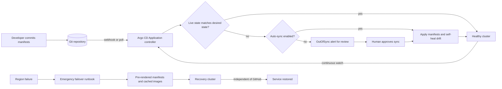

| Difficulty | Channel | Tags |
|---|---|---|
| beginner | devops | argocd, flux, declarative |

Intuit runs roughly 45 Argo CD instances managing 20,000 applications across 200 Kubernetes clusters — one of the largest GitOps estates on the planet [1]. Yet when a cloud region failed, the team could not wait for GitHub and Argo CD's normal reconciliation loop to notice. The lesson is not that GitOps is fragile; it is that declarative sync and emergency failover are different problems with different clocks. Here is how to wire Argo CD so routine changes stay auditable while your recovery path stays fast.

---

> ### Real-World Case — Intuit
>
> Intuit helped create Argo CD and runs one of the largest GitOps estates in the world: roughly 45 Argo CD instances managing about 20,000 applications across 200 Kubernetes clusters. But its most critical use case—evacuating a failed region—could not tolerate waiting on GitHub and Argo CD's normal reconciliation loop.
>
> | | |
> |---|---|
> | **Challenge** | Intuit needed Git as the source of truth and automatic drift correction for routine deployments, but pure pull-based GitOps created an unacceptable recovery path during regional failover. GitHub's 20-minute SLA plus Argo CD recovery time could mean roughly 40 minutes before critical changes took effect, and the company also had a large Jenkins estate that could not be rewritten overnight. |
> | **Solution** | Intuit standardized on declarative Argo CD Applications for normal workloads, with Git holding the desired state and Argo CD reconciling it automatically. For exceptions, it deliberately stayed hybrid: a kubectl CronJob handles east-west region evacuation without depending on GitHub, while existing Jenkins pipelines end by calling argocd app sync—an imperative trigger that still respects Git as the source of truth. Teams also commonly start with drift detection and alerting before enabling full self-healing. |
> | **Outcome** | Intuit scaled GitOps to roughly 45 Argo CD instances, 20,000 applications, and 200 clusters. Region failover no longer depends on GitHub availability, while routine deployments retain declarative auditability and automatic reconciliation. |
> | **Lesson** | GitOps is an operating model, not a purity test. Use declarative Git state for the steady state, but design explicit, documented imperative escape hatches for cases where the SCM or GitOps control plane sits in the failure path—GitOps most of the time can be more reliable than dogmatic GitOps. |

---

## Hook — The Three-Minute Gap That Nearly Broke a Region

It is 2:47 a.m. when the regional status page turns red. Your payments service is healthy in the cluster, the last Git commit is green, and the Argo CD dashboard says everything is Synced. Then someone asks the only question that matters: can you evacuate the region in the next ten minutes?

Suddenly, the three-minute reconciliation interval feels like a geological epoch. GitOps gave you a clean audit trail and automatic drift correction, but the failover path still depends on a Git host, a control plane, and a controller loop that may be in the blast radius.

That gap between the cluster matching Git and the business staying online is where most tutorials stop and where production begins. The real skill is not writing an Application manifest. It is understanding which parts of your system need declarative convergence and which parts need a path that works when the reconciler cannot.

## Problem — When the Cluster Becomes the Source of Truth

Configuration drift rarely announces itself. It arrives as a `kubectl edit` at 1 a.m., a hotfix applied directly to a production Deployment, or a manually created Secret that never existed in Git. The change works, so it stays. Three weeks later, a rollback restores the old manifest and the missing Secret takes the service down.

This is the quiet cost of imperative operations: the cluster becomes a second source of truth, and nobody can diff it against the first. Teams feel the pain in three places:

- **Audit and compliance:** shell history is not a change log, and a Slack thread is not a pull request.
- **Rollback confidence:** reverting Git only helps if Git contained the change in the first place.
- **On-call cognitive load:** every incident starts with the question, 'Is the cluster what we think it is?'

Many developers assume GitOps is just YAML in a repository. In practice, it is an operating model: every intentional change flows through version control, and a controller continuously closes the gap between intent and reality [9]. The hard part is preserving that model when humans are under pressure and the fastest fix is a direct command.

## Real-World Case — Intuit's 20,000-Application GitOps Estate

Intuit did not adopt GitOps as a side experiment. The company helped create Argo CD and now runs roughly 45 Argo CD instances managing about 20,000 applications across 200 Kubernetes clusters [1]. At that scale, a reconciliation loop is not a convenience feature; it is fleet infrastructure.

Intuit's most critical use case was regional evacuation. If an entire region failed, the recovery path could not tolerate waiting on GitHub availability or Argo CD's normal reconciliation loop [1]. The very properties that make GitOps safe for routine deployments — a remote source of truth, a controller, a polling interval — become liabilities when the emergency is happening inside the dependency chain.

The response was not to abandon declarative deployment. Routine changes still flow through Git, with auditability and automatic reconciliation intact. Instead, the failover path was decoupled from the normal loop so that region evacuation no longer depends on GitHub being reachable [1]. That distinction matters: GitOps is excellent at convergence, but convergence is not the same thing as disaster recovery.

The impact is measurable in architectural terms: roughly 45 controllers, 20,000 applications, and 200 clusters stay declarative, while a critical recovery workflow gets its own independent clock [1]. That is the pattern worth copying, regardless of whether you run two clusters or two hundred.

## Deep Dive — Declarative Intent vs Imperative Commands

Declarative and imperative are not competing religions. They answer different questions, and production systems usually need both — with clear boundaries.

**Declarative GitOps** describes the destination. You store YAML manifests, Helm charts, or Kustomize overlays in Git, and Argo CD [2] uses an Application custom resource to point at that source [3]. A controller compares the live cluster state with the desired state and reconciles the difference [11]. Auto-sync automates the apply step, while self-healing reverts manual drift [4]. In Kubernetes terms, this is the same control-loop idea used by built-in controllers, just extended to your whole application estate [5][11]. The OpenGitOps principles describe this as continuous reconciliation [12].

**Imperative operations** describe the journey. `kubectl run`, `kubectl edit`, and `kubectl delete` change the cluster immediately [6]. They are fast, direct, and invisible to Git unless someone remembers to backport the change. That makes them useful for debugging and emergencies, and dangerous as a default workflow.

| Dimension | Declarative GitOps | Imperative kubectl |
| --- | --- | --- |
| Source of truth | Git commit | Shell history and live cluster |
| Audit trail | Pull request review | Partial, often missing |
| Rollback | `git revert` and sync | Re-run an unknown sequence |
| Drift | Detected and optionally reverted | Accumulates silently |
| Speed | Seconds to minutes | Milliseconds |
| Best fit | Steady-state desired state | Debugging and break-glass |

Here is the plot twist that surprises many teams: auto-sync with self-healing is not just a safety net. It is an active policy that will revert a manual hotfix while an incident is still in progress. That is exactly what you want when someone fat-fingers a replica count. It is exactly what you do not want when the on-call engineer is applying a temporary mitigation at 3 a.m. The answer is not to disable self-healing forever; it is to define a break-glass procedure, document it, and make the return to Git explicit.

💡 **Insight:** Argo CD's default reconciliation timeout is typically three minutes, and webhooks can shorten the detection window [4]. Neither mechanism makes sync instantaneous. Design your recovery path around the loop, not against it.

⚠️ **Watch Out:** `prune: true` deletes resources that disappear from Git. Combined with a broad Application path, a bad merge can remove more than intended. Scope Applications tightly and use sync windows for high-risk environments [4].

Helm and Kustomize sit on the declarative side of the line: they generate manifests from versioned inputs, so the rendered output remains reproducible [7][8]. The trade-off is complexity — templating bugs and overlay drift are real — but the audit trail stays intact because the inputs live in Git.

## Workflow — Wiring Argo CD Without Building a Fragile Control Plane

Building on the declarative model, the goal is a setup where routine changes converge automatically and emergencies do not share the same failure domain. The sequence below is a practical starting point.

1. **Put every workload input in Git.** Manifests, Helm values, Kustomize overlays, and policy config belong in version control. If an object cannot be recreated from the repository, it is not really managed.
2. **Separate the platform from the applications.** Use an app-of-apps pattern or ApplicationSets so one root Application can register many child Applications without a human clicking through a UI.
3. **Define one Application per deployable unit.** Point `source.repoURL`, `targetRevision`, and `path` at the exact directory that owns the workload [3]. Keep the blast radius small.
4. **Enable automated sync deliberately.** Turn on `prune` and `selfHeal` for environments where convergence is the policy [4]. Add retry backoff so a transient API failure does not page anyone.
5. **Tune detection, then verify it.** Use a webhook for fast notification and keep the polling interval as a backstop [4]. Measure the time from merge to healthy, not the time from merge to 'sync started.'
6. **Build a failover path that does not share the control plane.** Pre-render critical manifests, cache container images, and document an emergency procedure that works when GitHub or the primary Argo CD instance is unavailable [1]. Test it on a schedule.

Argo CD is open source, so the controller behavior is inspectable and the project evolves in public [10]. The diagram accompanying this section shows the two clocks: the normal reconciliation loop on one side, and the emergency failover path on the other. They share artifacts, not dependencies.

## Code Example — A GitOps Gate You Can Run in CI

The script below turns the workflow into a CI gate. It creates an Argo CD Application, forces a refresh instead of waiting for the next poll, waits for health, and fails the pipeline if the cluster is not Synced and Healthy. The full snippet lives in the `codeExample` field; the key idea is that GitOps should be verifiable by automation, not just visible in a dashboard.

⚠️ **Watch Out:** Run this against a staging cluster first. The Application's `prune` and `selfHeal` settings are intentionally aggressive, and a mis-scoped path can delete resources in a real environment.

## Lessons Learned — What Survives the 3 A.M. Test

Intuit's scale makes the lesson obvious, but the same failure mode appears in a five-service startup. The control plane you trust for routine changes is not automatically the control plane you trust at 3 a.m.

Here is what to carry forward:

- **Auto-sync is convergence, not instant deployment.** A three-minute loop is fast for humans and slow for a regional outage [4]. Measure both clocks.
- **Self-healing needs an escape hatch.** Document a break-glass path, require an incident ticket, and reconcile Git afterward. Otherwise the controller will fight the fix.
- **Do not let failover depend on the same Git host.** Pre-render critical manifests or keep a local copy outside the primary region [1].
- **Alert on `OutOfSync`, not only on failed syncs.** Drift that cannot be auto-healed is an incident waiting for a customer to notice.
- **Test rollback with `git revert`.** A rollback path that has never been exercised is a hypothesis, not a capability.
- **Scope `prune` carefully.** Tight Application paths and sync windows prevent a routine merge from becoming a mass deletion [4].

🔥 **Hot Take:** Most GitOps outages are not YAML syntax errors. They are dependency errors — the controller, the Git host, the secret store, or the container registry sits inside the failure domain it is supposed to recover from.

🎯 **Key Point:** The winning architecture is boring on purpose. Routine changes go through Git and reconcile automatically. Emergencies use a separate, rehearsed path that produces the same declarative artifacts. Both paths are auditable, and neither one assumes the other is available.

Tomorrow, audit one thing: open your region-failover runbook and circle every step that depends on GitHub, the primary Argo CD instance, or a live `kubectl` command typed from memory. Each circled step is a place where your recovery clock is secretly someone else's.

---

## GitOps Sync and Failover Flow

<strong>Original Interview Question</strong>

**Q:** You're setting up GitOps for a microservices deployment. How would you configure ArgoCD to automatically sync changes from your Git repository to Kubernetes, and what's the difference between declarative and imperative approaches in this context?

**A:** I'd configure ArgoCD by setting up a Git repository containing Kubernetes manifests or Helm charts, creating an Application CRD that points to the Git repository, enabling auto-sync with a health check interval of 3 minutes, and implementing self-healing to automatically revert any manual changes. The declarative approach involves defining the desired state in Git through YAML manifests, Helm charts, or Kustomize configurations, where ArgoCD continuously reconciles the actual state with the desired state. In contrast, the imperative approach uses kubectl commands to make direct changes to the cluster, bypassing the Git repository as the single source of truth.

## Conclusion

Intuit's story is not a warning to avoid GitOps. It is a reminder that GitOps solves convergence, while resilience solves availability — and those are different problems [1]. Declarative Applications, auto-sync, and self-healing give teams an auditable, self-correcting default [3][4]. A decoupled failover path gives them a chance when the default is unavailable.

Start small: put one critical service under Argo CD, enable automated sync with a tight scope, measure merge-to-healthy time, then rehearse a rollback and a failover. The memorable insight is simple: **your GitOps loop is only as resilient as the dependencies it cannot see.**

---

## References

1. [Intuit incident report](https://youtu.be/m9a36_oEXa4) — article
2. [Argo CD Documentation](https://argo-cd.readthedocs.io/en/stable/) — documentation
3. [Argo CD Application Specification](https://argo-cd.readthedocs.io/en/stable/user-guide/application-specification/) — documentation
4. [Argo CD Automated Sync Policy](https://argo-cd.readthedocs.io/en/stable/user-guide/auto_sync/) — documentation
5. [Kubernetes Declarative Object Management](https://kubernetes.io/docs/tasks/manage-kubernetes-objects/declarative-config/) — documentation
6. [Kubernetes Imperative Object Management](https://kubernetes.io/docs/tasks/manage-kubernetes-objects/imperative-command/) — documentation
7. [Kubernetes Kustomize Documentation](https://kubernetes.io/docs/tasks/manage-kubernetes-objects/kustomization/) — documentation
8. [Helm Documentation](https://helm.sh/docs/) — documentation
9. [GitOps on Wikipedia](https://en.wikipedia.org/wiki/GitOps) — blog
10. [Argo CD GitHub Repository](https://github.com/argoproj/argo-cd) — documentation
11. [Kubernetes Controllers](https://kubernetes.io/docs/concepts/architecture/controller/) — documentation
12. [OpenGitOps Principles](https://opengitops.dev/) — documentation

---

**Author:** Satishkumar Dhule — [GitHub](https://github.com/satishkumar-dhule) · [LinkedIn](https://linkedin.com/in/satishkumar-dhule) · [Website](https://satishkumar-dhule.github.io)
