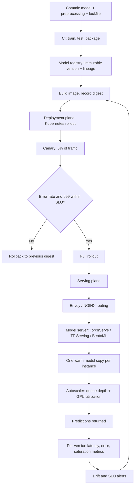

| Difficulty | Channel | Tags |
|---|---|---|
| beginner | devops | mlops, deployment |

Instacart's Ads team watched 15% of its end-to-end click-through-rate latency disappear inside model serving alone — not feature lookup, not ranking, just the act of getting a prediction out the door [1]. Every ML team had built its own Python and Gunicorn service, so the same preprocessing, logging, and monitoring code was reinvented dozens of times. When the platform team finally separated deployment from serving, p99 and p50 serving latency dropped by more than 80%, and serving's share of ads latency fell from 15% to 3% [1]. The lesson is uncomfortable but simple: shipping a model and running a model are not the same discipline, and treating them as one is how latency quietly becomes architecture.

---

> ### Real-World Case — Instacart
>
> Instacart's ML teams each ran their own Python/Gunicorn model-serving service under Griffin 1.0. Every team re-implemented the same feature loading, preprocessing, experimentation, monitoring, and logging logic. For the Ads team's click-through-rate model, model serving alone accounted for 15% of end-to-end ads latency.
>
> | | |
> |---|---|
> | **Challenge** | Instacart needed to separate the deployment lifecycle (packaging, model registry, rollout, configuration) from the runtime inference path (request routing, batching, version experiments, autoscaling) without forcing every ML team to rebuild both. The old Python/Gunicorn design also loaded a full model copy per worker process, so memory and EC2 cost scaled linearly with concurrency. |
> | **Solution** | Griffin 2.0 introduced a unified Model Serving Platform with a model registry and Control Plane UI for deployment, plus a separate Go-based runtime: a Proxy for version/experiment routing and Workers for inference with per-model configurable batching, deployed on Amazon ECS. Feature loading, preprocessing, experimentation, and production monitoring (Datadog/Arize) became configuration-driven and provisioned automatically. |
> | **Outcome** | P99 and P50 model-serving latency dropped by over 80%, and the Ads pCTR model's serving share of total ads latency fell from 15% to 3%. Running one model copy per instance instead of one per Gunicorn worker sharply reduced memory footprint and EC2 cost, and model launch time went from weeks to minutes. |
> | **Lesson** | Deployment and serving are distinct platform concerns: a self-service control plane handles packaging, rollouts, and registry, while a standardized runtime handles routing, batching, and scaling. Consolidating serving logic and choosing a compiled, concurrency-friendly runtime removes duplicated DevOps and is what actually fixes tail latency at scale. |

---

## Hook — The 15% Tax Hiding in Plain Sight

Picture a dashboard that looks healthy. Your model is deployed, the pod is green, the health check returns 200, and nobody is paging. Yet a meaningful slice of your product's response time is being spent inside a serving process that nobody owns end to end. That was the normal state at Instacart before Griffin 2.0: each ML team stood up its own Python and Gunicorn service, and each one carried its own feature loading, preprocessing, experimentation hooks, monitoring, and logging logic [1].

Here is the twist that catches experienced developers: the problem was not that the models were bad. The problem was that the serving layer was duplicated, unmeasured as a shared concern, and invisible to the people optimizing the product. When the Ads team's pCTR model spent 15% of total ads latency in serving, that cost looked like an unavoidable tax [1]. It was not. It was an architectural choice wearing a costume.

Sound familiar? Most teams can answer 'is the model deployed?' within seconds. Far fewer can answer 'what is the p99 of the serving path, which model version handled that request, and how much memory does one copy consume?' Those questions belong to a different discipline — and that distinction is the whole story.

## Problem — When 'It's Deployed' Means Almost Nothing

Deployment answers a lifecycle question: can this artifact reach an environment reliably, reproducibly, and reversibly? Serving answers a runtime question: given a live request, can this process produce a correct, fast, observable prediction right now? Confusing the two produces a familiar failure mode — a green deployment dashboard attached to a serving path nobody has profiled.

The pain compounds in four predictable ways. First, duplicated serving code drifts: two teams implement normalization differently, and offline metrics stop matching online behavior. Second, resource accounting goes blind; running one model copy per Gunicorn worker multiplies memory and cloud spend without anyone noticing. Third, versioning becomes tribal knowledge rather than metadata. Fourth, latency optimization has no owner, because deployment engineers own rollouts while data scientists own model quality, and the inference path falls between them.

This is not a small-team-only problem. Research on production ML systems describes hidden technical debt that accumulates around data dependencies, configuration, and serving glue — the model code is often the smallest part of the system [2]. Consequently, the question 'explain deployment versus serving' is really a maturity test: does your organization know where the boundary is, and does it have a contract across it?

## Real-World Case — Instacart and the Griffin 2.0 Rebuild

Instacart's Griffin 1.0 gave every ML team enough rope to hang itself politely. Teams ran their own Python and Gunicorn model-serving services, and each re-implemented feature loading, preprocessing, experimentation, monitoring, and logging [1]. For the Ads team's click-through-rate model, serving consumed 15% of end-to-end ads latency [1].

The platform team rebuilt the serving layer around a shared model-serving platform, Griffin 2.0. The results were not marginal. P99 and P50 model-serving latency dropped by over 80%, and serving's share of ads latency fell from 15% to 3% [1]. Running one model copy per instance instead of one per Gunicorn worker sharply reduced memory footprint and EC2 cost, and model launch time went from weeks to minutes [1].

⚠️ Watch Out: the headline is not 'rewrite your serving stack.' The headline is that Instacart separated concerns that had been accidentally fused. Shared serving infrastructure made latency measurable, made memory accounting honest, and made launches self-service. That is a deployment-and-platform story expressed through serving metrics. If your team cannot produce those numbers today, you do not have a serving strategy — you have a collection of services.

## Deep Dive — Two Planes, One Contract

Think of deployment as the control plane and serving as the data plane. The control plane owns CI/CD, infrastructure provisioning, artifact promotion, rollout strategy, and rollback. The data plane owns request routing, model loading, preprocessing, batching, response serialization, and runtime observability. Kubernetes Deployments and Horizontal Pod Autoscalers are control-plane primitives [3][4]; TensorFlow Serving, TorchServe, and BentoML are data-plane machinery [5][6][7].

| Concern | Deployment plane | Serving plane |
|---|---|---|
| Primary question | Can we ship and undo this safely? | Can we answer this request within SLO? |
| Typical tools | Kubernetes, Terraform, GitHub Actions, MLflow, SageMaker [8][9] | TorchServe, TF Serving, BentoML, Envoy, gRPC [5][6][7][10] |
| Scaling unit | Replicas, nodes, rollout batches | Queue depth, GPU utilization, in-flight requests [4] |
| Failure mode | Bad artifact reaches prod | Good artifact, bad runtime behavior |
| Key metric | Rollout success, time to deploy | p50/p99 latency, throughput, error rate |

Many developers assume serving is just 'the container that runs the model.' In reality, serving is where latency-versus-throughput trade-offs become physical. Larger batches improve GPU utilization but raise tail latency. Aggressive autoscaling protects SLOs but creates cold starts. Real-time inference prioritizes p99; batch inference prioritizes cost per prediction. There is no universally correct setting — only a documented SLO and a measurement loop.

💡 Insight: the contract between the planes is metadata. The deployment plane must hand serving an immutable artifact, a version identifier, and a warmup recipe. The serving plane must hand back per-version latency, error, and saturation metrics. Break that contract and you get Griffin 1.0: working models, duplicated glue, and an invisible latency tax [1].

## Workflow — From Commit to Served Prediction

A healthy pipeline makes the boundary explicit at every step. The Mermaid diagram below shows the handoff between the deployment plane (top) and the serving plane (bottom), including the canary gate and the feedback loop from monitoring back into the next rollout.

1. Package the model with its preprocessing code and dependency lockfile, not just the weights.
2. Register the artifact in a model registry with an immutable version and lineage metadata [9].
3. Build a container image and record its digest; the digest, not a floating tag, is the deployable unit.
4. Roll out to a small traffic slice and compare error rate and p99 against the incumbent [3].
5. Warm the model in the serving process before marking the instance ready, so the first user does not pay the cold-start bill.
6. Scale on the signal that actually reflects load — queue depth or in-flight requests usually beat CPU for inference workloads [4].
7. Emit per-version metrics and feed drift and latency alerts back into the next deployment decision.

🔥 Hot Take: if your rollout process cannot answer 'which model version served request X at 14:03?' then your deployment plane and serving plane are not connected. They are just adjacent.

## Code Example — A Serving Process That Owns Its Runtime

The following Python service illustrates the serving-plane responsibilities that Griffin 1.0 left to individual teams: atomic model activation, warmup, per-version metrics, and a clean 503 instead of a hung request. It is intentionally framework-light so the design decisions stay visible.

The key move is separating load from activate. You can load a new version into memory while the old one keeps serving, then swap a pointer. No request drain, no half-initialized model, no mystery latency spike during rollout.

## Lessons Learned — What to Change Tomorrow

First, name the boundary out loud. Deployment owns safe delivery; serving owns runtime behavior. If one team owns both, fine — but the SLOs and metrics must still be separate, because they fail differently.

Second, count your model copies. Instacart's shift from one model per Gunicorn worker to one per instance cut memory and EC2 cost sharply [1]. If you have not measured memory per replica, you do not know your serving bill.

Third, make warmup part of readiness. Cold starts are a deployment problem that users experience as a serving problem. Load, warm, then accept traffic.

Fourth, instrument per version, not per service. Aggregated latency hides the canary that is quietly 3x slower. Per-version histograms make rollback decisions obvious.

Fifth, treat the registry as the source of truth. Immutable artifacts plus digest-pinned images turn rollback from an incident scramble into a pointer change [9].

🎯 Key Point: the memorable insight is this — deployment is a promise about the past (this artifact is safe to run), serving is a promise about the present (this request will be fast and correct). Teams that conflate the two end up optimizing neither. Teams that separate them get numbers like 15% to 3% [1].

---

## Deployment to Serving Handoff

<strong>Original Interview Question</strong>

**Q:** Explain the key differences between model serving and model deployment in ML systems, including specific technologies, scaling considerations, and real-world implementation patterns?

**A:** Deployment encompasses CI/CD pipelines, infrastructure setup, and monitoring using tools like Kubernetes, MLflow, and SageMaker. Serving focuses on runtime inference APIs with frameworks like TensorFlow Serving, TorchServe, or BentoML, handling request routing, model versioning, and autoscaling. Key trade-offs include latency vs throughput, batch vs real-time inference, and cold start optimization.

## Conclusion

The Instacart story is not really about Gunicorn. It is about what happens when a runtime concern hides inside a delivery concern for long enough that nobody owns the latency [1]. Deployment gets your model into the building; serving makes sure it can answer the door quickly, correctly, and with a name tag. Separate the two planes, write down the contract between them, and instrument per version. Do that, and the next time someone asks whether the model is deployed, you can answer the more useful question instead: what is its p99, and which version handled the last request?

---

## References

1. [Instacart incident report](https://tech.instacart.com/unveiling-the-core-of-instacarts-griffin-2-0-a-deep-dive-into-the-model-serving-platform-4a7298c0a54e) — article
2. [Hidden Technical Debt in Machine Learning Systems](https://arxiv.org/abs/1503.05991) — paper
3. [Kubernetes Documentation: Deployments](https://kubernetes.io/docs/concepts/workloads/controllers/deployment/) — documentation
4. [Kubernetes Documentation: Horizontal Pod Autoscaling](https://kubernetes.io/docs/tasks/run-application/horizontal-pod-autoscale/) — documentation
5. [TensorFlow Serving Repository](https://github.com/tensorflow/serving) — documentation
6. [TorchServe Repository](https://github.com/pytorch/serve) — documentation
7. [BentoML Repository](https://github.com/bentoml/BentoML) — documentation
8. [MLOps Overview](https://en.wikipedia.org/wiki/MLOps) — documentation
9. [Amazon SageMaker Developer Guide](https://docs.aws.amazon.com/sagemaker/latest/dg/whatis.html) — documentation
10. [Envoy Proxy Documentation](https://www.envoyproxy.io/docs/envoy/latest/) — documentation

---

**Author:** Satishkumar Dhule — [GitHub](https://github.com/satishkumar-dhule) · [LinkedIn](https://linkedin.com/in/satishkumar-dhule) · [Website](https://satishkumar-dhule.github.io)
