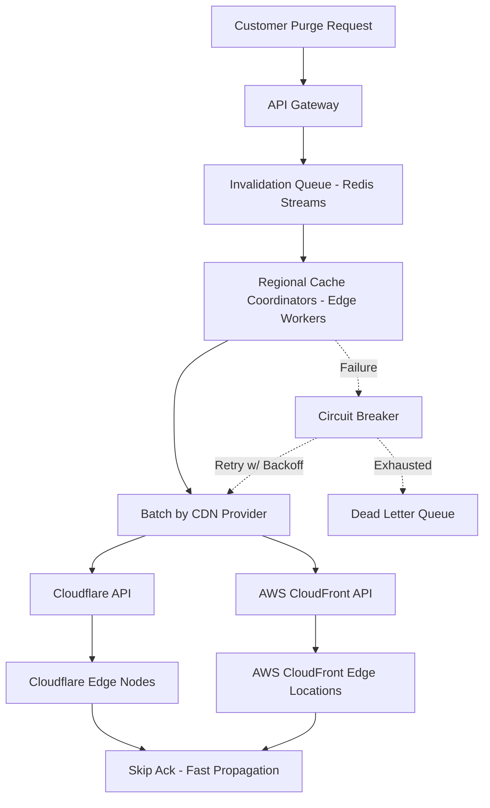

| Difficulty | Channel | Tags |
|---|---|---|
| intermediate | system-design | edge, caching, purging |

Picture this: a global sporting event is in its final seconds. A game-winning goal has just been scored. Within milliseconds, every major sports outlet updates their headline, and millions of viewers frantically refresh their pages to see the breaking news. The issue? Every single one of those pages is cached on edge nodes around the globe. If those stale headlines remain for even a minute too long, the race for views is lost. This exact high stakes scenario is what pushed Fastly to completely re-architect their purge system [1]. After hitting scaling limits with their original peer-to-peer broadcast approach, Fastly evolved their instant purge capabilities from processing roughly 2,000-3,000 purges per second in 2018 to handling about 60,000 per second by 2025, with the ability to scale to hundreds of thousands of purges per second [1].

---

> ### Real-World Case — Fastly
>
> Fastly operates a global CDN where breaking news, live event updates, and e-commerce promotions require cached content to be invalidated almost instantly. For years its purge system worked, but as the network and customer traffic grew, the original peer-to-peer broadcast approach hit scaling and reliability limits, and batched purge requests were being chopped into individual purges that flooded the system and triggered rate limiting.
>
> | | |
> |---|---|
> | **Challenge** | Guarantee that every cache node across dozens of global points of presence sees an invalidation within milliseconds, while scaling from thousands to tens of thousands of purge requests per second without a central bottleneck, message loss, or a thundering-herd effect from batch purges. |
> | **Solution** | Fastly treated purging as a decentralized distributed-messaging problem instead of a centralized command-and-control workflow. It used a variant of Bimodal Multicast: a cache server that receives a purge immediately broadcasts it to all other servers over UDP, with no acknowledgments and no attempt to track which node holds which content. To scale, purge packets are delivered to at least two healthy nodes per POP, which rebroadcast locally ('double delivery'), and the platform was changed to perform true batch purging rather than exploding batches into individual purge operations. |
> | **Outcome** | Fastly increased purge throughput from roughly 2,000-3,000 purges per second in 2018 to about 60,000 per second by 2025, and says the system can now scale to hundreds of thousands of purges per second. Skipping acknowledgments cut purge latency by up to half, and true batch purging eliminated the alert storms and manual rate limiting that had been caused by batch requests. |
> | **Lesson** | For global invalidation, the counterintuitive win is to broadcast everywhere over UDP and deliberately avoid acknowledgments and content-location maps. Reliability comes from redundant delivery and local rebroadcast rather than central coordination, which removes the bottleneck and makes latency mostly a function of network delay. |

---

## Hook — The Race Against Stale Cache

In the world of content delivery, speed is everything. For breaking news outlets, live event coverage, and flash e-commerce sales, cached content is a blessing. It allows for insanely low latencies and allows edge nodes to serve content to users without having to go all the way back to an origin server [2]. However, with great caching comes an even greater curse: staleness. The second a price changes, an article is corrected, or a live score updates, every cached copy of that asset becomes a liability. The window between an update and its propagation across the globe is a ticking time bomb. For some companies, seconds of stale content mean confused users. For others, it can mean thousands of dollars lost per second. This is the war that every large scale CDN is constantly fighting, and the weapon of choice for this war is cache purging.

## Problem — The Bottleneck Between Update and Propagation

Before diving into the solution, it is vital to understand the adversary at hand. Cache purging is the act of invalidating cached assets from edge nodes, forcing them to fetch the newest version from the origin upon the next request [3]. The requirements for this task are brutal. To be effective at global scale, a purge system must be able to propagate changes across dozens of points of presence within seconds, handle tens of thousands of invalidations concurrently, and do so with extreme reliability [1][4]. The most naive approach, a peer-to-peer broadcast, seems appealing at first glance. If a purge comes in, tell every node about it and have them invalidate their local copies. However, this approach falls apart exponentially with network size. With every added edge node, the amount of broadcast traffic grows, network congestion skyrockets, and fault tolerance becomes a nightmare to maintain [1][5]. Moreover, many CDNs had to deal with another silent killer: batched purge requests being chopped into individual purges. This would absolutely flood the system, trigger rate limits, and in some cases, create alert storms that required manual intervention from on-call engineers [1]. This is the exact bottleneck that was strangling Fastly's network as it continued to grow.

## Real-World Case — Fastly's Decade Long Evolution

Over the course of a decade, Fastly completely overhauled their instant purge architecture to combat these exact issues [1]. Prior to their re-architecture, their peer-to-peer broadcast approach was unable to keep up with the exponential growth of their network and customer traffic [1]. Not only was scaling a struggle, but their API contract was exacerbating the problem. Customers were sending batched purge requests to be efficient, however, these batches were being split into thousands of individual purges behind the scenes. This caused an artificial flood of traffic, triggering rate limiting and creating alert storms that required manual intervention [1]. The fix was multi-faceted. Fastly implemented true batch purging, allowing a singular batched request to be treated as a batch throughout the entire system as opposed to being fragmented [1]. Additionally, they began skipping unnecessary acknowledgments throughout the purge propagation path. These changes alone cut purge latency by up to half [1]. The results speak for themselves. Fastly increased purge throughput from roughly 2,000-3,000 purges per second in 2018 to about 60,000 per second by 2025, and the system can now scale to hundreds of thousands of purges per second [1]. Most importantly, the era of alert storms and manual rate limiting caused by fragmented batches was eradicated entirely [1]. This is a masterclass in not only optimizing for scale, but optimizing for the contracts and behaviors of the customers utilizing the system as well.

## Deep Dive — The Anatomy Of A Scalable Purge System

Building on Fastly's lessons, a modern multi-region purge system has to be built with intentionality around scale, fault tolerance, and cost [1][4][6]. First and foremost, batching is non-negotiable. Instead of purging assets one by one, requests should be grouped. A batch of 100 assets purged in a singular API call is astronomically cheaper and lighter on network overhead than 100 individual calls [1][6]. Next, acknowledgement strategies need to be evaluated. Synchronous, request by request acknowledgments from every single edge node create a massive synchronization tax. Skipping non-critical acknowledgments, similar to what Fastly did, can cut latency in half [1]. However, this is a trade-off. You gain speed, but lose immediate, granular confirmation. For the vast majority of CDN purges, eventual propagation is more than enough as long as a failure state is trackable [1][7]. Another crucial piece is regional coordination. Rather than broadcasting to the entire globe at once, a distributed queue can shard invalidations by region. Regional coordinators can then batch and dispatch to their local points of presence, preventing unnecessary cross-region traffic and containing the blast radius of a network partition [6][7]. Finally, fault tolerance is paramount. A circuit breaker can fail fast after consecutive failures to a specific CDN provider or region, a dead letter queue can capture failed purges for manual inspection, and regional health checks can reroute traffic away from unhealthy coordinators [4][6]. The core principle to remember here is this: at global scale, it is not about the speed of a singular purge, it's about the throughput and stability of purging millions of assets over time.

## Workflow — Orchestrating Purges Across The Globe

Now, how does all of this tie together in practice? The flow below showcases the battle-tested architecture that prevents the exact bottlenecks that plagued the original peer-to-peer approach. 

At the start, a purge request is sent to an API gateway. Instead of executing immediately, it is enqueued into a distributed queue, such as Redis Streams with consumer groups, to decouple ingestion from execution and to handle spikes of up to 10,000 concurrent invalidations per second [6][7]. From there, regional cache coordinators, often powered by edge compute such as Cloudflare Workers or custom regional services, claim batches of invalidations from the queue [6]. These coordinators are responsible for true batch purging. They will group assets by CDN provider (e.g CloudFront and Cloudflare) and dispatch them in batches of roughly 100 per API call, massively reducing overhead [1][6]. The CDN providers then propagate the invalidations to their respective edge nodes. Crucially, non-essential acknowledgments are dropped to minimize latency. If any provider fails, the circuit breaker trips, failed batches are pushed to a dead letter queue, and exponential backoff with jitter is utilized for retries to prevent thundering herds [6][7]. This entire process is designed to keep propagation well under 5 seconds globally, all whilst being horizontally scalable [4][6].

## Code Example — Batching And Purging With Resiliency

The architecture is only as strong as its implementation. The example below showcases a production inspired pattern for batching invalidations and purging them via the Cloudflare API, complete with backoff, jitter, and resilience. This is a simplified version of what regional coordinators would be doing at scale. Pay close attention to the batching logic, as this is what prevents the exact fragmentation issue that caused Fastly's alert storms [1][6].

## Lessons Learned — Purge Like Your Business Depends On It

After analyzing Fastly's decade long evolution and the architecture required to support it, a few hard truths arise. First, contracts matter. Optimizing your system is futile if your API contract allows customers to accidentally DDoS your own purge pipeline through batched requests. True batch support is a feature, not an afterthought [1]. Second, speed and certainty are a trade-off. Skipping acknowledgments is terrifying on paper, but for cache invalidation, losing half of your latency is often worth it as long as failures are observable and retryable [1][7]. Third, batching is king. Whether it be API calls to a CDN provider or database operations, batching will be your biggest lever for both cost and throughput optimization, oftentimes cutting costs by upwards of 90% in CDN invalidation scenarios [1][6]. Fourth, never broadcast everything to everyone. Regional sharding and edge compute coordination are what allow for horizontal scalability past the peer-to-peer ceiling [5][6]. Finally, prepare for failure. With hundreds of thousands of purges per second across the globe, failures will happen. Circuit breakers, dead letter queues, exponential backoff with jitter, and health checks are not 'nice to haves', they are the difference between a blip on a dashboard and a full page on-call [6][7]. The lesson is simple: in the race against stale cache, throughput and resiliency will always beat brute force broadcasting.

---

## Multi-Region CDN Purge Orchestration Flow

<strong>Original Interview Question</strong>

**Q:** How would you design a multi-region CDN cache purging system that guarantees content propagation within 5 seconds while handling 10,000 concurrent invalidations per second?

**A:** Implement Cloudflare API + AWS CloudFront with distributed invalidation queue, edge compute coordination, and 2-second TTL. Use batch invalidation, exponential backoff, and regional cache headers for 5-second SLA.

## Conclusion

The race against stale cache will never truly be won. The internet is far too large, too dynamic, and too fast moving for it to ever be perfect. However, the difference between a good CDN and a great one is measured in seconds, throughput, and resiliency. Fastly's evolution teaches a pivotal lesson: brute force broadcasting will only ever get you so far. True scale comes from batching, regional coordination, intelligent acknowledgement strategies, and most importantly, planning for failure at every layer [1][6][7]. The next time that a flash sale goes live, breaking news hits the wire, or a price is updated globally, remember that there is an entire symphony of queues, coordinators, and batches firing off behind the scenes to make sure that not a single user sees yesterday's news. For any team building at this scale, the question isn't 'can we purge it?' anymore. It's 'can we purge it in time, for everyone, every time?'

---

## References

1. [Fastly incident report](https://www.fastly.com/blog/over-a-decade-later-evolution-of-instant-purge) — blog
2. [Content delivery network (Wikipedia)](https://en.wikipedia.org/wiki/Content_delivery_network) — paper
3. [Cache (computing) (Wikipedia)](https://en.wikipedia.org/wiki/Cache_(computing)) — paper
4. [HTTP Caching - MDN Web Docs](https://developer.mozilla.org/en-US/docs/Web/HTTP/Caching) — documentation
5. [Broadcasting (networking) (Wikipedia)](https://en.wikipedia.org/wiki/Broadcasting_(networking)) — paper
6. [Invalidating and removing content - AWS CloudFront Documentation](https://docs.aws.amazon.com/AmazonCloudFront/latest/DeveloperGuide/Invalidation.html) — documentation
7. [Exponential backoff (Wikipedia)](https://en.wikipedia.org/wiki/Exponential_backoff) — paper
8. [Hypertext Transfer Protocol (HTTP/1.1): Caching - RFC 7234](https://datatracker.ietf.org/doc/html/rfc7234) — paper

---

**Author:** Satishkumar Dhule — [GitHub](https://github.com/satishkumar-dhule) · [LinkedIn](https://linkedin.com/in/satishkumar-dhule) · [Website](https://satishkumar-dhule.github.io)
