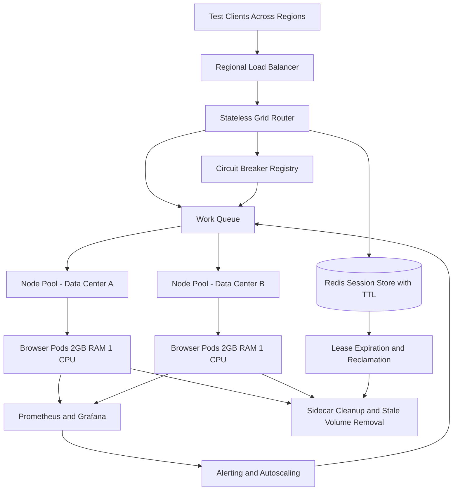

| Difficulty | Channel | Tags |
|---|---|---|
| advanced | system-design | selenium, webdriver, grid |

Yandex once pushed a standard Selenium Grid until the hub stopped being a coordinator and became a bottleneck, then a single point of failure [1]. Test teams speaking different languages and frameworks could not simply patch around it with client-side load balancing, because every new browser node made the central hub slower [1]. That is the uncomfortable truth behind every large-scale browser automation platform: the hard part is not starting a browser, it is keeping thousands of them alive without leaking memory, losing sessions, or turning one bad node into a regional outage [1]. This is the story of how to move from a fragile hub-and-node setup to an architecture that can carry 10,000 concurrent sessions and still recover gracefully when something breaks.

---

> ### Real-World Case — Yandex
>
> Yandex runs millions of Selenium autotests per day and needed thousands of browsers available 24/7 across multiple data centers. Its standard Selenium Grid deployments kept breaking under load: the hub was a single point of failure, and adding nodes made the hub slow or unresponsive. Test teams speaking different languages and frameworks could not all use a client-side balancing workaround.
>
> | | |
> |---|---|
> | **Challenge** | Scale a Selenium Grid to thousands of concurrent browser sessions with high availability and multi-datacenter failover. The stock hub architecture could only reliably handle roughly 20-30 connected nodes, had no quota isolation between teams, and lost every browser if the hub or its datacenter failed. |
> | **Solution** | Yandex built Grid Router, an open-source stateless proxy that presents itself as a normal Selenium hub but load-balances across many small hubs in different regions. It encodes the chosen hub and region inside the session ID, so subsequent WebDriver requests can be proxied without shared state, and it retries in another region when a datacenter is unavailable. Instead of large hubs, they run one hub plus about five nodes per 2-vCPU/4-GB VM, with one browser version per VM to make memory consumption measurable and predictable. |
> | **Outcome** | The production grid grew to more than 3,000 available browsers and handled approximately 3,000 concurrent user sessions at peak, serving millions of Selenium autotests daily. Multi-region routing means a datacenter outage is typically survived with at most one retry, and teams get independent quotas instead of competing for one hub. |
> | **Lesson** | At Selenium scale, one big hub is an anti-pattern: many small hubs behind a stateless, region-aware router provide better fault tolerance and simpler capacity planning. Encoding routing state in the session ID avoids a shared session database entirely, and limiting each VM to one browser version turns memory leaks from an invisible risk into a measurable, replaceable unit. |

---

## Hook — Three Thousand Browsers, One Very Tired Hub

Imagine a CI dashboard at 2 a.m. The release train is waiting, 3,000 browser sessions are active, and the grid hub is pinned at 100% CPU. A single node starts leaking memory, the hub waits on its health check, the queue grows, and suddenly every team is blocked by one process that was supposed to be a simple router [1].

That is not a hypothetical. It is close to what Yandex described when its standard Selenium Grid deployments kept breaking under load: the hub was a single point of failure, and adding nodes made the hub slower or unresponsive [1]. The lesson is brutal and useful: at scale, the hub is not the hero of the story. It is the character most likely to collapse in the second act.

So the real design question is not "how many browser nodes can be added?" It is "what happens when a node dies, a region disappears, or memory grows without bound while 10,000 tests are watching?"

## Problem — The Hub Is a Coordinator Until It Becomes a Chokepoint

Selenium Grid was designed to distribute sessions across browsers and operating systems, with a central component coordinating where each session should run [2]. That model works beautifully at small scale. At large scale, every session request, status update, and node registration passes through the same coordination layer, so the hub's memory, connection pool, and event loop become shared failure domains [3].

The math makes the risk obvious. If each browser node can safely host about 50 concurrent sessions, 10,000 sessions require at least 200 nodes. At 2GB of RAM per node, the baseline is 400GB, and a 30% buffer pushes the cluster toward 520GB. Those numbers are manageable with Kubernetes, but only if session state lives outside the hub and node lifecycle is automated [4].

There is also an organizational problem. When several test teams share one hub, a noisy team can starve everyone else. Yandex explicitly needed independent quotas instead of teams competing for a single hub [1]. That is not just a technical requirement; it is a reliability requirement. Without isolation, one team's browser leak becomes another team's blocked release.

And then there is the memory leak problem. Browser processes are notorious for holding onto memory after a session ends, especially when drivers, temporary profiles, and container volumes are not cleaned up [3]. A node that leaks 50MB per session will look healthy for hours and then fail precisely when the queue is deepest. The solution has to assume leaks will happen, not pretend they will not.

## Real-World Case — Yandex's Grid Outgrew Its Hub

Yandex ran millions of Selenium autotests per day and needed thousands of browsers available around the clock across multiple data centers [1]. Its standard Selenium Grid deployments kept breaking under load: the hub was a single point of failure, and adding browser nodes made the hub slow or unresponsive [1]. Client-side balancing was not a universal escape hatch because test teams used different languages and frameworks, so every workaround had to be rebuilt in a different ecosystem [1].

The outcome was a production grid with more than 3,000 available browsers, handling roughly 3,000 concurrent user sessions at peak and serving millions of Selenium autotests daily [1]. Multi-region routing meant a data-center outage was typically survived with at most one retry, and teams received independent quotas instead of competing for one hub [1].

Notice what Yandex did not do: it did not simply add more nodes to the same fragile center. It changed the topology so that routing, quotas, and regional failure were first-class concerns. That is the same shift required for a 10,000-session design. The number is bigger, but the lesson is identical: scale the architecture, not just the node count.

## Deep Dive — Sessions Need Leases, Not Just Connections

The most important mental shift is to treat every browser session as a lease with an expiration date. In a naive grid, a session exists until a test explicitly closes it. In a reliable grid, a session exists only while a heartbeat keeps renewing its lease. Redis is a strong fit for this because keys can be given a TTL at write time and renewed with EXPIRE, so orphaned sessions disappear automatically even if the test runner crashes [7].

That lease model changes the failure story. If a runner dies, the key expires and the cleanup controller can reclaim the browser. If a node stops sending heartbeats, its sessions become eligible for eviction instead of lingering forever. If a data center is partitioned, the lease store across regions becomes the source of truth rather than the hub's in-memory map.

Kubernetes provides the second half of the story. StatefulSets give browser nodes stable identities, which matters when sessions need to be mapped back to a specific pod [4]. Horizontal Pod Autoscaling can add node capacity when queue depth rises, rather than waiting for CPU to max out [5]. Pod Disruption Budgets keep at least 85% of capacity available during voluntary disruptions such as upgrades [6]. Resource quotas stop one team from consuming the whole cluster [11].

Here is the trade-off table many teams wish they had seen earlier:

| Concern | Naive Grid | Lease-Based Grid |
|---|---|---|
| Session state | In hub memory | Redis with TTL [7] |
| Node failure | Manual cleanup | Health checks plus circuit breaker [9] |
| Memory leaks | Restart when obvious | Rolling restarts plus 80% alerts [8] |
| Team isolation | Shared hub queue | Per-team quotas [1] |
| Regional outage | Full stop | Regional routing plus retry [1] |
| Upgrades | Big-bang deploy | Canary plus PDB [6] |

The availability target also has to be honest. 99.9% uptime allows roughly 43 minutes of downtime per month. Multi-AZ deployment, automated failover, and circuit breakers are not luxury features at that target; they are the minimum viable design [9]. A hub that takes 30 seconds to notice a dead node can burn a meaningful slice of the monthly budget in one incident.

Finally, split-brain prevention matters when multiple data centers are involved. Leader election ensures only one controller makes global reclamation decisions, while regional routers can continue serving local traffic [4]. This is the difference between a graceful degradation and two regions fighting over the same session.

## Workflow — From Request to Reclaimed Browser

The workflow below turns the architecture into an operational sequence. The Mermaid diagram shows the full path: test clients enter through a regional load balancer, a stateless router selects a healthy node, Redis records the session lease, and monitoring feeds autoscaling and circuit-breaker decisions.

1. A test client sends a session request to the nearest regional endpoint, not to a single global hub.
2. The regional router checks the circuit-breaker registry and asks only healthy node pools for capacity [9].
3. A browser pod accepts the session and the router writes a session key to Redis with a 300-second TTL [7].
4. The test runner sends a heartbeat every 60 seconds, renewing the lease before it expires.
5. Prometheus scrapes memory, queue depth, and session duration; alerts fire at 80% memory usage [8].
6. If three consecutive health checks fail, the node is removed from rotation and isolated for a 30-second recovery window [9].
7. When the session ends or the lease expires, a sidecar or cleanup controller terminates the browser and removes stale volumes.

This flow is deliberately boring in the best way. There is no single process holding the truth in memory, no manual node registration, and no assumption that a browser will clean up after itself. The system expects failure and makes recovery the default path.

## Code Example — A Session Lease Manager with Circuit Breaking

The Python example below captures the two ideas that prevent most grid disasters: a TTL-backed session lease and a circuit breaker that stops routing traffic to a failing node [7][9]. It is intentionally small enough to read, but the pattern maps directly to a production controller.

The acquire method walks through healthy nodes, creates a session through the WebDriver endpoint, and stores the session-to-node mapping in Redis with an expiration. The heartbeat method renews that lease. The release method deletes the remote session and the Redis key, so cleanup happens even when the test runner forgets to close the browser. The circuit breaker records failures and temporarily removes a node after three consecutive problems, which prevents a leaking or unresponsive node from poisoning the whole queue.

In production, this logic would run inside a stateless router or controller deployment, with Redis in cluster mode and node health checks driven by Kubernetes probes [10]. The important design decision is that no session state lives only in the router's memory.

## Lessons Learned — Design for the Failure You Have Not Seen Yet

The Yandex story is a reminder that scale exposes coordination problems before it exposes browser problems [1]. The hub was not slow because browsers are slow; it was slow because every node amplified the work done by one central component. The fix was architectural, not incremental.

Here are the takeaways worth carrying into the next design review:

- Treat sessions as leases with TTLs, not as connections that live forever [7].
- Keep routing stateless and put shared state in Redis or another highly available store [7].
- Make health checks aggressive enough to remove bad nodes quickly, but use circuit breakers to avoid flapping [9].
- Budget memory explicitly: 200 nodes at 2GB each is 400GB before buffers, and browsers are not polite tenants.
- Isolate teams with quotas so one noisy test suite cannot starve everyone else [1][11].
- Use Pod Disruption Budgets and rolling updates so maintenance does not become an outage [6].
- Monitor session duration and memory trends, not just pass/fail rates [8].

⚠️ Watch Out: A common battle scar is tuning autoscaling on CPU alone. Browser nodes can be saturated by session count and memory pressure while CPU still looks comfortable. Scale on queue depth and active sessions instead [5].

💡 Insight: The best memory-leak fix is not a better garbage collector. It is a lifecycle that guarantees termination: TTL leases, heartbeat renewal, sidecar cleanup, and weekly rolling restarts. Prevention beats forensic debugging at 2 a.m.

🔥 Hot Take: If your grid still depends on one hub process for session truth, you do not have a scalable grid. You have a very fast single point of failure.

---

## Scalable Selenium Grid Architecture

<strong>Original Interview Question</strong>

**Q:** Design a scalable Selenium Grid architecture to handle 10,000 concurrent test sessions with 99.9% uptime, ensuring zero memory leaks through automatic session lifecycle management, real-time monitoring, and graceful node failure recovery across multiple data centers?

**A:** Deploy Kubernetes cluster with auto-scaling node pools, Redis session store with TTL policies, Prometheus metrics for memory monitoring, circuit breakers for node isolation, and sidecar containers for session cleanup. Implement health checks, resource quotas, and rolling updates.

## Conclusion

Yandex's grid did not become reliable because someone found a magic number of browser nodes. It became reliable because routing, quotas, session state, and failure recovery were redesigned as separate concerns [1]. The same is true for a 10,000-session Selenium platform: put leases in Redis, put browsers in autoscaling node pools, put health decisions behind circuit breakers, and assume every node will eventually leak, hang, or disappear.

The one insight worth sharing with your team is this: a scalable test grid is not a bigger hub. It is a system that can lose a hub, a node, or an entire data center and still hand the next test a browser. Start by moving session state out of the coordinator, add TTLs and health checks, then practice a node failure on purpose. Your future 2 a.m. self will thank you.

---

## References

1. [Yandex incident report](https://habr.com/ru/companies/yandex/articles/268309/) — article
2. [Selenium Grid Documentation](https://www.selenium.dev/documentation/grid/) — documentation
3. [Selenium Grid Architecture](https://www.selenium.dev/documentation/grid/architecture/) — documentation
4. [Kubernetes StatefulSets](https://kubernetes.io/docs/concepts/workloads/controllers/statefulset/) — documentation
5. [Kubernetes Horizontal Pod Autoscaling](https://kubernetes.io/docs/tasks/run-application/horizontal-pod-autoscale/) — documentation
6. [Kubernetes Pod Disruptions and Pod Disruption Budgets](https://kubernetes.io/docs/concepts/workloads/pods/disruptions/) — documentation
7. [Redis EXPIRE Command](https://redis.io/docs/latest/commands/expire/) — documentation
8. [Prometheus Alerting Practices](https://prometheus.io/docs/practices/alerting/) — documentation
9. [CircuitBreaker](https://martinfowler.com/bliki/CircuitBreaker.html) — blog
10. [Kubernetes Liveness, Readiness, and Startup Probes](https://kubernetes.io/docs/tasks/configure-pod-container/configure-liveness-readiness-startup-probes/) — documentation
11. [Kubernetes Resource Quotas](https://kubernetes.io/docs/concepts/policy/resource-quotas/) — documentation

---

**Author:** Satishkumar Dhule — [GitHub](https://github.com/satishkumar-dhule) · [LinkedIn](https://linkedin.com/in/satishkumar-dhule) · [Website](https://satishkumar-dhule.github.io)
