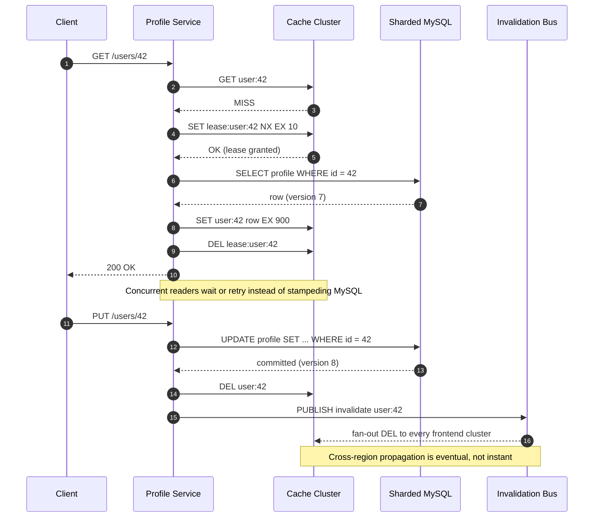

| Difficulty | Channel | Tags |
|---|---|---|
| beginner | backend | redis, memcached, cache-invalidation |

At Meta's scale, a single user editing a profile can set off a chain reaction across thousands of cache servers. In the paper describing Facebook's memcached deployment, engineers documented a look-aside cache in front of sharded MySQL serving profiles and social graph objects, where one update had to invalidate copies spread across many frontend clusters without letting a concurrent read resurrect stale data [1]. The numbers are staggering: billions of requests per second, trillions of cached items, and more than a billion users [1]. What follows is the playbook those engineers—and every team building a profile service—eventually learn.

---

> ### Real-World Case — Meta (then Facebook)
>
> Facebook used memcached as a look-aside cache in front of sharded MySQL for user-facing data, including profiles and social graph objects. A user update had to invalidate cached copies spread across many frontend clusters without allowing a concurrent read to write stale data back into the cache.
>
> | | |
> |---|---|
> | **Challenge** | At billions of requests per second and trillions of cached items, naive cache updates caused stale sets and thundering herds. Cross-region invalidation also had to tolerate replication lag, lost deletes, and packet amplification across many databases and memcached servers. |
> | **Solution** | Facebook wrote to MySQL first, then deleted the cache key instead of updating it, because deletes are idempotent. It introduced leases: a client that misses gets a token required to set the value, and a delete invalidates that token, preventing an old read from repopulating stale data. For distributed invalidation, mcsqueal daemons extracted cache keys from committed SQL, batched deletes through mcrouter, and replayed them from reliable logs. |
> | **Outcome** | The system handled billions of requests per second and trillions of items for over a billion users. Leases cut the peak database query rate for thundering-herd-prone keys from 17K/s to 1.3K/s, roughly a 92% reduction, while batching improved the median number of deletes per packet by 18x. Local invalidations achieved four nines of reliability within 1 second and five nines within an hour, though cross-region deletes only reached three nines within a second. |
> | **Lesson** | Cache invalidation is a distributed consistency protocol, not a single cache API call. Deleting an idempotent key and fencing repopulation with leases is safer than write-through updates under concurrency, and the invalidation pipeline often determines consistency more than the cache engine itself. |

---

## Hook — The Profile Update That Wouldn't Stick

Picture a user changing a display name. The write hits your profile service, commits to MySQL, and deletes the cache key. Done, right? Not even close. That user has requests in flight across a dozen frontend clusters, each with its own local cache, each answering reads from a copy of the old profile. One of those reads missed, fetched the old row, and is about to write it back into the cache a few milliseconds after your delete lands. Congratulations: the stale name is now the freshest thing in your system.

This is the part of caching that tutorials skip. Setting a TTL feels like insurance, but a 15-minute TTL also means 15 minutes of wrong data—and on a profile page, wrong data is visible, embarrassing, and occasionally a support ticket. At small scale you can delete a key and move on. At large scale, invalidation becomes a distributed systems problem with races, fan-out, and a very loud pager.

💡 Insight: The hard part of caching is not storing data. It is agreeing on when that data stops being true.

The stakes rise fast. A stale profile is annoying. A stale permissions flag, account status, or privacy setting is a security incident. So how do you keep a cache fast without letting it lie? That question is where the journey starts.

## Problem — When Deleting a Key Isn't Enough

The naive invalidation recipe sounds airtight: on update, write the database, then delete the cache key. In practice, three failure modes show up almost immediately.

First, the read-repair race. A reader misses the cache, queries the database, and gets the old value. Meanwhile the writer commits the new value and deletes the key. The reader then writes the old value into the cache. The delete already happened, so nothing cleans it up. Many developers assume delete-after-write is enough until they see this interleaving in production.

Second, the thundering herd. A hot key expires and hundreds of concurrent requests all miss at once. Every one of them queries the database. This is exactly the workload that caches exist to prevent, and it turns a routine expiration into a traffic spike [1].

Third, multi-cluster fan-out. A single logical cache is often dozens of physical clusters behind regional load balancers. Deleting a key in one cluster does nothing for the others. Without a coordination channel, stale data survives wherever the delete did not reach.

⚠️ Watch Out: TTL is a safety net, not an invalidation strategy. A long TTL hides races; a short TTL hides them less but pushes load onto the database.

The core tension is simple and unforgiving: consistency, latency, and database load pull in different directions [2]. You cannot max out all three. The rest of this article is about choosing which one to bend—and how companies with real traffic have bent it.

## Real-World Case — Meta (then Facebook)

Facebook's memcached deployment is the canonical war story because the company published the numbers. The system used memcached as a look-aside cache in front of sharded MySQL for user-facing data, including profiles and social graph objects. It handled billions of requests per second and trillions of cached items for over a billion users [1].

Two techniques did most of the heavy lifting. Leases let one request fetch a missing value while other requests for the same key waited briefly or retried, instead of stampeding the database. The result: peak database query rate for thundering-herd-prone keys dropped from 17K/s to 1.3K/s, roughly a 92% reduction [1]. Batching improved the median number of deletes per packet by 18x, which matters when invalidation traffic itself becomes a bandwidth problem [1].

The reliability numbers tell an equally important story. Local invalidations achieved four nines of reliability within one second and five nines within an hour, but cross-region deletes only reached three nines within a second [1]. In other words, even a company operating at that scale could not make global invalidation instantaneous. They made it fast locally and eventual globally, then designed around the gap.

🎯 Key Point: Facebook did not eliminate staleness. They bounded it, measured it, and made the common case—same-region reads—extremely fresh.

That distinction is the plot twist. The goal is not a perfectly consistent cache. The goal is a cache whose staleness window is known, short enough for the product, and observable when it breaks.

## Deep Dive — Write-Through, Cache-Aside, and the Redis vs Memcached Fork

There are two patterns worth separating before comparing products. Cache-aside (look-aside) means the application reads the cache first, then the database on a miss, and populates the cache itself [7]. Write-through means the application writes to the cache and the database together, keeping the cache warm and consistent on the write path. For profiles, a pragmatic hybrid is common: cache-aside on reads, write-through-ish behavior on writes by updating the database and deleting the key rather than overwriting it.

Why delete instead of set? Because concurrent writes can arrive out of order, and a blind set can leave an older value winning. Deleting forces the next reader to rebuild from the database, which is the source of truth. The trade-off is a guaranteed miss after every write, which is why TTLs and leases exist to soften the stampede [2][8].

Here is where the Redis versus Memcached decision actually bites:

| Dimension | Redis | Memcached |
|---|---|---|
| Invalidation | Built-in pub/sub fan-out across nodes [11] | Manual coordination; clients handle distribution [5] |
| Data model | Strings, hashes, sets, streams, sorted sets [6] | Flat key-value blobs [5] |
| Persistence | Snapshots and append-only file options [6] | Memory only; restart means cold cache [5] |
| Memory overhead | Higher per key and per instance | Lower per key, leaner for pure caching |
| Horizontal scaling | Cluster mode with more operational moving parts | Simple consistent-hash clients and sharding |
| Best fit | Complex invalidation, durability, queues, rate limits | Massive ephemeral caching with simple semantics |

The counterintuitive part: Redis is not automatically the better cache. If you only need to store blobs and evict them, Memcached's simplicity is a feature, not a limitation [5]. Redis wins when invalidation itself needs infrastructure—pub/sub channels, sorted-set indexes, and durable state that survives a restart [6][11].

🔥 Hot Take: Choose Memcached when you want a cache. Choose Redis when you want a cache plus a messaging system, a lock service, and a data structure toolbox—then accept the operational weight that comes with it.

## Workflow — From Read Miss to Global Invalidation

A production-grade profile cache follows a repeatable path. The diagram below tells the story: leases guard the read path, deletes guard the write path, and a bus fans invalidation out to every cluster.

1. Read the cache. On a hit, return immediately. This is the fast path and should handle the vast majority of traffic.
2. On a miss, acquire a short lease for the key. Only the lease holder queries the database; everyone else waits briefly or retries [1].
3. Populate the cache with a TTL—5 to 30 minutes is a reasonable starting range for profiles—then release the lease.
4. On update, commit to the database first. The database is the source of truth; the cache is a derived view.
5. Delete the key in the local cluster, then publish an invalidation event to a bus or pub/sub channel [11].
6. Let every cluster consume the event and delete its local copy. Treat this as eventual, not instant [1].
7. Monitor hit rate, lease contention, invalidation lag, and database query rate. If invalidation lag grows, you have a correctness problem, not just a performance one.

The sequence diagram captures the two paths side by side: the lease-protected read and the fan-out invalidation after a write. Notice that the diagram deliberately shows cross-region propagation as eventual. That is not a flaw to hide; it is a constraint to design around.

## Code Example — A Lease-Aware Profile Cache in Python

The snippet below implements the core read and write paths with Redis: lease-based miss handling to prevent stampedes, a bounded TTL, delete-on-update, and a pub/sub invalidation message. It is intentionally small enough to read in one sitting, but the structure mirrors production code.

The read path first checks the cache, then attempts an atomic lease with SET NX EX. Only the lease holder hits the database. The finally block releases the lease only if this request still owns the token, which prevents one request from deleting another request's lease after a timeout. The fallback path rechecks the cache before hitting the database, so waiting readers often get the freshly populated value instead of stampeding.

The write path commits to the database before touching the cache. It then deletes the key locally and publishes an invalidation event so peer clusters can delete their copies. Deleting rather than overwriting avoids the out-of-order write problem, and the event timestamp gives consumers a way to ignore stale invalidations.

## Lessons Learned — What Survives Contact With Production

Here is what holds up after the tutorials end and real traffic begins.

- **Delete on write, do not blindly overwrite.** Overwrites race; deletes force a rebuild from the source of truth [7].
- **Use leases or request coalescing for hot keys.** This is the single highest-leverage fix for thundering herds, and Meta's 92% reduction shows the payoff [1].
- **Treat TTL as a bound on staleness, not a strategy.** Pick a TTL based on how wrong the product can tolerate being, then measure the actual invalidation lag [2].
- **Design for eventual global invalidation.** Even Facebook saw cross-region deletes at three nines within a second while local invalidation reached four nines [1].
- **Separate the cache from the coordination layer.** Pub/sub in Redis is convenient [11], but a dedicated bus or change-data-capture stream scales further when fan-out grows.
- **Watch the cache, not just the database.** Hit rate, eviction rate, lease contention, and delete throughput are leading indicators of an incident.

⚠️ Battle scar: teams often add a cache to fix latency, then discover they have built a distributed consistency problem with no observability. Add metrics before you add the cache, not after.

If this feels overwhelming, you are not alone. Most teams learn invalidation the hard way—one stale profile at a time. The good news is that the patterns are well understood, and the failure modes are predictable once you name them.

---

## Lease-Based Read and Invalidation Flow

<strong>Original Interview Question</strong>

**Q:** You're building a user profile service that caches frequently accessed profiles. How would you implement cache invalidation when a user updates their profile, and what trade-offs would you consider between Redis and Memcached?

**A:** Implement write-through caching with TTL-based expiration. On profile update, invalidate the cache by deleting the key and writing new data to both the database and cache. Redis offers pub/sub for automatic distributed invalidation, while Memcached requires manual coordination across nodes.

## Conclusion

The journey ends where it began: a user edits a profile, and the system has to decide how quickly every other copy of that profile becomes wrong. Meta's answer was not a magic cache. It was leases to protect the read path, batching to survive the write path, and an honest acceptance that global invalidation is eventual [1]. You can apply the same thinking tomorrow: delete on write instead of overwriting, add a lease or request coalescing for hot keys, pick a TTL based on tolerable staleness, and measure invalidation lag as a first-class signal. The one insight worth sharing with your team is this: a cache is not a performance feature. It is a consistency boundary you chose to accept, and invalidation is how you keep that boundary honest.

---

## References

1. [Meta (then Facebook) incident report](https://www.usenix.org/conference/nsdi13/technical-sessions/presentation/nishtala) — article
2. [Cache invalidation](https://en.wikipedia.org/wiki/Cache_invalidation) — documentation
3. [Cache (computing)](https://en.wikipedia.org/wiki/Cache_(computing)) — documentation
4. [Redis](https://en.wikipedia.org/wiki/Redis) — documentation
5. [Memcached on GitHub](https://github.com/memcached/memcached) — documentation
6. [Redis documentation](https://redis.io/docs/latest/) — documentation
7. [Cache-Aside pattern](https://learn.microsoft.com/en-us/azure/architecture/patterns/cache-aside) — documentation
8. [Amazon ElastiCache caching strategies](https://docs.aws.amazon.com/AmazonElastiCache/latest/red-ug/Strategies.html) — documentation
9. [HTTP caching](https://developer.mozilla.org/en-US/docs/Web/HTTP/Guides/Caching) — documentation
10. [RFC 9111: HTTP Caching](https://datatracker.ietf.org/doc/html/rfc9111) — documentation
11. [Redis Pub/Sub documentation](https://redis.io/docs/latest/develop/interact/pubsub/) — documentation

---

**Author:** Satishkumar Dhule — [GitHub](https://github.com/satishkumar-dhule) · [LinkedIn](https://linkedin.com/in/satishkumar-dhule) · [Website](https://satishkumar-dhule.github.io)
