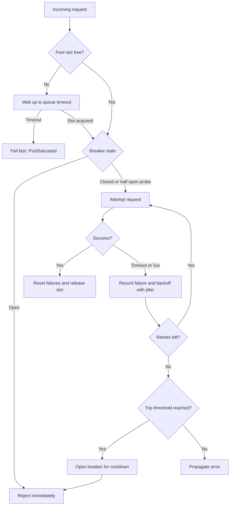

| Difficulty | Channel | Tags |
|---|---|---|
| advanced | backend | asyncio, aiohttp, concurrency |

The dashboard looked calm. That was the problem. One downstream service had quietly doubled its response time, and your aiohttp workers were doing what well-meaning code always does under pressure: holding on, retrying, and opening more connections until a dependency that normally saw 300 connections was staring at 2,000. Netflix documented exactly this spiral in its Hystrix operations guide, where a single slow dependency turned modest connection counts into a self-inflicted outage [1]. The fix was not a bigger pool. It was a pool that knows when to say no.

---

> ### Real-World Case — Netflix
>
> Netflix's API handled more than 1 billion incoming calls per day, fanning out roughly 6x to several billion dependency calls, with peaks above 100,000 dependency requests per second. When a single downstream service slowed down, requests piled up against it: a dependency that normally held 200-300 connections ballooned to 1,000 and then 2,000 as retries and hung connections compounded the problem.
>
> | | |
> |---|---|
> | **Challenge** | Prevent one slow or failing dependency from exhausting the connection pool and cascading into a cluster-wide outage — without simply adding more connections, which just pushed the overload onto the downstream service. |
> | **Solution** | Netflix wrapped every dependency call in a Hystrix command with bounded thread-pool or semaphore isolation (the bulkhead pattern), strict timeouts, fallbacks, and a circuit breaker that trips when the error rate exceeds roughly 50% over a 10-second window. Open circuits fail fast instead of retrying, releasing pressure so the dependency can recover. |
> | **Outcome** | The system now executes 10+ billion thread-isolated and 200+ billion semaphore-isolated commands per day across 40+ thread pools, with Netflix reporting a dramatic improvement in uptime and resilience. The concrete pool example showed that aggressively limiting concurrency and failing fast stops the 200-300 → 1,000 → 2,000 connection spiral. |
> | **Lesson** | A semaphore or max_connections limit alone does not give you graceful degradation — without fail-fast circuit breaking, timeouts, and retries that respect the breaker, a saturated pool amplifies the outage. Bound concurrency, isolate each dependency, and deliberately stop calling a failing service so it can heal. |

---

## Hook — The Night the Pool Became the Problem

Picture a service that fans out to ten dependencies per request. Traffic is steady, p99 latency is boring, and the connection pool has never been a topic in standup. Then one dependency slows from 80ms to 900ms. Nothing crashes. That is precisely why it is dangerous. Your requests now occupy their pool slots roughly eleven times longer, so the same traffic demands far more concurrency. The pool grows, the dependency gets more load, latency climbs further, and retries add fuel. Within minutes, the pool is not protecting the dependency — it is a megaphone telling the dependency to work harder while it is already drowning.

This is the uncomfortable truth many developers learn the hard way: a connection pool without admission control is just a connection counter. It tells you how many sockets exist, not whether opening them is a good idea. The interesting engineering happens before a socket is opened and after a failure is recorded.

Here is the tension you have to design around. Limit concurrency too tightly and legitimate bursts get rejected. Limit it too loosely and a single slow dependency takes down everything behind it. There is no magic number that satisfies both, which is why production systems combine several mechanisms instead of trusting one setting.

Keep that image in mind — a calm dashboard, a slow dependency, and a pool quietly making things worse — because that is the exact failure mode the rest of this article dismantles.

## Problem — Why Async Pools Amplify Instead of Absorb

Async I/O removes threads, not queueing. A single event loop can hold thousands of in-flight requests, which feels like infinite capacity until a dependency stops cooperating. Three forces then compound.

First, fan-out multiplication. One user request becomes ten dependency calls, each consuming a slot. Add retries and the multiplier grows again. This is why Netflix saw roughly 6x fan-out across billions of daily calls [1]. Second, retry synchronization. When many clients fail at the same moment and retry on a fixed schedule, they return in a thundering herd, hitting an already-struggling service with a synchronized second wave. Exponential backoff with jitter exists specifically to break that synchronization [7][8]. Third, missing timeouts. A connection timeout without a read timeout is half a timeout; a read timeout without a total deadline is a suggestion. Without a deadline budget, a request can wait on connect, then wait on headers, then wait on body, each stage politely respecting its own limit while the caller's patience expires.

Many developers assume the aiohttp connector limit is the pool. It is not. The connector caps sockets, while an asyncio semaphore caps work admitted into your application logic [3][4]. These are different resources with different failure semantics.

| Control | What it limits | Fails how |
|---|---|---|
| Connector limit | Open sockets per session or host | Queues inside the connector, often invisibly |
| Semaphore | Concurrent in-flight operations | You choose: wait briefly, then reject |
| Request deadline | Wall-clock time per call | Cancels work and frees the slot |
| Retry budget | Total attempts across a call | Caps amplification |

The stakes are not abstract. A saturated pool turns a partial dependency slowdown into a full outage because every endpoint shares the same event loop and the same slots. The question becomes: what does your system do in the first 30 seconds of that slowdown?

## Real-World Case — Netflix and the Connection Spiral

Netflix's API handled more than 1 billion incoming calls per day, fanning out roughly 6x to several billion dependency calls, with peaks above 100,000 dependency requests per second [1]. At that scale, a single misbehaving dependency is not an edge case; it is a certainty.

The documented failure pattern is chillingly ordinary. When one downstream service slowed, requests piled up against it. A dependency that normally held 200 to 300 connections ballooned to 1,000 and then 2,000 as retries and hung connections compounded the problem [1]. Nothing in that description is Netflix-specific. Replace the numbers with your own and the shape is identical: slower dependency, longer hold times, more concurrent connections, more retries, more load.

Netflix's answer was aggressive isolation rather than larger pools. Bulkheads partitioned concurrency so one dependency could not consume every slot, and fail-fast behavior stopped callers from waiting on work that had no chance of succeeding [1]. The result was dramatic in both scale and reliability: the system now executes more than 10 billion thread-isolated and 200 billion semaphore-isolated commands per day across 40-plus thread pools, with a reported improvement in uptime and resilience [1].

The concrete lesson from the pool example is blunt. Limiting concurrency harder, and failing fast sooner, broke the 200 to 300, then 1,000, then 2,000 connection spiral [1]. A smaller pool with a fast rejection path outperformed a larger pool that absorbed everyone's hope. That is counterintuitive until you have watched a pool grow during an incident and realized the growth is the incident.

Google's SRE guidance reaches the same conclusion from a different angle: overload is managed by rejecting or degrading work early, not by queueing it until memory or patience runs out [9]. Netflix simply had the numbers to prove it publicly.

## Deep Dive — Four Layers That Turn a Pool Into a Shield

A resilient manager is not one clever class. It is four layers, each answering a different question.

**Admission control.** A semaphore answers: should this request enter at all? Acquire with a short timeout, then fail fast when the pool is saturated. Waiting forever converts load into latency, and latency is how a pool becomes a memory leak with better branding [4]. Size this from concurrency, not vibes: concurrency equals arrival rate multiplied by service time. If you handle 500 requests per second at 100ms, you need about 50 concurrent slots, not 500.

**Deadline budget.** Every call needs a total deadline and per-stage bounds. aiohttp's ClientTimeout separates connect, socket read, and total time, which lets you reject a dead host quickly while still allowing a slow but healthy body [2][3]. The subtle rule: the caller's deadline must be shorter than its own caller's deadline. Otherwise you are the slow dependency.

**Retry with jitter.** Retries are amplification unless bounded. Use exponential backoff with random jitter, cap total attempts, and never retry non-idempotent operations blindly [7][8]. A 429 or 503 is a signal to slow down; RFC 7231 defines 503 as temporary overload and even defines Retry-After for this purpose [10][11]. Honor it when present.

**Circuit breaker.** This answers: is calling this dependency currently worth attempting? Three states matter. Closed passes traffic and counts failures. Open rejects immediately for a cooldown. Half-open permits a probe so recovery is discovered rather than assumed [6]. Half-open is where most implementations break: without a lock, a hundred probes rush in and recreate the surge.

💡 Insight: The breaker protects the dependency and your event loop simultaneously. Rejecting in microseconds frees slots for healthy traffic, which is the actual graceful degradation.

⚠️ Watch Out: The common aiohttp pattern of returning a ClientResponse from inside an async with block gives the caller a closed response. Read the body or stream it before leaving the context manager. This bug hides in code reviews because the types look fine.

## Workflow — From Load Spike to Controlled Rejection

Here is the sequence that keeps a slow dependency from becoming a platform outage. The Mermaid diagram below traces one request through every gate.

1. Measure the baseline. Record p50, p95, and p99 latency per dependency and the current in-flight count. Without this, pool sizing is guesswork.
2. Compute a starting concurrency budget. Use arrival rate times service time, then add a small safety margin. Set connector limits per host so one dependency cannot monopolize sockets [3].
3. Layer the timeouts. Connect timeout of a few seconds, socket read timeout below the total, and a total deadline below the caller's remaining budget [2].
4. Acquire admission with a bounded wait. If the semaphore cannot be acquired within a short queue timeout, raise a saturation error immediately. This is the fail-fast moment [4].
5. Check the breaker. If open, reject without touching the network. If half-open, allow exactly one probe [6].
6. Attempt the request with bounded retries and jittered delays. Record success or failure on every attempt so the breaker sees reality [7][8].
7. Emit metrics: admitted, rejected, retried, breaker state, queue wait time. These four signals explain nearly every incident.
8. Close cleanly. Cancel background tasks, close the session, and drain the connector on shutdown. Leaked sessions show up as warnings and, eventually, as mysterious hangs.

The diagram is the contract: nothing reaches the network without passing admission, breaker, and deadline checks in that order.

The ordering is deliberate. If you check the breaker after acquiring a slot, rejected requests still hold capacity. If you retry before recording failure, the breaker never learns.

## Code Example — A Pool Manager That Refuses to Drown

The implementation below combines the four layers in roughly 90 lines. It is intentionally small enough to read during an incident and structured so each concern can be tested independently.

Three design decisions deserve attention. First, admission uses wait_for around semaphore.acquire so queue time is bounded and observable; a saturated pool produces an immediate, typed error instead of a mysterious stall. Second, the breaker owns its own lock, because half-open transitions are a classic race: without the lock, concurrent callers all observe half-open and all probe at once [6]. Third, fetch returns bytes, not a ClientResponse, because returning a response after its context manager exits hands the caller a closed object — the bug mentioned earlier.

The timeout split matters too. A short connect timeout catches dead hosts, a socket read timeout catches stalled servers, and the total deadline prevents a slow trickle from holding a slot indefinitely [2]. The connector is configured separately with per-host limits, so the socket layer and the admission layer enforce different ceilings on purpose [3].

Retries use exponential backoff plus a small random jitter. The jitter is not decoration; it desynchronizes clients that failed together, which is the documented remedy for retry storms [7][8]. Every attempt records success or failure with the breaker, so the failure threshold reflects actual attempts rather than user-visible requests.

This example skips Retry-After parsing for clarity, but production code should honor it when a 429 or 503 arrives [10][11]. It also assumes idempotent GETs; for writes, gate retries behind an explicit idempotency key. Finally, wire the manager into application startup and shutdown so the session is created once and closed exactly once. Creating a session per request is the fastest way to defeat the entire design.

## Lessons Learned — What to Change Tomorrow

**A pool is a policy, not a number.** The connector limit says how many sockets may exist. Your semaphore, timeout, retry, and breaker settings decide what happens when that number is not enough.

**Fail fast is a feature, not a failure.** Netflix's numbers show that tighter concurrency limits and immediate rejection stopped a 200 to 2,000 connection spiral [1]. Users get a clean error in milliseconds instead of a timeout after 30 seconds, and healthy requests keep flowing.

**Retries without jitter are a self-DDoS.** Fixed-interval retries synchronize clients into waves [7]. Add jitter, cap attempts, and respect Retry-After on 503 responses [8][10][11].

**Half-open needs a lock.** Without one, recovery becomes a stampede and the breaker oscillates. One probe, then decide [6].

**Timeout budgets must nest.** Your deadline must be shorter than your caller's remaining budget, or you become the slow dependency in someone else's incident.

**Never return a closed response.** Read or stream the body inside the context manager. This single mistake invalidates most hand-rolled aiohttp wrappers.

**Measure admission, not just latency.** Track rejected count, queue wait time, retries per request, and breaker state transitions. Latency alone hides the moment a pool starts protecting itself by rejecting traffic.

Battle scars worth remembering: sessions created per request, missing SSL context validation, cleanup skipped on shutdown, and semaphores shared across unrelated dependencies so one slow service starves everything else. Each is a one-line fix that prevents a very long night.

If this feels like a lot, start with two changes: bound your semaphore wait and add jitter to retries. Those alone remove most of the amplification. Then add the breaker when you have metrics to tune it.

The memorable version: capacity is not how much you can accept, it is how much you can refuse without collapsing.

---

## Request Flow Through the Pool

<strong>Original Interview Question</strong>

**Q:** How would you implement a connection pool manager for aiohttp that handles graceful degradation under high load and connection timeouts?

**A:** Implement a connection pool manager for aiohttp using a semaphore to limit concurrent connections, exponential backoff for retrying failed requests, and circuit breaker pattern to gracefully degrade under high load and connection timeouts.

## Conclusion

Netflix did not fix its connection spiral by buying a bigger pool. It fixed it by refusing work earlier, isolating concurrency, and failing fast [1]. The same principle fits in a single aiohttp class: bound admission, layer deadlines, jitter retries, and trip a breaker with a properly locked half-open probe. Start tomorrow with the two cheapest wins — a bounded semaphore wait and jittered backoff — then add metrics for rejected requests and breaker transitions so the next tuning decision is evidence-based. The insight worth sharing with your team: a resilient pool is measured by what it refuses, not by what it accepts.

---

## References

1. [Netflix incident report](https://github.com/Netflix/Hystrix/wiki/Operations) — article
2. [aiohttp Client Advanced Usage](https://docs.aiohttp.org/en/stable/client_advanced.html) — documentation
3. [aiohttp Client Reference](https://docs.aiohttp.org/en/stable/client_reference.html) — documentation
4. [Python asyncio Synchronization Primitives](https://docs.python.org/3/library/asyncio-sync.html) — documentation
5. [Python asyncio Queues](https://docs.python.org/3/library/asyncio-queue.html) — documentation
6. [Circuit Breaker Design Pattern](https://en.wikipedia.org/wiki/Circuit_breaker_design_pattern) — documentation
7. [Exponential Backoff](https://en.wikipedia.org/wiki/Exponential_backoff) — documentation
8. [Timeouts, Retries, and Backoff with Jitter](https://aws.amazon.com/builders-library/timeouts-retries-and-backoff-with-jitter/) — article
9. [Site Reliability Engineering: Handling Overload](https://sre.google/sre-book/handling-overload/) — documentation
10. [HTTP 503 Service Unavailable](https://developer.mozilla.org/en-US/docs/Web/HTTP/Status/503) — documentation
11. [RFC 7231: HTTP/1.1 Semantics and Content](https://datatracker.ietf.org/doc/html/rfc7231) — documentation

---

**Author:** Satishkumar Dhule — [GitHub](https://github.com/satishkumar-dhule) · [LinkedIn](https://linkedin.com/in/satishkumar-dhule) · [Website](https://satishkumar-dhule.github.io)
