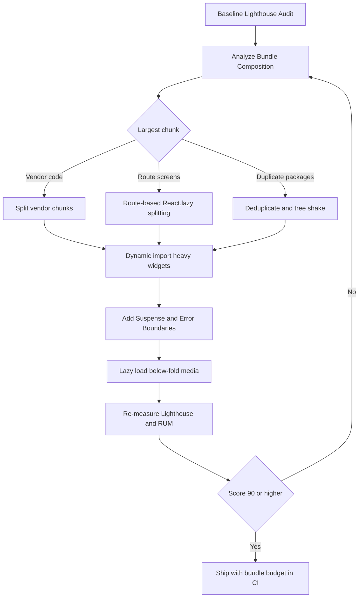

| Difficulty | Channel | Tags |
|---|---|---|
| intermediate | frontend | lighthouse, bundle, lazy-loading |

In 2017, Pinterest's mobile web experience was bleeding users before they ever saw a pin. The site shipped more than 2.5MB of JavaScript and took roughly 23 seconds to become interactive on average mobile hardware, while mobile web signups sat below 10% of desktop's [1]. Picture the business conversation: every extra second was a quiet rejection, not a vanity metric. The team did not tweak a spinner or compress an image; they rebuilt the experience as a React, Redux, and webpack progressive web app, and the results became a blueprint for every performance rescue since [1][11].

---

> ### Real-World Case — Pinterest
>
> In 2017, Pinterest rebuilt its mobile web experience as a React, Redux, and webpack Progressive Web App after the old site shipped over 2.5MB of JavaScript and took roughly 23 seconds to become interactive on average mobile hardware. Mobile web signups were less than 10% of desktop's, so performance was a direct business problem.
>
> | | |
> |---|---|
> | **Challenge** | Pinterest's JavaScript was effectively a monolith: a huge main bundle plus lazily loaded route code that duplicated shared dependencies across async chunks. Users paid a massive download, parse, and compile cost before the UI was usable, and route-based splitting alone was not enough because duplicated vendor code and inefficient chunk boundaries undermined caching and loading. |
> | **Solution** | Pinterest used webpack Bundle Analyzer to find duplicate code across async route chunks, then split bundles into a cacheable vendor chunk, an entry chunk containing common libraries and the app shell, and small async route chunks loaded through React Router. They combined route-level code splitting with component-level lazy loading via a shared Loader component, moved duplicated common code into the entry chunk, and added a route-preloading system plus service worker caching so lazy routes still felt instant to navigate. |
> | **Outcome** | The core bundle dropped from 650KB to 150KB, and the homepage JavaScript payload fell from about 490KB to 190KB. First Meaningful Paint improved from 4.2s to 1.8s, Time to Interactive dropped from 23s to 5.6s, and repeat visits reached 3.9s TTI. Pinterest also reported 40% more time spent, 44% higher user-generated ad revenue, and 60% higher core engagement. |
> | **Lesson** | The counterintuitive part: the best result did not come from lazily splitting everything. Moving shared code into the entry chunk made it 20% larger, but cut async route chunks by 60-90%, eliminating duplicated downloads. Code splitting only works when bundle boundaries follow real shared dependencies, and lazy routes need preloading to avoid trading a slow initial load for slow navigation. |

---

## Hook — The 23-Second Wait That Cost Pinterest Millions

Imagine handing a user a shopping cart, then locking the doors for 23 seconds. That was effectively Pinterest's mobile web experience in 2017: a JavaScript payload north of 2.5MB, an interactive delay measured in tens of seconds, and a signup rate that trailed desktop by more than 90% [1]. The uncomfortable truth is that this was not a bug in a single feature. It was the accumulated cost of a thousand reasonable decisions — another dependency, another analytics SDK, another rich component loaded on every page.

What makes the Pinterest story worth studying is not the size of the disaster. It is the size of the recovery. The team rebuilt the mobile web app as a React, Redux, and webpack progressive web app and cut the core bundle from 650KB to 150KB [1]. First Meaningful Paint fell from 4.2s to 1.8s. Time to Interactive dropped from 23s to 5.6s, and repeat visits reached 3.9s [1].

💡 **Insight:** Performance work is rarely about one heroic optimization. It is about systematically removing weight from the critical path until the product feels inevitable again.

That is the journey ahead: a 65 Lighthouse score, a 2.1MB bundle, a 4.2s Time to Interactive, and a repeatable playbook for getting to 90+. The stakes are not abstract. They are signups, engagement, and revenue.

## Problem — When 4.2 Seconds Feels Like a Broken Product

Your dashboard looks fine on the office Wi-Fi and a maxed-out laptop. Then a product manager opens it on a three-year-old Android phone during a train commute, and the page becomes a blank rectangle with a spinning logo. The numbers tell the same story: Lighthouse 65, bundle size 2.1MB, Time to Interactive 4.2s. None of those values is catastrophic in isolation. Together, they describe a product that asks users to wait before it earns their attention.

Lighthouse scores are not linear, and that trips up many developers. Moving from 65 to 75 can be a few targeted fixes; moving from 85 to 95 often requires rethinking what loads, when it loads, and why it exists at all [10]. Time to Interactive is similarly misunderstood. It measures the moment the page has rendered useful content and can reliably respond to input within a short window, not merely the moment the first pixel appears [9]. A page can look ready while the main thread is still choking on hydration and third-party scripts.

Here is the part that turns a technical metric into a business problem: users do not compare your app to its previous version. They compare it to every other tap they made that morning. A slow first interaction feels like a broken product, not a performance regression. Consequently, teams often respond by adding a loading spinner, which improves the perception of progress without improving the underlying experience.

⚠️ **Watch Out:** Optimizing only the Lighthouse lab score can produce a hollow win. A page can score 95 in a controlled environment and still feel slow on a mid-tier phone with a cold cache and a congested network. Always pair lab metrics with real-user monitoring.

The core challenge, therefore, is not simply making files smaller. It is deciding which code deserves to be on the critical path and which code can wait until the user actually needs it.

## Real-World Case — Pinterest's Progressive Web App Rebuild

Pinterest did not stumble into its performance crisis. The company had built a rich, feature-dense mobile web experience, and every feature brought JavaScript with it. By 2017, the old site shipped over 2.5MB of JavaScript and took roughly 23 seconds to become interactive on average mobile hardware [1]. Mobile web signups were less than 10% of desktop's, making performance a direct business problem rather than an engineering vanity project [1].

The rebuild was a ground-up bet on a React, Redux, and webpack progressive web app. Instead of shipping one monolithic bundle, the team split code along meaningful boundaries and loaded the rest on demand. The results were measured, public, and difficult to argue with:

| Metric | Before | After |
| --- | --- | --- |
| Core bundle | 650KB | 150KB |
| Homepage JS payload | ~490KB | ~190KB |
| First Meaningful Paint | 4.2s | 1.8s |
| Time to Interactive | 23s | 5.6s |
| Repeat-visit TTI | — | 3.9s |

Source: Pinterest engineering case study [1].

But the story does not end at faster paint times. Pinterest reported 40% more time spent, 44% higher user-generated ad revenue, and 60% higher core engagement after the rebuild [1]. Those numbers matter because they close the loop between engineering effort and business outcome. The team did not just make the site faster; it made the site more valuable to use.

🔥 **Hot Take:** The most important performance metric is not in Lighthouse. It is the number of users who stay long enough to complete the action your product exists for.

Building on this case, the next question is practical: what exactly made the bundle smaller, and which of those techniques can you apply to a 2.1MB React app without rewriting the whole product?

## Deep Dive — Where 2.1MB Actually Comes From

A 2.1MB bundle is rarely one giant file. It is a stack of decisions. Open a bundle analyzer and the composition usually falls into a few familiar buckets: framework and vendor code, route-level screens, shared UI components, third-party SDKs, polyfills, and duplicate versions of the same dependency pulled in by different packages [2]. The largest chunk is often not the code you wrote. It is the code you inherited.

Code splitting is the first lever. Route-based splitting turns each top-level screen into its own chunk, so a user visiting the dashboard does not download the analytics workspace, the settings panel, and the billing flow [3]. Component-based splitting goes finer: a heavy charting library or rich text editor loads only when that component renders [4]. The trade-off is real. Too little splitting leaves a monolithic download; too much splitting creates a waterfall of tiny requests and cache churn.

| Strategy | Best for | Main trade-off |
| --- | --- | --- |
| Route-based splitting | Distinct top-level screens | Shared code may be duplicated across chunks |
| Component-based splitting | Heavy widgets below the fold | Extra request when the component appears |
| Vendor splitting | Stable third-party libraries | Better long-term caching, more initial requests |
| Dynamic import on intent | Modals, editors, charts | Slight delay on first interaction |

Tree shaking is the second lever, and it only works when the toolchain cooperates. Modern bundlers remove unused exports from ES modules, but CommonJS packages, side-effectful imports, and barrel files can quietly defeat the optimization [6][7]. That is why a library you use for one function can still add hundreds of kilobytes. Setting `sideEffects: false` in your own package metadata and importing directly from module paths rather than giant index files often recovers more weight than expected.

Suspense and error boundaries are the third lever. `React.lazy()` defines a split point, but `Suspense` defines what the user sees while that split point resolves [4][5]. Without a thoughtful fallback, code splitting simply relocates the waiting. With one, the shell stays interactive while the heavy view loads in the background.

Consequently, the goal is not maximum splitting. It is intentional splitting: every chunk should correspond to a moment in the user's journey, and every fallback should preserve context rather than replace it with a spinner.

## Workflow — From 65 to 90+ Without Guesswork

Performance work fails when it starts with tactics instead of measurement. The workflow below is a loop, not a checklist, because every optimization changes the shape of the problem. The accompanying workflow diagram captures this loop from baseline audit to production monitoring.

1. **Establish a baseline.** Run Lighthouse on a throttled mobile profile, record the score, bundle size, First Contentful Paint, Largest Contentful Paint, and Time to Interactive. Save the report so future comparisons are honest [10].
2. **Analyze the bundle.** Generate a stats file and inspect it with webpack-bundle-analyzer. Identify the three largest chunks and the three largest third-party dependencies [2].
3. **Split by route first.** Convert top-level screens to `React.lazy()` imports wrapped in `Suspense`. This delivers the biggest initial-load win with the fewest architectural changes [3][4].
4. **Split heavy components second.** Charts, editors, maps, and modals should load only when rendered. Use dynamic imports rather than eager imports at module scope.
5. **Remove and deduplicate.** Delete unused dependencies, replace oversized libraries with smaller alternatives, and resolve duplicate versions of the same package. Verify tree shaking is actually working by comparing the analyzer output before and after [6][7].
6. **Lazy-load below-the-fold media.** Native `loading='lazy'` on images and iframes prevents off-screen assets from competing with the critical path [8].
7. **Prefetch on intent.** Warm likely next routes when a user hovers or focuses a navigation link. This hides latency without bloating the initial download.
8. **Re-measure and monitor.** Compare lab results, then validate with real-user monitoring. A score is a snapshot; field data is the truth.

🎯 **Key Point:** The order matters. Route splitting usually produces the largest improvement per unit of effort. Chasing tiny component splits before fixing the vendor bundle is like rearranging furniture while the roof leaks.

The workflow diagram for this article shows the decision loop: analyze, split, measure, and repeat until the score clears 90. Notice that the loop returns to analysis after every measurement. That is deliberate. Performance is a moving target, and a bundle that passes today can silently regress after the next dependency upgrade.

## Code Example — Route Splitting With Suspense and Intent Prefetching

The following example applies the first two workflow steps in code: route-level splitting, a shared error boundary, and intent-based prefetching. It is intentionally close to a production pattern rather than a toy demo, because the details that matter — fallback placement, error isolation, and prefetch timing — are exactly what separate a smooth experience from a janky one.

The key design decision is boundary placement. A single top-level `Suspense` boundary is simple, but it replaces the entire app with a fallback whenever any route loads. Placing a boundary inside the layout preserves the navigation shell and keeps the page feeling responsive [5]. The second decision is prefetching on hover or focus. It does not change the initial bundle, but it makes the next navigation feel instantaneous for users who signal intent before clicking.

## Lessons Learned — What to Do Differently Tomorrow

The Pinterest rebuild is a reminder that performance is a product feature, not a cleanup task. The company did not just shrink a bundle; it changed the economics of the mobile web experience and measured the business result [1]. Here is what that means for a team staring at a 65 score and a 2.1MB bundle:

- **Measure before you optimize.** A bundle analyzer turns opinion into evidence. Without it, teams routinely optimize the wrong chunk [2].
- **Split by user journey, not by file size.** Route boundaries map to how people actually navigate. Arbitrary splitting creates request waterfalls that feel slower, not faster [3].
- **Make tree shaking verifiable.** Check the analyzer output after configuration changes. If the unused export is still in the bundle, the optimization did not happen [6][7].
- **Treat fallbacks as UX, not afterthoughts.** A well-placed skeleton preserves layout and context; a full-screen spinner destroys both [5].
- **Lazy-load media aggressively.** Images below the fold should never compete with the JavaScript needed for first interaction [8].
- **Watch for regression.** Add a bundle-size budget to CI. The next dependency is always one pull request away.

⚠️ **Battle scar:** Many teams split a large component and celebrate the smaller initial bundle, only to discover the component now triggers a second network round trip at the worst possible moment. The fix is intent prefetching and a fallback that matches the final layout.

💡 **Insight:** The most durable performance improvement is a constraint, not a one-time cleanup. A CI budget and a real-user dashboard will protect the gains long after the optimization sprint ends.

The moral is simple: users do not experience bundle sizes. They experience the moment between intent and response. Pinterest closed that gap from 23 seconds to 5.6 seconds by making deliberate choices about what loads when [1]. Your 4.2-second problem is smaller, but the playbook is the same. Start with the analyzer, split the routes, measure again, and keep the loop running.

---

## Bundle Optimization Workflow

<strong>Original Interview Question</strong>

**Q:** You're tasked with improving a React app's Lighthouse performance score from 65 to 90+. The bundle size is 2.1MB and Time to Interactive is 4.2s. What specific steps would you take to optimize the bundle and implement lazy loading?

**A:** Implement code splitting with React.lazy() and Suspense, analyze bundle composition with webpack-bundle-analyzer to identify largest chunks, remove unused dependencies and optimize imports, add dynamic imports for heavy components and third-party libraries, implement route-based splitting for better initial load times, and utilize tree shaking with proper ES module configuration.

## Conclusion

Pinterest's recovery from a 23-second mobile web experience to a 5.6-second Time to Interactive was not a single optimization. It was a disciplined loop of measuring, splitting, removing, and re-measuring [1]. Your app does not need a full rebuild to follow the same path. Run the analyzer, split the routes, make tree shaking observable, place Suspense boundaries thoughtfully, and protect the result with a bundle-size budget in CI. The one insight worth sharing with your team is this: users never see your bundle size, but they feel every kilobyte that stands between intent and response.

---

## References

1. [Pinterest incident report](https://medium.com/dev-channel/a-pinterest-progressive-web-app-performance-case-study-3bd6ed2e6154) — article
2. [webpack-bundle-analyzer](https://github.com/webpack-contrib/webpack-bundle-analyzer) — documentation
3. [webpack Code Splitting Guide](https://webpack.js.org/guides/code-splitting/) — documentation
4. [React lazy Reference](https://react.dev/reference/react/lazy) — documentation
5. [React Suspense Reference](https://react.dev/reference/react/Suspense) — documentation
6. [Tree shaking](https://en.wikipedia.org/wiki/Tree_shaking) — documentation
7. [webpack Tree Shaking Guide](https://webpack.js.org/guides/tree-shaking/) — documentation
8. [MDN Lazy Loading](https://developer.mozilla.org/en-US/docs/Web/Performance/Lazy_loading) — documentation
9. [MDN Time to Interactive](https://developer.mozilla.org/en-US/docs/Glossary/Time_to_interactive) — documentation
10. [Lighthouse (software)](https://en.wikipedia.org/wiki/Lighthouse_(software)) — documentation
11. [Progressive web app](https://en.wikipedia.org/wiki/Progressive_web_app) — documentation
12. [MDN Code Splitting](https://developer.mozilla.org/en-US/docs/Glossary/Code_splitting) — documentation

---

**Author:** Satishkumar Dhule — [GitHub](https://github.com/satishkumar-dhule) · [LinkedIn](https://linkedin.com/in/satishkumar-dhule) · [Website](https://satishkumar-dhule.github.io)
