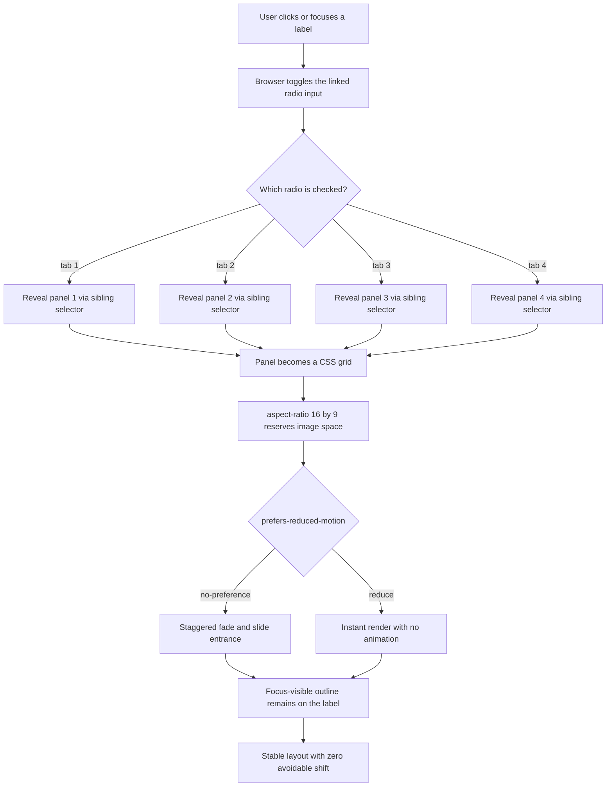

| Difficulty | Channel | Tags |
|---|---|---|
| beginner | frontend | css, flexbox, grid, animations |

A newsroom serving more than 22 billion page views a month noticed something small and expensive: its article hero images were arriving late, shoving headlines and body copy down the page as they loaded [1]. Yahoo! JAPAN News had known about the shift for a while, but it felt cosmetic until Core Web Vitals put a number on it in Search Console [1]. That number turned a design annoyance into a business problem. The same lesson applies to the humble CSS-only tab panel: if you can switch views without JavaScript but cannot keep the layout still, you have not solved the problem—you have moved it.

---

> ### Real-World Case — Yahoo! JAPAN
>
> Yahoo! JAPAN News serves more than 22 billion page views per month, and its article pages had a persistent Cumulative Layout Shift: the hero image loaded after the text, pushing the article body down. The team knew about the shift but had treated it as a low-priority cosmetic issue until Core Web Vitals made it visible in Search Console.
>
> | | |
> |---|---|
> | **Challenge** | Reserve the correct amount of space for images with varying aspect ratios before they load, while keeping images responsive and supporting browsers as old as iOS 9 that did not support the modern CSS aspect-ratio property. |
> | **Solution** | They used aspect ratio boxes: a wrapper with height: 0 and a padding-top percentage calculated from the image's known aspect ratio, with the image absolutely positioned inside. The backend API supplied the dimensions, so the browser could reserve the exact box before the image arrived. Modern implementations can use aspect-ratio: 16 / 9 on the card image container instead. |
> | **Outcome** | CLS in lab data fell from about 0.2 to 0, and URLs flagged as poor in Search Console dropped by 98%. Engagement improved: 15.1% more page views per session, 13.3% longer sessions, and a 1.72 percentage-point lower bounce rate. |
> | **Lesson** | A layout detail that looks cosmetic, such as an unreserved image box, can directly cost engagement. Reserve media space from a known aspect ratio before load; the same principle behind a fixed 16:9 card image is what prevents the page from jumping. |

---

## Hook — The Deploy Looked Clean

The deploy looked clean. The docs page rendered, the tabs switched, and no JavaScript error appeared in the console. Then Search Console started flagging article and documentation URLs as poor for Cumulative Layout Shift, and the culprit was not a broken script. It was space—or rather, the lack of it [6]. Images and tab panels were arriving after the text, and the browser was doing exactly what browsers do: reflowing everything around them.

That is the uncomfortable truth about CSS-only components. Removing JavaScript feels like a win, and it often is. But a radio-driven tab panel can still fail the same way a JavaScript-heavy page fails: it can move content after the user has started reading. The damage is quiet. A reader taps a tab, the cards appear, an image resolves a beat later, and the paragraph they were about to read jumps down the page.

Now picture a design-system docs page with four tabs and sixteen cards. Each card has a 16:9 image, a title, and a meta line. On desktop the cards sit in a 2×2 grid; on mobile they stack. The interaction is trivial. The stakes are not: every unnecessary shift erodes trust, and every missing focus ring locks out a keyboard user.

So here is the question worth carrying through the rest of this piece: can a component be completely JavaScript-free and still behave like a production-grade interface?

## Problem — JavaScript-Free Is Not Automatically Production-Grade

The problem is not that CSS-only tabs are impossible. They are almost suspiciously easy. A shared `name` attribute turns a set of radio inputs into a single-choice group, and a `` gives each radio a clickable proxy [3]. The `:checked` pseudo-class tells you which option is active, and a sibling combinator moves that state into the panel area [8]. No framework, no event listener, no hydration.

The hard part is everything around that trick.

- **Layout instability.** If the image area has no reserved dimensions, the card grows after the bitmap arrives. Multiply that by four cards and two breakpoints, and a fast connection can still produce a visibly jumpy page [6].
- **Keyboard traps and invisible focus.** Hiding the radio with `display: none` removes it from the tab order. Hiding it with `opacity: 0` keeps it focusable but leaves focus invisible unless you style the label [5].
- **Motion sensitivity.** A staggered entrance looks polished to some users and nauseating to others. Motion has to be optional, not mandatory [4].
- **Semantics drift.** A radio group is not the same thing as an ARIA tab widget. Screen readers will announce radios, and that may be perfectly fine for a documentation switcher—or completely wrong for an app shell.

Many developers discover this the hard way: the CSS passes review, the demo looks great, and then accessibility and performance audits find the gaps that visual inspection cannot. The component was never the hard part. The contract around it was.

So how did a company operating at a scale most teams will never touch turn exactly this kind of layout instability into a measurable win?

## Real-World Case — Yahoo! JAPAN News

Yahoo! JAPAN News serves more than 22 billion page views per month, which means small inefficiencies do not stay small [1]. On article pages, the hero image loaded after the text and pushed the article body downward. The team knew about the shift, but it had been filed away as a cosmetic annoyance—until Core Web Vitals made it visible in Search Console [1].

That visibility changed the priority. Layout shift stopped being a design nitpick and became a URL-level quality signal.

The results were not subtle:

- Lab-measured CLS fell from about **0.2 to 0** [1].
- URLs flagged as poor in Search Console dropped by **98%** [1].
- Page views per session rose **15.1%** [1].
- Session duration increased **13.3%** [1].
- Bounce rate fell by **1.72 percentage points** [1].

Those engagement numbers are the interesting part. A layout shift does not block content. It does something subtler: it interrupts reading, breaks the user's place, and makes the page feel less trustworthy. At Yahoo! JAPAN's scale, that friction compounds into real attention and real revenue.

The fix was not a heroic JavaScript rewrite. It was a discipline: reserve space before content arrives, treat stability as part of the design, and measure the result [1][6]. That same discipline is what separates a cute CSS-only tab demo from a component you can ship.

With the business case established, it is time to look at the machinery underneath the radio-and-label trick.

## Deep Dive — Radio Groups, Reserved Space, and the Accessibility Contract

At its core, the pattern is a state machine made of native form controls.

A radio group gives you mutual exclusivity for free. Every input shares the same `name`, so the browser guarantees that only one can be checked [3]. Each label points at one input with `for`, which means a click, tap, or spacebar press on the label toggles the input even though the input itself is visually hidden. The `:checked` pseudo-class exposes that state to CSS, and the general sibling combinator (`~`) lets a checked input style elements that come later in the same parent [8].

That last detail explains the markup order. The inputs and labels live together at the top of the component; the panels follow as siblings. The CSS can then say: when tab 2 is checked, show panel 2 and only panel 2.

Under the hood, four details do most of the work:

| Concern | CSS mechanism | Why it matters |
|---|---|---|
| Tab switching | `input:checked ~ .panel-stack .panel-N` | No JavaScript, no event listeners |
| Responsive cards | `grid-template-columns: repeat(2, minmax(0, 1fr))` | Two columns on desktop, one on mobile |
| Stable media | `aspect-ratio: 16 / 9` | Reserves the image box before the bitmap arrives [2] |
| Keyboard focus | `:focus-visible + label` | The focus ring appears on the visible control [5] |

The grid deserves a note. `repeat(2, 1fr)` looks harmless until a long unbroken string or a wide image forces a track to expand. `minmax(0, 1fr)` caps the track's minimum at zero, which lets content shrink instead of overflowing [7]. On small screens, a single-column override is enough.

Then there is the hidden-input decision. `display: none` is tempting because it removes the input from layout entirely. It also removes it from the tab order, which breaks keyboard access. The safer pattern is to keep the input in the accessibility tree and the focus order, then clip it visually.

Because the input remains focusable, `:focus-visible` can still fire. You then forward the visible ring to the adjacent label. That is the difference between a component that technically works and one a keyboard user can actually operate [5][9].

Here is the plot twist: **CSS-only tabs are not ARIA tabs.** The WAI-ARIA tabs pattern expects `role='tablist'`, `role='tab'`, `aria-selected`, and arrow-key navigation [9]. A radio group is announced as a radio group. For a simple docs section switcher, that native behavior is often clearer and more robust than a half-implemented ARIA widget. For an application shell with nested tab sets, roving tabindex, and deep linking, CSS-only is the wrong tool.

The other trade-off is motion. A CSS-only reveal can animate *in*, but it cannot easily animate *out*, because `display: none` removes the panel immediately. Entrance animation is the sweet spot. Exit choreography is where teams usually graduate to JavaScript—or decide they never needed it.

That is the full mental model. Next, turn it into a repeatable workflow.

## Workflow — From Label Click to Stable Panel

Treat the component as a sequence of guarantees rather than a pile of selectors. The flow below is the one that holds up in review.

1. **Start with content, not controls.** Write the cards first: title, meta line, and an image with meaningful alt text. If the content does not make sense without the tabs, the tabs are hiding a structure problem.
2. **Create one radio group.** Give every input the same `name`, a unique `id`, and a matching label. Keep the inputs focusable; clip them visually instead of using `display: none`.
3. **Bind state to panels.** Put the panels after the inputs in the same parent, then use `:checked` plus the general sibling combinator to reveal exactly one panel [8].
4. **Reserve every media box.** Apply `aspect-ratio: 16 / 9` and explicit `width` and `height` attributes on the image. The browser can then lay out the card before the file downloads [2][6].
5. **Make motion opt-in.** Wrap the stagger in `@media (prefers-reduced-motion: no-preference)`, and animate only `opacity` and `transform` [4][10].
6. **Verify the edges.** Tab through the component, switch tabs with the keyboard, emulate reduced motion, resize to 320px, and check CLS in the lab.

The accompanying diagram traces that journey from label click to stable panel. Notice where the stability guarantee sits: before animation, before styling polish, before any consideration of how the cards look. The space is reserved first. That ordering is deliberate, and it is the part teams skip when they are moving fast.

With the workflow defined, the implementation becomes a matter of encoding each guarantee in CSS.

## Code Example — Building the Component Without a Runtime

The example below writes a complete, standalone demo to disk. The JavaScript runs at build time; what reaches the browser is ordinary HTML and CSS, with no client-side runtime.

The important lines are not the ones that write a file. They are the ones that encode the contract:

- The radio inputs and labels are siblings of the panel stack, which is what makes the `~` selector work.
- Hidden inputs are clipped, not `display: none`, so keyboard focus survives.
- The checked-input rule reveals one panel and sets the two-column grid.
- `minmax(0, 1fr)` keeps long content from blowing out the tracks.
- The image uses `aspect-ratio` plus `width` and `height` attributes, so the box exists before the image does.
- The entire stagger lives inside `prefers-reduced-motion: no-preference`.

Run it with Node, open the generated file, and resize the window. The cards should collapse to one column, the focus ring should follow the labels, and the layout should stay put while images load.

The explanation below walks through the code section by section, including why the build-time split matters.

## Lessons Learned — What Survives Contact With Real Users

The component is small; the lessons are not.

**Stability is a feature, not polish.** Yahoo! JAPAN's CLS work did not make the news faster in a benchmark sense; it made the reading experience stop moving [1]. A tab panel earns the same trust by reserving space before content arrives.

**Hide controls visually, never from the keyboard.** `display: none` on a radio is the most common self-inflicted accessibility bug in this pattern. Clip it, keep it focusable, and put the ring on the label [5][9].

**Use `:focus-visible`, not `:focus`.** Mouse users do not need a persistent ring; keyboard users absolutely do [5].

**Opt into motion.** The default should be no animation, with a `no-preference` query adding the stagger. That inverts the usual mistake of animating first and patching accessibility later [4][10].

**Animate cheap properties.** `opacity` and `transform` can run on the compositor. Animating `height`, `top`, or `margin` forces layout and turns a 300ms entrance into a janky one.

**Know when to leave CSS-only behind.** If you need arrow-key navigation, `aria-selected`, URL state, or exit animations, use the ARIA tabs pattern with JavaScript [9]. CSS-only is a tool for simple, static section switching—not a religion.

**Battle scar to avoid:** hiding inactive panels with `opacity: 0` or `visibility: hidden` leaves their links and buttons in the tab order. Use `display: none` so hidden content is truly out of the way.

**Battle scar to avoid:** forgetting `minmax(0, 1fr)`. A single long URL in a card can push a two-column grid wider than its container, and the resulting horizontal scroll is its own kind of layout failure [7].

If this feels like a lot for a beginner component, you are not alone. The good news is that the checklist is short: stable media, visible focus, optional motion, and a clear decision about semantics. Ship those four things and the rest is styling.

---

## CSS-Only Tab State Flow

<strong>Original Interview Question</strong>

**Q:** Build a CSS-only tab panel for a design-system docs page. Use radio inputs to switch tabs (no JavaScript). Desktop: a 2x2 grid of cards under each tab; mobile: single column. Each card has a fixed 16:9 image area, a title, and a short meta line. Add a subtle entrance animation with a stagger and keep focus-visible outlines; ensure prefers-reduced-motion is respected?

**A:** Use a set of radio inputs with a shared `name` attribute and corresponding `` elements for each tab section. The `:checked` state of each radio controls visibility of its associated panel via adjacent sibling selectors. Each panel renders a 2×2 card grid on desktop and collapses to a single column on mobile. Cards use `aspect-ratio: 16/9` for fixed image containers, with a title and meta line below.

## Conclusion

Yahoo! JAPAN News did not fix 22 billion monthly page views with a clever abstraction. The team fixed a layout that moved when it should have stayed still, and the metrics followed: CLS from roughly 0.2 to 0, poor URLs down 98%, and measurably deeper engagement [1].

The same principle scales down to a single docs component. A CSS-only tab panel is not impressive because it avoids JavaScript. It is impressive because the cards never jump, the focus ring never disappears, and the animation never ignores a user's motion preference.

The memorable insight is this: **users do not notice a tab switch; they notice whether the page moved while they were reading.**

Tomorrow, pick one component and add the two lines that prevent the most damage: `aspect-ratio` on every media box, and a `prefers-reduced-motion` guard around every entrance animation. Then tab through it with the keyboard. If the ring follows you and the layout holds still, you have built something better than a demo.

---

## References

1. [Yahoo! JAPAN incident report](https://web.dev/case-studies/yahoo-japan-news) — article
2. [CSS aspect-ratio property](https://developer.mozilla.org/en-US/docs/Web/CSS/aspect-ratio) — documentation
3. [MDN :checked pseudo-class](https://developer.mozilla.org/en-US/docs/Web/CSS/:checked) — documentation
4. [MDN prefers-reduced-motion media query](https://developer.mozilla.org/en-US/docs/Web/CSS/@media/prefers-reduced-motion) — documentation
5. [MDN :focus-visible pseudo-class](https://developer.mozilla.org/en-US/docs/Web/CSS/:focus-visible) — documentation
6. [Cumulative Layout Shift (CLS)](https://web.dev/articles/cls) — blog
7. [MDN CSS Grid Layout](https://developer.mozilla.org/en-US/docs/Web/CSS/CSS_grid_layout) — documentation
8. [MDN General sibling combinator](https://developer.mozilla.org/en-US/docs/Web/CSS/General_sibling_combinator) — documentation
9. [Understanding Success Criterion 2.4.7: Focus Visible](https://www.w3.org/WAI/WCAG22/Understanding/focus-visible.html) — documentation
10. [prefers-reduced-motion: Sometimes less movement is more](https://web.dev/articles/prefers-reduced-motion) — blog

---

**Author:** Satishkumar Dhule — [GitHub](https://github.com/satishkumar-dhule) · [LinkedIn](https://linkedin.com/in/satishkumar-dhule) · [Website](https://satishkumar-dhule.github.io)
