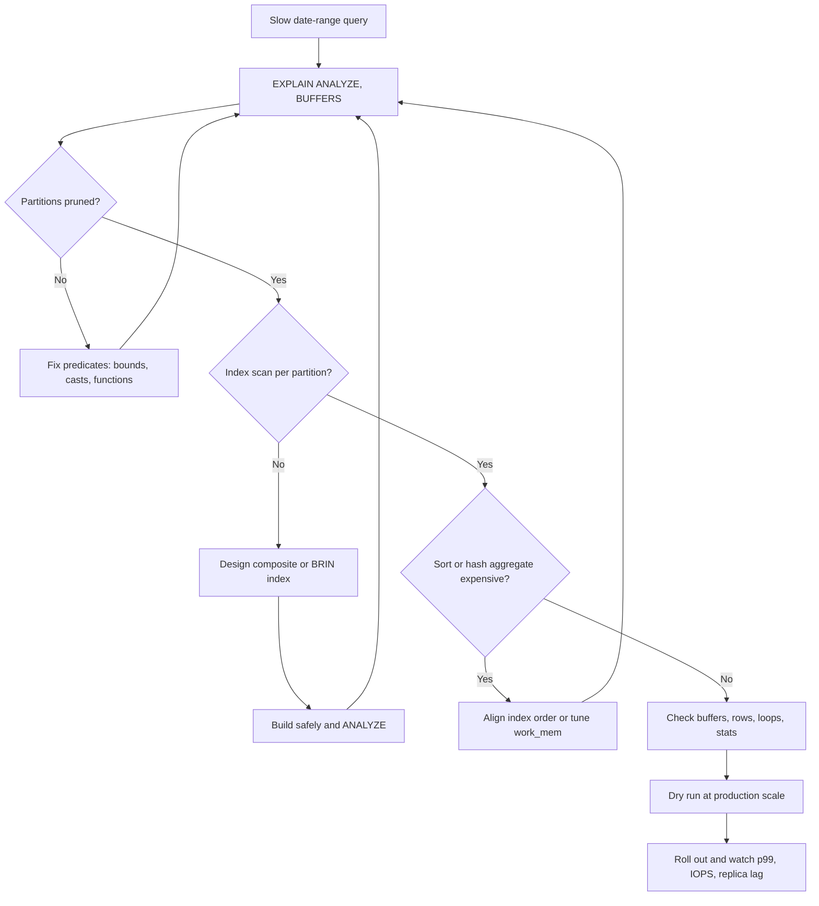

| Difficulty | Channel | Tags |
|---|---|---|
| intermediate | database | explain, query-plan, partitioning |

At CoinGecko, eight years of hourly cryptocurrency prices had become a PostgreSQL RDS table larger than 1TB, and some queries were averaging more than 30 seconds [1]. IOPS kept blowing past the 24K provisioned limit, request queues grew, Apdex fell, and replicas fell behind [1]. Range-partitioning the table by month eventually cut the affected endpoint's p99 latency by 86%, from 4.13s to 578ms [1]. But the most useful lesson is not that partitioning works—it is that partitioning only works when the query plan actually prunes partitions and uses the right access path.

---

> ### Real-World Case — CoinGecko
>
> CoinGecko stored eight years of hourly cryptocurrency price data in a PostgreSQL RDS table that had grown past 1TB, with some queries averaging more than 30 seconds. IOPS repeatedly blew past the 24K provisioned limit, driving request queues, falling Apdex scores, and replica lag. They decided to range-partition the table by month because nearly all queries filter on a timestamp range.
>
> | | |
> |---|---|
> | **Challenge** | After moving to the partitioned table, one date-range query still scanned every partition and became worse than it had been on the old unpartitioned table. The query lacked a proper lower bound on the date key, and CoinGecko had pre-created future empty partitions, so the planner could not prune down to the relevant months. |
> | **Solution** | The team used EXPLAIN/EXPLAIN ANALYZE to see which partitions were actually being touched, then rewrote the query to include an explicit date-range bound and removed the unnecessary future partitions. They also prewarmed the new partitions and used a foreign data wrapper to copy data from a warmed replica to keep IOPS under control during the migration. |
> | **Outcome** | The affected endpoint's p99 latency dropped 86%, from 4.13s to 578ms, IOPS fell 20%, and replica lag disappeared. Dry-run tests showed 6–8x faster queries on the partitioned table, and prewarming time fell from 10 hours to 3 hours. |
> | **Lesson** | Partitioning only helps when the planner can prove which partitions to skip. A date filter without both lower and upper bounds can still force a scan of every partition, and the same query can be faster on an unpartitioned table. In EXPLAIN, count the children under the Append node: a handful means pruning worked; all of them means it did not. |

---

## Hook — The query looked innocent

The query looked innocent. It filtered a handful of dates, added one status check, and ran against a table that was already partitioned by month. Yet the endpoint was slow enough to move a production SLO.

On a 100M-row table, that combination is a trap. Partitioning changes the physical layout, but it does not guarantee that PostgreSQL will skip a single partition [4]. The planner must prove that each partition can be eliminated, and then it must choose an efficient path through the partitions that remain.

The first clue is rarely the schema diagram. It is in the EXPLAIN plan—specifically, in the partitions the planner opens, the buffers it reads, and the work it does after pruning [2][3].

## Problem — Partitioning is not a force field

This is where the trouble starts: partitioning is an access-path strategy, not a magic filter [4]. When a query constrains the partition key with sargable predicates—predicates the planner can evaluate against partition bounds—PostgreSQL can prune irrelevant partitions. When it cannot, the plan becomes an `Append` node over every partition: a full table scan wearing a partitioned costume [3].

Three failure modes dominate:

- **Predicate wrapping.** `date_trunc('day', event_date) = ...` or `event_date::text = ...` hides the raw column from the pruning logic. The planner may still filter rows, but it cannot exclude partitions cleanly.
- **Missing bounds.** A query with only `event_date > '2024-01-01'` has no upper limit; a query with only an upper limit has no lower limit. Either shape can force the planner to touch every partition that could match [4]. CoinGecko hit exactly this after its migration [1].
- **Wrong index for the remaining work.** Partition pruning only removes partitions. Inside each partition, the planner still chooses between a sequential scan, an index scan, a bitmap scan, or a sort. A composite index that does not match the predicate order or selectivity can sit unused.

However, there is a quieter problem: even a perfectly pruned partition can be slow. A wide date range can make a sequential scan cheaper than an index. A `Sort` can spill to disk. A `HashAggregate` can burn memory and temp disk traffic. Stale statistics can make a nested loop look cheap when it is not [10].

⚠️ Watch Out: Plain `EXPLAIN` shows the planner's intentions. `EXPLAIN (ANALYZE, BUFFERS)` shows the bill.

Sound familiar? The table is partitioned, the index exists, and the query is still slow. That is the moment to stop trusting the DDL and start reading the plan.

## Real-World Case — CoinGecko's 1TB price table

CoinGecko's case is a useful antidote to partition optimism. The company stored eight years of hourly cryptocurrency price data in a PostgreSQL RDS table that had grown past 1TB, and some queries averaged more than 30 seconds [1]. IOPS repeatedly exceeded the 24K provisioned limit, request queues grew, Apdex dropped, and replicas lagged [1].

Adding indexes was considered first, but the workload used a JSONB column with currency keys; indexing every key for every application was not a sensible blanket fix [1]. The team chose range partitioning by month because nearly all queries filtered on a timestamp range and usually needed only a few months of data [1].

The results were substantial. In dry runs, the partitioned table delivered 6–8x faster queries, and prewarming time fell from 10 hours to 3 hours [1][7]. In production, the affected endpoint's p99 latency dropped 86%, from 4.13s to 578ms; IOPS fell 20%; and replica lag disappeared [1].

Then came the plot twist. One query regressed because it lacked a lower bound for the date range, causing all partitions to be scanned [1]. Another query used only `created_at > ?` without an upper bound and scanned future empty partitions [1]. The partition key was present, but the predicates were not shaped to prune. That is why the EXPLAIN plan—not the partitioning decision alone—is the real story.

## Deep Dive — Reading the plan like a detective

With those failure modes in view, the plan becomes the evidence. **Start with the actual plan.** Use `EXPLAIN (ANALYZE, BUFFERS, VERBOSE)` on a production-like snapshot or read replica [2][3]. The plan shows estimated rows, actual rows, loops, timing, and shared buffer reads. Estimates tell you what the planner believed. Buffers tell you what the database paid.

Look for these signals:

- `Append` with dozens or hundreds of child scans. That is the signature of weak pruning or a query that legitimately touches most partitions [3].
- `Subplans Removed` at the Append node. Pruning happened during execution initialization, often because a parameter value was not known at plan time [4].
- `(never executed)` under a child node. Execution-time pruning removed that partition on at least one loop [4].
- High `Rows Removed by Filter`. The index or partition scan is reading rows the query does not need.
- `Sort Method: external merge Disk`. The sort spilled because `work_mem` was too small for the actual row count; an index matching the ORDER BY may remove the sort entirely.
- `Buffers: shared hit` versus `shared read`. A plan that reads far more buffers than it returns rows is doing unnecessary disk reads.

Remember that `actual rows` is per loop in some nodes. Multiply by `loops` before comparing it with the estimated total.

**Pruning is a proof, not a setting.** PostgreSQL prunes using partition bounds, not indexes [4]. The predicates must let the planner compare the partition key to constants or parameters. A cast on the column, a function around the column, or a mismatched type can turn a clean range test into a filter that runs after every partition is opened.

**Index order is workload math.** The interview answer often says `(date, filtered_columns)`, and that is a reasonable default. But it is not universal. If a query scans an entire monthly partition and filters a rare status, `(status, event_date)` may be the better composite. If the query always uses a narrow date slice, `(event_date, status)` keeps the leading column aligned with the range. Test both on real data; do not argue from first principles alone.

| Access path | Best when | The catch |
|---|---|---|
| `(event_date, status)` | Narrow date range inside a partition; status is a residual filter | Less effective when the whole month is scanned and status is highly selective |
| `(status, event_date)` | Status is rare and the date range is broad | Less useful for queries that filter only by date |
| `BRIN (event_date)` | Append-only time-series with strong physical correlation [9] | Tiny and cheap, but not a substitute for a selective B-tree index |
| `CLUSTER` on a date index | Read-mostly, range-heavy workload with a maintenance window | Rewrites the table once and is not maintained by later inserts [6] |

**Do not worship clustering.** `CLUSTER` can improve locality for range scans, but it takes an ACCESS EXCLUSIVE lock, rewrites the table, and does not keep the order on future writes [6]. For append-only data, BRIN plus natural insertion order can deliver much of the locality benefit without the rewrite. For a read-mostly table, a one-time `CLUSTER` may still be worth it—after a dry run.

**Partition count is a trade-off.** Too few partitions leave large indexes and poor cache behavior. Too many increase planning time and memory, especially when pruning leaves many partitions in the plan [4]. CoinGecko's empty future partitions became a liability because a query without an upper bound touched them [1]. Create partitions when needed, not years in advance.

💡 Insight: The fastest partition is the one the planner never opens.

🔥 Hot Take: If a query does not constrain the partition key, the table is partitioned but the query path is not.

🎯 Key Point: Make predicates sargable first, then make indexes match the work that remains.

## Workflow — From suspicious scan to verified fix

The Mermaid flow below is the decision loop, not a linear checklist. Each fix sends you back to the plan, because a change that helps one query can hurt another [3].

1. **Capture a baseline.** Record p50, p95, p99, IOPS, replica lag, temp bytes, and the exact query text. A query is only slow relative to a target; RDS Performance Insights can help correlate database load with waits [8].
2. **Reproduce at scale.** Use a production-like snapshot or read replica. A small test table will not reveal partition planning overhead, buffer behavior, or sort spills [1].
3. **Run the real plan.** Use `EXPLAIN (ANALYZE, BUFFERS)` and count the partitions touched. Check `Append`, `Subplans Removed`, `never executed`, rows per loop, and buffer reads [2][4].
4. **Audit the predicates.** Keep the partition key naked. Supply both lower and upper bounds. Remove casts and functions from the key. Confirm that prepared-statement parameter types match the column types.
5. **Inspect per-partition access.** A parent index is virtual; the real indexes live on the partitions [4]. Look for sequential scans across many partitions, high `Rows Removed by Filter`, and index scans that still read too many buffers.
6. **Change one thing at a time.** Rewrite the predicate before adding an index. Add the index before tuning `work_mem`. Test `CLUSTER` only after the cheaper options fail. This keeps cause and effect visible.
7. **Validate, then roll out gradually.** Re-run the same plan, compare p99 and IOPS, and watch replica lag. Keep the old path available. CoinGecko's switch was complicated by unrelated deployments, which made attribution harder [1].
8. **Document the query shape.** The next slow query will probably be a variation. Record the predicate pattern, the index that won, and the partition count that kept planning cheap.

⚠️ Watch Out: Do not build an index on a partitioned parent with a blocking command during peak traffic. The documentation describes the `CREATE INDEX ON ONLY` plus per-partition `CONCURRENTLY` pattern for a reason [4][5].

🎯 Key Point: The goal is not a prettier plan. The goal is fewer buffers, less temp disk traffic, and a lower p99 under real concurrency.

## Code Example — A safe EXPLAIN-and-index loop

The script below keeps the feedback loop tight: measure, change, measure again. It uses fixed date literals so the predicate shape is obvious, and it runs the same query before and after the index. In production, replace the literals with properly typed bind parameters and run the diagnostic on a replica.

Notice what the script does not do: it does not run `CLUSTER` automatically, and it does not assume that one index is the answer. It creates a hypothesis—`(event_date, status)`—then asks the next plan whether the hypothesis paid off.

The explanation after the code walks through each block and the production-safe index variant.

## Lessons Learned — What to do before the next pager

CoinGecko's result is impressive, but the durable lesson is procedural [1]. The team did not just partition a table; they measured query performance, ran a dry run, prewarmed caches, and watched IOPS and replica lag [1]. The post-migration regression is equally instructive: a partition key in the schema does not guarantee pruning in the query [1][4].

Take these lessons into the next slow-query review:

- **Read the actual plan.** `EXPLAIN (ANALYZE, BUFFERS)` is the difference between a theory and an invoice [2].
- **Count partitions, not just rows.** An `Append` over every partition is a full scan with extra steps [3].
- **Constrain both ends of the range.** Missing lower or upper bounds are a classic partition-pruning failure [1][4].
- **Check indexes per partition.** Parent indexes are virtual; child indexes do the work [4].
- **Tune the remaining predicate.** Composite index order should follow selectivity and partition granularity, not a slogan.
- **Respect the lock and rewrite costs.** `CLUSTER` is a one-time maintenance event, not a permanent ordering guarantee [6].
- **Measure the user-facing metric.** p99, IOPS, and replica lag matter more than a single query's best-case latency [1].
- **Dry-run at production scale.** CoinGecko's dry run exposed 6–8x gains and a 10-hour-to-3-hour prewarm improvement; it also exposed risks that a small test would have hidden [1].

Battle scar to avoid: blocking deployments during a cutover. CoinGecko found that unrelated deployments made it harder to attribute post-switch CPU and IOPS changes [1]. A quiet change window is part of performance engineering.

💡 Insight: Partitioning reduces the search space. Indexes and predicates determine what happens inside the space that remains.

🎯 Key Point: The winning sequence is predicate, partition pruning, index, sort, stats—in that order.

---

## Partition-Aware Query Tuning Flow

<strong>Original Interview Question</strong>

**Q:** You have a PostgreSQL table with 100M rows partitioned by date. A query filtering on a specific date range is still slow. What would you check in the EXPLAIN plan and how would you optimize it?

**A:** Check partition pruning effectiveness, index utilization patterns, and expensive sort operations. Create composite indexes on (date, filtered_columns) and evaluate clustering strategies for optimal data access.

## Conclusion

CoinGecko turned a 1TB, 30-second query problem into an 86% p99 improvement by matching physical layout to query shape [1]. The end of the story is not 'partition everything.' It is 'prove that the plan prunes, then prove that each remaining partition is accessed efficiently' [4].

Tomorrow, pick one slow date-range query. Run `EXPLAIN (ANALYZE, BUFFERS)`. Count the partitions. Check the index that actually ran. Fix the predicate before you add another index. Then measure p99, IOPS, and replica lag—not just the query's best case.

Memorable line for the team chat: partitioning narrows the haystack; the query plan decides whether you are still searching it one straw at a time.

---

## References

1. [CoinGecko incident report](https://dev.to/coingecko/scaling-postgresql-performance-with-table-partitioning-136o) — article
2. [PostgreSQL Documentation: EXPLAIN](https://www.postgresql.org/docs/current/sql-explain.html) — documentation
3. [PostgreSQL Documentation: Using EXPLAIN](https://www.postgresql.org/docs/current/using-explain.html) — documentation
4. [PostgreSQL Documentation: Table Partitioning](https://www.postgresql.org/docs/current/ddl-partitioning.html) — documentation
5. [PostgreSQL Documentation: CREATE INDEX](https://www.postgresql.org/docs/current/sql-createindex.html) — documentation
6. [PostgreSQL Documentation: CLUSTER](https://www.postgresql.org/docs/current/sql-cluster.html) — documentation
7. [PostgreSQL Documentation: pg_prewarm](https://www.postgresql.org/docs/current/pgprewarm.html) — documentation
8. [Amazon RDS Performance Insights](https://docs.aws.amazon.com/AmazonRDS/latest/UserGuide/USER_PerfInsights.html) — documentation
9. [PostgreSQL Documentation: Indexes](https://www.postgresql.org/docs/current/indexes.html) — documentation
10. [PostgreSQL Documentation: Monitoring Statistics](https://www.postgresql.org/docs/current/monitoring-stats.html) — documentation

---

**Author:** Satishkumar Dhule — [GitHub](https://github.com/satishkumar-dhule) · [LinkedIn](https://linkedin.com/in/satishkumar-dhule) · [Website](https://satishkumar-dhule.github.io)
