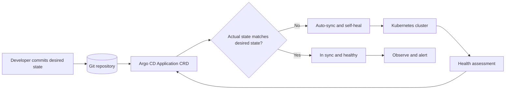

| Difficulty | Channel | Tags |
|---|---|---|
| beginner | devops | argocd, flux, declarative |

Adobe's Flex team once treated Git as the single source of truth for hundreds of Kubernetes clusters, with Argo CD turning commits into deployments automatically [1]. The setup worked beautifully — until adoption outran the platform. At roughly 2,500 Argo CD Applications, builds slowed, workflows hung, and deployments failed [1]. What happened next is a masterclass in why declarative GitOps is powerful, and why scale changes everything.

---

> ### Real-World Case — Adobe
>
> Adobe's Flex team used a single Argo CD hub cluster to deliver microservices to hundreds of Kubernetes clusters, with Git as the source of truth and declarative Helm/manifests driving automated sync. Adoption exploded after launch, and at only about 2,500 Argo CD Applications the platform began suffering slow builds, hung workflows, and failed deployments.
>
> | | |
> |---|---|
> | **Challenge** | The declarative reconciliation loop that eliminated configuration drift became a load generator: untuned Argo CD controllers and repo servers pounded the shared EKS control plane and etcd, while CI and CD competed on the same cluster. The imperative escape hatch, kubectl hotfixes, was exactly what they wanted to eliminate, but the reconciliation layer could not keep up at scale. |
> | **Solution** | Adobe tuned Argo CD self-heal and reconciliation timeouts, increased application-controller and repo-server replicas and parallelism, excluded unmanaged resources, enabled gzip compression, switched from Kubernetes APIs to Argo CD APIs to use the informer cache, and archived old Argo Workflows. That carried a single hub past 10,000 apps; then they re-architected into independent Flex-in-a-Box cells, each with its own Argo CD control plane, plus declarative routing and relocation between cells. |
> | **Outcome** | After outages at roughly 2,500 apps, the tuned single hub supported more than 10,000 Argo CD applications. The cell-based architecture then reached over 360 Kubernetes clusters, more than 22,000 Argo CD apps, over 30,000 deployments per month, and more than 1,000 production services by October 2024. Adobe later reported managing 6,000+ services across nearly 50,000 environments. |
> | **Lesson** | Auto-sync and self-heal are trivial to enable and hard to operate at scale: continuous reconciliation is a production workload, not a free background loop. Declarative GitOps only delivers its auditability and drift-elimination benefits if you tune and shard the reconciliation layer; otherwise the sync interval becomes a thundering herd, and the imperative kubectl fix starts looking attractive again. |

---

## Hook — The Sync Spinner That Would Not Stop

Picture a release train where every commit is a ticket and every ticket is supposed to arrive on time. That is the promise of GitOps: you merge a pull request, Argo CD notices the desired state changed, and the cluster quietly converges to match it. Most days, the magic is invisible. Then one morning the sync spinner keeps spinning, the health check turns yellow, and a routine deploy becomes an incident bridge. The uncomfortable question lands: is the problem the code, the cluster, or the platform that was supposed to make both safer? Adobe ran into that question at a scale most teams never see, and the answer changed how its platform team thought about Git itself [1].

## Problem — When Git Becomes a Traffic Jam

Here is the uncomfortable truth about GitOps: it does not eliminate complexity; it relocates it. Instead of remembering which engineer ran which kubectl command, you now have to design a control plane that can watch thousands of resources, detect drift, and reconcile them without stampeding the Kubernetes API. At small scale, an Argo CD Application feels like a set-and-forget appliance. At larger scale, every Application becomes a reconciliation loop competing for CPU, memory, API server capacity, and human attention [2]. The first failure mode is usually cultural: someone hotfixes production with kubectl because it is faster than opening a pull request. The second is architectural: the hub that watches everything becomes a single point of congestion. Both erode the very guarantee GitOps promises. So what happens when a platform team does everything right and still hits a wall?

## Real-World Case — Adobe

Adobe's Flex team built exactly the kind of platform the GitOps playbook describes. A single Argo CD hub cluster watched Git repositories containing Helm charts and Kubernetes manifests, then delivered microservices to hundreds of downstream clusters. Git was the source of truth, and declarative sync did the delivery [1]. Adoption exploded. Then the platform hit a cliff at roughly 2,500 Argo CD Applications. Builds slowed, workflows hung, and deployments failed. The fix was not to abandon GitOps. The team tuned the hub, introduced a cell-based architecture, and pushed a single tuned hub beyond 10,000 Applications. By October 2024, the cell-based design supported more than 360 Kubernetes clusters, over 22,000 Argo CD Applications, more than 30,000 deployments per month, and over 1,000 production services. Adobe later reported managing 6,000+ services across nearly 50,000 environments [1]. The lesson is blunt: GitOps scales, but the hub has to be engineered like a distributed system.

## Deep Dive — Declarative vs. Imperative, Without the Hand-Waving

Building on that story, the real distinction between declarative and imperative is not YAML versus kubectl. It is where the source of truth lives and who is allowed to change it. In a declarative model, you commit the desired state to Git using plain manifests, Helm charts, or Kustomize overlays [4][7][8]. Argo CD compares that desired state with the live cluster and reconciles the difference [2][3]. In an imperative model, you tell the cluster what to do step by step with kubectl or direct API calls [5]. Both can produce the same running workload. Only one leaves a reviewable, replayable history by default.

| Dimension | Declarative GitOps | Imperative kubectl |
|---|---|---|
| Source of truth | Git commit history | Terminal history and memory |
| Change review | Pull request, approvals, CI checks | Whoever has cluster credentials |
| Drift handling | Continuous reconciliation and self-healing | Manual detection, if any |
| Rollback | Revert the commit or redeploy a known revision | Re-run an earlier command, hope it still fits |
| Auditability | Every desired-state change is versioned | Partial, fragmented, easy to miss |
| Best use | Steady-state production delivery | Bootstrap, break-glass debugging, migrations |

The reconciliation loop is the heartbeat. Argo CD continuously asks a simple question: does the live state match the desired state [2]? When the answer is no, auto-sync can apply the difference, and self-healing can revert manual edits [2]. The OpenGitOps principles codify this: declarative, versioned, automatically applied, and continuously reconciled [6]. That sounds authoritarian until you remember the alternative: a production cluster that slowly becomes a museum of undocumented exceptions. The plot twist is that declarative systems still need imperative escape hatches. You may need kubectl to bootstrap Argo CD itself, recover a broken controller, or perform a one-off migration. The rule is not never use kubectl. The rule is never let kubectl become the source of truth. Flux applies the same pull-based reconciliation idea with a different controller topology, which is why the concepts transfer even when the tooling does not [10].

## Workflow — From Commit to Cluster in Six Moves

The path from commit to cluster is easier to trust when you can see it as a loop instead of a pile of YAML. The diagram below traces the reconciliation cycle that Adobe's platform depends on: a developer commits, Argo CD compares desired and actual state, and the cluster either stays healthy or gets corrected [1][2].

1. Structure the repository around deployable units. Keep environment overlays separate from shared base manifests, and avoid pointing one Application at a giant monorepo root.
2. Create an Application CRD. Point it at the repository, revision, and path that represent one deployable service or environment [3].
3. Enable automated sync. Turn on prune only after the team understands which resources Argo CD owns; otherwise a rename can delete more than expected [2].
4. Enable self-healing. This is the feature that reverts manual kubectl edits, so announce it loudly and make the Git path faster than the hotfix path [2].
5. Set reconciliation and health-check expectations. A three-minute reconciliation interval is a common starting point, but tune it against API server load and the number of Applications [2].
6. Watch the hub, not just the apps. Track controller memory, queue depth, API request rates, and sync latency. At scale, those signals fail before the deployments do [1].

💡 Insight: The most important security control in GitOps is not a policy engine. It is removing broad kubectl access from humans and making Argo CD the only writer.

⚠️ Watch Out: Self-healing without observability feels like a ghost. A manual change disappears, nobody knows why, and trust in the platform drops. Emit an event or alert whenever drift is corrected.

## Code Example — A Production-Ready Argo CD Application

The following bash script turns the workflow into a concrete bootstrap. It installs Argo CD, registers one Application with automated sync and self-healing, tunes the reconciliation interval, and verifies the result. In a real platform, this would live in a bootstrap repository and be applied by a higher-level app-of-apps pattern rather than run by hand.

The key design choices are deliberate: targetRevision is pinned to main for clarity, prune is enabled so removed manifests actually disappear, selfHeal is enabled so manual edits are reverted, and retries prevent a transient API hiccup from leaving the Application stuck. The explanation below walks through each block.

## Lessons Learned — What to Steal From Adobe's Playbook

Adobe's journey offers a set of battle scars that can save your team months of painful discovery.

• Treat the Argo CD hub as production infrastructure. It needs capacity planning, high availability, monitoring, and a blast-radius strategy, not just a namespace and a Helm install [1].
• Design for cells before you need them. A single hub can go surprisingly far, but the migration is easier when repositories, clusters, and Applications are already grouped by domain [1].
• Make Git the fastest path to production. If a pull request takes longer than a kubectl hotfix, developers will route around the platform. Automate reviews, previews, and rollbacks.
• Use app-of-apps or ApplicationSets instead of hand-registering every service. Manual Application sprawl becomes its own drift problem [9].
• Pin versions and prune carefully. Floating tags and aggressive pruning are a dangerous combination when a bad commit can propagate across hundreds of clusters.
• Keep an imperative break-glass path, but log it. The goal is not purity; the goal is a known, auditable exception process [5].
• Measure the platform like a product. Track deployment frequency, sync latency, drift-correction rate, and mean time to rollback. Those metrics tell you whether GitOps is actually helping [6].

The so-what is simple: declarative GitOps is not a tool you install. It is an operating model you design. Start with one service, one Application, and one clear ownership boundary. Then scale the pattern, not the blast radius.

---

## GitOps Reconciliation Loop

<strong>Original Interview Question</strong>

**Q:** You're setting up GitOps for a microservices deployment. How would you configure ArgoCD to automatically sync changes from your Git repository to Kubernetes, and what's the difference between declarative and imperative approaches in this context?

**A:** I'd configure ArgoCD by setting up a Git repository containing Kubernetes manifests or Helm charts, creating an Application CRD that points to the Git repository, enabling auto-sync with a health check interval of 3 minutes, and implementing self-healing to automatically revert any manual changes. The declarative approach involves defining the desired state in Git through YAML manifests, Helm charts, or Kustomize configurations, where ArgoCD continuously reconciles the actual state with the desired state. In contrast, the imperative approach uses kubectl commands to make direct changes to the cluster, bypassing the Git repository as the single source of truth.

## Conclusion

Adobe's story is not a warning to avoid GitOps. It is a warning to avoid treating GitOps as a magic wand. A single hub can absolutely deliver thousands of Applications, but only when the platform team plans for the control plane's own failure modes [1]. Tomorrow, audit one thing: is Git truly the only path to production, or is kubectl still the quiet back door? Then make the declarative path so fast, observable, and safe that nobody wants the back door. The memorable insight to share with your team is this: Git is the source of truth, Argo CD is the enforcement mechanism, and scale is the test that reveals whether either one was real.

---

## References

1. [Adobe incident report](https://architecture.cncf.io/architectures/adobe) — article
2. [Argo CD automated sync documentation](https://argo-cd.readthedocs.io/en/stable/user-guide/auto_sync/) — documentation
3. [Argo CD Application specification](https://argo-cd.readthedocs.io/en/stable/user-guide/application-specification/) — documentation
4. [Kubernetes declarative object configuration](https://kubernetes.io/docs/tasks/manage-kubernetes-objects/declarative-config/) — documentation
5. [Kubernetes imperative object management](https://kubernetes.io/docs/tasks/manage-kubernetes-objects/imperative-command/) — documentation
6. [OpenGitOps principles](https://opengitops.dev/) — documentation
7. [Kubernetes Kustomize documentation](https://kubernetes.io/docs/tasks/manage-kubernetes-objects/kustomization/) — documentation
8. [Helm documentation](https://helm.sh/docs/) — documentation
9. [Argo CD cluster bootstrapping](https://argo-cd.readthedocs.io/en/stable/operator-manual/cluster-bootstrapping/) — documentation
10. [Flux documentation](https://fluxcd.io/flux/) — documentation

---

**Author:** Satishkumar Dhule — [GitHub](https://github.com/satishkumar-dhule) · [LinkedIn](https://linkedin.com/in/satishkumar-dhule) · [Website](https://satishkumar-dhule.github.io)
