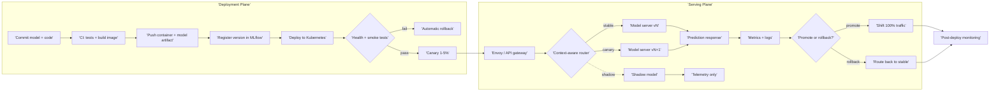

| Difficulty | Channel | Tags |
|---|---|---|
| beginner | devops | mlops, deployment |

Every second, Netflix's centralized ML platform answers roughly one million inference requests for recommendations, commerce, fraud detection, and other member experiences [1]. Those predictions flow through more than 30 client microservices and hundreds of model types, which means a single routing decision can quietly shape what millions of people see next. Yet the team behind the platform discovered that the hardest problem was not training better models; it was separating two disciplines that sound almost identical: deployment and serving [1]. That distinction is the difference between shipping a model and keeping it fast, safe, and available under real traffic.

---

> ### Real-World Case — Netflix
>
> Netflix’s centralized ML serving platform powers recommendations, commerce, fraud detection, and other member experiences. As it scaled to roughly 1 million inference requests per second across hundreds of model types and more than 30 client microservices, every request flowed through Switchboard, a custom routing proxy that handled model selection, A/B allocation, canaries, shadow traffic, and rollback.
>
> | | |
> |---|---|
> | **Challenge** | The deployment abstraction worked, but keeping the router in the serving data path added 10–20 ms of serialization and deserialization latency per request, made Switchboard a single point of failure, and created a noisy-neighbor blast radius across many ML-powered products. |
> | **Solution** | Netflix separated the control plane from the serving data plane. Lightbulb resolves a use case into a model ID and routing configuration, while Envoy—already used for service-to-service traffic—routes on a lightweight header without touching the request payload. This preserved one client contract and model-version lifecycle features while removing the central proxy from the hot path. |
> | **Outcome** | The platform serves hundreds of model types and versions at about 1 million inference requests per second for 30+ client services. The redesign removes the extra 10–20 ms hop and isolates routing failures by tenant instead of concentrating risk in one shared cluster. |
> | **Lesson** | Deployment is the control plane—model versions, rollout policy, canaries, rollback, and monitoring—while serving is the runtime data plane. Centralize model lifecycle management, but keep the inference path lean and free of unnecessary network hops and shared failure domains. |

---

## Hook — One Million Requests, One Extra Hop

Imagine a recommendation model that took months to train, passed every offline evaluation, and finally reached production. The launch looked clean. Then traffic arrived. Requests queued, GPU memory filled, a canary version behaved differently from the baseline, and the rollback path had never been exercised under load. The model was deployed. It was not really being served.

That gap is where careers, revenue, and user trust get tested. At Netflix scale, the gap is measured in milliseconds and millions of requests. The platform's routing layer sat in the hot path for every inference call, adding 10–20 ms of serialization overhead and concentrating failure risk in one shared service [1]. At one million requests per second, a tiny architectural tax becomes an enormous operational bill.

So here is the uncomfortable question: when your team says the model is live, do they mean it is deployed, or do they mean it is actually serving?

## Problem — Deployment Is Not Serving, and Conflating Them Is Expensive

Deployment and serving are often used interchangeably in meetings, job descriptions, and even architecture diagrams. That shorthand hides two different lifecycles with different failure modes.

Deployment is the delivery system. It covers source control, CI/CD, container builds, infrastructure provisioning, artifact registries, environment promotion, health checks, observability, and rollback. A deployment pipeline answers: can this version reach production repeatedly and safely?

Serving is the runtime system. It covers the inference API, request validation, routing, model loading, batching, autoscaling, version selection, A/B allocation, shadow traffic, and tail-latency management. A serving system answers: can this version handle real traffic within its latency and reliability targets?

Many developers discover the difference the hard way. A model that deploys successfully can still fail to serve because the container image is correct but the model weights are missing, the pod is healthy but the GPU is cold, or the API returns predictions but violates the p99 latency budget.

The stakes are asymmetric. A deployment bug may delay a release; a serving bug can take down every product that depends on the shared inference layer. Mature MLOps practice treats these as connected but distinct concerns [2]. That is why high-performing teams design deployment and serving as separate planes with a shared contract.

## Real-World Case — Netflix

Netflix's centralized ML serving platform is a masterclass in both the promise and the peril of that separation [1]. The platform powers recommendations, commerce, fraud detection, and other member experiences. As it grew to hundreds of model types and versions, serving roughly one million requests per second across more than 30 client microservices, every request passed through Switchboard, a custom routing proxy [1].

Switchboard was not a random extra service. It gave clients one abstraction for model access, performed context-aware routing, split traffic for canaries and experiments, managed multiple model versions, and enabled shadow mode plus instant rollback [1]. In other words, it handled the hard parts of serving that a naive model endpoint ignores.

But success created new problems. Because Switchboard sat in the critical request path, it became a single point of failure for multiple ML-powered experiences. It also added 10–20 ms of latency from serialization and deserialization, depending on payload size, and amplified tail latency [1]. At Netflix scale, that overhead is not cosmetic; it can trigger client timeouts. The platform's next step, Lightbulb, moved routing onto Envoy and kept a lightweight metadata service for model selection, removing the extra hop and isolating routing failures by tenant instead of concentrating risk in one shared cluster [1].

The lesson is sharp: deployment got the model into the building, but serving decided whether it could survive the crowd.

## Deep Dive — The Trade-Offs Beneath the API Call

Building on that case, the technical distinction becomes clearer when you compare the two planes side by side.

| Concern | Deployment | Serving |
|---|---|---|
| Primary question | How does this version reach production safely? | How does this version answer requests safely? |
| Core tools | Kubernetes, Terraform, GitHub Actions, Jenkins, MLflow, SageMaker, Vertex AI | FastAPI, gRPC, TensorFlow Serving, TorchServe, BentoML, Envoy, NGINX |
| Main failure | Bad build, missing artifact, failed rollout | Cold start, overload, routing error, latency spike |
| Scaling unit | Pipeline run, environment, release | Pod replica, GPU worker, model instance |
| Success metric | Repeatable, auditable release | Latency, throughput, availability, correctness |

Deployment is usually batch-oriented and human-gated. Serving is continuous and unforgiving. A CI pipeline can retry a failed build; a serving fleet cannot ask users to retry a 2 a.m. checkout prediction.

Latency versus throughput is the central serving trade-off. Larger batches improve GPU utilization and throughput, but they add queueing delay. Smaller batches protect p99 latency, but they can waste expensive accelerator capacity. The right answer depends on the product: a fraud check may tolerate tens of milliseconds, while an interactive recommendation surface may need a much tighter budget.

Cold starts are another plot twist. A Kubernetes pod can be ready from an orchestration perspective before the model is warm. Loading weights, compiling kernels, and allocating GPU memory can take seconds to minutes. That is why readiness probes, pre-warming, and minimum replica counts matter more in serving than in ordinary web workloads [4].

Horizontal scaling adds replicas; vertical scaling adds memory or GPU capacity. Horizontal scaling is usually preferred for availability, but it multiplies model loading cost and can create a thundering herd during traffic spikes [3]. Kubernetes Deployments and Horizontal Pod Autoscalers provide the mechanics, not the strategy [3][4].

The serving framework choice matters too. TensorFlow Serving is built around TensorFlow models and versioned servables [5]. TorchServe targets PyTorch workflows [6]. BentoML packages models with their dependencies and exposes production APIs [7]. A custom FastAPI or gRPC service offers flexibility, but you own batching, metrics, and lifecycle logic. Generic model servers reduce undifferentiated work; custom gateways buy control at the cost of operational surface area.

Model versioning ties both planes together. Deployment records which artifact was released; serving decides which artifact handles each request. Without a shared registry and a clear promotion policy, rollback becomes archaeology. MLflow and similar tools help track experiments and artifacts [8], while managed platforms such as SageMaker bundle deployment and hosting concerns [9]. Neither removes the need to define your own SLOs.

Finally, there is the hidden debt problem. ML systems accumulate entanglement, undeclared consumers, and pipeline jungles that are invisible until traffic exposes them [10]. A clean deployment diagram can hide a serving path with five undocumented dependencies. That is why observability belongs in the serving design, not in a later hardening sprint.

## Workflow — From Commit to a Safe Canary

Here is the thing though: the cleanest mental model is a relay race, not a single finish line. The deployment plane prepares and releases a version; the serving plane decides how that version earns traffic.

The workflow below is the one Netflix's evolution points toward, generalized for a team running models on Kubernetes [1][3].

1. Commit code and model metadata. The model artifact, feature schema, and evaluation report move together.
2. Run CI gates. Unit tests, schema checks, and a reproducibility check confirm the artifact matches the code.
3. Build and scan the container image. Pin dependencies and include a startup probe that verifies weights can load.
4. Register the version. Store the immutable artifact in a registry such as MLflow and attach lineage metadata [8].
5. Deploy to a staging namespace. Use Kubernetes Deployments with resource requests and limits, then run smoke tests [3].
6. Warm the serving replicas. Load the model, run a sample inference, and only then mark the pod ready.
7. Start a canary at 1–5 percent. Route by user or tenant, not by random request, so the same user gets a consistent experience.
8. Send shadow traffic. Compare predictions and latency without exposing users to the new version.
9. Promote or roll back. Shift traffic gradually while watching error rate, p50/p95/p99 latency, saturation, and prediction drift.

The Mermaid diagram in the next field shows how those steps connect, including the feedback loop from serving telemetry back into the release decision. Notice that autoscaling is not an afterthought: it is part of the serving plane's contract [4]. So is the gateway. Envoy or NGINX can handle load balancing and traffic splitting, but context-aware model routing may still require a dedicated layer or a carefully designed Envoy configuration [11][12].

The cliffhanger is this: a canary is only useful if you can measure it. If your serving layer emits only CPU metrics, you are flying blind.

## Code Example — A Minimal Version-Aware Serving Gateway

Concretely, a minimal serving gateway needs four capabilities: model registration, warmup, deterministic traffic splitting, and a safe fallback path. The Python example below uses FastAPI to illustrate those pieces without hiding them behind a framework.

The code does not try to be Netflix. It tries to make the routing logic visible so you can adapt it to your own registry and model server.

## Lessons Learned — A Deployed Model Is an Artifact; a Served Model Is a Promise

The journey from a successful deployment to a trustworthy serving system is mostly about accepting that they are different jobs.

- Treat deployment as the release system and serving as the runtime system. Give them separate dashboards, SLOs, and rollback procedures.
- Measure the hot path. Netflix's 10–20 ms proxy hop was small per request and enormous at one million requests per second [1].
- Warm models before declaring pods ready. A healthy container is not a warm model.
- Make traffic splits deterministic. Random per-request canaries create inconsistent user experiences and noisy experiments.
- Design rollback before launch. If the old version is not still loaded or quickly loadable, rollback is a hope, not a plan.
- Watch tail latency, not just averages. p99 is where timeouts, retries, and cascading failures live.
- Keep deployment and serving metadata connected. A version that cannot be traced from request to artifact is a future incident.
- Avoid sharing one routing service across every tenant unless you have isolated its failure modes. Netflix's shift toward per-tenant isolation came from exactly that lesson [1].

The battle scar most teams earn is conflating a green deployment with a healthy serving system. The fix is not more YAML. It is a clear contract: deployment proves the artifact can be released, and serving proves it can be trusted with traffic.

---

## Deployment and Serving Pipeline

<strong>Original Interview Question</strong>

**Q:** Explain the key differences between model serving and model deployment in ML systems, including specific technologies, scaling considerations, and real-world implementation patterns?

**A:** Deployment encompasses CI/CD pipelines, infrastructure setup, and monitoring using tools like Kubernetes, MLflow, and SageMaker. Serving focuses on runtime inference APIs with frameworks like TensorFlow Serving, TorchServe, or BentoML, handling request routing, model versioning, and autoscaling. Key trade-offs include latency vs throughput, batch vs real-time inference, and cold start optimization.

## Conclusion

Netflix's story starts with a model platform that worked and ends with a routing redesign because scale changed the definition of working [1]. Deployment got hundreds of model versions into production; serving had to route one million requests per second without turning one shared hop into a shared outage.

So what should you do differently tomorrow? Draw the boundary explicitly. List what belongs to deployment, list what belongs to serving, and assign an owner and a metric to each. Then test the ugly path: cold start, canary failure, rollback under load, and a noisy tenant. The team that can explain its serving path under pressure is the team that can scale it.

The memorable insight is simple: a deployed model is an artifact, but a served model is a promise. Keep the promise measurable.

---

## References

1. [Netflix incident report](https://netflixtechblog.com/state-of-routing-in-model-serving-16e22fe18741) — article
2. [MLOps — Wikipedia](https://en.wikipedia.org/wiki/MLOps) — documentation
3. [Kubernetes Deployments](https://kubernetes.io/docs/concepts/workloads/controllers/deployment/) — documentation
4. [Kubernetes Horizontal Pod Autoscaling](https://kubernetes.io/docs/tasks/run-application/horizontal-pod-autoscale/) — documentation
5. [TensorFlow Serving](https://www.tensorflow.org/tfx/guide/serving) — documentation
6. [TorchServe — PyTorch model serving](https://github.com/pytorch/serve) — documentation
7. [BentoML — Build production ML services](https://github.com/bentoml/BentoML) — documentation
8. [MLflow Documentation](https://mlflow.org/docs/latest/index.html) — documentation
9. [Amazon SageMaker Documentation](https://docs.aws.amazon.com/sagemaker/) — documentation
10. [Hidden Technical Debt in Machine Learning Systems](https://arxiv.org/abs/1503.05991) — paper
11. [Envoy Proxy Documentation](https://www.envoyproxy.io/docs/envoy/latest/) — documentation
12. [NGINX HTTP Load Balancing](https://docs.nginx.com/nginx/admin-guide/load-balancer/http-load-balancer/) — documentation

---

**Author:** Satishkumar Dhule — [GitHub](https://github.com/satishkumar-dhule) · [LinkedIn](https://linkedin.com/in/satishkumar-dhule) · [Website](https://satishkumar-dhule.github.io)
