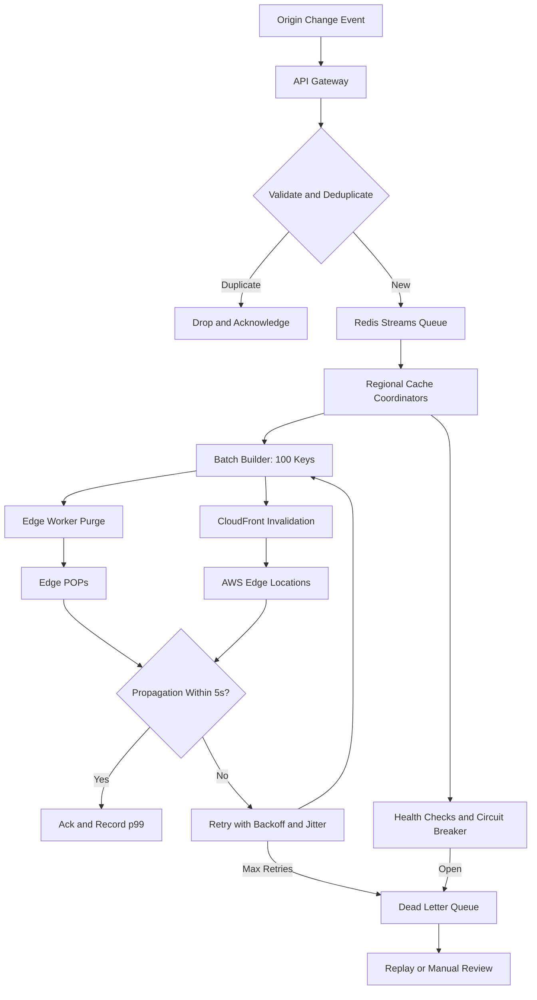

| Difficulty | Channel | Tags |
|---|---|---|
| intermediate | system-design | edge, caching, purging |

In 2018, Fastly's network handled roughly 2,000 to 3,000 cache purges per second. Five years later, that number had climbed to about 60,000 per second, and the system that carried it had to be rebuilt from the inside out [1]. The company's Instant Purge now pushes invalidations around the globe in about 150 milliseconds, proving that a five-second propagation SLA is less a finish line than a starting gun [1]. Here is how that journey unfolded, and how you can design a multi-region purge system that survives 10,000 concurrent invalidations per second without waking anyone at 3 a.m.

---

> ### Real-World Case — Fastly
>
> Fastly needed to invalidate cached content globally for breaking news, live-event updates, and e-commerce promotions without forcing requests back through a central coordinator. Its first decentralized purge design worked well for years, but network growth and rising purge volume exposed scaling and reliability limits.
>
> | | |
> |---|---|
> | **Challenge** | Propagate each invalidation to every active cache node worldwide within milliseconds while supporting extremely high purge throughput, surviving packet loss and POP failures, and avoiding central bottlenecks or unnecessary rate limiting. |
> | **Solution** | Fastly treated purging as a distributed messaging problem rather than a centralized command-and-control workflow. It used a Bimodal Multicast-inspired system over UDP, broadcasting purges to nodes without waiting for acknowledgments, then added double-delivery to at least two healthy nodes per POP, hierarchical rebroadcasting, and true batch purging instead of splitting batches into individual purges. |
> | **Outcome** | Fastly scaled from 2,000-3,000 purges per second in 2018 to roughly 60,000 purges per second, eliminated purge-related scaling alerts and manual rate limiting, and said it could scale to hundreds of thousands of purges per second. Its Instant Purge system propagates globally in about 150ms, well inside the 5-second target. |
> | **Lesson** | The counterintuitive lesson is that giving up central coordination and per-message acknowledgments can make invalidation faster and more reliable at scale. Broadcast-everywhere plus redundant delivery and real batching beat a seemingly simpler centralized queue. |

---

## Hook — The 3 A.M. Purge That Cannot Wait

Your phone lights up at 3:07 a.m. A breaking-news story is live, a retail partner just cut prices on 40,000 SKUs, and a legal team has ordered a correction to a product claim. Every second that stale bytes keep flowing from edge caches costs money, trust, or both. At Fastly, engineers watched purge traffic climb from roughly 2,000–3,000 requests per second in 2018 to about 60,000 per second — a volume that turned a once-elegant decentralized design into a reliability puzzle [1]. The fix was not to add more servers. It was to rethink how invalidations travel. That rethink is the difference between a purge system that works in a diagram and one that survives a Monday morning.

## Problem — When Five Seconds Feels Like Forever

Cache invalidation is the part of distributed systems that bites hardest, because it looks like a simple API call until it becomes a consistency protocol. The requirements sound innocent: propagate content globally in under five seconds, handle 10,000 concurrent invalidations per second, stay available 99.99% of the time, and keep caches strongly consistent across regions. Put those four goals together, and the hidden tensions appear.

A central coordinator gives you a clean mental model, but it becomes a throughput ceiling and a single point of failure. Cross-region calls add latency, retries amplify load, and one wildcard purge can trigger a thundering herd against the origin. Short TTLs reduce staleness, but they also increase origin traffic and make every cache miss more expensive [5].

| Strategy | Propagation | Cost | Failure mode |
| --- | --- | --- | --- |
| Short TTL only | 2–60s | High origin load | Stampede |
| Central purge coordinator | Seconds or more | Medium | Single point of failure |
| Decentralized regional fan-out | Milliseconds to seconds | Higher engineering complexity | Partial failure |

The CAP theorem makes the trade-off explicit: during a network partition, you can choose consistency or availability, not both [10]. Therefore, the real design question is not “how do we guarantee perfect consistency?” It is “which stale responses are acceptable, for how long, and how do we prove that the deadline was met?” RFC 9111 defines the mechanics of HTTP caching and invalidation [3], while provider APIs such as CloudFront invalidation expose their own asynchronous behavior and limits [2]. The gap between those two worlds is where SLAs go to die.

## Real-World Case — Fastly

Fastly's Instant Purge is one of the clearest public examples of this evolution. The company's first decentralized purge design worked well for years, but network growth and rising purge volume exposed scaling and reliability limits [1]. By 2018, Fastly was handling roughly 2,000–3,000 purges per second; by the early 2020s, that figure had grown to about 60,000 per second — a roughly 20x increase [1]. The old coordination model had become the ceiling.

Fastly redesigned the system so purges could fan out across the network without funneling every request through a central coordinator. The result was Instant Purge propagating globally in about 150ms — well inside the five-second target — while eliminating purge-related scaling alerts and manual rate limiting [1]. The team also said the architecture could scale to hundreds of thousands of purges per second [1]. That is the transformation every team chasing a hard SLA is really after: not a faster API call, but a system that stops treating the coordinator as the center of the universe.

## Deep Dive — The Physics of Invalidation

At its core, a purge is a distributed consistency problem wearing a CDN costume. You have a write (the origin change), many replicas (edge caches), and a deadline (five seconds). The CAP theorem says that during a network partition you can choose consistency or availability, not both [10]; therefore, the design must decide which failures may serve stale content and which must fail closed.

HTTP offers two levers: freshness and invalidation. `Cache-Control: max-age=2, must-revalidate` keeps worst-case staleness bounded [4], while RFC 9111 defines how caches store, revalidate, and invalidate responses [3]. A two-second TTL is a useful backstop, but it is not a purge strategy. At 10,000 invalidations per second, TTL alone creates a stampede of origin requests and burns bandwidth [5].

Push, pull, or hybrid? Pull-based polling is simple but cannot meet a five-second SLA at scale. Pure push is fast but fragile during partial failures. The winning pattern is hybrid: push an invalidation message to every region, keep a short TTL as a safety net, and use versioned cache keys or surrogate tags so one purge can cover thousands of objects.

Regional coordinators are the next move. Instead of a single global queue, each region owns a coordinator that claims work, batches it, and talks to the local CDN control plane. Consistent hashing maps cache keys to coordinators so ownership is stable when nodes join or leave [9]. Redis Streams with consumer groups provide at-least-once delivery, replay, and per-region backpressure [6]. Idempotency keys make duplicate deliveries harmless.

Batching is where the economics change. Purging 100 keys per API call can cut provider API calls dramatically, and a 90% cost reduction is realistic when tag and wildcard purges are used carefully. Retries need exponential backoff with jitter [8], capped by a deadline. A circuit breaker prevents a failing region from consuming the entire retry budget [7], and a dead-letter queue preserves failed invalidations for replay.

🔥 Hot Take: The provider API is rarely the bottleneck. Coordination, retries, and observability are. A 200 response means the request was accepted — not that every POP has applied it. Teams that measure API latency instead of edge propagation get a dangerous false sense of safety.

⚠️ Watch Out: Wildcard purges are a loaded gun. A single `/products/*` invalidation can evict millions of objects, spike origin traffic, and turn a routine content update into a global incident.

## Workflow — From Event to Edge Acknowledgment

Here is the journey of one invalidation, end to end. The flowchart below is the map; the numbered steps are the terrain.

1. **Ingest the change event.** A CMS publish, price update, or legal correction enters through an API gateway with an idempotency key.
2. **Normalize the target.** Convert routes, product IDs, and content IDs into cache keys, surrogate tags, or versioned object paths.
3. **Deduplicate aggressively.** If the same key was purged in the last few seconds, coalesce the request instead of sending duplicate work to every region.
4. **Enqueue with intent.** Append the event to a Redis Stream with a consumer group per region, preserving order and replayability [6].
5. **Claim and batch locally.** A regional coordinator claims up to 100 keys, checks its circuit breaker, and prepares a provider-specific payload.
6. **Fan out in parallel.** Edge workers handle local POP coordination, while the coordinator calls the CDN provider API for path or tag invalidations [11][2].
7. **Verify propagation.** Synthetic probes from each region request the affected object and compare version headers or content hashes.
8. **Close the loop.** Acknowledge success only after the deadline is met; otherwise retry, escalate, and record a p99 breach.

The regional coordinator is the key move: it keeps the hot path local, so a spike in one region cannot starve another. CloudFront invalidation requests are asynchronous and rate-limited [2], which is exactly why batching and backpressure belong in the coordinator rather than in the API gateway. Edge workers can also hold a local version map and short-circuit duplicate purges before they reach the provider [11].

Then comes the step most designs skip: verification. Synthetic requests from each region check whether the old bytes are gone. If propagation exceeds the deadline, the coordinator escalates, retries the affected keys, and records a p99 breach. This final step is where most designs quietly fail — and where Fastly's 150ms result becomes a meaningful benchmark rather than a vanity metric [1].

## Code Example — A Batched, Regional Purge Worker

The snippet below implements the regional half of the design: group keys by region, purge with a hard timeout, retry with exponential backoff and jitter, and trip a circuit breaker after repeated failures. It is small enough to read in one sitting, but the shape mirrors what runs in production.

`purgeRegion` owns one region and one provider call. `processBatch` groups events by region, caps each batch at 100 keys, and uses `Promise.allSettled` so one bad region cannot hide the success of the others. Failures go to a dead-letter queue for replay instead of disappearing into logs.

💡 Insight: The timeout is a feature, not a safety net. A purge that takes 1.5 seconds at the provider leaves almost no budget for retries inside a five-second SLA. Fail fast, then let the coordinator make a deliberate decision.

## Lessons Learned — What Survives Production

Fastly's journey offers a set of lessons that apply far beyond one CDN vendor [1]. The first is that purge is a distributed-systems problem, not an API integration. The moment multiple regions and partial failures enter the picture, you need acknowledgments, idempotency, and replay — not just a `fetch` call.

🎯 Key Point: Design for partial failure from day one. A region that cannot confirm propagation is not a success case; it is an incident waiting to be discovered by a customer.

⚠️ Watch Out: Retrying without jitter creates a second outage. Exponential backoff without randomization synchronizes retries across regions and turns a brief provider hiccup into a sustained traffic spike [8].

💡 Insight: A central coordinator is the easiest thing to build and the hardest thing to scale. Push ownership to regional coordinators, use consistent hashing for stable assignment [9], and keep the global layer focused on policy rather than per-key work.

🔥 Hot Take: Most “five-second SLA violations” are not network problems. They are queueing delays, retry storms, and missing observability. Instrument propagation at p99 in every region before adding more infrastructure.

Here is the practical checklist: batch up to 100 keys per provider call, deduplicate with idempotency keys, cap retries with a deadline, write failures to a dead-letter queue, and verify propagation with synthetic probes. Replace wildcard purges with versioned keys or surrogate tags whenever possible. Finally, treat the short TTL as a backstop, not a strategy. The TTL is what saves you when the purge path fails; it should never be the reason the purge path exists.

---

## Multi-Region Purge Flow

<strong>Original Interview Question</strong>

**Q:** How would you design a multi-region CDN cache purging system that guarantees content propagation within 5 seconds while handling 10,000 concurrent invalidations per second?

**A:** Implement Cloudflare API + AWS CloudFront with distributed invalidation queue, edge compute coordination, and 2-second TTL. Use batch invalidation, exponential backoff, and regional cache headers for 5-second SLA.

## Conclusion

Fastly's journey from a few thousand to tens of thousands of purges per second is not a story about buying a bigger hammer. It is a story about pushing coordination to the edge, batching ruthlessly, and measuring the only number that matters: how long stale content survives [1]. Tomorrow, instrument propagation at p99 in every region, add idempotency keys to your invalidation events, and replace at least one wildcard purge with a tagged, versioned key. The memorable insight: the fastest purge is the one you never needed — and the second fastest is a small, idempotent, regional batch with a hard deadline.

---

## References

1. [Fastly incident report](https://www.fastly.com/blog/over-a-decade-later-evolution-of-instant-purge) — article
2. [Amazon CloudFront invalidation documentation](https://docs.aws.amazon.com/AmazonCloudFront/latest/DeveloperGuide/Invalidation.html) — documentation
3. [RFC 9111: HTTP Caching](https://datatracker.ietf.org/doc/html/rfc9111) — documentation
4. [MDN: Cache-Control header](https://developer.mozilla.org/en-US/docs/Web/HTTP/Headers/Cache-Control) — documentation
5. [MDN: HTTP caching](https://developer.mozilla.org/en-US/docs/Web/HTTP/Caching) — documentation
6. [Redis](https://en.wikipedia.org/wiki/Redis) — documentation
7. [Circuit breaker design pattern](https://en.wikipedia.org/wiki/Circuit_breaker_design_pattern) — documentation
8. [Exponential backoff](https://en.wikipedia.org/wiki/Exponential_backoff) — documentation
9. [Consistent hashing](https://en.wikipedia.org/wiki/Consistent_hashing) — documentation
10. [CAP theorem](https://en.wikipedia.org/wiki/CAP_theorem) — documentation
11. [Cloudflare Workers documentation](https://developers.cloudflare.com/workers/) — documentation

---

**Author:** Satishkumar Dhule — [GitHub](https://github.com/satishkumar-dhule) · [LinkedIn](https://linkedin.com/in/satishkumar-dhule) · [Website](https://satishkumar-dhule.github.io)
