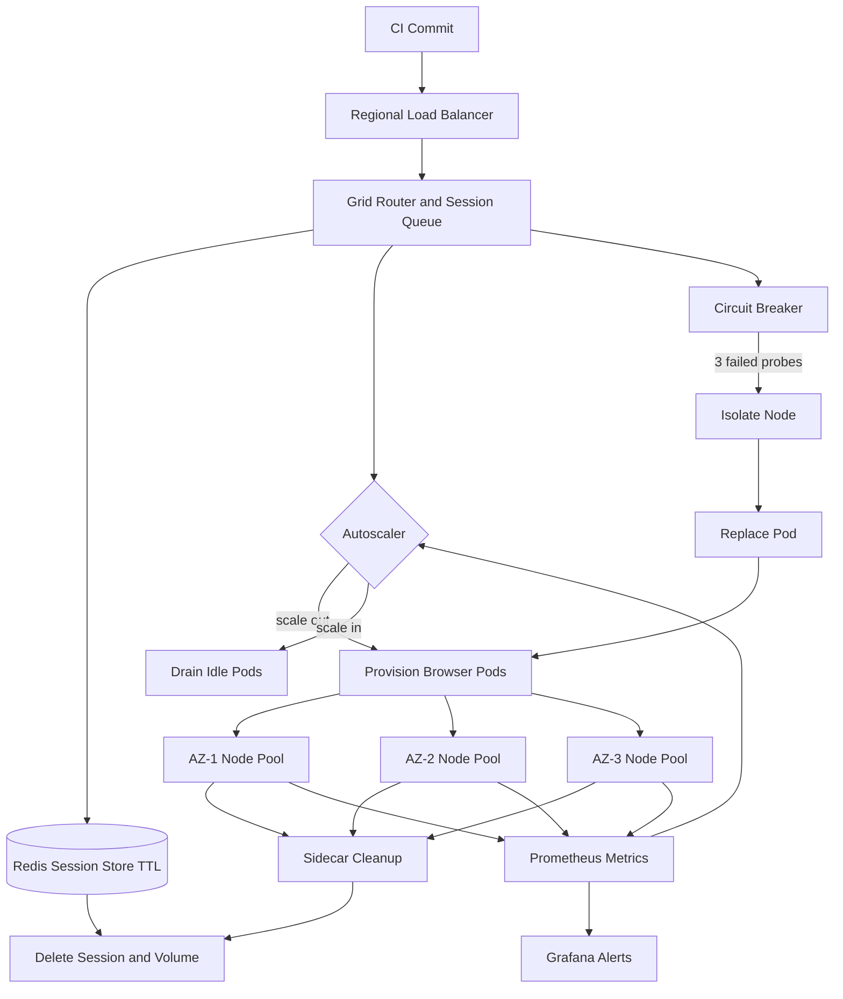

| Difficulty | Channel | Tags |
|---|---|---|
| advanced | system-design | selenium, webdriver, grid |

Imagine a CI pipeline where every commit wakes more than 40,000 UI tests, and the machines running them are long-lived, hand-tended, and quietly filling with orphaned browser processes. Salesforce faced exactly this pressure with its UI regression suite and chose a radically different path: continuously provision fresh virtual machines for test runs, then destroy them afterward [1]. That decision delivered browser and operating-system coverage without operating a permanent, manually maintained Grid at that scale [1]. The lesson is uncomfortable for teams that love a durable Selenium Grid: at scale, the best infrastructure is often the infrastructure you throw away.

---

> ### Real-World Case — Salesforce
>
> Salesforce needed to run its enormous UI regression suite — more than 40,000 Selenium test cases — continuously in CI across a wide variety of browsers and operating-system combinations. Instead of scaling a pool of long-lived Selenium Grid nodes, Salesforce's infrastructure team built a system that continuously provisioned fresh virtual machines for test runs and destroyed them afterward.
>
> | | |
> |---|---|
> | **Challenge** | Scaling browser-based UI testing to tens of thousands of cases without letting a shared, long-lived Selenium Grid become a fragile operational bottleneck. Persistent nodes accumulate browser state, drift in configuration, and require constant babysitting as test volume and platform coverage grow. |
> | **Solution** | Salesforce effectively treated Selenium infrastructure as cattle, not pets: VM 'gold masters' for each browser/platform were provisioned on demand for a test run and destroyed when the run finished. This gave every run a clean browser environment and avoided maintaining a permanent Grid of stateful nodes. The approach was presented at SeleniumConf 2013 as 'Scaling Selenium: The Selenium Infrastructure at Salesforce.' |
> | **Outcome** | Salesforce executed over 40,000 Selenium test cases as part of continuous integration, across a variety of browsers, with no changes required to the automation code. The disposable-VM model delivered browser/platform coverage without operating a persistent, manually maintained Grid at that scale. |
> | **Lesson** | Ephemeral, disposable test infrastructure can beat a large shared Grid for reliability and lifecycle hygiene. If every session starts on a clean machine that is destroyed afterward, stale browser state and memory leaks cannot accumulate — an early version of the immutable-infrastructure pattern now implemented with Kubernetes pods and Selenium Grid 4's Dynamic Grid. |

---

## Hook — When 40,000 UI Tests Became an Infrastructure Problem

Imagine a CI pipeline where every commit wakes more than 40,000 UI tests. Now imagine the machines running those tests are long-lived, hand-tended, and quietly filling with orphaned browser processes. That is not just a testing problem; it is a reliability problem wearing a test suite as a disguise. Salesforce faced exactly this pressure with its UI regression suite and chose a radically different path: continuously provision fresh virtual machines for test runs, then destroy them afterward [1]. The result was coverage across a wide range of browsers and operating systems without a permanent, manually maintained Grid at that scale [1].

That story should make you a little uncomfortable if your team treats Selenium nodes like pets. At 10,000 concurrent sessions, small leaks do not stay small. A handful of zombie Chrome processes per node becomes thousands of orphaned processes, exhausted file descriptors, and a queue that grows faster than your autoscaler can react. The stakes are simple: every minute of Grid downtime blocks merges, delays releases, and trains developers to ignore red builds.

So here is the question worth carrying through this article: what if the most reliable Selenium Grid is the one you keep replacing?

## Problem — The Grid That Grows Teeth

Static Selenium Grids start innocently. A hub, a few nodes, a dashboard, and a wiki page that says 'do not restart the hub on Fridays.' Then traffic grows. Ten thousand concurrent sessions sounds like a capacity target, but it is really a lifecycle target: every session must be created, watched, and destroyed without leaving residue.

The math sets the trap. At a planning assumption of 50 sessions per node, 10,000 sessions require at least 200 nodes. At 2 GB of RAM per node, that is 400 GB of baseline memory, plus a 30% buffer, for roughly 520 GB of cluster memory. Those numbers are not impossible; they are unforgiving. A 5% leak across 200 nodes is 10 nodes' worth of memory that never comes back.

Availability raises the pressure. A 99.9% uptime target allows roughly 43 minutes of downtime per 30-day month [11], and that budget has to cover node failures, rolling upgrades, network partitions, and the slow creep of memory pressure. Memory leaks are the silent antagonist here. You do not notice them in a dashboard at 9 a.m.; you notice them when a node stops accepting sessions at 2 a.m. and the queue backs up.

Many teams respond by adding retries. Retries are not free. They multiply load, lengthen sessions, and hide the fact that the Grid has no reliable cleanup path. The real problem is not any single failure; it is accumulation.

⚠️ Watch Out: If a browser session can outlive the test that created it, you do not have a session manager. You have a leak with a timeout.

## Real-World Case — Salesforce

Salesforce did not solve this by buying a bigger Grid. Its infrastructure team built a system that continuously provisioned fresh virtual machines for test runs and destroyed them afterward [1]. More than 40,000 Selenium test cases could then run as part of continuous integration across a variety of browsers and operating-system combinations, with no changes required to the automation code [1].

That last detail is the architectural plot twist. The test authors kept writing normal Selenium tests; the platform absorbed the complexity of provisioning, execution, and teardown. Ephemerality became a feature, not an operational compromise. A fresh VM starts from a known image, so browser drift and stale state disappear. When the run ends, the machine disappears too, taking its leaked processes and temp files with it.

The public account does not promise a magic node count, and that restraint matters. The durable lesson is the operating model: separate test intent from test infrastructure, and make disposal automatic. If your cleanup depends on a human remembering to restart a node, it is not a lifecycle; it is a hope.

## Deep Dive — Ephemeral Nodes, Sticky Sessions, and the Memory Leak Tax

Building on Salesforce's model, the central trade-off is persistence versus replaceability. A persistent Grid gives you warm nodes and fast startup, but it also accumulates state. A disposable model gives you clean state and reproducible browsers, but it adds cold-start latency and demands strong observability. Neither is universally right.

| Concern | Persistent Grid | Disposable Nodes |
| --- | --- | --- |
| Memory leaks | Accumulate across runs | Reset when the node is destroyed |
| Browser drift | Snowflake nodes and manual patching | Reproducible images |
| Cost | Pay for idle capacity | Pay for actual test work |
| Startup latency | Fast, because nodes are warm | Higher, mitigated by warm pools |
| Debugging | State survives for inspection | Requires logs, videos, and artifacts |

Use a persistent Grid when your suite is small, tests need long-lived state, or warm capacity is genuinely cheaper. Use disposable nodes when browser coverage, isolation, and operational sanity matter more than a two-second head start.

The control plane is where the story becomes concrete. Kubernetes Deployments treat pods as replaceable cattle [2], while StatefulSets are useful when a node needs stable identity and ordered lifecycle events [3]. Horizontal Pod Autoscaling can scale on queue depth rather than CPU alone, because a Selenium node can be saturated while its CPU graph looks bored [4]. Pod Disruption Budgets protect a minimum capacity during voluntary disruptions such as upgrades [5], and liveness, readiness, and startup probes keep traffic away from nodes that are alive but not useful [6].

Sessions need an owner as well as a timeout. Redis expires keys automatically through TTL semantics [7], which makes it a natural registry for session ownership and heartbeat renewal. The Selenium Grid documentation describes the router, distributor, session queue, and node roles that a modern Grid uses [8], and those roles map cleanly onto Kubernetes services. Prometheus supplies the metrics that turn memory trends and session duration into alerts instead of surprises [9].

Here is the counterintuitive part: weekly rolling restarts are not a memory strategy. They are a pressure valve. If restarting nodes is the only thing keeping the cluster healthy, the leak is still winning. The better design makes leaks impossible to accumulate by tying every browser process to a session record, a TTL, and a teardown hook. Circuit breakers and node isolation help contain failures [10], but they do not replace ownership.

Multi-AZ deployment adds another layer. Regional load balancing keeps session initiation close to the requester, while leader election can prevent split-brain behavior in the control plane. Still, leader election without quorum and fencing is just two leaders with better branding. Treat network partitions as normal weather, not rare exceptions.

💡 Insight: The cheapest memory leak to fix is the one that cannot survive a pod restart. The second cheapest is the one that never gets created.

## Workflow — From Commit to Cleanup

With the trade-offs clear, the operating loop becomes a sequence of small, observable commitments. The Mermaid diagram below traces one session from commit to cleanup, including the autoscaling and isolation paths.

1. A commit triggers CI, and the test runner requests a session with explicit browser and platform capabilities.
2. A regional load balancer routes the request to the nearest healthy Grid router, keeping P99 session initiation under the two-second target.
3. The router writes a session record to Redis with an owner, a node assignment, and a TTL [7].
4. The scheduler matches capabilities against available nodes, and the autoscaler uses queue depth to provision new browser pods when demand rises [4].
5. A sidecar or init container prepares the browser environment, clears stale volumes, and verifies the node status endpoint.
6. Probes and Prometheus metrics stream health, memory, and session duration data to the control plane [6][9].
7. If a node fails three consecutive health checks, the circuit breaker isolates it for a cooldown window while a replacement pod is created [10].
8. New node versions ship as canaries with traffic splitting, so a bad browser image affects a fraction of sessions instead of the whole fleet.
9. Teardown is a first-class stage: the sidecar kills leftover browser processes, removes temporary volumes, and the session key expires or is deleted explicitly.

Notice that cleanup is not a final step bolted on at the end. It is designed into every step. The session record exists before the browser starts, and it disappears only after the resources are gone. That ordering is what prevents orphaned processes from becoming invisible debt.

🎯 Key Point: A session is not finished when the test passes. It is finished when the node is clean, the record is gone, and the capacity is available again.

## Code Example — A Session Lifecycle Manager That Refuses to Leak

The snippet below implements the three controls that keep leaks from accumulating: a Redis-backed session registry with a TTL, a health probe that isolates a node after consecutive failures, and an idempotent release path that also reconciles orphaned sessions. It is deliberately small enough to read in one sitting, but the same shape scales to a Kubernetes controller.

The important design decisions are visible in the code. Registration writes the session hash and the node membership set in one pipeline, so ownership cannot be half-recorded. Heartbeats renew the TTL only for live tests, which means a crashed client eventually loses its claim. The probe counts consecutive failures instead of reacting to a single blip, and isolation uses a cooldown rather than permanent removal. Release is idempotent, so retries do not corrupt the active-session count. Finally, orphan reconciliation compares what the node says is running with what Redis says it owns, which is exactly the mismatch that produces zombie browsers.

In production, replace the in-memory node object with a Kubernetes custom resource or a database row, and let a controller delete the pod when isolation expires. The core logic stays the same.

## Lessons Learned — Designing for Disposal, Not Immortality

Salesforce's disposable-VM model and the controls above point to a handful of lessons that survive tool changes.

- Treat browser nodes as cattle, not pets. Fresh capacity is easier to trust than repaired capacity [1].
- Give every session three things: an owner, a TTL, and a teardown hook. Missing any one of them creates a future incident.
- Probe with a failure threshold and an isolation cooldown. One failed check is noise; three in a row is a signal [6][10].
- Autoscale on queue depth and session latency, not CPU alone. A browser can be memory-bound and CPU-idle at the same time [4].
- Budget for failure with Pod Disruption Budgets, multi-AZ placement, and canary releases. A 99.9% target is a budget, not a slogan [5][11].
- Measure P99 session initiation, session duration, orphan count, and memory growth per node. If you cannot see the leak trend, you cannot manage it [9].
- Restarting nodes is a smoke alarm, not a fire extinguisher. Use restarts to buy time while you fix lifecycle ownership.
- Test the cleanup path on purpose. Kill a node mid-session, expire a key, and verify that capacity returns without human intervention.

Also validate the 50-sessions-per-node assumption against your real workload. Browser memory profiles vary wildly, and a number that looks fine with headless Chrome can collapse when video recording, tracing, or heavy JavaScript frameworks enter the picture.

⚠️ Watch Out: A TTL shorter than your longest legitimate test is a self-inflicted flake factory. Measure real session duration before choosing the timeout.

🔥 Hot Take: Most 'Selenium Grid scaling problems' are actually session ownership problems in disguise. Add a TTL and a reaper before adding another 50 nodes.

If this feels overwhelming, start with one node pool and one metric. Instrument orphaned sessions first; that number tells you more about your future outages than any CPU dashboard.

---

## Ephemeral Selenium Grid Lifecycle

<strong>Original Interview Question</strong>

**Q:** Design a scalable Selenium Grid architecture to handle 10,000 concurrent test sessions with 99.9% uptime, ensuring zero memory leaks through automatic session lifecycle management, real-time monitoring, and graceful node failure recovery across multiple data centers?

**A:** Deploy Kubernetes cluster with auto-scaling node pools, Redis session store with TTL policies, Prometheus metrics for memory monitoring, circuit breakers for node isolation, and sidecar containers for session cleanup. Implement health checks, resource quotas, and rolling updates.

## Conclusion

Salesforce's story ends where your design should begin. A 40,000-test suite did not become manageable because someone found a bigger server; it became manageable because the infrastructure was designed to be replaced [1]. The same principle applies to a 10,000-session Grid: reliability comes from replaceability, not from immortality.

Tomorrow, pick one session path and trace it end to end. Does it have an owner? Does it have a TTL? Does cleanup happen even when the test crashes? Can you kill a node on purpose and watch capacity return automatically? If any answer is no, you have found your next upgrade.

The memorable insight to share with your team: at scale, the best Selenium node is the one you can afford to lose.

---

## References

1. [Salesforce incident report](https://developer.salesforce.com/blogs/engineering/2013/06/automated-testing-using-selenium-at-salesforce) — article
2. [Kubernetes Documentation: Deployments](https://kubernetes.io/docs/concepts/workloads/controllers/deployment/) — documentation
3. [Kubernetes Documentation: StatefulSets](https://kubernetes.io/docs/concepts/workloads/controllers/statefulset/) — documentation
4. [Kubernetes Documentation: Horizontal Pod Autoscaling](https://kubernetes.io/docs/tasks/run-application/horizontal-pod-autoscale/) — documentation
5. [Kubernetes Documentation: Pod Disruptions and Pod Disruption Budgets](https://kubernetes.io/docs/concepts/workloads/pods/disruptions/) — documentation
6. [Kubernetes Documentation: Configure Liveness, Readiness, and Startup Probes](https://kubernetes.io/docs/tasks/configure-pod-container/configure-liveness-readiness-startup-probes/) — documentation
7. [Redis Documentation: EXPIRE](https://redis.io/docs/latest/commands/expire/) — documentation
8. [Selenium Documentation: Grid](https://www.selenium.dev/documentation/grid/) — documentation
9. [Prometheus Documentation: Overview](https://prometheus.io/docs/introduction/overview/) — documentation
10. [Martin Fowler: CircuitBreaker](https://martinfowler.com/bliki/CircuitBreaker.html) — blog
11. [Google Site Reliability Engineering Book](https://sre.google/sre-book/table-of-contents/) — documentation
12. [AWS Well-Architected Framework: Reliability Pillar](https://docs.aws.amazon.com/wellarchitected/latest/reliability-pillar/welcome.html) — documentation

---

**Author:** Satishkumar Dhule — [GitHub](https://github.com/satishkumar-dhule) · [LinkedIn](https://linkedin.com/in/satishkumar-dhule) · [Website](https://satishkumar-dhule.github.io)
