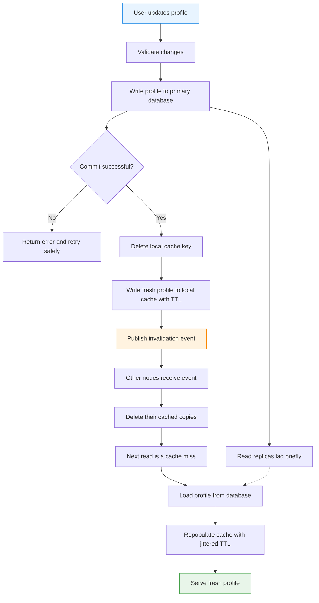

| Difficulty | Channel | Tags |
|---|---|---|
| beginner | backend | redis, memcached, cache-invalidation |

On Facebook's social graph, profile reads outnumbered writes by roughly 100 to 1, so almost every profile view came from a distributed memcached tier spanning thousands of servers and multiple regions [1]. That tier held trillions of items and absorbed billions of requests per second, yet every single profile edit still had to invalidate the right copies without corrupting the source of truth [1]. The cache looked like a performance win until it became a consistency problem hiding in plain sight. The way Meta's engineers handled that tension reveals the real trade-offs between Redis and Memcached.

---

> ### Real-World Case — Meta (Facebook)
>
> Facebook's social graph and profile reads massively outnumbered writes—roughly two orders of magnitude more reads than writes—so almost all user data was served from a distributed memcached tier. But profile and graph updates still had to invalidate cached copies consistently across thousands of servers and multiple regions.
>
> | | |
> |---|---|
> | **Challenge** | Keep cached user data fresh after database writes without sacrificing availability or hammering the database. Naive cache-aside set-on-write created stale sets during concurrent read-modify-write races, and hot keys caused thundering herds when a popular item was invalidated. |
> | **Solution** | Facebook invalidated on write by deleting the key rather than setting the new value, because deletes are idempotent and safe even if they arrive out of order. It added memcached 'leases': a 64-bit token issued on a cache miss that is invalidated by a delete, preventing a slow reader from writing a stale value back. Leases also coalesced thundering herds by allowing only one lease per key every 10 seconds. Cross-region invalidations were batched by dedicated daemons (McSqueal) and routed through mcrouter. |
> | **Outcome** | The memcached layer scaled to billions of requests per second, held trillions of items, and served over a billion users. The lease mechanism eliminated stale sets and protected the database from hot-key stampedes, while delete-based invalidation kept cache consistency without transactional replication. |
> | **Lesson** | On update, delete the cache key instead of overwriting it—deletion is idempotent and demand-filled, so it stays correct under races and eviction. TTLs alone are not invalidation; you need a coordination primitive like leases to stop stale writes and thundering herds. |

---

## Hook — The Profile Edit That Outran the Database

Picture a user changing a profile photo at 9 p.m. The write lands in the primary database, the API returns 200, and the user sees the new photo in their own browser. Then a friend in another region refreshes the profile and sees the old one. No error was logged. No deployment failed. The system simply served a different version of reality from a cache that had not heard about the update.

Multiply that moment by millions of users and thousands of cache nodes, and you have one of the most consequential consistency puzzles in backend engineering. The stakes are not just a stale avatar. They are privacy settings, account status, follower counts, and trust. A profile service is a read-heavy system with a write path that can quietly break the read path.

The fix sounds simple: delete the cached key. The hard part is deleting it everywhere, at the right time, without creating a new failure mode. That is where the story gets interesting.

## Problem — Reads Scale, Writes Rattle the System

That stale-photo moment gets sharper when you look at the ratio. When reads outnumber writes by two orders of magnitude, caching is not an optimization; it is the only way the database survives [1]. Every profile view becomes a cache lookup, and every profile edit becomes a small distributed-systems event. The cache is no longer a sidecar. It is part of the user experience.

The naive fix is to update the cache on every write. However, concurrent reads and writes can interleave in ways that leave a stale value behind: a reader misses, fetches an older database row, and writes that row back into the cache after the update. Even a write-through cache can lose the race if the database replica or the cache update order is wrong [4]. This is why teams often delete the key after the database commit and let the next read repopulate it.

TTL is the safety net, not the strategy. A 5-to-30-minute TTL on profiles bounds how long a missed invalidation can hurt, but it does not make the system correct on its own [4]. Popular profiles also create hot keys, and a synchronized cache miss can send a stampede of requests to the database, a classic thundering-herd problem [8]. Sound familiar? The problem is not caching. The problem is coordinating independent copies across failure domains.

## Real-World Case — Meta (Facebook)'s Memcached Fleet

To see why this problem is so hard, look at Facebook's social graph at scale. The company's profile and graph reads massively outnumbered writes, so almost all user data was served from a distributed memcached tier [1]. That tier grew to billions of requests per second, trillions of items, and more than a billion users, with thousands of servers and multiple regions in the path [1].

The plot twist is that the winning design was not a transactional cache that promised perfect replication. Facebook used delete-based invalidation to keep cached copies consistent without transactional replication, and added leases to prevent stale sets [1]. A lease is a short-lived token that lets one client fetch and repopulate a missing key while others wait or retry, which also protects the database from hot-key stampedes [7]. In other words, the system accepted that caches are independent copies and made invalidation explicit, fast, and failure-aware.

The impact is the lesson: the memcached layer scaled to billions of requests per second, held trillions of items, and served over a billion users, while leases eliminated stale sets and delete-based invalidation kept consistency without transactional replication [1]. 🔥 Hot Take: the most important cache feature at Meta's scale was not raw speed. It was the discipline of knowing exactly when a cached copy must die.

## Deep Dive — Redis vs Memcached and the Invalidation Trade-off

Understanding Meta's design starts with the two patterns every profile service juggles. Write-through caching persists the profile and updates the cache on the writer's path, while cache-aside keeps the cache out of the write path and fills it on demand. The interview-ready answer is write-through with a TTL, but production systems often combine write-through for the local node with delete-based fan-out for every other node [4]. On an update, the database commit must happen first, then the key is deleted, then a fresh value is written or the next read repopulates it.

The choice between Redis and Memcached is less about benchmarks and more about which failure modes you want to own. Redis brings data structures, optional persistence, and Pub/Sub for distributed invalidation [2][6]. Memcached brings a deliberately simple key-value cache with lower per-key overhead and straightforward horizontal scaling [3]. The TTL itself is a freshness contract, the same idea behind HTTP Cache-Control max-age [5]. Here is the real trade-off:

| Capability | Redis | Memcached | What it means for profiles |
|---|---|---|---|
| Data model | Strings, hashes, lists, sets, streams [2] | Opaque key-value blobs [3] | Redis can store versioned metadata; Memcached is excellent for serialized profile JSON. |
| Invalidation | Pub/Sub fan-out [6] | No built-in pub/sub [3] | Redis shortens cross-node invalidation; Memcached needs a separate message bus. |
| Persistence | Optional snapshots and append-only file [2] | In-memory only [3] | Redis survives restarts; Memcached restarts cold. |
| Scaling | Cluster and Sentinel add operational complexity | Simple client-side sharding | Memcached is easier when the cache is pure and disposable. |
| Memory overhead | Higher per-key metadata | Lower per-key overhead | Memcached can win on raw bytes per cached profile. |

💡 Insight: choose Redis when invalidation, data structures, or durability are part of the product; choose Memcached when the cache is a disposable speed layer and simplicity is the feature. ⚠️ Watch Out: Redis Pub/Sub is fire-and-forget, so a subscriber that is offline misses the message [6]. TTL or a durable change stream must cover that gap. 🎯 Key Point: TTL is not an invalidation strategy. It is the backstop for the invalidation strategy you failed to deliver.

## Workflow — From Update to Global Consistency

That architecture becomes actionable when you turn it into an ordered workflow. The diagram below traces the path from a profile edit to a globally consistent read, including the replica-lag branch that causes so many stale-cache bugs.

1. **Validate and persist.** Accept the profile change, validate authorization and shape, and commit it to the primary database. The cache must never be the source of truth.
2. **Delete the local key.** After the commit succeeds, delete the cached profile on the node handling the write. Deleting first is safer than blindly overwriting because it avoids leaving a stale value if the next step fails.
3. **Write the fresh local value.** Populate the local cache with the committed profile and a jittered TTL. Jitter prevents a fleet of profiles from expiring at the same instant.
4. **Publish the invalidation.** Send a compact event containing the user ID, cache version, and originating node over Redis Pub/Sub or a durable message bus [6].
5. **Delete remote copies.** Every other node consumes the event, ignores its own origin, and deletes its cached copy.
6. **Repopulate on the next read.** The next request misses, loads the committed profile from the database, and fills the cache. If a hot key triggers a stampede, use a lease or request coalescing to let one caller refresh while the rest wait [7][8].

The ordering is the story: commit, delete, publish, repopulate. Reverse any two steps and you create a window where stale data can win. Notice also that the workflow never asks the cache to be the database. It asks the cache to be an obedient copy with an expiration date.

## Code Example — Write-Through with Delete-First Invalidation

With the workflow fixed, the code becomes much easier to reason about. The snippet below implements a compact Python profile service with a Redis cache, a database interface, write-through local updates, and Pub/Sub invalidation for remote nodes. It is intentionally small enough to read in one sitting, but the comments mark the places where production systems add version checks, durable events, and retries.

The critical design choice is the order of operations: the database commit happens before any cache mutation, the local key is deleted before it is refreshed, and remote nodes receive an invalidation event rather than a blind overwrite. That ordering is what keeps a slow read from resurrecting an old profile.

## Lessons Learned — What to Carry Into Your Next Profile Service

The story ends where it started: a profile edit, a cache fleet, and a user expecting to see the truth. Meta's memcached tier is not a tribute to one technology. It is a reminder that cache invalidation is a workflow, not a single line of code. Here is what to carry forward:

- **Commit before you cache.** The database is the source of truth; any cache mutation after a failed commit is a future incident.
- **Delete, then repopulate.** Blind overwrites lose races. A delete-first path plus TTL is easier to reason about under concurrency [4].
- **Make invalidation durable or bounded.** Redis Pub/Sub is convenient but lossy for offline subscribers [6]. Pair it with TTL, an outbox, or change data capture.
- **Protect hot keys.** Leases or request coalescing stop a single popular profile from turning a cache miss into a database stampede [7][8].
- **Monitor the cache as a product.** Track hit rate, eviction rate, p99 latency, error rate, and database load. A hit-rate drop is an early warning, not a vanity metric.
- **Pick the simpler tool when the cache is disposable.** Memcached is often the right answer for raw profile blobs; Redis is worth the complexity when invalidation and durability matter [2][3].

Common battle scars include invalidating before commit, overwriting without a version, using a fixed TTL for every key, and treating a missed Pub/Sub message as impossible.

🎯 Key Point: the cache is a copy, never the truth. The moment a team forgets that, a simple profile update becomes a distributed-systems mystery. The teams that get this right do not just choose Redis or Memcached. They design the invalidation path first, then choose the cache that fits it.

---

## Profile Update and Invalidation Flow

<strong>Original Interview Question</strong>

**Q:** You're building a user profile service that caches frequently accessed profiles. How would you implement cache invalidation when a user updates their profile, and what trade-offs would you consider between Redis and Memcached?

**A:** Implement write-through caching with TTL-based expiration. On profile update, invalidate the cache by deleting the key and writing new data to both the database and cache. Redis offers pub/sub for automatic distributed invalidation, while Memcached requires manual coordination across nodes.

## Conclusion

Meta's story is not an argument for one cache vendor; it is a lesson in ownership. The same failure modes that shaped a fleet serving over a billion users also appear in a startup with 10,000 users: a stale avatar, a privacy flag that will not update, a cache miss that takes down the database. The difference is scale, not kind.

Tomorrow, audit one write path in your profile service. Ask three questions: Does the database commit happen before invalidation? Can a reader resurrect a stale value? What happens when the invalidation message is lost? If those answers are uncomfortable, you have found the next bug before it finds your users. The memorable insight is simple: cache invalidation is not a cleanup task. It is the contract that keeps a fast system honest.

---

## References

1. [Meta (Facebook) incident report](https://www.usenix.org/conference/nsdi13/technical-sessions/presentation/nishtala) — article
2. [Redis — Wikipedia](https://en.wikipedia.org/wiki/Redis) — documentation
3. [Memcached wiki](https://github.com/memcached/memcached/wiki) — documentation
4. [Cache invalidation — Wikipedia](https://en.wikipedia.org/wiki/Cache_invalidation) — documentation
5. [Cache-Control — HTTP headers](https://developer.mozilla.org/en-US/docs/Web/HTTP/Headers/Cache-Control) — documentation
6. [Redis SUBSCRIBE command](https://redis.io/docs/latest/commands/subscribe/) — documentation
7. [Scaling Memcache at Facebook](https://www.usenix.org/system/files/conference/nsdi13/nsdi13-final170_update.pdf) — paper
8. [Thundering herd problem — Wikipedia](https://en.wikipedia.org/wiki/Thundering_herd_problem) — documentation

---

**Author:** Satishkumar Dhule — [GitHub](https://github.com/satishkumar-dhule) · [LinkedIn](https://linkedin.com/in/satishkumar-dhule) · [Website](https://satishkumar-dhule.github.io)
