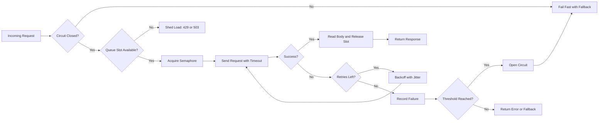

| Difficulty | Channel | Tags |
|---|---|---|
| advanced | backend | asyncio, aiohttp, concurrency |

At 9:14 p.m., one downstream service starts answering in 30 seconds instead of 30 milliseconds. Nobody changed a line of code, yet within minutes every worker is blocked, queues are full, and a routine traffic spike becomes a full outage. Netflix hit this exact wall as its API fanned a single user request across dozens of services, and the company's answer was not a bigger pool — it was isolation, bounded concurrency, and load shedding [1]. The lesson is uncomfortable: in a distributed system, your connection pool is not plumbing, it is a control system for failure. Here is how to build one for aiohttp that bends under pressure instead of snapping.

---

> ### Real-World Case — Netflix
>
> Netflix's API fanned out each user request to dozens of downstream services, so a single slow or failing dependency could tie up every request thread and cascade into a full outage. The team needed per-dependency isolation, bounded concurrency, and a way to shed load instead of amplifying it.
>
> | | |
> |---|---|
> | **Challenge** | How do you cap concurrent connections to each dependency, enforce timeouts, and degrade gracefully when a service becomes latent — without a retry or connection-pool stampede that takes down the whole API? |
> | **Solution** | Netflix built Hystrix: every dependency call runs as a command inside a per-dependency thread pool or semaphore (bulkhead) sized to a small fraction of total resources, with timeouts near p99.5, a circuit breaker that short-circuits failing dependencies, and fallbacks for graceful degradation. When a dependency got latent, Netflix explicitly refused to grow pools or timeouts, because that just holds more hung connections. |
> | **Outcome** | The system ran 100+ command types and 40+ thread pools, executing 10+ billion thread-isolated and 200+ billion semaphore-isolated calls per day. In one documented case, a single latent dependency tripped the breaker on about one-third of the cluster while other circuits stayed healthy and users received degraded-but-functional fallbacks. Netflix showed that 100 servers × 10 connections = 1,000 connections; doubling to 20 would have created 2,000 hung connections and worsened the incident. |
> | **Lesson** | Under stress, adding capacity is often the wrong move. If a downstream is slow, more connections, threads, or timeout budget just holds more stuck work and amplifies the failure; bound concurrency, fail fast, shed load, and let the circuit breaker release pressure so the dependency can recover. |

---

## Hook — The 1,000-Connection Trap

It starts with a delay you would barely notice. One dependency that normally replies in 30 milliseconds now takes 30 seconds. Your aiohttp service keeps accepting requests, keeps opening connections, and keeps waiting. Within a minute, every slot in the pool is occupied by a request that is technically alive but practically dead. New requests queue behind them, memory climbs, health checks start timing out, and the load balancer sends even more traffic to the instance that is already drowning. Sound familiar?

This is the trap Netflix documented at scale. A single slow dependency could consume every request thread because the API fanned out to dozens of downstream services [1]. The instinct in that moment is almost always the same: raise the connection limit. Give the pool more room. Let the queue breathe.

That instinct is backwards. Netflix showed the arithmetic plainly: 100 servers × 10 connections equals 1,000 connections, and doubling to 20 per server would have created 2,000 hung connections, making the incident worse rather than better [1]. The pool was never the bottleneck. The missing control system was.

⚠️ Watch Out: Under load, an unbounded queue is not a buffer. It is a delayed outage with a larger memory bill.

## Problem — When One Slow Dependency Becomes Everyone's Outage

The core problem is not slowness. It is shared fate. When every request path shares the same connection budget, one degraded dependency can starve every healthy feature behind it. A search box that depends on a recommendations API goes down because the checkout service is slow. That is a cascade, and it is the default behavior unless someone deliberately designs against it.

Several forces amplify the cascade:

- **Connection starvation:** Requests hold connections while waiting on a dependency, so healthy dependencies cannot get a slot.
- **Retry storms:** Clients retry failures at the same moment, multiplying traffic against a service that is already struggling [8].
- **Timeout mismatch:** An upstream timeout that is longer than the caller's budget turns a recoverable delay into a pile of abandoned work.
- **Queue amplification:** A queue with no deadline absorbs pressure until memory or latency becomes the new failure mode.
- **Shared pools:** One global semaphore protects the process, but it does not protect one dependency from another.

Many developers think of a connection pool as a performance optimization. In production, it is closer to a bulkhead on a ship. A bulkhead does not make the ship faster; it keeps one flooded compartment from sinking the whole vessel. The same logic applies to services: isolate each dependency, bound how much work it can consume, and decide in advance what happens when the bound is reached [8].

Consequently, the design question changes. It is no longer "How many connections can this service open?" It becomes "How much pressure is each dependency allowed to apply before the system sheds load?" That shift is the difference between a pool that amplifies an incident and one that contains it.

## Real-World Case — Netflix's Circuit Breakers

Netflix did not solve this problem with a larger pool. The company's API had grown to more than 100 command types and 40+ thread pools, executing over 10 billion thread-isolated and 200 billion semaphore-isolated calls per day [1]. At that scale, per-dependency isolation is not a nice-to-have; it is the only way to keep a single failing dependency from consuming the entire request path.

The mechanism was Hystrix, Netflix's latency and fault-tolerance library. Each dependency got its own isolated execution pool or semaphore, its own timeout, and its own circuit breaker [1][11]. When failures crossed a threshold, the breaker opened for that dependency alone. Requests failed fast into a fallback while other circuits stayed healthy.

In one documented case, a single latent dependency tripped the breaker on about one-third of the cluster, yet the remaining circuits stayed healthy and users received degraded-but-functional fallbacks [1]. That is the transformation worth studying: the incident still happened, but it did not become a total outage. The blast radius was bounded by design.

The connection arithmetic is equally important. Netflix explicitly warned that 100 servers × 10 connections equals 1,000 connections, and doubling the per-server limit to 20 would have produced 2,000 hung connections, worsening the incident [1]. More capacity without more isolation simply gives the failure more places to hide.

🎯 Key Point: The goal is not to keep every request alive. The goal is to keep the system alive while some requests fail.

## Deep Dive — Semaphores, Breakers, and the Math of Backpressure

A production-grade aiohttp pool combines four mechanisms. Each one answers a different question, and skipping any of them leaves a gap that load will eventually find.

**1. Semaphore-based concurrency limiting.** An asyncio semaphore caps how many requests can hold a connection at once [2]. This is the bulkhead. The important nuance is that the semaphore should be scoped per dependency, not shared across the entire process. A global limit stops the process from exploding, but it still lets one slow dependency consume slots that belong to healthy ones. Also, the acquire itself needs a deadline. Waiting forever for a slot is just a quieter form of failure [12].

**2. Circuit breakers with three states.** A breaker tracks failures per dependency and moves between closed, open, and half-open states [6][7]. Closed means traffic flows. Open means fail fast for a cooldown period. Half-open allows a small number of probe requests to test recovery before restoring full traffic. That half-open state is where most naive implementations break: they jump straight from open to closed and immediately flood a dependency that has only just recovered.

**3. Exponential backoff with jitter.** Retries are useful only when they are not synchronized. Full jitter picks a random delay between zero and the exponential ceiling, which spreads retries across time instead of creating a thundering herd [5][9]. Retry only idempotent operations, cap the attempts, and never retry a circuit-open error.

**4. Timeouts that form a budget.** aiohttp separates total, connect, and socket-read timeouts [3][4]. A connect timeout should be short because a refused or unreachable dependency is not going to become reachable in 30 seconds. The total timeout should be shorter than the caller's deadline, leaving room for fallback logic and response serialization.

| Strategy | What it buys you | What it costs |
| --- | --- | --- |
| Increase pool size | Short-term headroom | More hung connections, higher memory, slower recovery |
| Queue without a deadline | Smooths small bursts | Latency creep, memory growth, hidden overload |
| Fail fast with fallback | Protects the caller | Visible feature degradation |
| Breaker plus jittered retry | Stops amplification | Threshold tuning and occasional false positives |

💡 Insight: Circuit breakers are not about preventing failure. They are about converting a fast-moving cascade into a slow, observable, recoverable degradation.

## Workflow — Designing the Pool Before Writing a Line

The code is the easy part. The design decisions come first, because a pool is only as good as the assumptions baked into it.

1. **Map every downstream dependency.** List the services each request path touches and assign an owner. A pool without a dependency map is just a global semaphore with extra steps.
2. **Set a latency budget per request.** If the caller has 800 milliseconds, no downstream call should be allowed to consume all of it. Divide the budget across hops and make timeouts inherit from it.
3. **Size the pool from throughput and latency.** Using Little's Law, concurrency equals arrival rate multiplied by average time in the system. A pool sized from vibes will either throttle healthy traffic or hide overload.
4. **Add a queue deadline.** When the semaphore cannot be acquired within a short window, shed the request immediately with a clear error or fallback [8].
5. **Wrap each dependency in its own breaker.** Track failures separately, and use half-open probes instead of a full reopen.
6. **Retry selectively with full jitter.** Only idempotent calls, only bounded attempts, and never past the caller's deadline [5].
7. **Instrument everything.** Emit metrics for queue wait time, semaphore saturation, breaker state, retry counts, and fallback rates. Without these, tuning is guesswork.
8. **Warm up and drain cleanly.** Open connections during startup where appropriate, and close the session during shutdown so in-flight work is not abandoned [10].

The flowchart below captures the decision path for a single request. Notice that failure is handled at multiple points, not just at the network call.

This leads directly to the implementation. The code mirrors the diagram step for step, which makes the behavior easier to reason about during an incident.

## Code Example — A Pool Manager That Sheds Load on Purpose

The implementation below keeps the critical decisions explicit: a semaphore for concurrency, a deadline for queueing, a breaker per dependency, and jittered retries. It returns the response body inside the context manager rather than handing a live response back to the caller, which is one of the simplest ways to prevent connection leaks.

Read it as a set of guardrails rather than a finished library. In a real service, the breaker and semaphore would live in a registry keyed by dependency name, and the metrics would be exported to your observability stack.

## Lessons Learned — What to Do Differently Tomorrow

The Netflix case is memorable because the fix was counterintuitive. Teams did not survive by adding capacity; they survived by refusing to let one dependency consume everything [1]. That principle translates directly to aiohttp.

- **Bound the queue, not just the pool.** A semaphore without an acquire timeout hides overload until memory or latency forces the issue.
- **Isolate by dependency.** One global pool protects the process but not the feature. Per-dependency pools contain the blast radius.
- **Prefer fail-fast over slow-fail.** A fast 503 with a fallback is often better than a 30-second timeout that consumes a connection slot.
- **Add jitter to every retry.** Synchronized retries turn a small blip into a self-inflicted denial of service [5].
- **Make breaker state observable.** An open circuit should be a dashboard event, not a mystery discovered in logs.
- **Close sessions on shutdown.** Abandoned sessions leak connections and produce confusing errors during deploys [10].
- **Validate TLS and DNS settings explicitly.** Defaults are usually safe, but production networks are not always default-shaped [3].

🔥 Hot Take: If your pool has no load-shedding path, it does not have a degradation strategy. It has a waiting room for failure.

The so-what is simple. Tomorrow, add one queue timeout and one per-dependency breaker. Then watch the metrics for a week before touching the pool size. Most teams discover that the real bottleneck was never the number of connections; it was the absence of a decision about what to do when the pool is full.

---

## Request Lifecycle with Load Shedding

<strong>Original Interview Question</strong>

**Q:** How would you implement a connection pool manager for aiohttp that handles graceful degradation under high load and connection timeouts?

**A:** Implement a connection pool manager for aiohttp using a semaphore to limit concurrent connections, exponential backoff for retrying failed requests, and circuit breaker pattern to gracefully degrade under high load and connection timeouts.

## Conclusion

The Netflix story begins with a slow dependency and ends with a system that stayed partially useful instead of fully down [1]. That is the transformation to aim for in your own aiohttp services. You do not need 40 thread pools or billions of calls per day to benefit from the same ideas. You need a semaphore with a deadline, a breaker with a half-open state, retries with jitter, and the discipline to shed load before the queue becomes the incident. The one insight worth sharing with your team is this: the goal is not to keep every request alive; it is to keep the system alive while some requests fail. Start tomorrow by adding a queue timeout and a per-dependency breaker, then measure what actually happens under pressure.

---

## References

1. [Netflix incident report](https://github.com/Netflix/Hystrix/wiki/Operations) — article
2. [Python asyncio synchronization primitives](https://docs.python.org/3/library/asyncio-sync.html) — documentation
3. [aiohttp client advanced reference](https://docs.aiohttp.org/en/stable/client_advanced.html) — documentation
4. [aiohttp client quickstart](https://docs.aiohttp.org/en/stable/client_quickstart.html) — documentation
5. [AWS exponential backoff and jitter](https://docs.aws.amazon.com/general/latest/gr/api-retries.html) — documentation
6. [Martin Fowler on the CircuitBreaker pattern](https://martinfowler.com/bliki/CircuitBreaker.html) — blog
7. [Circuit breaker design pattern](https://en.wikipedia.org/wiki/Circuit_breaker_design_pattern) — documentation
8. [Google SRE book: Handling overload](https://sre.google/sre-book/handling-overload/) — documentation
9. [AWS Builders' Library: Timeouts, retries, and backoff with jitter](https://aws.amazon.com/builders-library/timeouts-retries-and-backoff-with-jitter/) — blog
10. [aiohttp GitHub repository](https://github.com/aio-libs/aiohttp) — documentation
11. [Netflix Hystrix GitHub repository](https://github.com/Netflix/Hystrix) — documentation
12. [Python asyncio tasks and timeouts](https://docs.python.org/3/library/asyncio-task.html) — documentation

---

**Author:** Satishkumar Dhule — [GitHub](https://github.com/satishkumar-dhule) · [LinkedIn](https://linkedin.com/in/satishkumar-dhule) · [Website](https://satishkumar-dhule.github.io)
