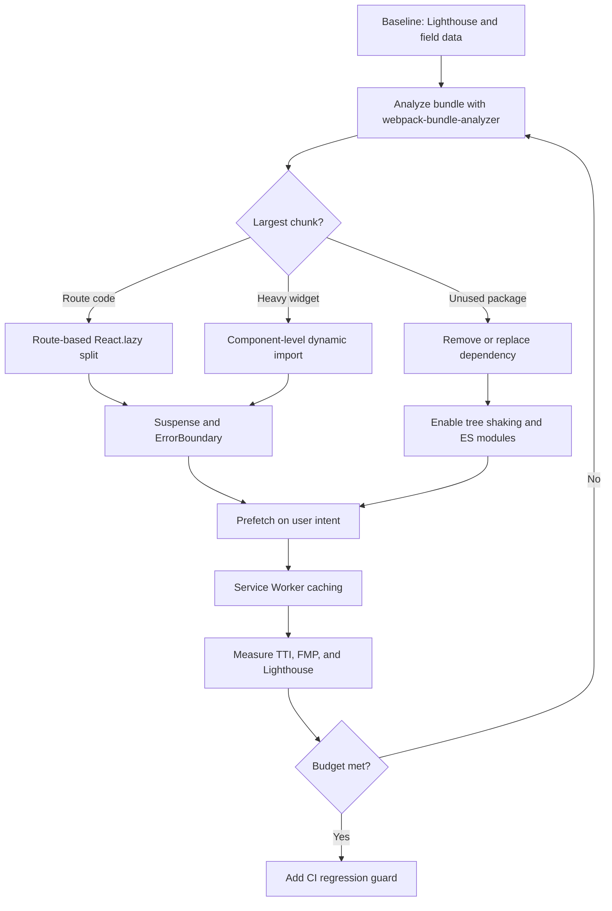

| Difficulty | Channel | Tags |
|---|---|---|
| intermediate | frontend | lighthouse, bundle, lazy-loading |

In 2017, Pinterest's mobile web experience made users on average Android hardware wait up to 23 seconds over slow 3G before the page became usable, because the site shipped more than 2.5 MB of JavaScript [1]. That is long enough to abandon the tab, open a competitor, and never come back. The company rebuilt the experience as a Progressive Web App and treated performance as a hard product requirement, not a cleanup task [1]. The result offers a blueprint for any React team staring at a 2.1 MB bundle, a 4.2-second Time to Interactive, and a Lighthouse score stuck at 65.

---

> ### Real-World Case — Pinterest
>
> In 2017 Pinterest's mobile web experience was a JavaScript monolith. On average Android hardware over slow 3G, users waited up to 23 seconds before any UI was usable, because the site shipped over 2.5MB of JavaScript (~1.5MB main bundle plus ~1MB lazily loaded). Pinterest rebuilt it as a Progressive Web App with performance as a hard requirement.
>
> | | |
> |---|---|
> | **Challenge** | Drastically reduce the initial JavaScript payload and Time to Interactive for a large React/Redux application without removing product functionality, while keeping dozens of routes and features working on low-end mobile devices and poor networks. |
> | **Solution** | Pinterest split the monolith into route-based webpack chunks using React Router: a ~73KB vendor chunk (React, Redux, React Router), a ~72KB entry chunk, and 13-18KB async route chunks loaded on demand. They used webpack-bundle-analyzer (and their own Bonsai analyzer) to find bloat, lazy-loaded non-critical advertiser workflows, extracted single methods from huge helper libraries instead of shipping entire libraries, removed unnecessary React context providers, and added service worker precaching. Crucially, the analyzer revealed duplicate code spread across async chunks, so they moved that shared code into the main chunk. |
> | **Outcome** | The core bundle dropped from 650KB to 150KB. First Meaningful Paint fell from 4.2s to 1.8s, and Time to Interactive dropped from 23s to 5.6s on average Android hardware over slow 3G, then to 3.9s on repeat visits thanks to Service Worker caching. The ~150KB gzipped web experience delivered the same home feed at a fraction of the 9.6MB Android and 56MB iOS app download costs. |
> | **Lesson** | The counterintuitive finding: consolidating duplicated code into the main chunk increased the entry bundle by 20% but shrank every lazy-loaded chunk by up to 90%, proving that the smallest initial bundle is not always the fastest real experience. The chunk graph matters more than a single number, and because one bad import can silently bloat everything, Pinterest later enforced bundle-size budgets, CI alerts, and custom ESLint rules to prevent regressions. |

---

## Hook — Twenty-Three Seconds of Nothing Useful

Picture a user on a mid-range Android phone, standing in a queue, opening Pinterest on slow 3G. The screen shows a shell, then nothing useful for up to 23 seconds [1]. The browser has already downloaded more than 2.5 MB of JavaScript, and the main thread is still busy parsing and executing it [1]. That is the moment performance stops being an engineering metric and becomes a product decision: every additional kilobyte is a tax on attention.

The uncomfortable truth is that most React apps do not have a JavaScript problem because developers are careless. They have one because the default architecture asks every visitor to pay for every feature at once. The home page imports the analytics dashboard. The login screen pulls in the rich text editor. The marketing header drags along a charting library that only appears three clicks later. Nobody chose that outcome, but everybody shipped it.

🎯 Key Point: The fix is not a single library or a magic webpack flag. It is a change in when code loads relative to when users need it.

## Problem — A 2.1 MB Bundle and a 4.2-Second Promise

Now bring that story closer to home. The brief is familiar: a React app scores 65 on Lighthouse, ships a 2.1 MB bundle, and reaches Time to Interactive in 4.2 seconds. The target is 90+. On paper, that sounds like a few webpack settings. In practice, it is a negotiation between network cost, parse cost, execution cost, and perceived speed. Lighthouse rolls those pressures into a weighted lab score [5], while Time to Interactive tries to capture when the page can reliably respond to input [10]. Neither number is the user's full experience, but both point at the same bottleneck: too much JavaScript on the critical path.

A 2.1 MB bundle is not one number. It is hundreds of modules, polyfills, duplicated helpers, icon packs, third-party SDKs, and components that were imported for convenience and never questioned again. On a fast laptop, that weight hides behind a warm cache and a powerful CPU. On a mid-range phone, the browser must download, decompress, parse, compile, and execute the same bytes while the main thread is also trying to render the page. The result feels like a site that is thinking very hard about whether to exist.

The trap is chasing the score instead of the cause. Teams minify harder, inline critical CSS, and add preload hints, then wonder why the number barely moves. Those tactics can help, but they do not fix an architecture that ships the entire product on first load. The real question is not how to use React.lazy. The real question is which code has earned the right to load before the user needs it.

⚠️ Watch Out: A Lighthouse score is a diagnostic, not a trophy. Optimizing only the lab score can produce a faster synthetic page and a slower real experience.

## Real-World Case — Pinterest's JavaScript Monolith

In 2017, Pinterest answered that question under pressure. Its mobile web experience was a JavaScript monolith: roughly 1.5 MB in the main bundle plus about 1 MB loaded lazily, and on average Android hardware over slow 3G, users could wait up to 23 seconds before any UI was usable [1]. The page was technically interactive long before it felt interactive. For a visual discovery product, that delay was especially brutal: the entire value proposition depended on showing the feed quickly.

Pinterest rebuilt the experience as a Progressive Web App with performance as a hard requirement. The core bundle dropped from 650 KB to 150 KB. First Meaningful Paint fell from 4.2 seconds to 1.8 seconds, and Time to Interactive dropped from 23 seconds to 5.6 seconds on average Android hardware over slow 3G, then to 3.9 seconds on repeat visits thanks to Service Worker caching [1]. The roughly 150 KB gzipped web experience delivered the same home feed at a fraction of the 9.6 MB Android and 56 MB iOS app download costs [1].

What makes the case durable is not the dramatic before-and-after table. It is the discipline behind it. The team treated the bundle as a product surface, measured what users actually experienced, and made performance a release requirement rather than a quarterly cleanup. The biggest win did not come from loading less code in general. It came from changing when code loaded relative to user intent.

🔥 Hot Take: Pinterest's result is often summarized as a code-splitting victory. The deeper lesson is that performance budgets change architecture, and architecture changes what users feel.

## Deep Dive — What Actually Moves the Needle

Building on Pinterest's lesson, the work starts with evidence, not instinct. webpack-bundle-analyzer turns the bundle into a map of who is actually shipping weight [6]. Source maps let you trace a suspicious chunk back to the exact import. Lighthouse tells you the score moved, but the analyzer tells you why. Without that map, teams tend to split the wrong things and optimize the smallest chunks because they are easy to see.

Code splitting is the practice of breaking a bundle into chunks that load on demand [4]. There are two useful levels, and they solve different problems:

| Strategy | Best for | Risk |
| --- | --- | --- |
| Route-based splitting | Pages with distinct URLs and clear navigation boundaries | Too many tiny routes can create a request waterfall |
| Component-based splitting | Heavy widgets, modals, editors, charts, and below-the-fold features | A late chunk can make an important interaction feel slow |
| Dependency-level splitting | Large third-party libraries used by one feature | Version drift and duplicated dependencies across chunks |

Tree shaking is the quiet multiplier. When the build understands ES modules and can prove that an export is unused, it removes dead code [7]. That sounds automatic, and sometimes it is, but CommonJS dependencies, side-effectful imports, and barrel files can silently defeat it. A single `import { everything } from './utils'` can pull in far more than the three functions you call.

Then comes the counterintuitive part: more chunks are not automatically better. A route split that creates twelve tiny requests can produce a waterfall where each chunk waits for the previous one. A 40 KB chunk requested one second late can feel slower than a 60 KB chunk that was already in the initial bundle. The goal is fewer critical bytes, not more files.

💡 Insight: Dynamic imports work best when they are tied to intent. Prefetch the checkout route when the user hovers over the cart button. Load the chart when the user opens the analytics panel. Do not lazy-load the hero image and call it performance.

Images and caching complete the picture. Lazy loading images with the browser's native `loading='lazy'` attribute or an Intersection Observer avoids downloading offscreen media too early [9]. A Service Worker can then cache hashed assets and serve repeat visits from local storage, which is how Pinterest reached 3.9-second TTI on return visits [1][8]. However, a Service Worker is not a magic cache. It is a versioned contract, and a careless cache strategy can serve stale JavaScript long after a deploy.

## Workflow — From Audit to Guardrail

Here is a repeatable sequence that turns the analysis into shipped improvements. The diagram below maps the same flow visually.

1. Establish a baseline. Capture Lighthouse results, field data, and a bundle report before changing anything [5][6]. If the team cannot explain which chunk is largest, the optimization is guesswork.
2. Set a bundle budget. Pick a realistic first-load JavaScript budget and assign an owner. A budget without an owner is a wish.
3. Split by route first. Convert top-level pages to `React.lazy` imports with a shared Suspense fallback [3][4]. Route boundaries are natural because users already understand navigation.
4. Isolate heavy components. Charts, editors, maps, modals, and admin-only tools should load when the user asks for them, not when the app boots.
5. Audit dependencies. Replace oversized libraries, remove unused packages, and fix barrel imports that defeat tree shaking.
6. Add boundaries. Wrap lazy regions in Suspense and an error boundary so a failed chunk request does not take down the whole app.
7. Prefetch on intent. Warm the next likely route on hover, focus, or viewport visibility instead of loading everything up front.
8. Cache deliberately. Use hashed filenames and a Service Worker strategy that updates cleanly on deploy [8].
9. Guard the win in CI. Fail the build when the main bundle exceeds the budget. Performance that is not enforced will regress.

The order matters. If you split before measuring, you cannot tell which change helped. If you cache before versioning, you create a new class of bugs. If you set a budget without CI enforcement, the next feature sprint quietly spends it.

## Code Example — Splitting Routes Without Breaking the Experience

The following pattern is intentionally boring, which is exactly what production code should be. It combines route-level splitting with a component-level split that waits for a click. The fallback is announced to assistive technology, and an error boundary catches failed chunk downloads so users see a recovery message instead of a blank screen.

Notice what is not happening: no lazy import is created inside render, no above-the-fold hero is deferred, and no route is split so finely that the browser needs a scavenger hunt. The code keeps the first load small while preserving a usable experience when a chunk arrives late or fails.

Many developers discover the hard way that `React.lazy` is only half the pattern. The other half is deciding where the Suspense boundary belongs, what the fallback should say, and how the app recovers when the network drops mid-navigation.

## Lessons Learned — The Performance Habits That Stick

Pinterest's 23-second wait is a dramatic example, but the same lessons apply at smaller scale. A React app does not need to be a monolith to ship too much JavaScript. It only needs enough convenience imports, enough third-party scripts, and enough features that nobody measured.

- Measure before splitting. Use the bundle analyzer to find the largest chunks and the source map to find the import that created them [6].
- Treat the bundle as a budget. A performance budget turns an abstract goal into a release constraint.
- Split by route first, then by component. Route boundaries are predictable and easy to reason about [4].
- Lazy-load on intent, not on a timer. Load heavy code when the user shows interest, not when the app guesses.
- Keep fallbacks honest. A spinner that appears for 20 milliseconds is visual noise; a skeleton that matches the layout feels faster.
- Make failure recoverable. Chunk loading fails on flaky networks, corporate proxies, and stale deployments. An error boundary is not optional.
- Cache with a contract. Hashed assets and a versioned Service Worker prevent stale-code mysteries [8].
- Guard the win in CI. Without a regression check, the next sprint will undo the optimization.

Battle scars are predictable. Teams lazy-load a component inside a render function and create a new chunk request on every render. They split so aggressively that mobile users wait on a chain of tiny files. They enable tree shaking but keep importing from a CommonJS package that ignores it. They add a Service Worker and then spend a week debugging why an old deploy is still alive. Each mistake is avoidable with a review checklist and a measurement loop.

🎯 Key Point: Performance is not a one-time project. It is a set of constraints that keep architecture honest as the product grows.

---

## Bundle Optimization Workflow

<strong>Original Interview Question</strong>

**Q:** You're tasked with improving a React app's Lighthouse performance score from 65 to 90+. The bundle size is 2.1MB and Time to Interactive is 4.2s. What specific steps would you take to optimize the bundle and implement lazy loading?

**A:** Implement code splitting with React.lazy() and Suspense, analyze bundle composition with webpack-bundle-analyzer to identify largest chunks, remove unused dependencies and optimize imports, add dynamic imports for heavy components and third-party libraries, implement route-based splitting for better initial load times, and utilize tree shaking with proper ES module configuration.

## Conclusion

Pinterest did not win by discovering a secret API. It won by refusing to ship every feature to every user on first load, then measuring the result in the conditions real users faced [1]. The same discipline applies to a React app at any scale: analyze the bundle, set a budget, split by route, lazy-load by intent, make failures recoverable, and enforce the win in CI.

Start tomorrow with one route and one bundle report. Find the largest chunk that does not need to be there, move it behind a dynamic import, and measure the difference on a throttled connection. Then write down the budget so the next feature cannot quietly spend it.

The memorable insight is simple: users do not remember your Lighthouse score. They remember whether the page responded when they tapped. Build for that moment, and the score will follow.

---

## References

1. [Pinterest incident report](https://medium.com/dev-channel/a-pinterest-progressive-web-app-performance-case-study-3bd6ed2e6154) — article
2. [MDN: Code splitting](https://developer.mozilla.org/en-US/docs/Glossary/Code_splitting) — documentation
3. [React: lazy](https://react.dev/reference/react/lazy) — documentation
4. [web.dev: Reduce JavaScript payloads with code splitting](https://web.dev/articles/reduce-javascript-payloads-with-code-splitting) — documentation
5. [Chrome for Developers: Lighthouse performance scoring](https://developer.chrome.com/docs/lighthouse/performance/performance-scoring) — documentation
6. [GitHub: webpack-bundle-analyzer](https://github.com/webpack-contrib/webpack-bundle-analyzer) — documentation
7. [MDN: Tree shaking](https://developer.mozilla.org/en-US/docs/Glossary/Tree_shaking) — documentation
8. [MDN: Service Worker API](https://developer.mozilla.org/en-US/docs/Web/API/Service_Worker_API) — documentation
9. [MDN: Intersection Observer API](https://developer.mozilla.org/en-US/docs/Web/API/Intersection_Observer_API) — documentation
10. [web.dev: Time to Interactive](https://web.dev/articles/tti) — documentation

---

**Author:** Satishkumar Dhule — [GitHub](https://github.com/satishkumar-dhule) · [LinkedIn](https://linkedin.com/in/satishkumar-dhule) · [Website](https://satishkumar-dhule.github.io)
