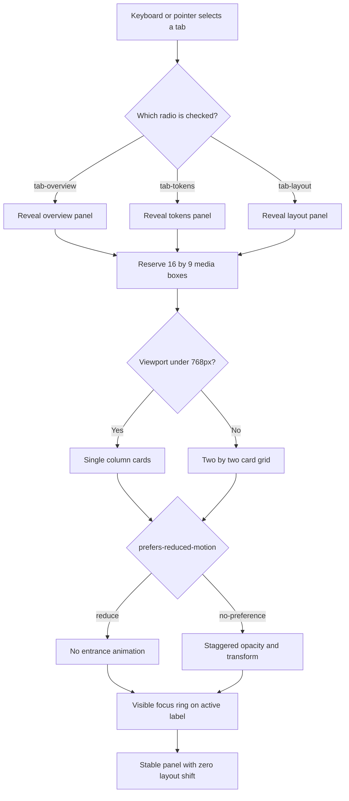

| Difficulty | Channel | Tags |
|---|---|---|
| beginner | frontend | css, flexbox, grid, animations |

More than 22 billion page views a month flow through Yahoo! JAPAN News, yet a hero image with no reserved space was quietly shoving headlines down the page and triggering accidental clicks [1]. When the team reserved that space, Cumulative Layout Shift fell from about 0.2 to 0, page views per session rose 15.1%, and bounce rate dropped 1.72 percentage points [1]. The same physics governs the humble tab panel on a design-system docs page: if the browser has to guess where content goes, or if the CSS lies about which panel is active, users feel the instability before they can name it. What follows is the build—and the trap—behind a CSS-only tab component that stays stable, accessible, and calm.

---

> ### Real-World Case — Yahoo! JAPAN
>
> Yahoo! JAPAN News serves more than 22 billion page views per month, but its article detail pages had poor Cumulative Layout Shift. The hero image loaded without reserved space, pushing the headline and body text down and causing accidental clicks, disorientation, and frustration.
>
> | | |
> |---|---|
> | **Challenge** | The team needed to eliminate the layout shift from fixed-size images while still supporting older browsers such as iOS 9, which did not support the modern CSS aspect-ratio property. They also tracked field data to see whether the fix correlated with business outcomes. |
> | **Solution** | Using Chrome DevTools and Lighthouse, they identified the shifting hero image and reserved its space before load with Aspect Ratio Boxes, a padding-based technique. The aspect ratio came from the backend API, so the correct box could be reserved in the markup before the image loaded. They also used the web-vitals library to monitor field CLS. |
> | **Outcome** | CLS in lab data dropped from about 0.2 to 0, and URLs with poor performance in Search Console fell by 98%. More importantly, page views per session rose 15.1%, session duration rose 13.3%, and bounce rate fell 1.72 percentage points. |
> | **Lesson** | A fixed 16:9 media slot is not just a visual detail; it is a layout contract. Reserving the box before the image loads prevents cumulative layout shift, and that stability can change real engagement. The same principle applies to the card grid in a CSS-only tab panel: define the panel and card geometry first, then animate inside it, and gate the stagger behind prefers-reduced-motion. |

---

## Hook — The page looked fine. The numbers disagreed.

A design-system docs page ships. The tabs switch. The cards line up. The animations feel polished. Everyone moves on to the next ticket.

Then the field data arrives: users are clicking things they did not mean to click, losing their place while reading, and bouncing before the second card even renders. Nothing looks broken in the screenshot, which is exactly the problem. Layout instability is invisible in a static image and painfully visible in a real session [1].

Here is the uncomfortable part: the most common CSS-only tabs snippet hides panels with a selector like `input:not(:checked) ~ .panel`. It reads beautifully. It also hides every panel whenever any radio is unchecked—so with more than one tab, the page can collapse into a blank shell. The component looks finished right up until the second tab exists.

What makes that failure so sneaky, and how do you build the version that survives production?

## Problem — Tabs are a state machine wearing a CSS costume

At its core, a tab panel is a tiny state machine: one active control, exactly one visible panel, and a layout that must not jump when the state changes. CSS-only tabs fake that machine with radio inputs. The shared `name` attribute makes the radios mutually exclusive [9], and the `:checked` pseudo-class exposes the active state to CSS [3]. That part is elegant.

The requirements for this docs page raise the difficulty:

- Desktop shows a 2×2 grid of cards inside each panel; mobile collapses to one column.
- Every card has a fixed 16:9 media area, a title, and a meta line.
- Cards enter with a subtle stagger instead of appearing all at once.
- Keyboard focus must remain clearly visible.
- `prefers-reduced-motion` must be respected, not merely tolerated.

Each requirement sounds independent. They are not. The grid determines how much space the browser can reserve. The media area determines whether images cause layout shift. The animation determines whether motion-sensitive users get a calm page or a carnival. And the selector strategy determines whether the whole thing works with two tabs or only with one.

That last point is where many implementations quietly break. The naive selector hides panels globally instead of binding each control to its own panel. The fix is not more CSS—it is a better relationship between markup and state.

## Real-World Case — Yahoo! JAPAN News

Yahoo! JAPAN News is not a small experiment. The news platform serves more than 22 billion page views per month, and the wider company handles over 79 billion [1]. At that scale, a fraction of a second of visual instability becomes a business metric.

The team found the problem through Core Web Vitals monitoring: Search Console grouped pages with poor performance, Lighthouse exposed per-page opportunities, and Chrome DevTools highlighted the exact element shifting on the article detail page [1]. The culprit was the hero image at the top of the article. Until it loaded, the headline and body text had no reserved space. When the image arrived, the text jumped downward—sometimes right as a reader was about to tap a link.

The fix was conceptually simple: reserve the image's space before it loads. Modern browsers can do this with width and height attributes plus the CSS `aspect-ratio` property [2], but Yahoo! JAPAN News also had to support older environments such as iOS 9. The team used aspect-ratio boxes—markup that reserves space based on a ratio obtained from the backend API—so the image loaded into an already-sized hole [1].

The results were not subtle. CLS in lab data dropped from about 0.2 to 0, and URLs with poor performance in Search Console fell by 98% [1]. More importantly, page views per session rose 15.1%, session duration rose 13.3%, and bounce rate fell 1.72 percentage points [1].

Read that again. Nobody added a feature. Nobody redesigned the page. They stopped content from moving, and engagement improved. The same principle applies to a 16:9 card image in a docs tab: reserve the box first, and the browser never has to guess.

## Deep Dive — Selectors, space, and motion

The tab state machine has three moving parts: controls, labels, and panels. The controls are radio inputs with a shared `name` [9]. The labels point at those inputs with `for`. The panels are ordinary sections. The CSS decides which panel is visible based on which radio is checked [3].

The critical design decision is sibling order. General sibling combinators only look forward. If an input appears before a panel, `#tab-overview:checked ~ #panel-overview` can reach it. If the input is nested inside a label, that path disappears. Put all radios first, then the label row, then the panels. Now each radio can address both its label and its panel.

Why is `input:not(:checked) ~ .panel` wrong? Because it is a global hide rule disguised as a local one. With three radios, two are always unchecked, so two copies of the rule are always active, and every panel that follows those radios gets hidden. The correct rule is per-panel: show the panel whose own control is checked, and let the default state stay hidden. One relationship per tab. No global side effects.

A second trap is hiding the radio with `display: none`. That removes it from the accessibility tree and the tab order. If keyboard users cannot reach the control, the focus ring is decoration. Hide the radio visually while keeping it focusable, then style the associated label with `:focus-visible` when the input receives keyboard focus [5].

Space reservation is the CLS story. `aspect-ratio: 16 / 9` on the media container tells the browser how tall the box will be before the image loads [2]. The image can then fill that box with `object-fit: cover`. Without the ratio, the card height is unknown until the image arrives, and every card below it shifts. On a 2×2 grid, one late image can move half the panel.

Motion is the third trap. A stagger is delightful the first time and nauseating the fifth time. The safest pattern is opt-in motion: wrap the animation in `@media (prefers-reduced-motion: no-preference)` so the default is calm and only users who have not requested reduced motion get the entrance [4]. Animate only `opacity` and `transform`, never height, top, or margin. Use `animation-delay` for the stagger, and cap it so the fourth card does not wait a full second [10].

Finally, be honest about semantics. Native radios already form a radio group, which screen readers understand. The ARIA tabs pattern expects roving tabindex and arrow-key navigation, which pure CSS cannot provide [8]. Do not slap `role="tab"` on a radio group and call it accessible. Either accept the native radio-group semantics or bring JavaScript and implement the full APG pattern [8].

| Approach | JS shipped | Keyboard behavior | CLS safety | Best fit |
|---|---|---|---|---|
| Radio + label, CSS only | 0 KB | Native radio group; arrow keys move within the group | Strong if media space is reserved | Docs tabs, filters, simple panels |
| ARIA tabs with JavaScript | Usually 1–3 KB | Full roving tabindex and arrow keys | Depends on implementation | App shells, complex tab widgets |
| `details` / `summary` | 0 KB | Native disclosure controls | Depends on content | FAQs, progressive disclosure |
| Anchor links + `:target` | 0 KB | Link semantics and browser history | Depends on content | Deep-linkable sections |

The trade-off is clear: CSS-only tabs win on weight and simplicity, but they are not a drop-in replacement for the full ARIA tabs pattern. Choose the semantics you can actually support.

## Workflow — From markup to a stable tab panel

The build follows the state machine, not the visual mockup. The diagram below shows the flow from keyboard input to rendered layout.

1. Put every radio first. Give each one a unique `id` and the same `name`. Mark exactly one as `checked` so the page has a valid initial state [9].
2. Add a label row immediately after the radios. Each label uses `for` to point at its radio. Clicking the label changes the radio; no JavaScript is involved [3].
3. Add the panels after the labels. Each panel gets an `id` that the CSS can target from its radio using a general sibling selector.
4. Hide panels by default. Show only the panel whose matching radio is checked. Never hide panels from an unchecked sibling selector.
5. Lay out the visible panel with CSS Grid: `repeat(2, minmax(0, 1fr))` on desktop, one column below your mobile breakpoint [6]. The `minmax(0, 1fr)` prevents long words or images from blowing out the track.
6. Give the media container `aspect-ratio: 16 / 9` and a background color. The box exists before the image does, so the headline and meta line never move [2].
7. Add the stagger inside a `prefers-reduced-motion: no-preference` block. Animate `opacity` and `transform`; use `animation-delay` per card [4][10].
8. Visually hide the radios without removing them from the tab order. Style the label when the radio has `:focus-visible` [5].
9. Test with keyboard only, then emulate reduced motion, then throttle the network and watch the cards. If the layout moves, the media box is not reserving space.

The order matters. Radios first means sibling selectors can reach both labels and panels. Panels after labels means the visual tab row stays intact. Media boxes before images means the browser reserves height. Each step removes a class of failure rather than patching a symptom.

## Code Example — The CSS contract and its proof

Here is the corrected CSS structure. The radios are direct children of the tab container, followed by the label row and the panels. Each checked radio selects exactly one panel.

```css
.tabs {
  border: 0;
  padding: 0;
  margin: 0;
}

/* Keep radios focusable, but out of sight. Never use display: none. */
.tabs__radio {
  position: absolute;
  inline-size: 1px;
  block-size: 1px;
  margin: -1px;
  padding: 0;
  overflow: hidden;
  clip-path: inset(50%);
  white-space: nowrap;
  border: 0;
}

.tabs__list {
  display: flex;
  flex-wrap: wrap;
  gap: 0.5rem;
  margin-block-end: 1.5rem;
}

.tabs__label {
  cursor: pointer;
  padding: 0.5rem 0.875rem;
  border: 1px solid transparent;
  border-radius: 999px;
}

/* Selected label styling, driven by the radio state. */
#tab-overview:checked ~ .tabs__list [for='tab-overview'],
#tab-tokens:checked ~ .tabs__list [for='tab-tokens'],
#tab-layout:checked ~ .tabs__list [for='tab-layout'] {
  border-color: currentColor;
  font-weight: 600;
}

/* Keyboard focus lands on the radio; the label wears the ring. */
#tab-overview:focus-visible ~ .tabs__list [for='tab-overview'],
#tab-tokens:focus-visible ~ .tabs__list [for='tab-tokens'],
#tab-layout:focus-visible ~ .tabs__list [for='tab-layout'] {
  outline: 2px solid currentColor;
  outline-offset: 3px;
}

/* Hidden by default. Only the matching panel is shown. */
.tabs__panel {
  display: none;
}

#tab-overview:checked ~ #panel-overview,
#tab-tokens:checked ~ #panel-tokens,
#tab-layout:checked ~ #panel-layout {
  display: grid;
  grid-template-columns: repeat(2, minmax(0, 1fr));
  gap: 1.5rem;
}

/* Reserve the media box before the image loads. */
.card__media {
  aspect-ratio: 16 / 9;
  overflow: hidden;
  border-radius: 0.75rem;
  background: #e9e9e9;
}

.card__media img {
  display: block;
  inline-size: 100%;
  block-size: 100%;
  object-fit: cover;
}

/* Motion is opt-in, not opt-out. */
@media (prefers-reduced-motion: no-preference) {
  .card {
    animation: card-in 320ms cubic-bezier(0.2, 0.8, 0.2, 1) both;
  }
  .card:nth-child(2) { animation-delay: 70ms; }
  .card:nth-child(3) { animation-delay: 140ms; }
  .card:nth-child(4) { animation-delay: 210ms; }
}

@keyframes card-in {
  from {
    opacity: 0;
    transform: translateY(8px);
  }
  to {
    opacity: 1;
    transform: none;
  }
}

@media (max-width: 768px) {
  #tab-overview:checked ~ #panel-overview,
  #tab-tokens:checked ~ #panel-tokens,
  #tab-layout:checked ~ #panel-layout {
    grid-template-columns: 1fr;
  }
}
```

The companion code example below is a Playwright contract test. It is JavaScript, but it never ships to the browser. Its job is to prove the production component needs no JavaScript at all. It checks four things: tab switching via radio state, a visible focus ring, reduced-motion behavior, and a 16:9 media box that exists before the image loads.

## Lessons Learned — What to ship tomorrow

The Yahoo! JAPAN story is not really about images. It is about the gap between how a page looks and how it behaves while loading. That gap is where trust is lost. A tab panel has the same gap, just smaller and easier to miss.

Here are the takeaways worth carrying into the next component review:

- **Bind each control to its own panel.** Show `#tab-x:checked ~ #panel-x`. Never write a global `input:not(:checked) ~ .panel` rule. The first works for any number of tabs; the second collapses the page.
- **Reserve space before content arrives.** `aspect-ratio: 16 / 9` plus a background color prevents the card grid from reflowing when images load [2]. Yahoo! JAPAN's 98% reduction in poor-performance URLs and 15.1% lift in page views per session show that this is not cosmetic [1].
- **Hide radios visually, not semantically.** `display: none` removes the control from keyboard and assistive technology. Use a visually hidden pattern and keep the input focusable [5].
- **Put the focus ring on the label.** Users see the label, not the hidden radio. Style the label when its input matches `:focus-visible` [5].
- **Make motion opt-in.** Wrapping animation in `prefers-reduced-motion: no-preference` means the default experience is calm [4]. Animate only `opacity` and `transform`, and cap the stagger [10].
- **Do not cosplay as ARIA tabs.** Native radio groups are honest and accessible [9]. The full ARIA tabs pattern needs JavaScript for arrow-key navigation [8]. Pick one and document the trade-off.
- **Test the second tab.** The one-tab demo hides the selector bug. A two-tab test exposes it in seconds.

The broader lesson is almost philosophical: stability is a feature. Users do not praise a page for not moving, but they leave when it does. The 0.2 you cannot see can become the 15% you can measure.

---

## Tab State and Layout Flow



<details>
<summary><strong>Original Interview Question</strong></summary>

**Q:** Build a CSS-only tab panel for a design-system docs page. Use radio inputs to switch tabs (no JavaScript). Desktop: a 2x2 grid of cards under each tab; mobile: single column. Each card has a fixed 16:9 image area, a title, and a short meta line. Add a subtle entrance animation with a stagger and keep focus-visible outlines; ensure prefers-reduced-motion is respected?

**A:** Use a set of radio inputs with a shared `name` attribute and corresponding `` elements for each tab section. The `:checked` state of each radio controls visibility of its associated panel via adjacent sibling selectors. Each panel renders a 2×2 card grid on desktop and collapses to a single column on mobile. Cards use `aspect-ratio: 16/9` for fixed image containers, with a title and meta line below.

</details>

## Conclusion

Yahoo! JAPAN did not fix engagement by adding a feature. The team removed an invisible source of instability, and the business metrics followed [1]. A CSS-only tab panel offers the same opportunity at a smaller scale: reserve the 16:9 media box, bind each radio to its own panel, keep the hidden input focusable, and make the stagger opt-in. Do one thing differently tomorrow: open the component with two tabs instead of one, press Tab, emulate reduced motion, and throttle the network. If nothing moves and the focus ring is visible, you have built more than a demo. You have built trust.

---

## References

1. [Yahoo! JAPAN incident report](https://web.dev/case-studies/yahoo-japan-news) — article
2. [MDN: aspect-ratio](https://developer.mozilla.org/en-US/docs/Web/CSS/aspect-ratio) — documentation
3. [MDN: :checked](https://developer.mozilla.org/en-US/docs/Web/CSS/:checked) — documentation
4. [MDN: prefers-reduced-motion](https://developer.mozilla.org/en-US/docs/Web/CSS/@media/prefers-reduced-motion) — documentation
5. [MDN: :focus-visible](https://developer.mozilla.org/en-US/docs/Web/CSS/:focus-visible) — documentation
6. [MDN: CSS Grid Layout](https://developer.mozilla.org/en-US/docs/Web/CSS/CSS_grid_layout) — documentation
7. [web.dev: Cumulative Layout Shift](https://web.dev/articles/cls) — article
8. [W3C WAI-ARIA Authoring Practices: Tabs Pattern](https://www.w3.org/WAI/ARIA/apg/patterns/tabs/) — documentation
9. [MDN: input type=radio](https://developer.mozilla.org/en-US/docs/Web/HTML/Element/input/radio) — documentation
10. [MDN: animation-delay](https://developer.mozilla.org/en-US/docs/Web/CSS/animation-delay) — documentation

---

**Author:** Satishkumar Dhule — [GitHub](https://github.com/satishkumar-dhule) · [LinkedIn](https://linkedin.com/in/satishkumar-dhule) · [Website](https://satishkumar-dhule.github.io)
