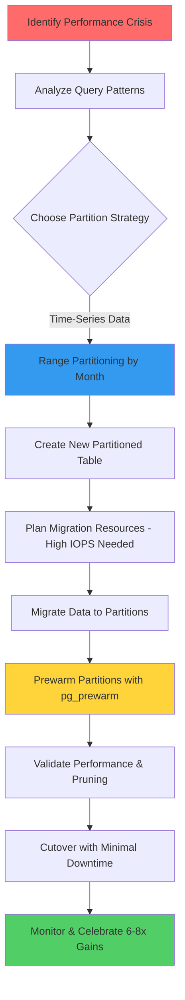

| Difficulty | Channel | Tags |
|---|---|---|
| intermediate | database | explain, query-plan, partitioning |

Picture this: it's peak traffic hours, and your API is gasping for breath. P99 latencies are climbing past 4 seconds, daily IOPS alerts are flooding inboxes, and replica lag is growing with each passing request [1]. This was the reality facing CoinGecko's engineering team as their 1TB+ 'prices' table, storing over 8 years of hourly cryptocurrency price data, had grown far too large for their PostgreSQL RDS instance to handle efficiently. What started as a slow creep of performance degradation had become a full-blown crisis threatening their Service Level Objectives.

---

> ### Real-World Case — CoinGecko
>
> CoinGecko's 1TB+ 'prices' table storing 8+ years of hourly cryptocurrency price data had grown so large that queries took over 30 seconds on average. Daily IOPS alerts were being breached, Apdex scores were dropping, and replica lag was becoming a persistent problem under normal request loads.
>
> | | |
> |---|---|
> | **Challenge** | A 1TB+ PostgreSQL table with 8+ years of hourly crypto price data had degraded to the point where queries timed out, IOPS limits were breached daily, and simply adding more indexes wasn't working—especially because the table used JSONB columns with currency-dependent keys that made traditional indexing impractical. |
> | **Solution** | Implemented monthly RANGE partitioning by timestamp after analyzing query patterns (most queries hit only 1-4 months of data). Used PostgreSQL's declarative partitioning with a creative Foreign Data Wrapper approach to migrate 1.2TB of data without warming the production cache—spinning up a separate production-grade database, pre-warming the data there, and streaming it via FDW into the production partitioned table. |
> | **Outcome** | P99 response time dropped 86% from 4.13s to 578ms. IOPS reduced by 20% across all replicas. Query performance improved 6-8x. Table warm-up time dropped from 10 hours to 3 hours. The API became significantly more stable and resilient during traffic spikes. |
> | **Lesson** | Partitioning is not a silver bullet—one query that lacked a lower date bound (WHERE created_at > ? without upper limit) performed WORSE after partitioning because it scanned all partitions including empty future ones. The team had to rewrite queries to always include explicit range bounds. |

---

## Hook — When 30-Second Queries Become Unacceptable

Every developer knows the sinking feeling that comes with a slowly degrading system. At first, you might ignore a query that went from milliseconds to a second. Then two seconds. However, when queries begin consistently taking over 30 seconds on average [1], what was once a nuisance becomes an existential threat to your API's stability. For CoinGecko, whose entire business revolves around delivering fast, accurate cryptocurrency market data to millions of users, this was unacceptable. The stakes weren't just about response times - they were about reliability at scale.

## Problem — The JSONB Tax on Massive Tables

The core challenge lies in scale. Storing 8+ years of hourly price data across countless cryptocurrency pairs creates a table of gargantuan proportions. You might think adding indexes is the obvious fix, but CoinGecko's team discovered a cruel twist - their queries utilized a JSONB column with keys based on supported currencies [1]. Indexing different keys for various applications would have been excessive, with each added index potentially only benefiting a single use case. Moreover, full table scans on a 1TB+ table mean reading enormous amounts of data from disk, crushing IOPS limits and creating massive replica lag. The question wasn't whether something needed to change - it was what approach could scale without breaking everything in the process.

## Real-World Case — CoinGecko

In 2025, CoinGecko's engineering team embarked on a mission to tame their unruly prices table [1]. The situation was dire: higher IOPS usage during traffic spikes, growing request queues, plummeting Apdex scores, and IOPS alerts breaching daily. As a short-term band-aid, they increased IOPS to 24K, but even that wasn't sustainable. After careful investigation, the team chose table partitioning as their solution despite its complexity. The results were nothing short of transformative: P99 response time dropped 86% from 4.13s to 578ms, IOPS reduced by 20% across all replicas, query performance improved 6-8x, and table warm-up time plummeted from 10 hours to 3 hours [1]. Most importantly, their API became significantly more stable and resilient during traffic spikes. This is proof that the right architectural change can turn a crisis into a competitive advantage.

## Deep Dive — Partitioning Strategies and Tradeoffs

Before diving into implementation, you need to understand the three partitioning strategies PostgreSQL offers [2]. Range partitioning divides data by value ranges (like dates or numbers), list partitioning splits by specific values (like countries or categories), and hash partitioning distributes data evenly using a hash function. For time-series data where most queries filter by timestamp ranges, range partitioning is almost always the right choice [1][2]. However, this power comes with constraints - you cannot convert an existing unpartitioned table to a partitioned one; you must create a new partitioned table and migrate data over [1]. Additionally, the partition key must be part of the primary key, often requiring composite keys [1]. Schema management also changes, as Rails users need to switch from schema.rb to schema.sql [1]. These constraints mean partitioning isn't a quick fix - it's a deliberate architectural decision with real migration costs.

## Workflow — From Crisis to Partitioned Architecture

Successfully partitioning a terabyte-scale table requires meticulous planning. The journey starts with analyzing query patterns to select the right partitioning strategy - for time-series data with timestamp filters, monthly range partitions often strike the perfect balance [1][2]. Next comes preparation: provisioning adequate IOPS for the migration since copying 1.2TB can spike to 6000 IOPS even in isolation [1]. Then the team creates the new partitioned table structure with the partition key included in the primary key. Data migration follows, often taking days for terabyte-scale tables. However, here's the plot twist - a freshly migrated partitioned table has no cache, so performance will initially be terrible [1]. This is why prewarming is critical; using tools like pg_prewarm, CoinGecko found partitioned tables only needed 3 hours to warm up compared to 10 hours for the original [1]. Finally comes the cutover strategy to switch traffic with minimal downtime. The Mermaid diagram below illustrates this complete workflow. 💡 Insight: The warm-up phase is often the most underestimated part of a partitioning migration.

## Code Example — Implementing Range Partitioning

Seeing partitioning in action makes the concept concrete. The example below demonstrates creating a monthly partitioned table for time-series price data, complete with partition creation and querying strategies. Notice how the partition key (event_date) is included, and how queries naturally benefit from partition pruning when filtering by date ranges [1][2]. This is the pattern that allowed CoinGecko to achieve their dramatic performance gains.

## Lessons Learned — Partitioning Wisdom from the Trenches

After going through this battle, several hard-earned lessons emerge. ⚠️ Watch Out: Partitioning isn't a silver bullet - sometimes a simple index is all that's needed [1]. Always diagnose first. 🎯 Key Point: Plan for 3x the migration time you think you'll need, and budget for massive IOPS during copy operations [1]. Remember that you cannot alter an unpartitioned table in-place, so downtime strategies matter [1]. Most critically, never underestimate cache warm-up - budget time for this or your 'fixed' system will appear broken [1]. The biggest takeaway: choose your partition key based on actual query patterns, not hypothetical ones. For CoinGecko, monthly range partitioning aligned perfectly with their 'fetch last few months' access pattern [1]. If this feels overwhelming, you're not alone - but with careful planning, the rewards are absolutely worth it.

---

## Partitioning Migration Workflow

<strong>Original Interview Question</strong>

**Q:** You have a PostgreSQL table with 100M rows partitioned by date. A query filtering on a specific date range is still slow. What would you check in the EXPLAIN plan and how would you optimize it?

**A:** Check partition pruning effectiveness, index utilization patterns, and expensive sort operations. Create composite indexes on (date, filtered_columns) and evaluate clustering strategies for optimal data access.

## Conclusion

The story of CoinGecko's 1TB+ table is a powerful reminder that scale changes everything. What works for thousands of rows will crumble under billions. Partitioning isn't just about splitting data - it's about aligning your data architecture with your actual access patterns. For time-series data with range-based queries, monthly range partitions can be transformative, delivering order-of-magnitude improvements as CoinGecko proved with their 86% P99 reduction and 6-8x query speedup [1]. The key is remembering that there are no free lunches - you'll need to plan for migration complexity, IOPS spikes, cache warm-up, and schema changes. But when done right, partitioning doesn't just fix a crisis; it makes your system more resilient for whatever scale comes next. So tomorrow, before reaching for yet another index, ask yourself: is it time to partition?

---

## References

1. [CoinGecko incident report](https://dev.to/coingecko/scaling-postgresql-performance-with-table-partitioning-136o) — article
2. [PostgreSQL Table Partitioning Documentation](https://www.postgresql.org/docs/current/ddl-partitioning.html) — documentation
3. [PostgreSQL EXPLAIN Documentation](https://www.postgresql.org/docs/current/sql-explain.html) — documentation
4. [pg_prewarm Extension Documentation](https://www.postgresql.org/docs/current/pgprewarm.html) — documentation
5. [Partitioning in PostgreSQL: Boosting Performance and Simplifying Data Management](https://dev.to/0xog_pg/partitioning-in-postgresql-boosting-performance-and-simplifying-data-management-2pjd) — blog
6. [Table partitioning in PostgreSQL](https://dev.to/serenasensini/table-partitioning-in-postgresql-4ica) — blog
7. [AWS RDS for PostgreSQL Documentation](https://docs.aws.amazon.com/AmazonRDS/latest/UserGuide/CHAP_PostgreSQL.html) — documentation
8. [MDN: Database Indexing](https://developer.mozilla.org/en-US/docs/Glossary/Index) — documentation

---

**Author:** Satishkumar Dhule — [GitHub](https://github.com/satishkumar-dhule) · [LinkedIn](https://linkedin.com/in/satishkumar-dhule) · [Website](https://satishkumar-dhule.github.io)
