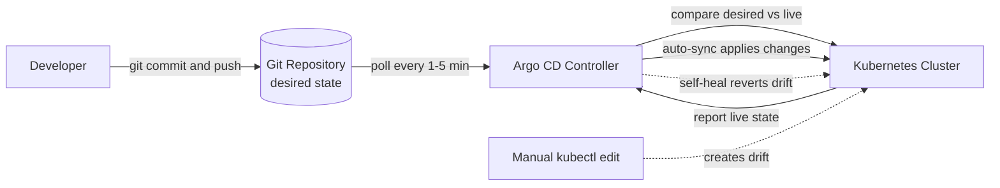

| Difficulty | Channel | Tags |
|---|---|---|
| beginner | devops | argocd, flux, declarative |

It was 3 a.m., and the pager was screaming. A staging cluster was running a version of the checkout service that nobody recognized — one that existed nowhere in any pipeline. For teams running a handful of microservices, this is a nightmare. For Intuit, running thousands of services across hundreds of clusters, this exact scenario had become a way of life until they made Git the single source of truth with Argo CD [1].

---

> ### Real-World Case — Intuit
>
> Intuit moved thousands of services and 5,000 engineers onto a Kubernetes-based internal platform, with Argo CD as the GitOps control plane. By 2021 the setup had grown to more than 11,000 applications spread across 375+ clusters and 15,500 nodes, making the deployment system itself a critical piece of production infrastructure.
>
> | | |
> |---|---|
> | **Challenge** | Intuit had to decide how to run Argo CD at enterprise scale without creating a single point of failure or an enormous security blast radius. A single Argo CD instance managing everything would give developers one pane of glass but could block all 5,000 engineers if it went down, and security was uncomfortable with one system able to change every cluster in the company. They also had to keep cluster state reconciled with Git while avoiding configuration drift from imperative kubectl changes. |
> | **Solution** | Intuit committed to declarative GitOps: Kubernetes manifests, Helm, and Kustomize configuration live in Git, and Argo CD Application resources continuously reconcile each cluster to that declared desired state using automated sync and self-healing. Rather than one giant Argo CD, they sharded by business unit, eventually running 140+ Argo CD instances, each with a bounded blast radius and its own upgrade cadence. In a particularly recursive twist, they stored Argo CD's own configuration in Git and used Argo CD to deploy and manage its own instances. |
> | **Outcome** | The platform grew to 11,000+ applications, 11,500 managed namespaces, 375+ clusters, 15,500 nodes, and 5,000 developers, with roughly 1,000 deployments per day. Intuit reported 5-10x improvements in MTTR and MTTD, and the GitOps model eliminated manual deployment scripts as the source of truth. |
> | **Lesson** | At scale, the counterintuitive GitOps lesson is that 'one Argo CD to rule them all' is often the wrong answer: sharding by business domain limits blast radius, avoids a company-wide single point of failure, and lets teams upgrade at different speeds. The second lesson is that self-healing is exactly as powerful as it is unforgiving: any imperative kubectl hotfix that never reaches Git will be reverted by design, so teams need a documented break-glass process, not an expectation that Argo CD will tolerate drift. |

---

## Hook — The Ghosts in the Cluster

Every direct `kubectl` command feels harmless in the moment. Type it in, watch pods roll, and move on with your day. But at scale, those one-off commands accumulate into something sinister: ghosts. No commit, no reviewer, no audit trail, and no way to know who changed what or when. For a platform the size of Intuit's Answer platform — spanning 12,000 applications across 370 clusters and serving 5,000 engineers — these ghosts multiplied until configuration drift was no longer an edge case, but the default state [1]. The question becomes: how do you make an ever-growing cluster forget how to drift?

## Problem — When the Cluster Forgets Its History

The allure of imperative commands is immediacy. You need to scale a deployment right now, so you run `kubectl scale`. You need to hotfix a config right now, so you patch a ConfigMap. However, immediacy comes at a steep cost. With each manual change, the live cluster state diverges from whatever documentation, manifests, or mental models existed before [6]. Environments begin to drift from one another. Rollbacks turn into archaeology as teams dig through shell history trying to figure out what the 'real' state was. Audits become impossible to pass with confidence. Most importantly, collaboration is completely bypassed — the entire PR review process exists to prevent exactly these kinds of untracked changes. For small teams, drift is annoying. For platform teams at Intuit's scale, it is a systemic liability that requires a fundamentally different approach.

## Real-World Case — Intuit

Intuit hit that breaking point hard. Its internal Kubernetes platform, Answer, grew to manage 12,000 applications across 370 clusters, pulling desired state from 3,000 Git repositories, with roughly 15,000 nodes spread over 350 clusters [1]. Imperative kubectl commands and homegrown scripts simply could not keep up. The solution was to make Git the declared source of truth and let a controller converge the cluster onto it. That controller became Argo CD. The results speak for themselves: roughly 1,000 deployments per day supported by 5,000 engineers, with drastically improved auditability and recoverability [1]. Argo CD would go on to graduate as a CNCF project [8], proving that what Intuit built out of necessity had become an industry standard under the banner of GitOps [2].

## Deep Dive — Declarative vs Imperative: Truth Lives in Different Places

At its core, this isn't a debate about `kubectl apply` vs other commands. Even `kubectl apply` is declarative — it submits a desired state to the API server [5]. The difference is location of truth. The imperative approach treats the running cluster as the source of truth: changes are executed against it directly with commands like `kubectl create` or `kubectl patch` [6]. The declarative GitOps approach treats a version-controlled repository as the source of truth, with a reconciler continuously ensuring the cluster matches it [2][3]. Argo CD implements this reconciliation loop with two critical features: auto-sync, which applies changes from Git on a configurable interval (typically 1-5 minutes) [4], and self-healing, which reverts any unauthorized manual changes back to the Git-defined state [4]. Moreover, because Kubernetes objects themselves have a 'last-applied-configuration' annotation [7], truth can become fragmented across teams. GitOps centralizes it into commits, making every change reviewable, revertible, and auditable.

## Workflow — From Git Commit to Self-Healing Cluster

So how does this actually work in practice? It all starts by treating manifests as code. First, desired state is committed to Git as YAML, a Helm chart, or Kustomize overlays [9]. Next, Argo CD is installed on the cluster and an Application Custom Resource (CRD) is created, pointing to that repository, target branch, path, and destination namespace [3]. Then, auto-sync and self-healing are enabled, telling Argo CD to both apply changes and police drift [4]. From there, the loop is elegant: developers open PRs to change manifests, get them reviewed, and merge to the target branch. Argo CD polls Git on its reconciliation interval, detects the diff, and applies it to the cluster. If anyone runs a rogue `kubectl edit`, self-healing kicks in within minutes and reverts it back to the Git state. As seen in the diagram below, the cluster is no longer a place you deploy to directly — it's a place that converges to what Git says it should be.

## Code Example — Declaring an Argo CD Application

The best way to understand this is to see it in action. Below is a minimal, production-lean example that demonstrates how to declare an Argo CD Application using a YAML manifest. This is applied to the cluster (a one-time bootstrap step), after which all future changes flow through Git. Pay close attention to the `syncPolicy` — that's where auto-sync and self-healing are enabled.

## Lessons Learned — Battle Scars From The Reconciliation Loop

After running GitOps at scale, a few hard-earned lessons emerge. First, auto-sync without self-healing is only half the battle — enable both to truly eliminate drift [4]. Second, never rely on mutable tags like `:latest`; use immutable image tags so that a `git revert` actually restores the exact artifact that was running before. Third, be extremely careful with pruning — when Argo CD prunes resources removed from Git, it will delete them from the cluster, so always scope Applications to the correct namespaces and projects [3]. Fourth, resist the temptation to make 'quick fixes' through the Argo CD UI or kubectl — every manual edit is just drift waiting to be reverted, and it trains bad habits. Finally, start small. Prove the loop with a single non-critical service before scaling to hundreds of Applications. The goal isn't to use more tools, it's to make deployment boring again — and boring deployments are the ones that never wake you up at 3 a.m.

---

## GitOps Reconciliation Flow

<strong>Original Interview Question</strong>

**Q:** You're setting up GitOps for a microservices deployment. How would you configure ArgoCD to automatically sync changes from your Git repository to Kubernetes, and what's the difference between declarative and imperative approaches in this context?

**A:** I'd configure ArgoCD by setting up a Git repository containing Kubernetes manifests or Helm charts, creating an Application CRD that points to the Git repository, enabling auto-sync with a health check interval of 3 minutes, and implementing self-healing to automatically revert any manual changes. The declarative approach involves defining the desired state in Git through YAML manifests, Helm charts, or Kustomize configurations, where ArgoCD continuously reconciles the actual state with the desired state. In contrast, the imperative approach uses kubectl commands to make direct changes to the cluster, bypassing the Git repository as the single source of truth.

## Conclusion

Intuit didn't just solve a deployment problem — they redefined where truth lives. By making Git the single source of truth and letting Argo CD continuously reconcile and self-heal, they turned thousands of ad-hoc deploys into a boring, auditable, and reversible process. The lesson for any team is simple: if you can't answer 'what's running right now and how did it get there?' from Git, you're one pager away from a 3 a.m. mystery. Pick one service, commit its desired state, turn on auto-sync with self-healing, and walk away. That's GitOps in its purest form.

---

## References

1. [Intuit incident report](https://static.sched.com/hosted_files/gitopssummit2021/7a/ProgressiveDeliveryAtIntuit-BlixtSuen.pdf) — article
2. [GitOps — Wikipedia](https://en.wikipedia.org/wiki/GitOps) — article
3. [Argo CD Documentation](https://argo-cd.readthedocs.io/en/stable/) — documentation
4. [Argo CD Automatic Sync Policy Documentation](https://argo-cd.readthedocs.io/en/stable/user-guide/auto_sync/) — documentation
5. [Declarative Management of Kubernetes Objects Using Configuration Files](https://kubernetes.io/docs/concepts/overview/working-with-objects/#object-management) — documentation
6. [Manage Kubernetes Objects Using Imperative Commands](https://kubernetes.io/docs/tasks/manage-kubernetes-objects/imperative-command/) — documentation
7. [Understanding Kubernetes Objects](https://kubernetes.io/docs/concepts/overview/working-with-objects/) — documentation
8. [Argo (software) — Wikipedia](https://en.wikipedia.org/wiki/Argo_(software)) — article
9. [Helm Documentation](https://helm.sh/docs/) — documentation
10. [Argo CD GitHub Repository](https://github.com/argoproj/argo-cd) — documentation

---

**Author:** Satishkumar Dhule — [GitHub](https://github.com/satishkumar-dhule) · [LinkedIn](https://linkedin.com/in/satishkumar-dhule) · [Website](https://satishkumar-dhule.github.io)
