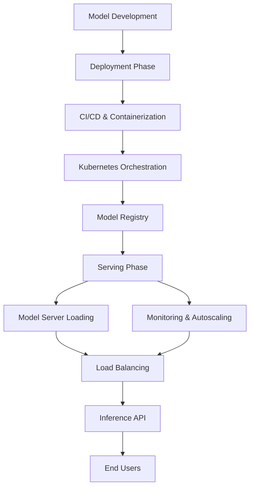

| Difficulty | Channel | Tags |
|---|---|---|
| beginner | devops | mlops, deployment |

Picture this: a data scientist at Uber has just spent months perfecting a machine learning model to predict estimated delivery times for UberEATS. The accuracy is staggering, the offline metrics are green across the board, and excitement is at an all-time high to ship it to production. However, the moment that model leaves the safety of a Jupyter notebook, an entirely different beast awakens. This exact nightmare is what plagued Uber's engineering teams for years, as data scientists found themselves spending a whopping 80% of their time on manual infrastructure work with no standardized way to train, deploy, or serve ML models at scale [1].

---

> ### Real-World Case — Uber
>
> Before Michelangelo, data scientists at Uber spent 80% of their time on manual infrastructure work building one-off systems, with no standard way to train, deploy, or serve ML models at scale. For complex use cases like UberEATS estimated delivery time (ETD), each team had to build custom serving containers from scratch, creating massive inefficiency and inconsistent practices across the organization.
>
> | | |
> |---|---|
> | **Challenge** | Uber needed a unified ML platform to handle the full ML lifecycle - data pipelines, distributed training at scale, consistent deployment, low-latency prediction serving, and model monitoring. They needed to support traditional ML, time series, and deep learning models while serving predictions for their highest-loaded services with strict latency requirements. |
> | **Solution** | Uber built Michelangelo, an internal ML-as-a-service platform that standardizes the entire ML workflow. It provides feature store and data pipelines (batch + near-real-time via Samza/Cassandra), distributed training on Spark/YARN/Mesos, three deployment modes (offline batch via Spark, online serving via containers behind load balancers, and library deployment), a domain-specific language for feature transformation ensuring train/serve consistency, and comprehensive monitoring/logging. Models are packaged in containers and deployed across data centers with support for A/B testing and versioning. |
> | **Outcome** | Michelangelo became the de-facto ML platform at Uber with models serving more than 250,000 predictions per second for the highest-traffic use cases, with P95 latency under 5ms for simple models and under 10ms for models requiring Cassandra features. The platform enabled hundreds of teams to build and deploy models without building custom serving infrastructure. As of later reports, it supported 5K+ models in production serving 10M real-time predictions per second at peak across the company. |
> | **Lesson** | Separating deployment (packaging models into containers, pushing to clusters via standard deployment infrastructure) from serving (loading models in prediction containers, routing requests, managing versions/tags for A/B testing, autoscaling) is critical at scale. A unified platform with train/serve consistency guarantees, shared feature stores, and standardized deployment patterns can turn ML from bespoke engineering efforts into a scalable, democratized capability. |

---

## Hook — The 80% Tax On Innovation

Every ML team has felt this pain at some point. You spend countless sleepless nights perfecting your model's architecture, tuning your hyperparameters, and watching your accuracy climb higher and higher. However, the second that you need to get your masterpiece to actually make predictions for real users, the reality comes crashing down onto your shoulders. Suddenly, you are no longer just a data scientist. You are expected to become a DevOps engineer, a containerization specialist, a networking expert, and a site reliability engineer all in the blink of an eye. For Uber's teams, this was far more than an inconvenience. It was an 80 cent tax on every dollar of their ML talent, with data scientists spending 80% of their time on manual infrastructure work building one-off systems instead of innovating [1]. The question isn't if this is broken, it's how does an organization of this magnitude ever escape it?

## Problem — Deployment and Serving Are Different Worlds

Here is the thing though, many developers think that model deployment and model serving are one in the same. They couldn't be further from the truth. This confusion is the exact root cause as to why so many incredibly promising ML projects rot away between experimentation and production. Deployment is the journey of getting your model into a production ready environment. It encompasses your entire release lifecycle consisting of version control, continuous integration and continuous deployment (CI/CD) pipelines, infrastructure provisioning, environment configuration, monitoring setup, and most importantly, rollback strategies [2]. Think of deployment as constructing an entire house. Before anyone can live in it, the foundation must be poured, the plumbing must be ran, the electricity must be wired, and security systems must be put into place. Serving, on the other hand, is everything that happens after that house is finished. It is the runtime aspect of responding to requests. Serving focuses around exposing your model through APIs, handling incoming prediction requests, routing traffic, loading models into memory, managing model versions in real-time, batching requests for efficiency, and autoscaling to meet immense demand [2]. If deployment is the construction, serving is the front door. It is how the outside world interacts with your model. These two worlds hold drastically different trade offs. You have to constantly balance latency versus throughput, decide between batch and real-time inference, and optimize for dreaded cold starts. Get either side wrong, and your beautiful model will become entirely useless to your end users.

## Real-World Case — Uber's Michelangelo Platform

The breaking point would arise as Uber's ML use cases began to evolve into monstrosities of complexity. Take UberEATS estimated delivery time (ETD) for example. This isn't some simple lookup table, it's real time calculations based off of restaurant prep times, driver locations, traffic patterns, weather conditions, and countless other factors. For complex use cases such as this, each and every team at Uber was forced to build their own custom serving containers from scratch [1]. The result was a massive, unmaintainable patchwork of inconsistent systems spanning the entire organization. This chaos would be the catalyst for the birth of Michelangelo, Uber's unified machine learning platform. Michelangelo would standardize the entire ML workflow from feature engineering and training, all the way down to deployment and serving [1]. The impact was nothing short of staggering. Michelangelo became the de-facto ML platform at Uber with models serving more than 250,000 predictions per second for the highest traffic use cases, with P95 latency under 5ms for simple models and under 10ms for models requiring Cassandra features. The platform enabled hundreds of teams to build and deploy models without having to build custom serving infrastructure. As of later reports, it supported over 5K models in production, serving 10M real-time predictions per second at peak across the company [1]. This isn't just efficiency, this is what allows Uber to make critical, real time decisions on a global scale.

## Deep Dive — The Technical Distinction In Practice

Building off of Uber's lesson, you need to understand the tools and patterns that truly separate deployment from serving. For deployment, the name of the game is infrastructure as code and orchestration. Tools such as Docker allow you to containerize your models and all of their dependencies [3], whereas Kubernetes orchestrates these containers across clusters, handling health checks, rolling updates, and rollbacks [4]. For ML specific deployment, platforms such as MLflow track experiments and manage model registries [5], whilst managed services such as Amazon SageMaker or Google Vertex AI abstract away a majority of the underlying infrastructure. However, once deployed, the game completely changes for serving. You now need specialized model servers that are optimized strictly for inference. TensorFlow Serving is built specifically for TensorFlow models with first class support for batching and versioning [6]. TorchServe does the exact same for PyTorch models [7]. BentoML takes a completely different approach, packaging models as microservices with support for multiple frameworks and easy deployment to a plethora of targets [8]. These servers sit behind load balancers such as NGINX or Envoy, and are often exposed through APIs built with FastAPI or gRPC for high performance communication. The scaling considerations tell the true story here. For deployment, you care about horizontally scaling your training pipelines and deployment infrastructure. For serving, you care about horizontally scaling inference pods, GPU allocation, and autoscaling based off of request volume [4]. Latency requirements drive everything. You may need sub-50ms responses for real-time recommendations, whilst batch inference can be more than tolerant of minutes worth of wait time. To add onto this, A/B testing adds another layer of immense complexity, requiring traffic splitting between model versions at the serving layer. Moreover, cold start optimization becomes absolutely critical when scaling to zero or handling burst traffic. These are fundamentally different optimization problems from one another.

## Workflow — From Chaos To Standardization

So, how does all of this come together? The key is treating deployment and serving as separate, yet intricately connected concerns with crystal clear boundaries. Platforms like Michelangelo pioneered this exact workflow to immense success. First, during the deployment phase, models go through a CI/CD pipeline where they are tested, containerized, and registered into a model registry with full version control [2][5]. Infrastructure is provisioned utilizing tools such as Terraform, and deployments are managed through Kubernetes with blue-green or canary strategies [4]. Secondly, during the serving phase, the model server loads the registered model version into memory, warms up any necessary caches, and exposes prediction endpoints. Load balancers then distribute traffic across multiple replicas, whilst autoscalers add or remove instances based off of CPU, GPU utilization, or custom metrics such as queue depth [4]. Observability is crucial at both layers. Deployment monitoring tracks pipeline health and rollout success, whilst serving monitoring tracks prediction latency, error rates, throughput, and even data drift [2]. With that being said, here is the visual flow of how all of these moving parts interact with one another:

## Code Example — Building A Production Ready Model Server

All of this theory comes alive when it is seen in practice. For the sake of demonstration, let us take a look at how you might serve a scikit-learn model using FastAPI. This is an extremely common pattern that bridges the gap between simple serving and production readiness. It is important to note that this example solely demonstrates the serving layer, whereas deployment would consist of containerizing and orchestrating this exact service with Kubernetes. Pay extra attention to the fact that the scope of this snippet is purely inference, not training, provisioning, or infrastructure management.

## Lessons Learned — Bridging The Gap

After seeing the chaos that Uber endured all the way to the immense scale of Michelangelo, the path forward couldn't be clearer. First and foremost, treat them as two completely different concerns. Deployment is about getting your models into production reliably and repeatedly. Serving is about responding to predictions efficiently and at scale. Confusing these two will lead to either immense over-engineering, or devastating under-engineering. Second, standardize as early as humanly possible. Uber's greatest mistake was allowing each team to build custom serving containers, their greatest fix was creating a platform [1][4]. You do not need to build Michelangelo from scratch, however you do need standards around containerization, model registries, and serving patterns. Third, choose the right tools for the job. For simple use cases, FastAPI may be more than sufficient. For high-throughput, low-latency needs at a massive scale, specialized model servers such as TorchServe or TensorFlow Serving are more than worth the investment [6][7]. Fourth, monitor absolutely everything. Track deployment metrics such as success rate and rollout duration, as well as serving metrics such as P50/P95/P99 latency, throughput, error rates, and model drift. Without observability, scaling with confidence is an impossibility [2]. Fifth, plan for scale from day one. Consider autoscaling, batching strategies, and cold start optimization. Uber went from pure chaos to serving 10M predictions per second, and that level of scale requires incredibly intentional architecture [1]. Finally, embrace gradual rollouts. A/B testing and canary deployments allow you to validate model performance with real traffic before going all in, drastically reducing the blast radius of any potentially bad models. The 'so what' here is simple. The next time that you look at an ML project, stop asking, 'how do I deploy this model?' and start asking, 'how do I deploy AND serve this model?' These are two questions with two entirely different answers, and getting both of them correct is the difference between a disposable proof of concept, and a production system that can drive immense business value.

---

## Model Deployment vs Serving Workflow

<strong>Original Interview Question</strong>

**Q:** Explain the key differences between model serving and model deployment in ML systems, including specific technologies, scaling considerations, and real-world implementation patterns?

**A:** Deployment encompasses CI/CD pipelines, infrastructure setup, and monitoring using tools like Kubernetes, MLflow, and SageMaker. Serving focuses on runtime inference APIs with frameworks like TensorFlow Serving, TorchServe, or BentoML, handling request routing, model versioning, and autoscaling. Key trade-offs include latency vs throughput, batch vs real-time inference, and cold start optimization.

## Conclusion

The journey from Uber's chaos to Michelangelo's scale teaches one crucial lesson: model deployment and model serving are not interchangeable terms. Deployment gets your model into production, it is about infrastructure, pipelines, and reliability. Serving keeps your model alive in production, it is about speed, scale, and responsiveness. Treating them separately is not overcomplication, it is what separates ML experiments from ML systems that can serve 10 million predictions per second. Tomorrow, when you look at your next ML project, ask yourself, have you planned for both the journey in, and the door open to serve predictions? That distinction might just save your team from the 80% tax on innovation.

---

## References

1. [Uber incident report](https://www.uber.com/us/en/blog/michelangelo-machine-learning-platform/) — blog
2. [MLOps: Continuous delivery and automation pipelines in machine learning](https://en.wikipedia.org/wiki/MLOps) — documentation
3. [Docker Documentation](https://docs.docker.com/) — documentation
4. [Kubernetes Documentation](https://kubernetes.io/docs/home/) — documentation
5. [MLflow Documentation](https://mlflow.org/docs/latest/index.html) — documentation
6. [TensorFlow Serving](https://www.tensorflow.org/tfx/guide/serving) — documentation
7. [TorchServe Documentation](https://pytorch.org/serve/) — documentation
8. [BentoML Documentation](https://docs.bentoml.com/) — documentation

---

**Author:** Satishkumar Dhule — [GitHub](https://github.com/satishkumar-dhule) · [LinkedIn](https://linkedin.com/in/satishkumar-dhule) · [Website](https://satishkumar-dhule.github.io)
