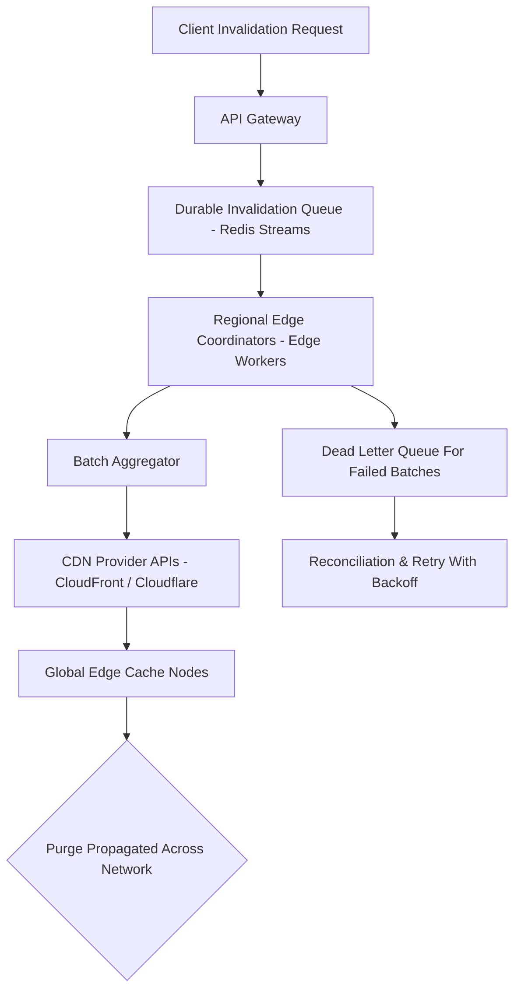

| Difficulty | Channel | Tags |
|---|---|---|
| intermediate | system-design | edge, caching, purging |

It was never a matter of 'if' a cache needed to be cleared, but of 'how fast' before thousands of users saw stale content. For a global network the size of Cloudflare's, the difference between a purge completing in 200ms and one completing in 6 seconds can be the difference between a critical bug being fixed for the world, or a critical bug being seen by millions of people. This immense pressure is exactly what led Cloudflare to re-engineer their purge pipeline, resulting in most global purges now completing well under two seconds [1].

---

> ### Real-World Case — Cloudflare
>
> Cloudflare operates one of the world's largest global CDN networks spanning over 270 cities. As the network grew, their original cache purge pipeline (routing requests through core data centers to fan out globally) was becoming a bottleneck - they needed to invalidate cached content faster and more reliably at planetary scale.
>
> | | |
> |---|---|
> | **Challenge** | Design and operate a global cache purging system that can invalidate content across hundreds of data centers worldwide with low latency. The system needed to handle different purge types (by URL, by tag, by prefix, by hostname, purge everything) while maintaining consistency across the distributed network. |
> | **Solution** | Cloudflare re-architected their purge pipeline to move away from the core-data-center routing model ("coreless purge"). They redesigned how purge requests are distributed and processed across all data centers, optimizing for speed while preserving correctness for all purge types (including tag-based group invalidations). |
> | **Outcome** | Benchmarked across their global network (representing ~90 cities/regions, data from 48 hours of production traffic), purge latencies were measured as: for Purge by URL, global p50=1.31s, p75=1.80s, p99=6.35s; for other purge types (everything/tag/prefix/hostname), global p50=1.57s, p75=2.32s, p99=5.97s. Most purges complete well under 2 seconds globally, with tail latencies approaching 6 seconds. Cloudflare states their goal is to get purge as close as possible to the speed-of-light limit for their network size (~200ms). |
> | **Lesson** | At planetary scale, the routing topology (where coordination happens) matters as much as raw processing speed. Moving from a hub-and-spoke through core data centers to a more distributed 'coreless' approach was necessary to reduce latency. Even for a mature CDN, global cache invalidation remains a hard distributed systems problem where tail latencies dominate and you need to measure across all regions. |

---

## Hook — The Race Against Stale Content

Picture this. A security patch is pushed, a pricing page is updated, or an asset with an expired license is pulled from the web. The second that change is made, every cached copy of that asset across the globe becomes a liability. For teams operating at planetary scale, a single stale response isn't a minor inconvenience, it's a breach of trust. Many developers think cache invalidation is as simple as 'flipping a switch', however, once you have to do it across hundreds of points of presence, that switch has to be flipped all at the same time. This is where the race against the speed of light begins.

## Problem — Scaling The Unseen Bottleneck

As traffic scales, cache purges become exponentially harder to coordinate. Traditional CDN architectures relied heavily on a 'core-first' design, meaning that an invalidation request would have to travel to a centralized core data center before being fanned out to each edge location. This created a massive single choke point. You may have the ability to serve content from the edge in milliseconds, but without a fast purge path, you are stuck serving yesterday's data. Moreover, with 10,000 invalidations needing to be processed per second, a synchronous, hop-by-hop purge is no longer viable. The stakes are latency, reliability, and cost. Specifically, every extra second of purge latency is an extra second of risk for every user that is hitting a stale cache.

## Real-World Case — Cloudflare

The theoretical problem became an engineering reality for Cloudflare. Operating one of the world's largest CDN networks spanning over 270 cities, their original core-routed purge pipeline was becoming a bottleneck as the network grew [1]. In order to fix this, Cloudflare moved towards a 'coreless' purge architecture, removing the need to route every purge through their core data centers and instead allowing for coordination from closer to the edge. The results, benchmarked across ~90 cities and regions over 48 hours of production traffic, were staggering. For Purge by URL, global p50 was measured at 1.31s, p75 at 1.80s, and p99 at 6.35s. For all other purge types (everything, tag, prefix, hostname), global p50 sat at 1.57s, p75 at 2.32s, and p99 at 5.97s [1]. While the p99 tail is still approaching 6 seconds, the vast majority of purges are completing well under 2 seconds. Their end goal is an incredibly ambitious one: to get purges as close to the speed-of-light limit for their network size (~200ms) as possible [1].

## Deep Dive — The Anatomy Of A Lightning Fast Purge

So, how is this possible? The key shift is moving away from centralized fan-out, towards distributed coordination. Building on Cloudflare's work, modern, planetary scale invalidation is built upon a few battle tested pillars [1][2][3]. Firstly, distributed queues are utilized in order to decouple the ingestion of an invalidation from the act of propagation, preventing any one node from being overwhelmed by spikes of 10,000+ requests per second [2][3]. Secondly, edge compute is leveraged to act as regional coordinators, allowing purges to be announced and processed without unnecessary round trips across the entire globe [1]. Thirdly, batch processing is vital. Instead of firing off a purge API call for every single asset, keys are batched together (often up to hundreds at a time), massively cutting down API overhead and network chatter [1][3]. Finally, intelligent caching headers are still king. Even with the fastest purge in the world, pairing purges with short TTLs, such as a 2 second max-age with must-revalidate, creates a safety net in the event of a partial failure or a network partition [4]. This is a classic example of 'defense in depth', never solely relying on one mechanism to guarantee freshness.

## Workflow — Mapping Out A Coreless Purge

With all of these moving parts, it's best to visualize the flow. In a coreless, distributed design, invalidation requests never have to be beholden to a singular core. Instead, they are ingested, queued, and propagated from as close to the source of truth as possible. The diagram below represents this workflow. You can see the request being accepted by an API gateway, enqueued into a durable, distributed stream, picked up by regional edge coordinators, and lastly propagated to the CDN providers' edge nodes in batches. This distributed approach is what allows for parallelization across every region at once, instead of a sequential tree that grows with network size [1][2][3].

## Code Example — A Practical Implementation Blueprint

Theory is only as good as its implementation. Many teams aren't able to rebuild a planetary network from scratch, however, the patterns utilized by Cloudflare can be emulated for multi-region CDN setups. The example below demonstrates a durable invalidation pipeline utilizing a Redis Stream as the queue, regional batching, and a retry mechanism with exponential backoff when purging against a CDN provider's API. Pay attention to the batching, as well as the circuit breaker-esque retry logic. These are the exact types of safeguards needed to survive 10,000 invalidations per second without cascading failures.

## Lessons Learned — Purge Smarter, Not Harder

After analyzing Cloudflare's benchmarked results and battle tested patterns, there are some invaluable takeaways to bring back to your own stack. First and foremost, decouple everything. Ingestion, queuing, coordination, and propagation should all be able to fail independently of one another [1][2]. Secondly, batch whenever possible, as this is one of the largest cost and rate limit reducers, oftentimes cutting API calls by upwards of 90% [1][3]. Thirdly, always plan for tails. p50 means nothing if your p99 is 6 seconds, so retries, dead letter queues, and reconciliation jobs are mandatory, not optional [1][2]. Fourthly, defense in depth is non-negotiable. Pair purges with short TTLs and cache headers such as Cache-Control [4]. Finally, measure, don't guess. Just as Cloudflare benchmarked across 90 cities and 48 hours of production traffic, you must benchmark against your own regions to know your true speed-of-light limit [1]. If this all feels overwhelming, you are not alone. The trick isn't perfection, it's building a system that fails gracefully whilst getting as close to instant as humanly and physically possible.

---

## Coreless CDN Cache Purge Flow

<strong>Original Interview Question</strong>

**Q:** How would you design a multi-region CDN cache purging system that guarantees content propagation within 5 seconds while handling 10,000 concurrent invalidations per second?

**A:** Implement Cloudflare API + AWS CloudFront with distributed invalidation queue, edge compute coordination, and 2-second TTL. Use batch invalidation, exponential backoff, and regional cache headers for 5-second SLA.

## Conclusion

The race to purge cache at the speed of light isn't about raw horsepower, it's about distribution. Cloudflare proved that moving away from core-routed fan-out towards a coreless, queue driven, and batch oriented architecture is what brings purge latencies down to the realm of milliseconds [1]. The lesson for every team is simple: you don't need a planetary network to utilize these patterns. Decouple your pipeline, batch your requests, plan for your p99 tail, and always keep a safety net with short TTLs [1][2][3][4]. Do that, and the next time a critical patch goes out, your users will see the fix the moment that it matters.

---

## References

1. [Cloudflare incident report - Coreless purge: Getting closer to instant purges](https://blog.cloudflare.com/part1-coreless-purge/) — blog
2. [Redis Documentation - Streams](https://redis.io/docs/latest/develop/data-types/streams/) — documentation
3. [AWS Documentation - Invalidate files from a CloudFront distribution](https://docs.aws.amazon.com/AmazonCloudFront/latest/DeveloperGuide/Invalidation.html) — documentation
4. [MDN Web Docs - HTTP Cache Control](https://developer.mozilla.org/en-US/docs/Web/HTTP/Guides/Caching) — documentation
5. [RFC 7234 - Hypertext Transfer Protocol (HTTP/1.1): Caching](https://datatracker.ietf.org/doc/html/rfc7234) — documentation
6. [Wikipedia - Content delivery network](https://en.wikipedia.org/wiki/Content_delivery_network) — documentation
7. [Kubernetes Documentation - Concepts: Workloads, Controllers, and Jobs](https://kubernetes.io/docs/concepts/workloads/controllers/job/) — documentation
8. [DigitalOcean Community - How To Design A Scalable Caching System](https://www.digitalocean.com/community/tutorials/how-to-design-a-scalable-caching-system) — blog

---

**Author:** Satishkumar Dhule — [GitHub](https://github.com/satishkumar-dhule) · [LinkedIn](https://linkedin.com/in/satishkumar-dhule) · [Website](https://satishkumar-dhule.github.io)
