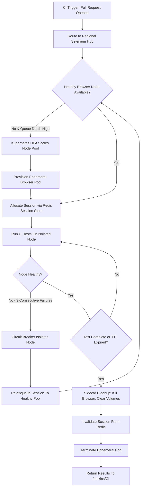

| Difficulty | Channel | Tags |
|---|---|---|
| advanced | system-design | selenium, webdriver, grid |

Picture this: It's 9 AM on a Monday. A pull request is opened, triggering the CI pipeline for a large application. However, instead of getting feedback in minutes, the UI tests are projected to finish in just under four hours. By the time the results come in, the developer has already context-switched to three other tasks, the release window has been pushed back, and frustration is at an all time high. This exact scenario is what plagued the engineering teams at Expedia Group [1]. With an ever growing UI automation suite of around 9,000 tests spread across hundreds of Jenkins jobs running directly onto executors, feedback cycles had become glacial, scaling had become impossible, and their CI/CD pipeline was brought to a grinding halt. The question was no longer 'do these tests pass?', but rather, 'will they ever finish?'.

---

> ### Real-World Case — Expedia Group
>
> Expedia's UI automation suite (~9k tests) was running across hundreds of Jenkins jobs directly on executors, causing multi-hour runs, flaky/broken executors, excessive job sprawl, and slow feedback cycles (e.g. ~3.5 hours per run) which blocked CI/CD as check-ins scaled.
>
> | | |
> |---|---|
> | **Challenge** | Scale Selenium Grid-based UI test execution to handle thousands of concurrent browser sessions reliably and cost-effectively without manual node management or hundreds of Jenkins jobs. |
> | **Solution** | Built Distributed Automation using SeleniumGridScaler (Selenium Grid + AWS EC2 API autoscaling). Implemented on-demand node provisioning tied to test counts, ran many sessions per node, used appropriately sized hub instances, managed hubs across teams/subnets, and automated termination after runs. Migrated from static/underutilized grid pools to pay-per-use autoscaled infrastructure. |
> | **Outcome** | Reduced UI automation runtime from hours (e.g. ~90 minutes for ~300 tests down toward the longest-test duration) to minutes; consolidated hundreds of Jenkins jobs down to handful; scaled to ~90+ SeleniumGridScaler hubs running 150,000+ UI tests per day; achieved cost-effective, on-demand scaling with nodes spun up/terminated per run. |
> | **Lesson** | Autoscale test infrastructure to match parallel test demand (not to fixed node pools), terminate resources when idle, size hub bandwidth appropriately, and design for per-run elasticity rather than always-on capacity to get fast feedback at scale. |

---

## Hook — The Pager That Never Sleeps

For any team practicing continuous integration, time is their most valuable resource. Every minute spent waiting for a UI regression test to complete is a minute where bugs can slip into the next environment, features are blocked from shipping, and developer momentum is lost. The stakes are even higher for companies such as Expedia Group, where hundreds of engineers are committing code daily to a massive monolith of travel services. A clogged test suite isn't an inconvenience, it's a tax that is applied to every single check-in. Many developers think that more executors will solve this issue, however, as job sprawl increases, so does flakiness, executor rot, and maintenance overhead. Sometimes, the answer isn't to add more workers to a broken system, but to completely rethink how those workers are orchestrated.

## Problem — Death By A Thousand Jenkins Jobs

At first glance, running Selenium tests directly on Jenkins executors appears simple. However, this approach does not scale linearly, it compounds its problems as coverage grows. With hundreds of isolated jobs, resource allocation becomes a guessing game, browser binaries fall out of sync between executors, and a single crashed VM can invalidate an entire batch of tests. Moreover, without any form of session lifecycle management, these executors are prone to memory leaks, zombie browser processes, and disk exhaustion. Consequently, the feedback loop becomes painfully slow, with Expedia Group seeing runs upwards of ~3.5 hours for their UI suite [1]. This isn't a problem of test quantity alone, it's a problem of distributed orchestration. Without a centralized grid, autoscaling, session isolation, or failure recovery, the system will inevitably collapse under its own weight. The true challenge lies in taming concurrency, all whilst maintaining reliability at scale.

## Real-World Case — Expedia Group's 5 Minute Miracle

Building on this crisis, Expedia Group set out to completely re-architect their UI automation. Instead of tethering tests to static Jenkins executors, their engineers built out a distributed Selenium Grid architecture powered by their in house solution, SeleniumGridScaler [1]. This allowed for on-demand browser nodes to be spun up for a test run, and terminated the moment that they were no longer needed. The results were staggering. The team consolidated hundreds of Jenkins jobs down to a handful, bringing runs that previously took hours all the way down to minutes. For example, a suite of ~300 tests went from an agonizing duration all the way down to approaching the duration of their longest individual test [1]. At its peak, this scaled to over 90 SeleniumGridScaler hubs running more than 150,000 UI tests per day [1]. Most importantly, this was achieved in a cost effective manner through elastic scaling. This serves as concrete proof that a properly orchestrated grid isn't a luxury for enterprise scale, but a requirement for any team looking to ship at velocity.

## Deep Dive — The Pillars Of A Scalable Grid

To achieve these results at a scale of 10,000 concurrent sessions with 99.9% uptime, a grid can no longer be a simple hub and node setup. It must be treated as a distributed system. Firstly, orchestration is key. Utilizing a container orchestrator such as Kubernetes allows for node pools to autoscale based off of queue depth [2]. With 10,000 concurrent sessions and an estimated 50 sessions per browser node, this equates to at least 200 nodes at baseline, ballooning to much larger numbers based off of peak traffic [3]. Secondly, session management is paramount to preventing the exact memory leaks that plague static executors. A distributed session store, such as Redis with TTL based expiration policies, allows sessions to be tracked, load balanced to, and automatically invalidated after inactivity [4]. Thirdly, observability must be non-negotiable. Tools such as Prometheus paired with Grafana allow for real time memory tracking, queue depth, and node health, alerting teams the moment usage creeps over pre-set thresholds such as 80% memory utilization [5]. Finally, resilience is the glue that holds everything together. Circuit breakers allow for failing nodes to be isolated from the grid for a recovery window, health checks must be ran frequently, and multi data center or multi availability zone deployments are required in order to reach 99.9% uptime [3][6]. These pillars, when combined together, are what separate a flaky grid from a self healing one.

## Workflow — Building A Self Healing Grid Step By Step

With the theory established, how does one go about implementing this in practice? The diagram below outlines the lifecycle of a test request from queue to completion, all whilst showcasing the self healing mechanisms in play. **Step 1: Request Ingestion** - A test request hits a regional load balancer and is routed to a Selenium Hub. These hubs should be horizontally scaled and placed across multiple availability zones to prevent a single point of failure [3][6]. **Step 2: Session Allocation** - The hub queries its session store (i.e Redis) to find an eligible, healthy node with capacity. Using a weighted round robin algorithm based off of node capacity and response time allows for optimal utilization [3]. **Step 3: Node Provisioning** - If no eligible nodes exist and the queue depth is above a threshold, the orchestrator (Kubernetes) will horizontally scale the browser node pool via its autoscaler, spinning up new pods to meet demand [2]. **Step 4: Health Monitoring & Isolation** - While tests are running, sidecar containers and the orchestrator continuously run health checks against each node. If a node consecutively fails its health checks, a circuit breaker will isolate it, preventing any new sessions from being routed to it for its recovery window [3][6]. **Step 5: Automatic Session Lifecycle Management** - Upon test completion, or after the TTL for a session has been reached, cleanup jobs (often ran via sidecar containers or cron based jobs) will terminate the browser process, clear Docker volumes, and invalidate the session from Redis. This is the critical step to prevent any memory leaks from persisting between runs [3]. **Step 6: Graceful Failure Recovery & Rollouts** - In the event of node failure, queued sessions are re-enqueued to be routed to healthy nodes. For upgrades, rolling updates paired with canary deployments and Pod Disruption Budgets ensure that capacity never drops below the required minimum to uphold the 99.9% uptime SLA [2][3].

## Code Example — Enforcing A Leak Proof Session Lifecycle

The most common failure point within a grid is forgetting to clean up after a browser session. The example below showcases a production inspired pattern using Kubernetes sidecars, Redis TTL's, and automated cleanup. This is similar to the patterns that allow for thousands of ephemeral browser instances to be ran with no memory bleed between them.

## Lessons Learned — Battle Scars To Avoid

After looking towards Expedia Group's triumph and the pitfalls that lead to the 3.5 hour runs, there are some hard earned lessons to take away. **Orchestration over Static Infrastructure**: Treating browser nodes as cattle, not pets, and allowing them to be ephemeral is vital. If a node is misbehaving, terminate it and spin up a new one [1][2]. **Cleanup is not optional**: Memory leaks are insidious. Enforce TTLs on your session store, run cleanup scans frequently, and utilize sidecars to nuke stale volumes and processes. Prevention is infinitely cheaper than debugging a grid that has been up for a week [3][4]. **Observe everything**: You cannot fix what you cannot see. Track P50, P90, and P99 session startup times, memory usage per pod, queue depth, and flake rates. Alert at 80% utilization to allow for autoscaling to react before exhaustion [3][5]. **Plan for failure**: Assume that nodes, zones, and even entire regions will fail. Circuit breakers, leader election to prevent split-brain scenarios, and multi-AZ deployments are required to reach 99.9% uptime, not nice to haves [3][6]. **Optimize for cost and velocity**: Expedia's greatest achievement wasn't just speed, it was cost effective elasticity. Only pay for browser capacity whilst tests are actively running. This, paired with consolidating job sprawl, is what allows for 150,000+ tests a day to be ran without breaking the bank [1]. **Don't over-engineer day one**: Start small. Containerize your grid, add health checks, enforce session TTLs, and implement autoscaling before trying to deploy to multiple data centers. Iterate off of your bottlenecks, not hypothetical ones. The biggest takeaway of them all? Speed is a feature. By investing in your test orchestration, you aren't just saving CI minutes, you're buying back your developer's time, and time is the greatest multiplier for any engineering organization.

---

## Self-Healing Selenium Grid Session Lifecycle

<strong>Original Interview Question</strong>

**Q:** Design a scalable Selenium Grid architecture to handle 10,000 concurrent test sessions with 99.9% uptime, ensuring zero memory leaks through automatic session lifecycle management, real-time monitoring, and graceful node failure recovery across multiple data centers?

**A:** Deploy Kubernetes cluster with auto-scaling node pools, Redis session store with TTL policies, Prometheus metrics for memory monitoring, circuit breakers for node isolation, and sidecar containers for session cleanup. Implement health checks, resource quotas, and rolling updates.

## Conclusion

The story of Expedia Group serves as a testament to the fact that speed is a feature, not an afterthought. What was once a 3.5 hour bottleneck blocking every check-in was transformed into a minutes long feedback loop, capable of running 150,000+ tests a day with on-demand elasticity. The solution wasn't more compute thrown at a broken process, it was orchestration, observability, and ruthless cleanup. For any team fighting against CI queue times, the lesson is simple: treat your test grid as a distributed, self healing system. Start off by enforcing session TTLs, adding health checks, and containerizing your nodes. From there, autoscale to meet demand, isolate your failures, and clean up after every session. Your developers deserve feedback in minutes, not hours. More importantly, your product deserves to ship at the speed that your ambition demands.

---

## References

1. [Expedia Group incident report - Distributed Automation: How to run 1000 UI automation tests in 5mins](https://medium.com/expedia-group-tech/distributed-automation-how-to-run-1000-ui-automation-tests-in-5mins-cf9a84ca32d1) — blog
2. [Kubernetes Documentation - Horizontal Pod Autoscaling](https://kubernetes.io/docs/tasks/run-application/horizontal-pod-autoscale/) — documentation
3. [Selenium Documentation - Selenium Grid](https://www.selenium.dev/documentation/grid/) — documentation
4. [Redis Documentation - Key Expiration](https://redis.io/docs/latest/develop/use/keyspace/notifications/) — documentation
5. [Prometheus Documentation - Overview](https://prometheus.io/docs/introduction/overview/) — documentation
6. [AWS Documentation - Availability Zones and Regions](https://docs.aws.amazon.com/AWSEC2/latest/UserGuide/using-regions-availability-zones.html) — documentation
7. [MDN Web Docs - Circuit breaker pattern](https://developer.mozilla.org/en-US/docs/Glossary/Circuit_breaker) — documentation
8. [Kubernetes Documentation - Pod Disruption Budgets](https://kubernetes.io/docs/tasks/run-application/configure-pdb/) — documentation

---

**Author:** Satishkumar Dhule — [GitHub](https://github.com/satishkumar-dhule) · [LinkedIn](https://linkedin.com/in/satishkumar-dhule) · [Website](https://satishkumar-dhule.github.io)
